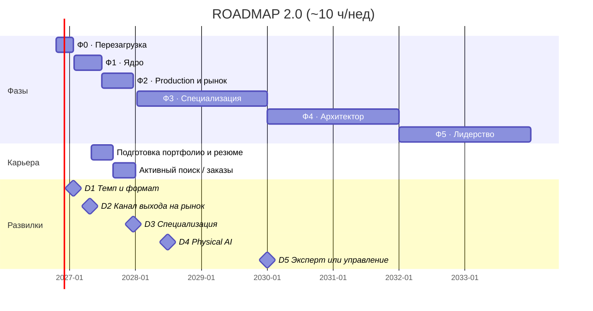

# 🧭 ROADMAP 2.0 — Инженер → Архитектор доверенных агентных систем (2026–2036)

> **Версия 4.3** («Обучение 2.0») · создан 16.10.2026, данные о рынке перепроверены 16.10.2026 · автор: Claude (`claude-opus-5-5`)
> Основной вектор: **агентные AI-системы** — проектирование, интеграция, проверка качества, безопасность.
> Опора: **инфраструктура и данные** · Отличие на рынке: **безопасность (AI Security)** · Ветки: Platform/MLOps · Product/CTO · Physical AI / IoT
> Языки: **Python** (основной, читать свободно и писать связующий код) · Go, SQL, Bash/PowerShell, C, Rust, TypeScript — сквозной трек «полиглот» через «код руками» · C / Rust глубже — полка `LOW`
> Как работаем — [[AGENTS]] · Где мы сейчас — [[ПРОГРЕСС]] · Текущая фаза — [[Фаза 0/РАСПИСАНИЕ|расписание]] и [[Фаза 0/ТРЕКЕР|трекер]] Фазы 0
> Предыдущая версия (архив, только как ориентир): `(COPY) Агентное обучение, IT\Стратегия и трекеры\main_roadmap_v3.md`

---

## 📋 Оглавление

1. [[#📖 Как читать документ|Как читать документ]]
2. [[#🎯 Ориентир и принципы|Ориентир и принципы]]
3. [[#🧑‍💻 Профиль и стартовая точка|Профиль и стартовая точка]]
4. [[#🗺 Карта пути|Карта пути]]
5. [[#🧩 Обзор фаз|Обзор фаз]]
6. [[#🔄 Фаза 0 — Перезагрузка|Фаза 0 — Перезагрузка (по занятиям)]]
7. [[#🧱 Фаза 1 — Ядро|Фаза 1 — Ядро (по занятиям)]]
8. [[#🚀 Фаза 2 — Production и выход на рынок|Фаза 2 — Production и выход на рынок (по занятиям)]]
9. [[#🎯 Фаза 3 — Специализация|Фаза 3 — Специализация (ветки)]]
10. [[#👑 Фазы 4–5 — Архитектор и лидерство|Фазы 4–5 — Архитектор и лидерство]]
11. [[#🔀 Развилки и точки решений|Развилки и точки решений]]
12. [[#🧵 Сквозные треки|Сквозные треки]]
13. [[#🏭 Ветка Physical AI и IoT|Ветка Physical AI и IoT]]
14. [[#🟨 Полка интересов|Полка интересов]]
15. [[#🛠 Проекты|Проекты]]
16. [[#📊 Рынок, роли и деньги|Рынок, роли и деньги]]
17. [[#🔭 Скаут — интересное для отслеживания|Скаут — интересное для отслеживания]]
18. [[#💼 Карьерная стратегия|Карьерная стратегия]]
19. [[#⏱ Ритм и нагрузка|Ритм и нагрузка]]
20. [[#⚠️ Риски и антипаттерны|Риски и антипаттерны]]
21. [[#📚 Ресурсы (сводно)|Ресурсы (сводно)]]
22. [[#🔗 Источники рыночных данных|Источники рыночных данных]]

---

## 📖 Как читать документ

### Типы контента

| Метка | Что значит | Обязательность |
|---|---|---|
| 🟥 **Ядро** | Нужно для любой ветки. Идёт по плану, по фазам | Обязательно |
| 🟦 **Ветка** | Специализация после развилки | Обязательно *после* выбора ветки |
| 🟨 **Полка** | Интересы без дедлайна. ~20% времени. Берётся по желанию | По желанию |
| ⏸ **Отложено** | Будет нужно, но не сейчас. Есть триггер «когда доставать» | По триггеру |

### Уровни глубины (для каждой темы)

| Уровень | Название | Критерий |
|---|---|---|
| **L1** | Знаю, что это | Могу объяснить своими словами за 1 минуту, понимаю, зачем нужно |
| **L2** | Понимаю механизм | Могу нарисовать, как работает внутри, разобрать пример, найти ошибку в чужом решении |
| **L3** | Применяю | Спроектировал / настроил / проверил в реальной системе, могу защитить решение на ревью |
| **L4** | Эксперт | Могу научить другого, вижу компромиссы и редкие случаи, принимаю архитектурные решения |

### Коды занятий

Каждое занятие имеет код **`Фаза.Предмет.Номер`** — например `0.LLM.03`. Этот код используется в трекере, в домашних заданиях и в тестах.

| Код | Предмет | Код | Предмет |
|---|---|---|---|
| `AIN` | AI-native разработка (агенты-кодеры, SDD, ревью, чтение кода) | `SEC` | Безопасность (классическая) |
| `PY` | Python и грамотность в коде | `AIS` | Безопасность AI и агентов |
| `LLM` | Как устроены LLM, работа с контекстом | `INF` | Инфраструктура и эксплуатация |
| `AGT` | Агентные системы | `OPS` | LLMOps: наблюдаемость, стоимость, надёжность |
| `EVL` | Evals и качество AI-систем | `ML` | ML: основы и своя модель |
| `RAG` | Поиск, извлечение, документы | `MTH` | Математика |
| `SD` | System Design и архитектура | `BIZ` | Продукт, требования, заказчик, бизнес-процессы |
| `DAT` | Данные: SQL, PostgreSQL, моделирование, очереди | `CAR` | Карьера: портфолио, резюме, собеседования, фриланс |
| `OS` | Операционные системы и Linux | `GOV` | Право, персональные данные, AI Governance |
| `DEV` | Git, параллельная разработка с агентами, CI/CD, пайплайн деплоя | `SND` | Звук изнутри: DSP, синтез, анализ, AI в звуке (интерес) |
| `PRD` | Product management: discovery, скоуп и MVP, метрики, деньги, AI-продукт | `LAW` | Право глубже (интерес по желанию с Фазы 1). Код `ML` в интересах — поток «своя модель руками» |
| `NET` | Сети | `PAI` | Physical AI / IoT |
| `CS` | Алгоритмы и структуры данных | `LOW` | Низкоуровневое (интерес) |
| | | `SQL` | Глубокий SQL, устройство БД и хранилищ (интерес) |
| | | `CTF` | CTF и offensive для удовольствия (интерес) |
| | | `ENG` | Английский, тексты, публичность (сквозной трек, без отдельных занятий) |

### Формат описания предмета

Каждый предмет в фазе описан так: **Зачем** → **Цель по уровню** → **Модули и занятия** (≈1 час на занятие, если не указано иное) → **Как проверяется** → **Ресурсы**.
Занятие — единица содержания (~1 ч). Сессия — одна учебная посадка, обычно 1–2 занятия. Занятие можно разбить на две короткие сессии или объединить с соседним — важен результат, а не хронометраж.

---

## 🎯 Ориентир и принципы

### Ориентир (North Star)

> **Инженер, а затем архитектор агентных AI-систем, которым можно доверять.**
> Человек, который берёт бизнес-задачу, проектирует под неё агентную систему (модели, инструменты, данные, интеграции), доказывает, что она работает (evals), что она безопасна (модель угроз, права, песочница), и что её можно эксплуатировать (наблюдаемость, стоимость, отказоустойчивость). Код в основном пишут агенты — ты автор спецификации, тестов и решений, и ты ревьюер.

Почему именно так:
- Это пересечение всех четырёх интересов (агентные системы, AI Security, платформа, свой бизнес). Ни одна дверь не закрывается до развилки в конце 2027.
- «Собрать агента» скоро будет уметь каждый. **Доказать**, что агент не сольёт данные, не выполнит чужую инструкцию и не разорит бюджет, — умеют единицы.
- Опыт в 1С (бизнес-процессы, учёт, транзакционное мышление) и работа в инфраструктуре — прямые преимущества для этой роли.

### Горизонты целей

| Горизонт | Срок | Цель | Как понять, что достигнута |
|---|---|---|---|
| **H1** | до апреля 2027 | Фундамент восстановлен и обновлён; появился собственный рабочий цикл «спека → агент → ревью → evals» | Могу защитить архитектуру своей системы на ревью; есть design doc, модель угроз и набор evals хотя бы для одной системы |
| **H2** | до конца 2027 | Выход на рынок: найм на AI-роль **и/или** стабильные заказы; своя система живёт с реальными пользователями | Оффер на роль с AI в основе работы (DevOps/Platform с AI, системный аналитик/архитектор с AI, AI/Agent Engineer) — или ≥2 оплаченных заказа на AI-автоматизацию |
| **H3** | 2028–2029 | Специализация по итогам развилки (см. D3) | Middle+ в выбранной ветке, публичные артефакты (статьи, доклады, open source) |
| **H4** | 2030–2032 | Архитектор / техлид / CTO своего продукта | Принимаю архитектурные решения уровня системы или компании |
| **H5** | 2032+ | Стратегия: архитектура AI в организации, Governance, своя компания | — (пересматривается на развилке D5) |

### Принципы обучения v2

1. **Понимать > писать.** Цель — читать любой код, ставить задачу агенту, находить ошибки в его работе. Руками пишется мало, но регулярно (см. «Код руками»).
2. **Спецификация — главный артефакт.** Любая практика начинается со спеки (SDD) и критериев приёмки. Код без спеки не пишется ни тобой, ни агентом.
3. **Нет evals — нет системы.** Всё, что использует LLM, сопровождается способом измерить качество.
4. **Безопасность по умолчанию.** Любой дизайн включает модель угроз. Это не отдельный блок в конце, а вопрос на каждом ревью.
5. **Фундамент — глубоко, инструменты — по необходимости.** ОС, сети, данные, архитектура живут десятилетиями. Фреймворки меняются каждые полгода — их изучаем на примерах, не как предмет.
6. **Всё через практику.** Каждый модуль заканчивается тем, что знание применено к реальной системе.
7. **8–12 часов в неделю — это норма, а не провал.** Плана хватает при таком бюджете. Минимум — 4 часа в неделю. Неделя с нулём допустима только как осознанная пауза, записанная в трекер, а не как тихое выпадение.
8. **Решения — по данным.** Развилки имеют сроки и критерии. До развилки не нужно «знать, кем я хочу быть».
9. **Документ живой.** Роадмап пересматривается на каждом чекпоинте фазы, ежемесячно (аудит успеваемости и актуальности, `Аудиты/`) и раз в квартал — расширенным аудитом с технологическим сканом. Мелкие правки вносятся сразу. Крупные (сроки, фазы, ветки, решения на развилках) — отдельным файлом `Mainchange/Mainchange_ГГГГ_ММ_ДД.md` и строкой в журнале событий `ПРОГРЕСС.md`.
10. **Интерес — ресурс.** Полка интересов — не роскошь, а топливо. ~20% времени на то, что просто нравится, защищают от выгорания. Поэтому интересы разбиты на занятия и стоят в расписании каждой недели, по два, — обязательно, но без блокировки остального; занятие можно взять раньше по своему выбору (правило 27 в `AGENTS.md`).

### «Код руками» — сколько и зачем

| Фаза | Объём | Формат | Языки |
|---|---|---|---|
| 0 | 1 задача в неделю, 15–30 мин | Функция на 10–30 строк без автодополнения и агентов | Python + ротация (в Фазе 0: Go, Bash/PowerShell, C): из задач недели не на Python — хотя бы две при 4+ задачах, иначе хотя бы одна; что и когда — в расписании и плане недели |
| 1 | 1 задача в неделю, 30–45 мин | Небольшой модуль с тестами или SQL-запрос средней сложности | Python ~ половина; остальное — ротация: Go, SQL, Bash/PowerShell, C, Rust, TypeScript |
| 2+ | 2 задачи в месяц | Разбор чужого кода + исправление бага вручную; ревью PR агента построчно | Любой язык ротации — какой встречается в реальном коде |
| Полка `LOW` | по желанию | C, Rust, ассемблер — здесь руками пишется много, потому что это и есть цель | — |

**Сквозной трек «полиглот».** Python — основной язык (правило 8 `AGENTS.md`), остальные держатся в тонусе через «код руками», без отдельных занятий:
- **Ротация:** Go · SQL · Bash/PowerShell · C · Rust · TypeScript. Список открытый: новый язык добавляется, когда он встречается в работе, практике или интересах.
- **Порог входа:** язык попадает в ротацию, когда есть база. Go, SQL, Bash и PowerShell знакомы по v1 и работе. C — после `0.LOW.05`. Rust и TypeScript — первая задача на них всегда «прочитай и поправь готовый код», а не «напиши с нуля».
- **Приём «перевод»:** часть задач — переписать свою прошлую задачу «кода руками» на другом языке. Видно, чем языки отличаются: ошибки, типы, память, конкурентность.
- **Минимум и предел:** из задач недели — еженедельной «код руками» и микрозадач разминок — не на Python хотя бы две, если задач 4 и больше, и хотя бы одна, если меньше. Новые языки — по одному, не два подряд, первая задача на новом — «прочитай и поправь» (урок v1: полиглотность сразу во всём перегружала). Язык, на котором задача не идёт, повторяется, пока не пойдёт.
- **Не только «код руками»:** задание сессии или ивент тоже может быть на другом языке ротации, если тема к нему просится (SQL — в данных, Bash — в ОС, Go — в сетях). В одной сессии — не больше двух языков (правило 8 `AGENTS.md`).

**Лёгкий сквозной трек «алгоритмы».** Чтобы алгоритмы не обрывались на `0.CS.01–04` и к собеседованиям (Фаза 2, `2.CAR.03–05`) не пришлось поднимать их с нуля:
- **Фаза 0:** алгоритмические задачи «кода руками» идут вслед за `0.CS` — после вход-теста (поиск) и после рекурсии (недели — в расписании). **Фаза 1:** каждая 3–4-я задача — алгоритмическая (уровень Easy): массивы и строки, хеш-таблицы, стек и очередь, рекурсия, деревья, графы.
- **Фаза 2, с начала поиска работы:** 1–2 задачи в неделю сверх «кода руками», Easy → Medium, по темам частых вопросов на собеседованиях (два указателя, скользящее окно, BFS/DFS, бинарный поиск, динамика L1). Источник — LeetCode или аналоги; язык — Python для собеседований, иногда «перевод» на Go.
- Решение сдаётся так же, как «код руками»: код + оценка сложности по времени и памяти своими словами.

---

## 🧑‍💻 Профиль и стартовая точка

### Вводные

| Параметр | Значение | Влияние на стратегию |
|---|---|---|
| Текущая работа | IT-инфраструктура (с лета 2026), до этого 1С | Инфраструктура, сети, Windows/Linux — практика каждый день. Опыт 1С — бизнес-процессы, учёт, транзакции |
| Подработка | Заказы на автоматизацию (парсинг + LLM) | Канал фриланса уже открыт |
| Бюджет времени | 8–12 ч/нед | Нейтральный сценарий. Все сроки ниже рассчитаны на ~10 ч/нед |
| Английский | ~B1+ | Документация и видео — да. Для созвонов нужен B2 |
| Локация | Екатеринбург, удалёнка | Регионы платят на 16% меньше рынка, в Екатеринбурге зарплаты за 1П 2026 снизились на 2% → основной фокус — удалённые вакансии Москвы/СПб |
| Математика | База подтянута в v1 (алгебра, линейная алгебра гл. 1–9, описательная статистика) | Дальше — статистика и вероятности для evals, остальное по запросу |
| Интересы | Агенты, безопасность, низкоуровневое, глубокий SQL, IoT/Physical AI, IT-право | Всё учтено: ядро, ветки, полка |
| Практика через агентов | За авг–окт 2026 собраны две системы: сбор и обогащение данных (Playwright, FastAPI, PostgreSQL, LLM-извлечение из документов) и Telegram-агент (инструменты, память, права, маршрутизация моделей, учёт стоимости) | Опыт «оркестратора агентов» уже есть. Пробел — фундамент, чтобы **оценивать и защищать** результат |

### Что закрыто в Фазе 0 v1 (апрель – август 2026)

> После паузы в 2,5 месяца «закрыто» не значит «помнится». Всё с пометкой «освежить» проходится в Фазе 0 через **вход-тест**: результат ≥ 70% — тема засчитывается без повтора, ниже — короткое повторное занятие.

| Предмет | Что пройдено в v1 | Статус | В v2 |
|---|---|---|---|
| Математика | Алгебра (Khan, закрыта 27.04). Линейная алгебра 3B1B гл. 1–9: векторы, span, базис, матрицы, определитель, обратная матрица, column/null space, скалярное и векторное произведение. Статистика: mean/median/variance/std вручную, z-score | ✅ закрыто, освежить | Вход-тест `0.MTH`. Собственные векторы (гл. 10–15) — не пройдены, нужны на L1 |
| CS | Big-O (O(1), O(n), O(log n)), бинарный поиск, стек, merge sort, массивы и память (CS50 нед. 0–3), компилятор vs интерпретатор. Two Sum и Binary Search на LeetCode | 🟡 частично | Вход-тест `0.CS`. Рекурсия, деревья, хеш-таблицы — добрать до L2 |
| Архитектура компьютера | Turing Complete пройден полностью (к 19.10.2026): логические элементы → память → ALU → свой процессор и программы на его ассемблере | ✅ засчитано | Разбор «игра vs реальный CPU» — интерес `0.LOW.01`, дальше x86-64 — `0.LOW.02`, байт-код Python — `0.LOW.03` |
| Сети | OSI, TCP/UDP, DNS, HTTP, маски подсети, tracert, HTTP/2 и TLS-handshake обзорно, симметричное vs асимметричное шифрование | ✅ освежить | Вход-тест `0.NET`, далее углубление в Фазе 1 |
| ОС | Не начато (Stepik #1780 запланирован) | ❌ | `0.OS` + `1.OS` |
| Go | Синтаксис → интерфейсы, указатели, ошибки, горутины/каналы/WaitGroup/Mutex, net/http, middleware, httptest, table-driven TDD | ✅ засчитано | Только чтение кода. Новых занятий нет |
| Python | Основы, функции, классы, декораторы и генераторы обзорно, type hints, pytest базово, pandas (groupby/agg/apply/pivot), FastAPI GET/POST + Pydantic, OpenAI SDK через OpenRouter, function calling (демо), LangChain LCEL + Memory | 🟡 частично. Логика есть, синтаксис руками слабый | `0.PY` — переход к «грамотности»: чтение, ревью, типы, async, тесты |
| Git / GitHub | Ветки, merge-конфликты, PR, Conventional Commits, stash/reflog/bisect, первый CI в GitHub Actions | ✅ | Только практика |
| Docker | Dockerfile, multi-stage build | ✅ | Compose и безопасность контейнеров — `INF` |
| SQL | SQLBolt 1–8: SELECT, WHERE, ORDER BY, JOIN, GROUP BY/HAVING. Ошибка с LEFT JOIN для «пустых» связей | 🟡 | Вход-тест в начале Фазы 1 (`1.DAT.01`) — SQL нужен с Фазы 1 |
| Безопасность | OWASP Top 10 обзорно, secrets management (.env, .gitignore, BFG), TLS обзорно | 🟡 | `0.SEC`, `0.AIS` |
| AI / LLM | Zero/Few-shot, CoT/ReAct (теория), temperature, статья Lilian Weng про агентов, function calling | 🟡 основы | `0.LLM`, `0.AGT` — системно |
| System Design | Горизонтальное/вертикальное масштабирование, CAP обзорно | 🟡 | `0.SD`, `1.SD` |
| Windows-инфраструктура | ipconfig, nslookup, tracert, netstat, PowerShell, Invoke-RestMethod, Task Scheduler | ✅ | Дальше — на работе, отдельного трека нет |

---

## 🗺 Карта пути

### Линейная шкала (нейтральный сценарий, ~10 ч/нед)

### Три сценария по срокам

| Сценарий | Часов/нед | Ф0 | Ф1 | Ф2 (выход на рынок) | Специализация Middle+ | Архитектор |
|---|---|---|---|---|---|---|
| 🟢 Оптимистичный | 13–16 | ~10 нед | ~16 нед | к осени 2027 | 2028 | 2030 |
| 🟡 **Нейтральный** | **8–12** | **~14 нед** | **~22 нед** | **конец 2027** | **2029** | **2031–2032** |
| 🔴 Пессимистичный | 4–6 | ~24 нед | ~36 нед | конец 2028 | 2030–2031 | 2034+ |

> Сценарий пересматривается на развилке **D1** по фактическим часам за Фазу 0.

---

## 🧩 Обзор фаз

| Фаза | Сроки | Главный вопрос | Итоговые артефакты |
|---|---|---|---|
| **0 · Перезагрузка** | 19.10.2026 – 24.01.2027 (14 нед, включая новогодние праздники) | «Как работать в паре с агентом и понимать, что он делает?» | Свой цикл работы с агентом; схема и риски агентной системы; первый набор evals; ADR |
| **1 · Ядро** | 25.01 – 27.06.2027 (22 нед) | «Как спроектировать надёжную агентную систему с данными?» | Design doc системы; модель данных; модель угроз; eval-отчёт; RAG-конвейер |
| **2 · Production и рынок** | 28.06 – 19.12.2027 (25 нед) | «Как запустить, наблюдать, защищать и продавать?» | Развёрнутая система с CI/CD и наблюдаемостью; red team отчёт; портфолио; резюме; оффер/заказы |
| **3 · Специализация** | 2028–2029 | «В чём я сильнее всех вокруг?» | Зависит от ветки (см. D3) |
| **4 · Архитектор** | 2030–2031 | «Как принимать решения на уровне системы и команды?» | Архитектурные решения, менторство, публичные выступления |
| **5 · Лидерство** | 2032+ | «Как влиять на стратегию?» | AI-стратегия, governance, своя компания |

**Бюджет часов** — в шапке раздела каждой фазы. **Распределение времени внутри фазы** (занятия · практика · интересы) — раздел [[#⏱ Ритм и нагрузка|Ритм и нагрузка]].

---

## 🔄 Фаза 0 — Перезагрузка

> **Сроки:** 19.10.2026 – 24.01.2027 · **Бюджет:** ~157 ч (≈77 ч занятий, ≈50 ч практики, ≈30 ч интересов)
> **Цель:** восстановить фундамент после паузы, выстроить рабочий цикл с агентами и системно понять, что такое LLM и агент.
> **Вход:** вход-тесты по Python, математике, CS и сетям в первые две недели (результат ≥ 70% — тема засчитана). SQL проверяется в начале Фазы 1 (`1.DAT.01`).
> **Выход:** чекпоинт Фазы 0 + развилка D1.

### Порядок прохождения (рекомендуемый)

| Недели | Даты | Основной фокус | Параллельно |
|---|---|---|---|
| 1–2 | 19.10 – 01.11 | Вход-тесты: `0.PY.01`, `0.MTH.01`, `0.CS.01`, `0.NET.01` · `0.AIN.01–04`, `0.AIN.09` | `0.SEC.01` · выбор полигона, первая спецификация |
| 3–5 | 02.11 – 22.11 | `0.LLM.01–06`, `0.PY.02–05` | `0.AIN.05–06`, `0.MTH.02–03`, `0.SD.01`, `0.NET.02` |
| 6–8 | 23.11 – 13.12 | `0.LLM.07–10`, `0.AGT.01–06` | `0.PY.06–08`, `0.NET.03–05`, `0.EVL.01`, `0.MTH.04` |
| 9–10 | 14.12 – 27.12 | `0.AGT.07–08`, `0.EVL.02–04`, `0.AIN.10` | `0.MTH.05–06`, `0.SEC.02–03`, `0.AIS.01`, `0.CS.02` |
| 11–12 | 28.12 – 10.01 | Праздники — облегчённо: `0.OS.01–04`, `0.OS.08`, `0.CS.03–05`, `0.GOV.01`, `0.LLM.11` | Полка |
| 13–14 | 11.01 – 24.01 | `0.AIS.02–03`, `0.SD.02–04`, `0.AIN.07–08` | `0.OS.05–07` · чекпоинт |

> Около 5 занятий в неделю; недели 3, 6–10 и 13 плотнее (по 6), праздничные 11–12 — по 5 лёгких обзорных занятий. Число занятий, разбивка по каждой неделе, шаги практики и задачи «код руками» — в [[Фаза 0/РАСПИСАНИЕ|расписании Фазы 0]]. Не успеваешь — чекпоинт сдвигается на 1–2 недели, это учитывается на D1.

---

### 0.AIN — AI-native разработка 🟥

**Зачем:** твой основной инструмент — агент, который пишет код. Профессиональный уровень — управлять им как инженер: ставить задачу, ограничивать, проверять, откатывать.
**Цель:** L3 (рабочий цикл применяется на практике).

| Код | Занятие | Содержание |
|---|---|---|
| `0.AIN.01` | Как устроен coding-агент | Цикл «план → действие → наблюдение». Инструменты агента: чтение файлов, shell, правки, поиск. Контекстное окно и почему агент «забывает» начало задачи. Разбор собственного опыта: 5 случаев, когда агент ошибся, и почему |
| `0.AIN.02` | Режимы и права | Чат vs агент в репозитории vs фоновые задачи. Когда какой режим. Что разрешать без подтверждения, что — только с подтверждением. Песочница, отдельная ветка, отдельный worktree |
| `0.AIN.03` | Spec-Driven Development | Шаблон спецификации: Feature, Context, Input, Output, Errors, Acceptance criteria, Non-goals, Constraints. Типичные ошибки спеки (размытая цель, нет критериев, нет ограничений). Упражнение: спека на небольшую фичу |
| `0.AIN.04` | Тесты как спецификация | Критерий приёмки → тест-кейс. Цикл: ты пишешь кейсы/тесты (Red), агент пишет код (Green), ты проверяешь и рефакторинг. Тесты, которые «ничего не проверяют», и как их распознать. **Инварианты и свойства:** что в системе не должно нарушаться никогда — писать в спецификацию явно; контракты (пред- и постусловия, `assert`); property-based тесты (Hypothesis) — свойство проверяется на тысячах случайных входов, а не на трёх примерах. Куда это ведёт — формальная верификация (`2.AIS.12`) |
| `0.AIN.05` | Чтение чужого кода | Стратегия: точка входа → поток данных → границы модуля → побочные эффекты. Когнитивные приёмы (chunking, «маяки» в коде). Упражнение: незнакомый модуль за 30 минут → схема потока данных |
| `0.AIN.06` | Ревью кода от агента | Чек-лист: корректность, граничные случаи, обработка ошибок, безопасность (секреты, инъекции, права), лишняя сложность, несуществующие API, дублирование, качество тестов. Упражнение: построчное ревью diff на 200+ строк |
| `0.AIN.07` | Контекст проекта для агента | Файлы правил для агента (CLAUDE.md / AGENTS.md), ADR и документация как «память» проекта. Как не утопить агента в контексте: что класть, что нет. Дробление задачи на шаги размером «один PR» |
| `0.AIN.08` | Git как страховка + свой цикл | Маленькие коммиты, ветка на эксперимент, откат, diff-ревью, worktrees. **Итог:** документ «Мой цикл работы с агентом» на 1–2 страницы |
| `0.AIN.09` | Скоуп и декомпозиция задач | Где проходят границы задачи: что входит, что сознательно не входит, где граница с соседними задачами и что будет, если её не провести. Скоуп по типу задачи: фича, баг (симптом или причина, что не трогать), рефакторинг (поведение не меняется), исследование-спайк (ограничено временем и вопросом), интеграция (где кончается твоя система). Декомпозиция «продукт → фича → задача → шаг»: вертикальные срезы против горизонтальных слоёв, «ходячий скелет». Размер задачи для агента: одна проверяемая задача на сессию; признаки слишком большой задачи. Итог — дерево декомпозиции фичи полигона перед первой спекой. Продуктовый скоуп и MVP — `1.PRD.01`, оценка сроков — `1.BIZ.02`. **2 часа** |
| `0.AIN.10` | Проверь свои тесты | Как понять, что тесты что-то проверяют. Техники тест-дизайна: классы эквивалентности, граничные значения, таблицы решений, переходы состояний. Мутационное тестирование (mutmut): инструмент вносит мелкие ошибки в код — тесты, которые не упали, пустые. Почему coverage врёт: строка пройдена ≠ поведение проверено. Правила для агента: тест-кейсы пишешь ты, агенту нельзя менять тесты, чтобы они позеленели, ревью тестов — отдельно от ревью кода. Углубляет `0.AIN.04`, `0.PY.08` и пункт «качество тестов» чек-листа `0.AIN.06`. Практика — мутационный прогон тестов полигона и разбор выживших мутантов. **2 часа** |

**Как проверяется:** документ «Мой цикл»; одна фича, сделанная строго по циклу (спека → тесты → код агентом → ревью → merge), с записанными замечаниями ревью.
**Ресурсы:** документация Claude Code (раздел best practices) и Cursor; документация mutmut и Hypothesis (`0.AIN.04`, `0.AIN.10`); блог Simon Willison; Felienne Hermans «The Programmer's Brain»; Google Engineering Practices — Code Review Developer Guide.

---

### 0.PY — Python-грамотность 🟥

**Зачем:** Python — язык почти всех AI-систем. Нужно свободно читать его, понимать, что делает код агента, и писать связующий код и тесты.
**Цель:** L2 по чтению, L1–L2 по написанию.

| Код | Занятие | Содержание |
|---|---|---|
| `0.PY.01` | Вход-тест + разбор | Типы, коллекции, функции, классы, исключения, comprehensions (30 мин теста + разбор ошибок) |
| `0.PY.02` | Модель данных Python | Всё — объект. Изменяемые vs неизменяемые. Ссылки, копирование (поверхностное/глубокое). Почему функция может «случайно» изменить аргумент (повтор случая с DataFrame) |
| `0.PY.03` | Функции глубже | `*args/**kwargs`, замыкания, декораторы (фабрика декораторов — повтор `retry`), генераторы и итераторы, контекстные менеджеры (`with`) |
| `0.PY.04` | Типы как контракт | Type hints, `dataclasses`, Pydantic, mypy. Почему типы особенно важны, когда код пишет агент: тип = проверяемая часть спеки |
| `0.PY.05` | Ошибки и логирование | Иерархия исключений, свои исключения, где ловить и где пропускать, `logging` вместо `print`, структурные логи (JSON) |
| `0.PY.06` | Асинхронность | Event loop, `async/await`, когда asyncio, когда потоки и процессы. GIL на уровне L1. Связь с I/O-bound vs CPU-bound |
| `0.PY.07` | Устройство проекта | Пакеты, модули, импорты, `pyproject.toml`, uv, виртуальные окружения, ruff/mypy/pre-commit — читать конфиги и понимать, что они делают |
| `0.PY.08` | pytest на уровне постановки задачи | fixtures, `parametrize`, моки, coverage. Умение сформулировать агенту «какие тесты нужны» |

**Как проверяется:** объяснить поток данных в модуле 200–300 строк; 4 задачи «код руками» (по одной в неделю).
**Ресурсы:** официальный Python Tutorial; «Fluent Python» (Ramalho) — выборочно, как справочник; Real Python; документация pytest и Pydantic.

---

### 0.LLM — Как устроены LLM и работа с контекстом 🟥

**Зачем:** без понимания механизма невозможно объяснить, почему агент ошибается, и спроектировать систему, которая с этим справляется.
**Цель:** L2.

| Код | Занятие | Содержание |
|---|---|---|
| `0.LLM.01` | Большая картина | Что такое LLM. Pretraining → instruction tuning → RLHF/RLAIF. Модель как «сжатие интернета» + «ассистент поверх» |
| `0.LLM.02` | Токены | Токенизация (BPE). Почему модель плохо считает буквы. Русский текст «дороже» английского. Цена запроса в токенах |
| `0.LLM.03` | Эмбеддинги | Текст → вектор. Связь с линейной алгеброй: скалярное произведение, косинусное сходство. Семантическая близость на практике |
| `0.LLM.04` | Attention и трансформер (интуиция) | Что делает attention. Почему контекст ограничен и стоит денег. KV-cache на уровне L1 |
| `0.LLM.05` | Генерация | Логиты → вероятности → sampling. temperature, top-p, детерминизм. Почему один запрос даёт разные ответы |
| `0.LLM.06` | Экономика контекстного окна | Роли system/user/assistant. Prompt caching. «Потерянное в середине». Лимиты и стоимость длинного контекста |
| `0.LLM.07` | Context engineering I | Структура промпта, роли, примеры (few-shot), формат вывода, structured output (JSON Schema) |
| `0.LLM.08` | Context engineering II | Что класть в контекст и что нет: сжатие, суммаризация, retrieval, память. Контекст как ограниченный ресурс |
| `0.LLM.09` | Карта моделей | Закрытые и открытые семейства, reasoning-модели, размер, цена, контекст. Бенчмарки и почему им нельзя слепо верить. Российские модели (GigaChat, Alice AI) и открытые веса (Qwen, DeepSeek, Mistral). Модели устаревают за 6–12 месяцев — учим принцип выбора и маршрутизации, а не названия. **2 часа.** Чем открытые отличаются от закрытых: доступ к весам, лицензии («открытые веса» ≠ open source), где живут данные, модель цены (токены против аренды GPU), можно ли дообучить, надёжность вызова инструментов, насколько открытые отстают. Устройство сверху: плотные модели и MoE (в запросе работает часть параметров), reasoning-модели. Как читать карточку модели (system card): что заявлено, на каких оценках, какие ограничения — подробно в `1.AIS.12`. Свежие модели и цены — по хронике `РАДАР.md` |
| `0.LLM.10` | Ограничения + локальный запуск | Галлюцинации, угодливость (sycophancy), дата среза знаний, чувствительность к формулировке. Практика: запустить маленькую модель через Ollama и сравнить с API |
| `0.LLM.11` | История ИИ: от перцептрона до агентов | Символьный ИИ и экспертные системы (MYCIN), перцептрон (1958) и две «зимы ИИ»; обратное распространение ошибки (1986); глубокое обучение (AlexNet, 2012), word2vec (2013); attention (2014) и трансформер (2017); GPT и BERT (2018), законы масштабирования, GPT-3 (2020), ChatGPT (30.11.2022). Агенты: от экспертных и многоагентных систем и AlphaGo (2016) к ReAct (2022), вызову инструментов, MCP (2024) и агентам-кодерам; reasoning-модели и открытые веса (2024–2025). Хайп-циклы: как отличить прорыв от шума. Итог — своя лента на страницу: 10 поворотов, у каждого «какую проблему решили и что сломалось». Идёт после `0.LLM.01–10` и `0.AGT`, когда механизм уже понятен |

**Как проверяется:** нарисовать путь «текст → токены → эмбеддинги → attention → логиты → токен» и объяснить каждый шаг; сравнить 3 модели на одной задаче (качество, цена, задержка) с выводом.
**Ресурсы:** Andrej Karpathy — «Intro to Large Language Models», «Deep Dive into LLMs like ChatGPT»; история — Melanie Mitchell «Artificial Intelligence: A Guide for Thinking Humans», Cade Metz «Genius Makers», документальный фильм «AlphaGo» (2017); свежие модели и цены — `РАДАР.md`; 3Blue1Brown — серия Neural Networks (главы про GPT и attention); документация Anthropic по prompt engineering и статья «Effective context engineering for AI agents»; OpenRouter (каталог моделей и цен); Ollama docs.

---

### 0.AGT — Агентные системы: основы 🟥

**Зачем:** это центр всей специализации.
**Цель:** L2 (понимаю механизм, могу разобрать чужую систему).

| Код | Занятие | Содержание |
|---|---|---|
| `0.AGT.01` | Что такое агент | Workflow vs агент. Автономия как шкала. Когда агент вообще не нужен |
| `0.AGT.02` | Tool calling | Схема инструмента, как модель «вызывает» функцию, цикл исполнения. Проектирование хорошего инструмента: имя, описание, параметры, понятные ошибки |
| `0.AGT.03` | Паттерны workflow | Prompt chaining, routing, parallelization, orchestrator-workers, evaluator-optimizer |
| `0.AGT.04` | Паттерны агентов | ReAct, plan-and-execute, reflection. Ограничение шагов и бюджета |
| `0.AGT.05` | Память | Краткосрочная (контекст), долгосрочная (факты, векторы, файлы), эпизодическая. Проблемы: устаревание, противоречия, отравление памяти |
| `0.AGT.06` | MCP | Зачем протокол. Клиент/сервер, tools/resources/prompts, транспорты. Практика: подключить готовый MCP-сервер к агенту |
| `0.AGT.07` | Human-in-the-loop и права | Когда агент обязан спросить человека. Подтверждение опасных действий. Минимальные привилегии для инструментов |
| `0.AGT.08` | Разбор реальной системы | Нарисовать архитектуру знакомой агентной системы по шаблону: оркестратор, инструменты, память, права, наблюдаемость. Найти 3 слабых места |

**Как проверяется:** архитектурная схема агентной системы (Mermaid/C4) + список из ≥5 рисков с предложениями.
**Ресурсы:** Anthropic — «Building effective agents»; спецификация MCP (modelcontextprotocol.io); Hugging Face Agents Course; Lilian Weng — «LLM Powered Autonomous Agents» (повтор).

---

### 0.EVL — Evals: введение 🟥

**Зачем:** главный навык, отличающий инженера AI-систем от «промпт-инженера».
**Цель:** L2.

| Код | Занятие | Содержание |
|---|---|---|
| `0.EVL.01` | Зачем evals | Почему «посмотрел пару ответов — работает» не работает. Виды: детерминированные проверки, LLM-as-judge, ручная разметка, A/B |
| `0.EVL.02` | Анализ ошибок | Собрать 30–50 реальных примеров, разметить ошибки, сгруппировать по типам, найти главные |
| `0.EVL.03` | Первый набор evals | Датасет кейсов, критерии, автоматические проверки, регрессия промптов. Инструмент: promptfoo (или аналог) |
| `0.EVL.04` | Статистика evals (L1) | Размер выборки, доля успехов ± погрешность, почему 3 прогона — не вывод |

**Как проверяется:** набор из ≥20 кейсов для одной LLM-функции + отчёт (доля успехов, типы ошибок, что улучшить).
**Ресурсы:** Hamel Husain — «Your AI Product Needs Evals» и другие статьи его блога; документация promptfoo; Evan Miller (Anthropic) — «Adding Error Bars to Evals».

---

### 0.CS — Алгоритмы и структуры данных 🟥

**Цель:** L2 по концепциям (чтобы читать код и оценивать решения агента).

| Код | Занятие | Содержание |
|---|---|---|
| `0.CS.01` | Вход-тест + повтор | Big-O, линейный и бинарный поиск, сортировки, стек и очередь |
| `0.CS.02` | Хеш-таблицы | Почему поиск O(1), коллизии. `dict`/`set` в Python. Где хеши в жизни (кеши, дедупликация, индексы) |
| `0.CS.03` | Рекурсия и деревья | Стек вызовов, BST, обходы. Деревья вокруг: файловая система, DOM, B-tree индекс (мост к `DAT`) |
| `0.CS.04` | Графы | Вершины и рёбра, BFS/DFS на уровне понимания. Граф как язык описания оркестрации агентов и зависимостей задач |
| `0.CS.05` | Архитектуры компьютеров | Фон Нейман (команды и данные в одной памяти — «бутылочное горлышко»), Гарвардская (раздельная память), модифицированная Гарвардская (раздельные кеши команд и данных над общей RAM — так устроены ПК и смартфоны). Конвейер и предсказание переходов (L1). CISC и RISC: x86 против ARM и открытой RISC-V — почему ноутбуки Apple и смартфоны на ARM. Параллельные архитектуры: многоядерные CPU, GPU (тысячи простых ядер — почему нейросети считают на них), NPU и TPU (матричные ускорители), FPGA (L1). Итог — таблица «архитектура → идея → где живёт → что значит для LLM и агентов». Опора — лекция Тьютора [[От игры к железу — архитектура CPU, кеши и изоляция]] (24.10); мост к `0.LOW.01–02`, `1.BIZ.07`, `2.OPS.09` |

**Как проверяется:** оценить сложность 3 фрагментов кода (один — написанный агентом) и предложить, где список стоит заменить словарём или множеством.
**Ресурсы:** «Грокаем алгоритмы» (Бхаргава); CS50; VisuAlgo (визуализации); для `0.CS.05` — CS:APP (Bryant, O'Hallaron), глава 4 «Архитектура процессора»; Patterson, Hennessy — «Computer Organization and Design» (издание RISC-V), выборочно.

---

### 0.NET — Сети 🟥

**Цель:** L2 + практика диагностики.

| Код | Занятие | Содержание |
|---|---|---|
| `0.NET.01` | Вход-тест + повтор | OSI и TCP/IP, адресация, маски, DNS |
| `0.NET.02` | HTTP глубже | Методы, статусы, заголовки, cookies, кеширование, идемпотентность. `curl` как основной инструмент |
| `0.NET.03` | Стили API | REST и JSON, вебхуки, SSE и стриминг (как LLM отдаёт токены), WebSocket, gRPC (L1) |
| `0.NET.04` | TLS и сертификаты | Handshake, цепочка доверия, mTLS (L1). Разбор сертификата вживую |
| `0.NET.05` | Диагностика по слоям | DNS → TCP → TLS → HTTP по шагам (`dig`, `curl -v`, `openssl s_client`, `ss`). Кейс: «почему не проходит запрос к API модели» (прокси, SOCKS, таймауты) |

**Как проверяется:** пошаговая диагностика реального запроса к API модели — вывод команд и объяснение каждого слоя.
**Ресурсы:** Julia Evans (зины и блог про сети); MDN — HTTP; «Computer Networking: A Top-Down Approach» (Kurose & Ross), выборочно.

---

### 0.OS — Операционные системы и Linux 🟥

**Зачем:** процессы, память, права и изоляция — основа песочниц для агентов, контейнеров и безопасности.
**Цель:** L2.

| Код | Занятие | Содержание |
|---|---|---|
| `0.OS.01` | Что делает ОС | Ядро и пространство пользователя, системные вызовы |
| `0.OS.02` | Процессы и потоки | fork/exec, PID, состояния, сигналы. `ps`, `top`, `htop` |
| `0.OS.03` | Память | Виртуальная память, стек и куча, страницы, OOM (мост к `LOW` и к безопасности) |
| `0.OS.04` | Файлы и права | «Всё — файл», inode, права rwx, владельцы, sudo, минимальные привилегии |
| `0.OS.05` | Linux-практика I | Навигация, `find`/`grep`, пайпы, перенаправления. OverTheWire Bandit, уровни 0–10 |
| `0.OS.06` | Linux-практика II | systemd, journalctl, сервисы, cron и таймеры. Как программа живёт службой на сервере |
| `0.OS.07` | Изоляция | Что такое контейнер на самом деле: namespaces, cgroups. Связь Docker и песочниц для агентов |
| `0.OS.08` | Кеш процессора и локальность | Иерархия памяти в цифрах: регистры, L1, L2, L3, RAM, SSD, сеть. Кеш-линия (64 байта), временная и пространственная локальность, вытеснение (LRU и его приближения), ассоциативность (L1). Практика — замер: обход двумерного массива по строкам против по столбцам, последовательный доступ против случайного (NumPy или C), объяснить разницу. Тот же принцип выше по стеку: кеш страниц ОС, буферный пул СУБД, CDN, prompt caching и KV-cache. Безопасность: атаки по побочным каналам через кеш — Spectre и Meltdown (2018, L1): изоляция ОС может протекать через железо. Опора — лекция Тьютора [[От игры к железу — архитектура CPU, кеши и изоляция]] (24.10) |

**Как проверяется:** OverTheWire Bandit 0–10; схема «как контейнер изолирует процесс» (namespaces, cgroups) с объяснением; своя программа, запущенная службой systemd.
**Ресурсы:** для `0.OS.08` — CS:APP, глава 6 «Иерархия памяти»; Stepik #1780 «Операционные системы» (Академический университет, СПб; модули: память, планирование, синхронизация, системные вызовы); OSTEP (выборочно); W. Shotts — «The Linux Command Line»; OverTheWire Bandit.

---

### 0.SEC + 0.AIS — Безопасность: старт 🟥

**Цель:** L2 по модели угроз, L1–L2 по атакам на LLM и агентов.

| Код | Занятие | Содержание |
|---|---|---|
| `0.SEC.01` | Модель угроз | Активы, нарушители, поверхность атаки, доверенные границы. STRIDE на простом примере |
| `0.SEC.02` | Веб-уязвимости | OWASP Top 10:2025 — повтор (новое в редакции 2025: сбои цепочки поставок, обработка исключительных ситуаций). Broken access control, SQL-инъекция (лаборатория PortSwigger), XSS (L1) |
| `0.SEC.03` | Секреты и доступы | API-ключи: хранение, ротация, утечки в git и логах. Аутентификация vs авторизация |
| `0.AIS.01` | Prompt injection | Прямая и косвенная (через документы, страницы, письма, результаты инструментов). Практика: Gandalf (Lakera) |
| `0.AIS.02` | OWASP Top 10 for LLM Applications 2025 | Обзор 10 рисков: prompt injection, утечка чувствительных данных, supply chain, отравление данных, небезопасная обработка вывода, excessive agency, утечка system prompt, слабости векторных хранилищ, дезинформация, неограниченное потребление |
| `0.AIS.03` | OWASP Top 10 for Agentic Applications 2026 | ASI01 Agent Goal Hijack · ASI02 Tool Misuse · ASI03 Identity & Privilege Abuse · ASI04 Agentic Supply Chain · ASI05 Unexpected Code Execution · ASI06 Memory & Context Poisoning · ASI07 Insecure Inter-Agent Communication · ASI08 Cascading Failures · ASI09 Human-Agent Trust Exploitation · ASI10 Rogue Agents. Применить к схеме из `0.AGT.08` |

**Как проверяется:** модель угроз (STRIDE) для небольшой системы; ≥5 уровней Gandalf; риски OWASP Agentic, нанесённые на схему из `0.AGT.08`.
**Ресурсы:** PortSwigger Web Security Academy; OWASP Top 10; OWASP GenAI Security Project (LLM Top 10, Agentic Top 10); Gandalf by Lakera.

---

### 0.MTH — Математика 🟥

**Цель:** вернуть базу и закрыть вероятности на уровне, нужном для evals.

| Код | Занятие | Содержание |
|---|---|---|
| `0.MTH.01` | Вход-тест | Линейная алгебра (гл. 1–9), описательная статистика |
| `0.MTH.02` | Векторы для эмбеддингов | Скалярное произведение, нормы, косинусное сходство |
| `0.MTH.03` | Собственные векторы (L1) | 3B1B, глава про eigenvectors. Зачем они: PCA, понижение размерности |
| `0.MTH.04` | Вероятность | События, условная вероятность, независимость, Байес — интуитивно |
| `0.MTH.05` | Распределения | Нормальное, биномиальное (успех/провал eval-кейса), равномерное |
| `0.MTH.06` | Выборка и погрешность | Доверительный интервал на пальцах. Почему 10 примеров мало (мост к `0.EVL.04`) |

**Как проверяется:** вход-тест; вручную — косинусное сходство двух векторов и доверительный интервал для доли успешных eval-кейсов.
**Ресурсы:** 3Blue1Brown (Essence of Linear Algebra); StatQuest; Seeing Theory (Brown University, визуальная вероятность); Khan Academy.

---

### 0.SD — System Design: вход 🟥

**Цель:** L1–L2, язык для описания систем.

| Код | Занятие | Содержание |
|---|---|---|
| `0.SD.01` | Как думать об архитектуре | Функциональные и нефункциональные требования, ограничения, компромиссы |
| `0.SD.02` | Компоненты | Клиент, API, сервис, БД, кеш, очередь, воркер. Синхронное vs асинхронное взаимодействие |
| `0.SD.03` | Описание архитектуры | C4-модель (контекст, контейнеры, компоненты). Диаграммы в Mermaid |
| `0.SD.04` | Design doc и ADR | Шаблон design doc. ADR (формат Nygard). Написать ADR для одного реального решения |

**Как проверяется:** C4-диаграмма (контекст + контейнеры) своей системы и один ADR.
**Ресурсы:** Richards & Ford — «Fundamentals of Software Architecture»; c4model.com; репозиторий joelparkerhenderson/architecture-decision-record.

---

### 0.GOV — Право: база-база 🟥

**Зачем:** твои системы уже хранят переписку и сведения о людях и собирают данные с чужих сайтов. Минимум права нужен не к Фазе 2, а сейчас. Здесь — одно занятие на самом необходимом; дальше — `1.GOV`, `2.GOV`.
**Цель:** L1.

| Код | Занятие | Содержание |
|---|---|---|
| `0.GOV.01` | Персональные данные в твоих системах | Что такое ПДн по 152-ФЗ, кто оператор, когда нужно согласие, что значит «передать в облачную модель». Разобрать свой полигон: какие ПДн в нём есть, куда они уходят, что минимально поправить (маскирование в логах, срок хранения) |

**Как проверяется:** таблица «какие ПДн хранит мой полигон → где → кому передаются → что исправить» + 3 предложения своими словами.
**Ресурсы:** текст 152-ФЗ (consultant.ru / pravo.gov.ru) — статьи 3, 6, 9, 12; разъяснения Роскомнадзора. Агент сверяет актуальную редакцию при выдаче.

---

### 🟨 Интересы в Фазе 0

> Два занятия в неделю, пн и чт; правила — правило 27 `AGENTS.md`. На какой неделе какое занятие — [[Фаза 0/РАСПИСАНИЕ|расписание]], раздел «Интересы Фазы 0».
> Чередование: нечётные недели — `LOW` + `SQL`, чётные — `CTF` + `PAI`; каждая тема возвращается раз в две недели. Исключение — неделя 13: Bandit 11–15 после `0.OS.05`.

| Код | Занятие | Содержание |
|---|---|---|
| `0.LOW.01` | От игры к железу | Зачёт Turing Complete (пройден полностью): паспорт своего процессора + таблица «игра vs реальный CPU» — кеши, режимы привилегий, виртуальная память, конвейер. CS:APP, глава 1. Иерархия памяти в цифрах |
| `0.SQL.01` | Повтор JOIN и агрегатов | SQLBolt: OUTER JOIN заново (фокус — LEFT JOIN для «пустых» связей), выражения, агрегаты, порядок выполнения запроса |
| `0.CTF.01` | Первые флаги | picoGym (PicoCTF), категория General Skills: 5 задач — кодировки, base64, работа с файлами |
| `0.PAI.01` | Пирамида автоматизации | ISA-95: датчики → ПЛК → SCADA → MES → ERP. Где здесь 1С и где — AI-агенты |
| `0.LOW.02` | Настоящий ассемблер | Compiler Explorer (godbolt.org): функция на C в 3–5 строк → ассемблер x86-64. Регистры `rax`, `rdi`, `rsp`, `rip` против регистров своего процессора из Turing Complete; `call`/`ret` и кадр стека — где лежит адрес возврата (мостик к `0.LOW.06`); `-O0` против `-O2` |
| `0.SQL.02` | Изменение данных и схемы | SQLBolt: INSERT, UPDATE, DELETE, CREATE, ALTER, DROP. Транзакция на уровне «зачем» |
| `0.CTF.02` | Байты и форензика | picoGym, категория Forensics: 3 простые задачи — `file`, `strings`, просмотр в hex (`xxd`), метаданные (`exiftool`). Мостик к `LOW`: «магические байты» — как программа узнаёт формат файла не по расширению |
| `0.PAI.02` | MQTT | Publish/subscribe, брокер, топики, QoS. Mosquitto в Docker + «телеметрия» из Python (код пишет агент, ты читаешь и объясняешь) |
| `0.LOW.03` | Байт-код Python | Модуль `dis`: во что компилируется твоя функция, стековая машина CPython против регистрового процессора из Turing Complete, что лежит в `.pyc`. Вывод `dis` меняется от версии к версии (с 3.11 — специализация инструкций) — смотреть на своей версии Python |
| `0.SQL.03` | Оконные функции и CTE | PostgreSQL, раздел учебника «Window Functions» + `WITH`. На логе LLM-вызовов из практики недели 5: стоимость нарастающим итогом по дням (`SUM() OVER`), топ-3 самых дорогих вызова за день (`ROW_NUMBER`) |
| `0.CTF.03` | Криптография на пальцах | picoGym, категория Cryptography: 3 простые задачи — шифр Цезаря / ROT13, XOR, base-кодировки. Чем кодирование отличается от шифрования (мостик к `0.NET.04`, TLS) |
| `0.PAI.03` | Телеметрия → БД → дашборд | Продолжение `0.PAI.02`: подписчик на Python пишет сообщения MQTT в PostgreSQL, панель в Grafana, всё в Docker Compose (код пишет агент, ты читаешь и объясняешь). Зачем для телеметрии придумали БД временных рядов (TimescaleDB — L0) |
| `0.LOW.04` | Числа в машине | Переполнение целых: two's complement из Turing Complete в реальном C и почему в Python его нет. Float по IEEE 754: почему `0.1 + 0.2 != 0.3`, `decimal` для денег (мостик к учёту стоимости токенов). Документация Python: «Floating-Point Arithmetic: Issues and Limitations» |
| `0.SQL.04` | Транзакции и изоляция | Две сессии `psql` к одной таблице: `BEGIN`/`COMMIT`/`ROLLBACK`, кто что видит при Read Committed и Repeatable Read, блокировка строки при `UPDATE`. Документация PostgreSQL: «Transaction Isolation» |
| `0.CTF.04` | SQL-инъекция | PortSwigger Web Security Academy: 2–3 лабы SQL injection уровня Apprentice. Почему параметризованные запросы её закрывают |
| `0.PAI.04` | OPC UA и Modbus | Чем отличаются, модель данных OPC UA на уровне L1. Почему Modbus без аутентификации — проблема безопасности |
| `0.LOW.05` | Указатели в C | CS50, неделя про память: адреса, указатели, `*` и `&` |
| `0.SQL.05` | Как устроен индекс | «Use The Index, Luke!», глава про анатомию индекса (B-tree) + `EXPLAIN` в PostgreSQL на своей таблице |
| `0.CTF.05` | Path traversal | PortSwigger Web Security Academy: лаба «File path traversal, simple case» + 1–2 соседние уровня Apprentice. Мостик к агентам: инструмент «прочитай файл» с путём от модели — та же уязвимость (рядом `0.SEC.02`, `0.AIS.01`) |
| `0.PAI.05` | Modbus вживую | Сервер-симулятор Modbus (pymodbus) в Docker, клиент на Python читает и пишет регистры; захват в Wireshark — видно, что команды идут без аутентификации и шифрования (мостик к `0.NET.05`) |
| `0.LOW.06` | malloc и переполнение буфера | CS50, неделя про память: `malloc`/`free`, утечки, переполнение буфера — мостик к `0.OS.03` (неделя 12) и безопасности |
| `0.SQL.06` | Как СУБД хранит строки | CMU 15-445, лекция про хранение (Database Storage), выборочно: страницы и кортежи. В PostgreSQL — `ctid` строки до и после `UPDATE`: почему обновление создаёт новую версию строки (MVCC) и зачем нужен `VACUUM` |
| `0.CTF.06` | Natas: веб-основы | OverTheWire Natas, уровни 0–5: исходный код страницы, заголовки, cookies, `robots.txt`. Чему сервер не должен доверять (мостик к `0.SEC.02`) |
| `0.PAI.06` | Агент у станка | Где AI уже работает на производстве (предиктивное обслуживание, контроль качества по камере, ассистенты над MES) и что меняется, если агенту дать запись в ПЛК: human-in-the-loop, сегментация IT/OT (мостик к `0.AGT.07`, этап PAI-7). Кейсы подбираются и проверяются при выдаче |
| `0.LOW.07` | Отладчик gdb | Своя программа на C из `0.LOW.05–06` под gdb в Linux или WSL: точки останова, шаги, `bt`, `info registers`, `x` — увидеть кадр стека и адрес возврата, которые смотрел в `0.LOW.02` |
| `0.CTF.07` | Bandit дальше | OverTheWire Bandit, уровни 11–15 (после `0.OS.05`, где уровни 0–10) |

**Как проверяется:** у каждого занятия — короткий критерий в сессии (флаг или скриншот, объяснение своими словами, схема); мини-тест — как обычно, но на продвижение не влияет.
**Сверх плана, по желанию:** любое из `Тьютор/Банк идей.md`, игры-обучалки из «Полки интересов».

### 🏁 Чекпоинт Фазы 0

| Часть | Что сдаётся |
|---|---|
| Экзамен | ~30 вопросов по всем предметам фазы + 2 задачи «код руками» |
| Артефакты | «Мой цикл работы с агентом» · схема и риски агентной системы (`0.AGT.08` + `0.AIS.03`) · набор evals с отчётом · ADR |
| Решение | Развилка **D1** (темп и формат) |

---

## 🧱 Фаза 1 — Ядро

> **Сроки:** 25.01 – 27.06.2027 (22 недели) · **Бюджет:** ~262 ч (≈137 ч занятий, ≈80 ч практики, ≈45 ч интересов)
> **Цель:** научиться проектировать агентную систему целиком — с данными, надёжностью, безопасностью и измеримым качеством.
> **Выход:** чекпоинт Фазы 1. В середине фазы — развилка **D2** (канал выхода на рынок).

### Порядок прохождения (рекомендуемый)

| Недели | Основной фокус | Параллельно |
|---|---|---|
| 1–4 | `1.SD.01–08`, `1.DAT.00–06` | `1.OS.01–03`, `1.DEV.01–02` |
| 5–8 | `1.AGT.01–06`, `1.DAT.07–12` | `1.SEC.01–03`, `1.MTH` |
| 9–12 | `1.EVL.01–06`, `1.RAG.01–05` | `1.NET.01–03`, `1.NET.07`, `1.DEV.03–07` · **D2 (апрель)** |
| 13–16 | `1.AGT.07–12`, `1.RAG.06–10`, `1.SD.09–15` | `1.AIS.01–05`, `1.GOV.01–02` |
| 17–20 | `1.AGT.13–17`, `1.EVL.07–11`, `1.DAT.13–21` | `1.AIS.06–12`, `1.SEC.04–06` |
| 21–22 | `1.SD.16–20` (кейсы, защита design doc), `1.BIZ`, `1.PRD.01–02` | `1.OS.04–06`, `1.NET.04–06`, чекпоинт |

---

### 1.SD — System Design и архитектура 🟥

**Цель:** L2–L3. Главный предмет фазы.

| Код | Занятие | Содержание |
|---|---|---|
| `1.SD.01` | Требования и оценки | Оценки «на салфетке»: RPS, объёмы, задержки. SLA / SLO / SLI |
| `1.SD.02` | Масштабирование | Stateless-сервисы, балансировка (round robin, least connections, hash), горизонтальное и вертикальное |
| `1.SD.03` | Кеширование | Cache-aside, write-through, write-back, TTL, инвалидация. Кеширование ответов LLM и семантический кеш |
| `1.SD.04` | Хранилища в архитектуре | SQL vs NoSQL. Репликация (leader–follower, кворум). Шардирование (range, hash, consistent hashing) |
| `1.SD.05` | Консистентность | CAP и PACELC, строгая и eventual consistency. Распределённые транзакции и саги |
| `1.SD.06` | Асинхронность | Очереди, pub/sub, гарантии доставки (at-least-once, exactly-once), идемпотентность, dead letter queue |
| `1.SD.07` | Отказоустойчивость | Таймауты, retry с backoff и jitter, circuit breaker, bulkhead, деградация. Для LLM API: rate limits, резервная модель |
| `1.SD.08` | Дизайн API | REST, версионирование, пагинация, rate limiting, OpenAPI, API-First |
| `1.SD.09` | Архитектурные стили | Монолит, модульный монолит, микросервисы, serverless, event-driven. Clean / Hexagonal |
| `1.SD.10` | DDD I | Единый язык, ограниченные контексты. Пример на бизнес-процессах из 1С (учёт, склад, продажи) |
| `1.SD.11` | DDD II | Агрегаты, доменные события, карта контекстов |
| `1.SD.12` | Наблюдаемость в дизайне | Логи, метрики, трейсы — что закладывать на этапе проектирования (детали — `2.OPS`) |
| `1.SD.13` | Безопасность в дизайне | Доверенные границы, authn/authz, секреты, шифрование at rest / in transit |
| `1.SD.14` | Архитектура AI-систем I | Где LLM в системе: синхронно, асинхронно, стриминг. Очереди задач для агентов. Долгие операции |
| `1.SD.15` | Архитектура AI-систем II | Durable execution: состояние агента, контрольные точки, возобновление после сбоя (подходы в стиле Temporal) |
| `1.SD.16` | Кейс: сокращатель ссылок | Классика: БД, кеш, шардирование |
| `1.SD.17` | Кейс: система уведомлений | Очереди, повторы, идемпотентность, приоритеты |
| `1.SD.18` | Кейс: AI-ассистент поддержки | RAG, эскалация на человека, метрики качества, стоимость |
| `1.SD.19` | Кейс: агентная обработка документов | Входящие → извлечение → проверка → запись в учётную систему (мост к опыту 1С) |
| `1.SD.20` | Защита design doc | Полный design doc по одному кейсу + ревью (агент в роли критика, твой разбор замечаний) |

**Как проверяется:** design doc (кейс 19 или собственная система) с C4-диаграммами, ADR, оценками нагрузки, моделью отказов.
**Ресурсы:** Martin Kleppmann, Chris Riccomini — «Designing Data-Intensive Applications», 2-е изд. (2026); Alex Xu — «System Design Interview» (т. 1–2); The System Design Primer (GitHub); Vlad Khononov — «Learning Domain-Driven Design»; Chip Huyen — «AI Engineering» (главы об архитектуре).

---

### 1.DAT — Данные: SQL, PostgreSQL, очереди 🟥

**Цель:** L3 по SQL и моделированию; L2 по очередям. Глубина внутренностей БД — на полке.

| Код | Занятие | Содержание |
|---|---|---|
| `1.DAT.00` | Карта хранилищ | Модели данных (DDIA, глава 2): реляционная, документная, графовая. Типы хранилищ и их задачи: key-value, wide-column, временные ряды, поисковые, векторные, колоночные, объектные. Итог — таблица «задача → тип хранилища → почему → чем платим» на примерах своих систем. Идёт до `1.SD.04` |
| `1.DAT.01` | Вход-тест + JOIN | Повтор JOIN, включая LEFT JOIN + IS NULL для «пустых» связей |
| `1.DAT.02` | Подзапросы и CTE | Коррелированные подзапросы, `WITH`, рекурсивные CTE (деревья) |
| `1.DAT.03` | Оконные функции | `ROW_NUMBER`, `RANK`, `LAG/LEAD`, нарастающие итоги, `PARTITION BY` |
| `1.DAT.04` | Аналитические запросы | `ROLLUP`, `FILTER`, отчёты по остаткам и оборотам |
| `1.DAT.05` | Моделирование | Нормальные формы (1–3), денормализация, ER-диаграммы |
| `1.DAT.06` | Целостность и типы | Ключи, ограничения, `jsonb`, массивы, `timestamptz` |
| `1.DAT.07` | Транзакции | ACID, уровни изоляции и аномалии, MVCC (L1) |
| `1.DAT.08` | Блокировки | Deadlocks, оптимистичные и пессимистичные блокировки |
| `1.DAT.09` | Индексы | B-tree, составные, покрывающие, GIN (`jsonb`, полнотекстовый поиск) |
| `1.DAT.10` | EXPLAIN ANALYZE | Чтение плана, seq scan vs index scan, типичные проблемы |
| `1.DAT.11` | Миграции | Эволюция схемы, Alembic (чтение), миграции без простоя (L1) |
| `1.DAT.12` | PostgreSQL для AI | pgvector, индексы HNSW и IVFFlat, гибрид с полнотекстом |
| `1.DAT.13` | Схема для агентов | Модель данных для сессий, сообщений, вызовов инструментов, стоимости, аудита |
| `1.DAT.14` | Redis | Структуры данных, TTL, кеш, rate limiting, pub/sub (в Docker) |
| `1.DAT.15` | RabbitMQ | Exchanges, очереди, подтверждения, DLQ. Producer/consumer |
| `1.DAT.16` | Kafka (L1–L2) | Топики, партиции, consumer groups, offsets. Kafka или RabbitMQ — когда что |
| `1.DAT.17` | Аналитика (L1) | OLTP vs OLAP, колоночные БД (ClickHouse), DuckDB для локальной аналитики |
| `1.DAT.18` | Практика | Модель данных для системы из `1.SD.19` |
| `1.DAT.19` | Логика в базе | Функции и процедуры на PL/pgSQL, триггеры (аудит изменений). Когда логика в базе уместна, а когда мешает |
| `1.DAT.20` | Доступ к базе для агента | Роли и `GRANT`, отдельная роль только на чтение для инструмента агента, Row-Level Security, представления как «окно» к данным. Мост к `1.AIS` (excessive agency) |
| `1.DAT.21` | Бэкапы и восстановление | `pg_dump` / `pg_restore`, проверка восстановления, PITR (L1). Восстановить базу полигона из бэкапа с нуля |

**Как проверяется:** 10 SQL-задач без подсказок (2 из них — «код руками»); схема БД с обоснованием индексов; роль агента с минимальными правами и проверенное восстановление из бэкапа.
**SQL сквозь фазы:** вне `1.DAT` SQL держится в тонусе через полиглотный «код руками» (задачи на SQL — в ротации с Фазы 1), интерес `SQL` (устройство БД) и `2.DAT` (конвейеры данных).
**Ресурсы:** SQLBolt (повтор); pgexercises.com; документация PostgreSQL; Markus Winand — «Use The Index, Luke!»; документация pgvector; учебники RabbitMQ; DDIA (главы про хранение и транзакции).

---

### 1.AGT — Агентные системы: проектирование 🟥

**Цель:** L3.

| Код | Занятие | Содержание |
|---|---|---|
| `1.AGT.01` | Оркестрация как граф | Узлы, переходы, условия. Конечный автомат vs маршрут, который выбирает LLM |
| `1.AGT.02` | Фреймворки обзорно | LangGraph, OpenAI Agents SDK, Claude Agent SDK, PydanticAI, CrewAI. Общее ядро (цикл, инструменты, состояние) и различия. Правило: фреймворк изучается на примере, а не как предмет |
| `1.AGT.03` | Проектирование инструментов II | Гранулярность, идемпотентность, ошибки как сигнал модели, пагинация, лимиты, описания для модели |
| `1.AGT.04` | Свой MCP-сервер | Tools + resources, авторизация, HTTP-транспорт. Через агента, с твоей спекой и ревью |
| `1.AGT.05` | Память II | Архитектуры памяти (факты, профиль, эпизоды), извлечение и консолидация, забывание, конфликты фактов, приватность |
| `1.AGT.06` | Структурированный вывод | JSON Schema, Pydantic, повтор при невалидном ответе, constrained decoding (L1) |
| `1.AGT.07` | Планирование | Планировщик + исполнители, перепланирование, лимиты шагов и бюджета |
| `1.AGT.08` | Мультиагентные системы | Supervisor, иерархия, peer-to-peer, передача управления. Когда несколько агентов хуже одного |
| `1.AGT.09` | Межагентное взаимодействие | Протокол A2A (L1), контракты между агентами, доверие между агентами |
| `1.AGT.10` | Долгие задачи | Контрольные точки, возобновление, фоновые задачи, расписания, идемпотентность действий |
| `1.AGT.11` | Computer use и браузерные агенты | Как работают, риски, когда оправданы, а когда лучше API или парсинг |
| `1.AGT.12` | Coding-агент как компонент | Агент-исполнитель в песочнице, субагенты, агент-ревьюер |
| `1.AGT.13` | Мультимодальность и голосовые агенты | Распознавание и синтез речи, изображения, документы — архитектура конвейера. Голосовой агент: конвейер «речь → текст → LLM → речь» против моделей «речь в речь»; задержка, перебивания, живой диалог. Модели, которые видят экран и изображения. Риски: инъекция через картинку или аудио, голосовые дипфейки и подтверждение личности по голосу (мостик к интересу `SND` и к скауту «Безопасность голоса»). **2 часа** |
| `1.AGT.14` | Стоимость и задержка | Бюджет токенов, маршрутизация моделей, кеш, батчи. Юнит-экономика агента (стоимость одной задачи) |
| `1.AGT.15` | Отказы агентов | Циклы, зависания, выдуманные вызовы, частичное выполнение — обнаружение и восстановление |
| `1.AGT.16` | Design doc агентной системы | Собрать всё в design doc (вместе с `1.SD.20`) |
| `1.AGT.17` | Российский контур моделей | GigaChat и Alice AI (Яндекс) через API, open-weight модели на своей инфраструктуре. Слой абстракции над провайдером: систему можно переключить на другую модель за день. Связь с 243-ФЗ и 152-ФЗ |

**Как проверяется:** design doc агентной системы; свой MCP-сервер, прошедший ревью; расчёт юнит-экономики.
**Ресурсы:** документация Anthropic (tool use, agents); документация LangGraph и OpenAI Agents SDK; спецификации MCP и A2A; Chip Huyen — «AI Engineering» (глава про агентов); короткие курсы DeepLearning.AI.

---

### 1.EVL — Evals: системно 🟥

**Цель:** L3.

| Код | Занятие | Содержание |
|---|---|---|
| `1.EVL.01` | Таксономия | Offline и online, с эталоном и без, сквозные и покомпонентные |
| `1.EVL.02` | Датасеты | Сбор, разметка, синтетические данные, golden set, версионирование |
| `1.EVL.03` | LLM-as-judge | Как построить судью, калибровка по ручной разметке, смещения судьи |
| `1.EVL.04` | Метрики классификации | Precision, recall, F1, матрица ошибок — для извлечения данных и маршрутизации |
| `1.EVL.05` | Evals для RAG | Поиск (recall@k, MRR) отдельно от генерации (faithfulness, relevance) |
| `1.EVL.06` | Evals для агентов | Успех задачи, траектории, корректность вызовов инструментов, шаги и стоимость на задачу, нарушения безопасности |
| `1.EVL.07` | Статистика II | Доверительные интервалы, сравнение двух версий, парные сравнения, нужный размер выборки |
| `1.EVL.08` | Evals в CI | Регрессия при смене промпта или модели, пороги, блокирующие проверки |
| `1.EVL.09` | Онлайн-качество | Обратная связь пользователей, выборочная разметка продакшн-логов, дрейф |
| `1.EVL.10` | Eval-отчёт | Полный eval системы с выводами и принятыми решениями |
| `1.EVL.11` | Проверка заявленного результата | Агент сказал «готово» — как убедиться, что это правда: проверка по трейсу и по состоянию системы, а не по словам агента. «Обманное завершение» задачи и как его ловить |

**Как проверяется:** eval-отчёт (`1.EVL.10`): ≥50 кейсов, судья откалиброван по ручной разметке, сравнение двух версий системы с доверительным интервалом.
**Ресурсы:** материалы Hamel Husain и Shreya Shankar; фреймворк Inspect (UK AI Security Institute); DeepEval; RAGAS; promptfoo; документация Anthropic по разработке тестов и критериев успеха.

---

### 1.RAG — Поиск, извлечение, документы 🟥

**Цель:** L3.

| Код | Занятие | Содержание |
|---|---|---|
| `1.RAG.01` | Зачем retrieval | RAG vs длинный контекст vs fine-tuning vs инструменты |
| `1.RAG.02` | Разбор документов | PDF, DOCX, HTML, таблицы, сканы (OCR). Типичные проблемы извлечения |
| `1.RAG.03` | Chunking | Фиксированный, по структуре, семантический. Метаданные |
| `1.RAG.04` | Эмбеддинг-модели | Выбор, многоязычность (русский), размерность, цена, локальные модели |
| `1.RAG.05` | Векторный поиск | Приближённый поиск, HNSW интуитивно, pgvector vs отдельные БД (Qdrant) |
| `1.RAG.06` | Гибридный поиск | BM25 + векторы, reranking, переформулировка запроса |
| `1.RAG.07` | Извлечение структуры из документов | Схемы, валидация, приоритет источников, ручная проверка спорных случаев |
| `1.RAG.08` | Agentic RAG | Агент сам решает, что искать. Многошаговый поиск. GraphRAG (L1) |
| `1.RAG.09` | Безопасность RAG | Косвенная инъекция через документы, права доступа в поиске, утечки |
| `1.RAG.10` | Практика | RAG-конвейер с eval (recall@k + faithfulness) |

**Как проверяется:** RAG-конвейер (`1.RAG.10`) на ≥30 вопросах с recall@k и faithfulness; короткий отчёт, какие изменения улучшили метрики.
**Ресурсы:** Chip Huyen — «AI Engineering» (RAG); документация pgvector и Qdrant; RAGAS; статья Anthropic «Contextual Retrieval».

---

### 1.SEC + 1.AIS — Безопасность: классическая и AI 🟥

**Цель:** L2 по классике, L3 по модели угроз агентной системы.

| Код | Занятие | Содержание |
|---|---|---|
| `1.SEC.01` | Прикладная криптография | Хеши, HMAC, симметричное и асимметричное шифрование, подписи, хранение паролей (argon2/bcrypt), чего никогда не делать |
| `1.SEC.02` | Аутентификация | Сессии, JWT, OAuth 2.0 / OIDC. Как агент получает доступ к API от имени пользователя |
| `1.SEC.03` | Авторизация | RBAC / ABAC, проверка на сервере, IDOR (лаборатория PortSwigger) |
| `1.SEC.04` | Инъекции II | SQLi, command injection, SSRF (критично для агентов, которые ходят в веб) — лаборатории PortSwigger |
| `1.SEC.05` | Цепочка поставок | Зависимости, lock-файлы, typosquatting, подписи, SBOM (L1) |
| `1.SEC.06` | Логи и аудит | Что логировать, что нельзя (персональные данные, секреты), аудит действий |
| `1.AIS.01` | Модель угроз для агентов | Всё, что прочитала модель, — недоверенный ввод. «Смертельная триада»: доступ к приватным данным + недоверенный контент + канал наружу |
| `1.AIS.02` | Защита от prompt injection | Что работает, а что нет. Разделение привилегий (паттерн «карантинная LLM»), подтверждения, allowlist |
| `1.AIS.03` | Права инструментов | Минимальные права, токены с ограниченной областью, подтверждения, лимиты |
| `1.AIS.04` | Песочницы | Контейнеры, gVisor / Firecracker (L1), сетевые ограничения, изоляция файлов |
| `1.AIS.05` | Безопасность памяти и RAG | Отравление памяти, изоляция пользователей, права доступа к документам |
| `1.AIS.06` | MCP и supply chain агентов | Отравление описаний инструментов, подмена сервера, проверка MCP-серверов |
| `1.AIS.07` | Мультиагентные риски | Каскадные сбои, доверие между агентами, подмена идентичности |
| `1.AIS.08` | Guardrails | Входные и выходные фильтры, классификаторы, валидаторы. Пределы подхода |
| `1.AIS.09` | Приватность | Персональные данные, маскирование, утечки третьим сторонам (облачные модели, распознавание речи). 152-ФЗ на уровне L1 (детали — `GOV`) |
| `1.AIS.10` | Модель угроз своей системы | Полный документ: STRIDE + OWASP Agentic Top 10, меры защиты, остаточные риски |
| `1.AIS.11` | Идентичность и авторизация агентов | Сервисные учётные записи агентов и их права по умолчанию, делегирование прав пользователя, короткоживущие токены, аудит «кто сделал — человек или агент». Протоколы идентичности агентов — следить за развитием |
| `1.AIS.12` | Как вендоры делают модели безопасными (L1) | Обучение безопасному поведению: RLHF, RLAIF, constitutional AI; почему отказы обходятся (подробно — `2.AIS.06`). Интерпретируемость (L1): что можно увидеть внутри модели и зачем это безопасности. Политики масштабирования вендоров (Anthropic RSP, Google Frontier Safety Framework, OpenAI Preparedness Framework): какие опасные способности проверяют до выпуска. **Как читать system card модели:** заявленные способности, оценки опасного поведения, red team вендора, известные ограничения. Практика — карточка модели, на которой работает твой агент: 5 выводов для своей модели угроз |

**Как проверяется:** модель угроз своей системы (`1.AIS.10`); пройденные лаборатории PortSwigger по IDOR, SSRF, SQLi, command injection и аутентификации.
**Ресурсы:** system cards и политики безопасности вендоров (Anthropic, OpenAI, Google DeepMind) — для `1.AIS.12`; PortSwigger Web Security Academy; OWASP GenAI Security Project (LLM Top 10 2025, Agentic Top 10 2026, Agentic AI Threats and Mitigations); серия Simon Willison о prompt injection; MITRE ATLAS.

---

### 1.OS + 1.NET — Системы глубже 🟥

| Код | Занятие | Содержание |
|---|---|---|
| `1.OS.01` | Планирование | Многозадачность, переключение контекста (Stepik #1780) |
| `1.OS.02` | Синхронизация | Мьютексы, гонки, deadlock. Связь с Mutex в Go и GIL в Python |
| `1.OS.03` | Ввод-вывод | Блокирующий и неблокирующий I/O, epoll (L1) — почему работает asyncio |
| `1.OS.04` | Файловые системы | Журналирование, fsync — мост к устройству БД |
| `1.OS.05` | Hardening сервера | Пользователи, SSH-ключи, ufw, fail2ban |
| `1.OS.06` | Bash | Переменные, условия, циклы, awk/sed, xargs — читать и править скрипты агента |
| `1.NET.01` | Маршрутизация | NAT, VPN, прокси (прямой и обратный), SOCKS |
| `1.NET.02` | Reverse proxy | nginx / Caddy / Traefik — конфигурация на L2 |
| `1.NET.03` | DNS глубже | Записи, TTL, split-horizon. Почта: SPF, DKIM, DMARC (L1) |
| `1.NET.04` | Сетевая безопасность | Firewall, сегментация, zero trust (L1) |
| `1.NET.05` | Wireshark | Захват и разбор HTTP и TLS трафика |
| `1.NET.06` | Сети контейнеров | Docker-сети, порты, DNS внутри Compose |
| `1.NET.07` | Веб изнутри | Как браузер строит страницу: HTML → DOM → рендер; JavaScript на уровне чтения, события, куки и сессии, same-origin и CORS (L1). Зачем: браузерные агенты (`1.AGT.11`) и атаки через страницу — XSS, скрытые инструкции в DOM. Идёт до `1.AGT.11` |

**Цель:** L2. **Как проверяется:** своя VM, укреплённая по чек-листу (`1.OS.05`); reverse proxy перед своим сервисом; разбор захваченного TLS-трафика в Wireshark с объяснением handshake.
**Ресурсы:** Stepik #1780; OSTEP; Julia Evans; документация Wireshark; «The Linux Command Line».

---

### 1.MTH + 1.BIZ 🟥

| Код | Занятие | Содержание |
|---|---|---|
| `1.MTH.01` | Проверка гипотез | p-value, ошибки I и II рода, A/B-тесты |
| `1.MTH.02` | Корреляция и причинность | Почему корреляция ≠ причина. Ловушки в метриках |
| `1.MTH.03` | Байес на практике | Фильтры, обновление уверенности, базовые частоты |
| `1.MTH.04` | Энтропия и cross-entropy (L1) | Связь с функцией потерь LLM и с неопределённостью ответа |
| `1.BIZ.01` | Бизнес-процесс как модель | BPMN (L1), где в процессе боль и где AI реально помогает |
| `1.BIZ.02` | Оценка задачи | Декомпозиция ТЗ, риски, оценка сроков и цены |
| `1.BIZ.03` | Разговор с заказчиком | Как выяснить реальную проблему, не навязывая решение («The Mom Test») |
| `1.BIZ.04` | Деньги от AI | ROI автоматизации, юнит-экономика, когда AI не окупается |
| `1.BIZ.05` | Требования | User stories, use cases, нефункциональные требования, критерии приёмки — мост от разговора с заказчиком к спецификации (SDD) |
| `1.BIZ.06` | Диаграммы аналитика | BPMN (L2), UML: sequence и activity. Когда диаграмма помогает, а когда мешает |
| `1.BIZ.07` | Бизнес-модели и экономика AI | Как компании зарабатывают: подписка, оплата за использование, маркетплейс, лицензия, услуги; где деньги у заказчика и за что он заплатит. Экономика самой AI-индустрии: провайдеры моделей, облака, обёртки над моделями, сервисные компании; почему дешевеют токены и что это значит для продукта на агентах (юнит-экономика — `1.BIZ.04`). **Экономика вычислений:** GPU и их дефицит, свои чипы вендоров для обучения и для ответов (inference), дата-центры и энергия; почему цена токена падает в разы за год, а счёт за агентов растёт (агент тратит на задачу в десятки раз больше токенов, чем чат); как с этим прогнозировать бюджет |
| `1.BIZ.08` | Процессы предприятия глазами архитектора | Цепочка создания ценности: где компания теряет деньги и время, где агент реально окупается, а где мешает. Process mining (L1): как процесс восстанавливают по логам системы. Разбор на процессе из 1С |
| `1.BIZ.09` | Карта корпоративных систем | Классы систем и кто «хозяин» каких данных: ERP (1С:ERP, 1С:УТ), CRM (Битрикс24, amoCRM), СЭД (Directum, DocsVision, ELMA), BPM, ITSM и service desk (Naumen, Jira Service Management), HRM. Как к ним подключаются — от лучшего к худшему: официальный API (REST, OData, HTTP-сервисы), вебхуки, обмен файлами и очереди, RPA. Агент как пользователь системы или как сервис со своей учёткой. Что ломается при интеграции: дубли без идемпотентности, мастер-данные, лимиты API, конфликты синхронизации, необратимые операции. Типовые сценарии, за которые платят. **2 часа** |

**Цель:** L2. **Как проверяется:** статистическая значимость A/B-сравнения двух промптов; для одного реального ТЗ — требования (user stories + критерии приёмки), BPMN-схема процесса и оценка сроков, цены и рисков.
**Ресурсы:** StatQuest; Khan Academy (статистика); Rob Fitzpatrick — «The Mom Test»; учебные материалы по BPMN от Camunda.

---

### 1.DEV — Git, параллельная разработка и поставка 🟥

**Зачем:** код пишут несколько агентов одновременно. Без дисциплины веток, CI и пайплайна деплоя их работа превращается в конфликты и «у меня работало». Это навык не DevOps-инженера, а любого, кто руководит агентами. В Фазе 2 (`2.INF.05–07`, `2.INF.20`) — углубление до L3.
**Цель:** L2.

| Код | Занятие | Содержание |
|---|---|---|
| `1.DEV.01` | Git-воркфлоу команды | Trunk-based vs GitFlow, короткоживущие ветки, PR и ревью, защищённые ветки, Conventional Commits, теги и semver, changelog |
| `1.DEV.02` | Параллельные сессии агентов | `git worktree`: ветка и рабочая копия на каждого агента; разделение задач по файлам; rebase vs merge, cherry-pick, разрешение конфликтов между агентами; когда параллелить, а когда нет |
| `1.DEV.03` | CI на каждый PR | GitHub Actions: lint → тесты → evals → сборка образа; обязательные проверки перед merge; секреты в CI (L1) |
| `1.DEV.04` | Пайплайн деплоя | Путь «PR → merge → сборка → staging → ручное подтверждение → прод → откат»; окружения и переменные; деплой полигона на VM по тегу (L1) |
| `1.DEV.05` | Практика: команда агентов | 2–3 агента параллельно делают фичи полигона в отдельных worktree; ты ведёшь ветки, ревьюишь PR, интегрируешь через CI и выкатываешь релиз по пайплайну |
| `1.DEV.06` | Как работает IT-команда | Scrum и Kanban без религии, роли (продакт, техлид, QA, аналитик), планирование и оценка, ретро, задачи в трекере, жизнь PR в команде с ревью людей. Где в этом процессе агенты и кто за них отвечает |
| `1.DEV.07` | Уровни тестов, контракты и фаззинг | Модульные, интеграционные, end-to-end и контрактные тесты: что где ловить и сколько каких нужно. Контрактные тесты API (schemathesis по OpenAPI; Pact — L1). Тестовые окружения и данные, нестабильные (flaky) тесты. Фаззинг: случайные и злые входы (Hypothesis, atheris) — связь с безопасностью и `2.AIS.12`. Как это требовать от агента в спеке |

**Как проверяется:** история репозитория полигона за неделю практики (ветки, PR с ревью, зелёный CI, тег релиза); схема своего пайплайна деплоя с точкой отката.
**Ресурсы:** Pro Git (git-scm.com/book); документация `git worktree`; trunkbaseddevelopment.com; документация GitHub Actions. Агент сверяет актуальность при выдаче.

---

### 1.GOV — Право: база 🟥

**Зачем:** продолжение `0.GOV.01` — то, что нужно, чтобы делать AI-системы для себя и заказчиков, не дожидаясь `2.GOV`.
**Цель:** L1.

| Код | Занятие | Содержание |
|---|---|---|
| `1.GOV.01` | Закон об ИИ для разработчика | 243-ФЗ: кого касается, какие требования к системам и разработчикам, что меняется для тех, кто встраивает модели в продукты. Агент сверяет актуальную редакцию и подзаконные акты |
| `1.GOV.02` | Чьё это: лицензии и права на результат | Open-source лицензии (MIT, Apache 2.0, GPL — что можно, что нельзя), лицензии моделей и датасетов, права на код и тексты, сгенерированные моделью |

**Как проверяется:** проверка лицензий зависимостей и моделей своего полигона с выводом «что можно, что нельзя»; короткий разбор «касается ли 243-ФЗ моей системы и чем».
**Ресурсы:** текст 243-ФЗ (pravo.gov.ru); choosealicense.com; spdx.org/licenses.

---

### 1.PRD — Продукт: вход 🟥

**Зачем:** `1.BIZ` учит понять, что нужно заказчику. `PRD` — решать, что делаем, что выкидываем, сколько это стоит и как поймём, что получилось. Здесь — вход на основной системе Фазы 1; основная часть предмета — `2.PRD`.
**Цель:** L1.

| Код | Занятие | Содержание |
|---|---|---|
| `1.PRD.01` | Скоуп и MVP | Проблема прежде решения; что входит в MVP и что сознательно выкидываем; «ходячий скелет»; MoSCoW. Скоуп MVP своей основной системы перед защитой design doc |
| `1.PRD.02` | 🎲 Симуляция: первый релиз | Ведущий-агент даёт проект, бюджет (часы, деньги на токены), срок и заказчика с «хотелками». Определи MVP, распредели ресурсы, пройди 3 «спринта» с событиями (заказчик передумал, модель подорожала, баг в проде). Разбор решений в конце |

**Как проверяется:** одностраничник MVP своей системы (проблема, для кого, что входит и что нет, как поймём успех); итог и разбор симуляции.
**Ресурсы:** Marty Cagan — «Inspired»; Rob Fitzpatrick — «The Mom Test» (повтор из `1.BIZ`).

---

### 🟨 Интересы в Фазе 1

> Темы, из которых при подготовке расписания Фазы 1 (сценарий F в `AGENTS.md`) нарезаются занятия интересов — по два в неделю, как в Фазе 0 (~44 занятия на 22 недели).

- `LOW` — C (CS50 + K. N. King, первые главы); инструменты на своих программах на C (valgrind, strace, objdump); CS:APP выборочно (представление данных, кеши, линковка); первые шаги в Rust (Rustlings — база для полиглотного «кода руками»); по желанию — Nand2Tetris часть 2 (VM и компилятор). Часть 1 не нужна: закрыта Turing Complete. Байт-код Python и gdb пройдены в Фазе 0.
- `SQL` — устройство БД и хранилищ: лекции CMU 15-445 (Andy Pavlo) по выбору; pgexercises.com на скорость; «Use The Index, Luke!» дальше; LSM-деревья против B-деревьев — почему NoSQL быстро пишет (Alex Petrov — «Database Internals»); MongoDB руками на той же задаче, что в PostgreSQL; графовая БД (Neo4j или аналог) — задел под GraphRAG (`1.RAG.08`).
- `CTF` — PicoCTF (веб, криптография, reverse), Natas дальше, TryHackMe — вводные комнаты.
- `PAI` — симулятор OPC UA, TimescaleDB для телеметрии, первый edge-инференс на CPU (ONNX Runtime).
- `ML` — **новый поток: своя модель руками.** Andrej Karpathy «Neural Networks: Zero to Hero»: micrograd (свой автоград) → makemore → маленький GPT; классификатор на своих данных; соревнование Kaggle для новичков. Задел для `2.ML.08–10`.
- `SND` — **новый поток: звук изнутри** (ступени 1–4 полки «SND»): цифровой звук, спектр, фильтры и динамика, реальное время. Активен в паре с `ML` — общий стек (Python, PyTorch, спектрограммы).
- `LAW` — по желанию, если право зацепит: разборы реальных дел про ПДн и AI, судебная практика, EU AI Act глубже. Триггер подъёма в ядро — как у всех интересов.

> **Активные потоки Фазы 1 (предложение, утверждается на чекпоинте Фазы 0):** `ML`, `SND`, `SQL`, `CTF` + `LOW` (C и первые шаги в Rust). `PAI` и `LAW` дремлют — их можно взять в любой момент.

### 🏁 Чекпоинт Фазы 1

| Часть | Что сдаётся |
|---|---|
| Экзамен | ~40 вопросов + system design интервью (45 мин, по одному из кейсов) + 3 задачи «код руками» (включая SQL) |
| Артефакты | Design doc агентной системы · модель данных · модель угроз · eval-отчёт · RAG-конвейер с метриками |
| Решение | Подтверждение итогов D2 и план Фазы 2 |

---

## 🚀 Фаза 2 — Production и выход на рынок

> **Сроки:** 28.06 – 19.12.2027 (25 недель) · **Бюджет:** ~276 ч (≈141 ч занятий, ≈100 ч практики, ≈35 ч полки и карьеры)
> **Цель:** уметь запустить, наблюдать, защищать и сопровождать AI-систему в продакшене — и выйти на рынок (найм и/или заказы).
> **Выход:** чекпоинт Фазы 2 + развилка **D3** (специализация).

| Недели | Основной фокус | Параллельно |
|---|---|---|
| 1–6 | `2.INF.01–13` (Docker, CI/CD, облако) | `2.ML.01–04`, `2.CAR.01–02` (портфолио, резюме) |
| 7–12 | `2.OPS.01–13` | `2.INF.14–20` (IaC, Kubernetes), `2.CAR.03–05` (собеседования) · старт активного поиска |
| 13–18 | `2.AIS.01–12`, `2.AGT.01–10` | `2.GOV.01–08`, `2.PRD.01–03` |
| 19–25 | `2.DAT.01–06`, `2.ML.05–10` | `2.PRD.04–07`, `2.CAR.06–07`, поиск / заказы, чекпоинт |

> Занятия Фазы 2 в основном практические и длиннее обычных (≈1,5 ч), поэтому по числу их меньше (90), а по часам столько же.

---

### 2.INF — Инфраструктура 🟥

**Цель:** L3 (Docker, CI/CD, облако), L2 (Kubernetes, IaC).

| Код | Занятие | Содержание |
|---|---|---|
| `2.INF.01` | Docker Compose I | Сервисы, тома, сети, переменные окружения |
| `2.INF.02` | Docker Compose II | `depends_on`, healthcheck, профили, многосервисный стек (приложение + PostgreSQL + Redis + очередь) |
| `2.INF.03` | Безопасность образов | Non-root, read-only FS, минимальные базовые образы, сканирование (Trivy) |
| `2.INF.04` | Docker изнутри (повтор) | Слои, кеш сборки, namespaces/cgroups на практике |
| `2.INF.05` | CI I | Продолжение `1.DEV.03`: матрицы, кеш, переиспользуемые workflow, CI для нескольких сервисов |
| `2.INF.06` | CI II | Секреты в CI, окружения, ручное подтверждение деплоя, публикация образов |
| `2.INF.07` | CD | Деплой на VM по пушу, откат |
| `2.INF.08` | Облако: основы | Yandex Cloud: VM, VPC, группы безопасности, SSH |
| `2.INF.09` | Облако: хранилища | Object Storage (S3-совместимое), Managed PostgreSQL |
| `2.INF.10` | Облако: IAM | Сервисные аккаунты, роли, минимальные привилегии, ключи |
| `2.INF.11` | Облако: serverless | Функции, триггеры, очереди — когда это дешевле VM |
| `2.INF.12` | Облако: AI-сервисы | Модели как сервис в облаке, ограничения, ПДн |
| `2.INF.13` | Облако: стоимость | Как читать счёт, бюджеты и алерты |
| `2.INF.14` | Terraform | HCL, plan/apply, state, провайдер Yandex Cloud |
| `2.INF.15` | Ansible (L1) | Playbook, inventory — когда нужен |
| `2.INF.16` | Kubernetes I | Pod, Deployment, Service, Namespace |
| `2.INF.17` | Kubernetes II | Ingress, ConfigMap, Secret, probes |
| `2.INF.18` | Kubernetes III | Ресурсы и лимиты, автомасштабирование (L1), Helm (L1) |
| `2.INF.19` | Kubernetes IV | Локальный кластер (kind/minikube), деплой своего сервиса |
| `2.INF.20` | Стратегии деплоя | Blue-green, canary, rolling, feature flags |

**Как проверяется:** своя система проходит путь «Compose локально → VM в облаке через CI/CD с откатом»; инфраструктура описана в Terraform; сервис развёрнут в локальном Kubernetes.
**Ресурсы:** документация Docker, GitHub Actions, Yandex Cloud, Terraform, Kubernetes; Trivy.

---

### 2.OPS — LLMOps: наблюдаемость, стоимость, надёжность 🟥

**Цель:** L3.

| Код | Занятие | Содержание |
|---|---|---|
| `2.OPS.01` | Три сигнала | Логи, метрики, трейсы. OpenTelemetry: модель данных |
| `2.OPS.02` | Структурные логи | JSON-логи, корреляция запросов, уровни, что нельзя писать в лог |
| `2.OPS.03` | Метрики | Prometheus: типы метрик, лейблы, PromQL (L2) |
| `2.OPS.04` | Дашборды и алерты | Grafana, алерты по симптомам, а не по причинам |
| `2.OPS.05` | Трейсинг LLM и агентов | Langfuse (или аналог): трейсы вызовов модели и инструментов, стоимость, задержки |
| `2.OPS.06` | Стоимость | Учёт по пользователю/задаче/модели, бюджеты, лимиты, кеш |
| `2.OPS.07` | SRE I | SLO, error budget |
| `2.OPS.08` | SRE II | Инциденты, дежурство, постмортемы без поиска виноватых |
| `2.OPS.09` | Serving открытых моделей: теория | Как устроен inference-сервер: квантизация, батчинг, KV-cache, vLLM и llama.cpp. Метрики: TTFT, tokens/sec (практика — `2.OPS.13`) |
| `2.OPS.10` | LLM-шлюз | Единая точка доступа к моделям: маршрутизация, резервные модели, кеш, квоты (готовые решения вроде LiteLLM) |
| `2.OPS.11` | Нагрузочное тестирование | k6 или locust: p50/p95/p99, точка насыщения |
| `2.OPS.12` | Обновления моделей | Смена версии модели как релиз: evals → canary → мониторинг |
| `2.OPS.13` | Open-weight модели в своём контуре | Развернуть открытую модель (vLLM или llama.cpp) на своей VM, сравнить с API по качеству (evals), цене и задержке. Когда это требование закона или заказчика |

**Как проверяется:** дашборд с SLO и алертами; трейсы агента со стоимостью; отчёт нагрузочного теста (p50/p95/p99); сравнение open-weight модели с API (`2.OPS.13`).
**Ресурсы:** документация OpenTelemetry, Prometheus, Grafana, Langfuse, vLLM; Google — «Site Reliability Engineering» (бесплатная книга).

---

### 2.AIS — Offensive: red teaming AI-систем 🟥

**Цель:** L2–L3.

| Код | Занятие | Содержание |
|---|---|---|
| `2.AIS.01` | Методология red teaming | Цели, scope, правила, классификация находок по критичности |
| `2.AIS.02` | Инструменты | garak, PyRIT, promptfoo (режим red team) |
| `2.AIS.03` | Атаки через инструменты | Косвенная инъекция через результаты инструментов, злоупотребление инструментами |
| `2.AIS.04` | Эксфильтрация | Утечка через ссылки и изображения в markdown, через вызовы инструментов |
| `2.AIS.05` | Атаки на RAG и память | Отравление документов и памяти, обход прав доступа |
| `2.AIS.06` | Jailbreaking (L2) | Классы техник и почему фильтры обходятся |
| `2.AIS.07` | Мультиагентные атаки | Подмена агента, каскад, атаки через MCP |
| `2.AIS.08` | Отчёт red team | Формат, критичность, воспроизведение, рекомендации |
| `2.AIS.09` | Практика CTF | TryHackMe (начальные пути по пентесту) + задачи по безопасности AI |
| `2.AIS.10` | Red team своей системы | Полный отчёт по своей системе |
| `2.AIS.11` | Разбор реальных инцидентов | Квартальные отчёты OWASP GenAI по инцидентам: что пошло не так и какая мера бы сработала. Повторять раз в квартал |
| `2.AIS.12` | Доказательство вместо атаки: формальная верификация (L1) | Red team ищет ошибки, верификация доказывает их отсутствие — в заданных рамках. Спецификация → доказательство → механическая проверка (Rocq, Lean, Dafny, Verus). LLM пишет доказательство, проверяющий его принимает или нет: модели на слово не верят. Что доказательство не покрывает: допущения о среде, ошибки в самой спецификации, reward hacking. Мини-практика: доказать простое свойство в Dafny вместе с агентом. Опора — исследование Anthropic о формальной верификации (2026) |

**Как проверяется:** red team отчёт своей системы (`2.AIS.10`) — ≥5 находок с воспроизведением, критичностью и исправлениями.
**Ресурсы:** OWASP GenAI Red Teaming Guide; MITRE ATLAS; документация garak и PyRIT; TryHackMe; PortSwigger (раздел про атаки на LLM).

---

### 2.AGT — Агенты в организации 🟥

| Код | Занятие | Содержание |
|---|---|---|
| `2.AGT.01` | Среды выполнения агентов | Платформы и runtime: что дают готовые, что строить самому |
| `2.AGT.02` | Выбор стека | ADR «фреймворк/платформа для агентной системы» по критериям |
| `2.AGT.03` | UX агента | Как агент показывает ход работы, подтверждения, объяснимость, отмена |
| `2.AGT.04` | Мульти-тенантность | Изоляция пользователей и организаций, персонализация |
| `2.AGT.05` | Агенты в корпоративной среде | SSO, действие от имени пользователя, интеграции (почта, календарь, документы) |
| `2.AGT.06` | Интеграция с 1С | HTTP-сервисы и OData — читать и записывать снаружи; обмены через EnterpriseData; почему агент пишет через документы, а не в регистры напрямую. Практика — на бесплатной учебной версии 1С, никогда на рабочей базе. **2 часа** |
| `2.AGT.07` | Low-code оркестрация | n8n и аналоги: когда их достаточно, где они ломаются, как встроить в них своего агента или MCP-сервер |
| `2.AGT.08` | Обзор рынка агентных платформ | Что изменилось за год (связка с квартальным сканом) |
| `2.AGT.09` | Агент и CRM: Битрикс24 и amoCRM | REST API, входящие и исходящие вебхуки, приложения с OAuth; сделки, контакты, воронки. Персональные данные клиентов и 152-ФЗ. Практика — своя бесплатная песочница Битрикс24: агент разбирает входящее сообщение, создаёт или обновляет сделку, пишет черновик ответа (основа мини-проекта «Агент над CRM») |
| `2.AGT.10` | Агент поверх корпоративной системы через MCP | MCP-сервер над 1С или CRM: какие инструменты открыть агенту, учётка с минимальными правами, аудит «кто сделал — человек или агент», идемпотентность записей. Защита от prompt injection через сообщения клиентов и поля карточек. Готовые MCP-серверы вендоров — сверить при нарезке занятия |

**Цель:** L3. **Как проверяется:** ADR выбора стека (`2.AGT.02`); агент, действующий от имени пользователя в одной внешней системе, с подтверждениями и аудитом.

---

### 2.DAT — Конвейеры данных 🟥

| Код | Занятие | Содержание |
|---|---|---|
| `2.DAT.01` | ETL и ELT | Когда что. Идемпотентные загрузки |
| `2.DAT.02` | Оркестрация конвейеров (L1) | Airflow / Prefect / Dagster — сравнение на уровне идей |
| `2.DAT.03` | Качество данных | Проверки, контракты данных, дедупликация |
| `2.DAT.04` | CDC (L1) | Захват изменений, события из БД |
| `2.DAT.05` | Файлы и объектное хранилище | S3, форматы (Parquet), версионирование данных |
| `2.DAT.06` | Сбор данных из веба | Архитектура сборщика: очередь, повторы, вежливость, обнаружение изменений; правовые рамки — `2.GOV.02` |

**Цель:** L2. **Как проверяется:** идемпотентный конвейер загрузки с проверками качества: повторный запуск не создаёт дублей.

---

### 2.ML — ML: основы и своя модель 🟥

**Цель:** L2 по концепциям + **своя обученная модель** на своих данных, доведённая до сервиса. Глубина исследователя не нужна, но цикл «данные → обучение → оценка → сервис → мониторинг» надо пройти руками. Задел — интерес `ML` в Фазе 1 (micrograd, makemore).

| Код | Занятие | Содержание |
|---|---|---|
| `2.ML.01` | Виды обучения | С учителем, без учителя, с подкреплением. Train/val/test, переобучение |
| `2.ML.02` | Baseline и метрики | Простая модель как точка отсчёта, повтор метрик |
| `2.ML.03` | scikit-learn на примере | Классификация через агента + твой анализ результата |
| `2.ML.04` | Нейросети интуитивно | 3Blue1Brown: градиентный спуск, обратное распространение (L1) |
| `2.ML.05` | Fine-tuning | Когда нужен, а когда нет. LoRA/QLoRA, дистилляция (L1–L2) |
| `2.ML.06` | MLOps (L1) | MLflow, реестр моделей, дрейф данных |
| `2.ML.07` | Компьютерное зрение (L1) | Классификация, детекция, сегментация — мост к `PAI` |
| `2.ML.08` | Своя модель I: PyTorch | Свой датасет из своих систем (например, классификация документов закупок или сообщений бота): разметка, обучение небольшой сети на PyTorch, сравнение с baseline из `2.ML.02` |
| `2.ML.09` | Своя модель II: дообучение | LoRA-дообучение маленькой открытой языковой модели на своих данных (бесплатные GPU Kaggle или Colab); evals до и после; решение «стоило ли» |
| `2.ML.10` | Своя модель III: в продакшн | Версии данных (DVC), трекинг экспериментов (MLflow), модель как сервис (FastAPI или BentoML), мониторинг дрейфа (Evidently) — на модели из `2.ML.08` или `2.ML.09` |

**Как проверяется:** baseline-модель с метриками и письменное решение «промпт / RAG / fine-tuning» для одной реальной задачи; своя модель, обученная на своих данных, работает сервисом, с версиями данных и отчётом о качестве.
**Ресурсы:** 3Blue1Brown (Neural Networks); StatQuest (ML); документация scikit-learn и PyTorch; Andrej Karpathy — «Neural Networks: Zero to Hero»; fast.ai «Practical Deep Learning for Coders»; Hugging Face — курсы (LLM course, PEFT); документация DVC, MLflow, Evidently. Агент сверяет актуальность при выдаче.

---

### 2.GOV — Право и персональные данные 🟥

| Код | Занятие | Содержание |
|---|---|---|
| `2.GOV.01` | 152-ФЗ для AI-систем | Персональные данные, согласие, локализация, трансграничная передача — при работе с облачными моделями |
| `2.GOV.02` | Законность сбора данных | Пользовательские соглашения сайтов, права на базы данных, авторское право |
| `2.GOV.03` | Договор на разработку | ТЗ, приёмка, права на результат, ответственность, NDA |
| `2.GOV.04` | 243-ФЗ «Об искусственном интеллекте» — глубже (база — `1.GOV.01`) | Подписан 26.07.2026, действует с 01.09.2026. Большие фундаментальные модели, суверенные и национальные модели, требования с 01.03.2027 (прежде всего финансовый сектор), маркировка, связь с 152-ФЗ. Проверить подзаконные акты на момент прохождения |
| `2.GOV.05` | EU AI Act (L1) | Классы риска, обязанности. Зачем знать, работая из РФ |
| `2.GOV.06` | Рамки управления AI (L1) | NIST AI RMF, ISO/IEC 42001 |
| `2.GOV.07` | Кто отвечает за действия агента | Ответственность за ошибку AI-системы перед пользователем и заказчиком; ограничения в договоре и оферте; журнал действий агента как доказательство; страхование рисков (L1) |
| `2.GOV.08` | Коммерческая тайна и NDA при работе с LLM | Что можно отправлять в облачные модели по договору с заказчиком, режим коммерческой тайны, локальные модели как решение |

**Цель:** L2. **Как проверяется:** чек-лист соответствия своей системы 152-ФЗ и 243-ФЗ; разобранный шаблон договора на разработку.

---

### 2.PRD — Product management 🟥

**Зачем:** к выходу на рынок — как заказчик, CTO своего продукта или product engineer — нужно уметь принимать продуктовые решения и считать деньги. В 2026 году граница между PM и инженером размывается: прототип собирает агент за вечер, качество задаётся evals, а токены — переменные затраты на каждого пользователя. Предмет учит продукту именно в этих реалиях. Половина занятий — симуляции с ведущим-агентом.
**Цель:** L2.

| Код | Занятие | Содержание |
|---|---|---|
| `2.PRD.01` | Discovery | Интервью, сегменты, Jobs To Be Done, проверка проблемы до кода. Прототип вместо спецификации: агент собирает кликабельный прототип, на нём проверяется идея |
| `2.PRD.02` | Приоритизация и роадмап | RICE, Kano, стоимость задержки; роадмап по результатам, а не по фичам; как говорить «нет» заказчику и не потерять его |
| `2.PRD.03` | Метрики и эксперименты | North Star, воронки, retention, когорты; A/B на продукте (мост к `1.MTH.01`); метрики качества AI — evals как продуктовые требования |
| `2.PRD.04` | Экономика AI-продукта | Юнит-экономика с переменными затратами на токены, стоимость на пользователя и на задачу, ценообразование (подписка, за использование, за результат), когда AI-фича не окупается |
| `2.PRD.05` | UX недетерминизма | Что видит пользователь, когда модель ошиблась; уверенность и объяснимость; человек в контуре как продуктовое решение; доверие и его потеря |
| `2.PRD.06` | 🎲 Симуляция: продукт за квартал | Ведущий-агент: продукт с пользователями, бюджет, команда агентов, конкурент, события рынка. Ты ведёшь роадмап, метрики и деньги 6 «спринтов». Разбор: какие решения дали результат |
| `2.PRD.07` | 🎲 Симуляция: выход на рынок | Запуск своей основной системы как продукта или услуги: позиционирование, первые клиенты, цена, канал. Ведущий играет рынок и клиентов. Итог — go-to-market план |

**Как проверяется:** discovery-отчёт по своей системе (5 интервью или их симуляция + выводы); юнит-экономика AI-фичи; итоги трёх симуляций с разбором.
**Ресурсы:** Marty Cagan — «Inspired», «Empowered»; Teresa Torres — «Continuous Discovery Habits»; Lenny's Newsletter (актуальная практика AI-продуктов). Агент сверяет актуальность при выдаче.

---

### 2.CAR — Карьера и упаковка 🟥

| Код | Занятие | Содержание |
|---|---|---|
| `2.CAR.01` | Портфолио | Что показывать: design docs, модели угроз, eval-отчёты, red team отчёты, статьи. Что скрывать (данные заказчиков) |
| `2.CAR.02` | Позиционирование | История «1С → инфраструктура → AI-системы». Резюме на hh и Хабр Карьере, профиль на английском |
| `2.CAR.03` | Собеседование: system design AI-системы | Тренировки на кейсах из `1.SD` |
| `2.CAR.04` | Собеседование: разбор своей системы | «Почему так, а не иначе» — защита решений |
| `2.CAR.05` | Собеседование: ревью кода | Live-ревью чужого кода, поиск ошибок |
| `2.CAR.06` | Фриланс | Ниши, ценообразование, договор, поиск клиентов, отказ от плохих заказов |
| `2.CAR.07` | Публичность | Статья на Хабре по своей системе, доклад на митапе |

**Цель:** L3. **Как проверяется:** резюме и портфолио готовы; 3 пробных собеседования (system design, разбор своей системы, ревью кода); опубликованная статья.

### 🏁 Чекпоинт Фазы 2

| Часть | Что сдаётся |
|---|---|
| Экзамен | Комплексный: теория (~40 вопросов) + system design интервью + разбор инцидента |
| Артефакты | Система, развёрнутая с CI/CD, evals в CI, наблюдаемостью и бюджетами · red team отчёт · портфолио · резюме · статья |
| Решение | **D3** — выбор специализации |

---

## 🎯 Фаза 3 — Специализация

> **Сроки:** 2028–2029 · **Бюджет:** ~900 ч · Выбирается **одна основная ветка (≈70%)** и **одна поддерживающая (≈20%)**, 10% — полка.
> Ядро не заканчивается: каждый квартал — технологический скан и обновление знаний по `AGT`, `EVL`, `AIS`.

### 🟦 Ветка A — Secure Agentic Systems / AI Security

**Роли:** AI Security Engineer · AppSec для AI-продуктов · Security Architect агентных систем
**Почему:** самая сильная позиция по сочетанию «интерес + отличие + устойчивость». Безопасность нужна при любом исходе AI-рынка.

| Модуль | Темы |
|---|---|
| A1. Offensive-фундамент | Веб-пентест глубоко (PortSwigger все разделы), Burp Suite, TryHackMe/HackTheBox, методология пентеста, отчёты |
| A2. AI red teaming профессионально | Автоматизация атак, бенчмарки безопасности, MITRE ATLAS, оценка рисков для бизнеса, red team как услуга |
| A3. Безопасная архитектура агентов | Идентичность агентов, делегированная авторизация, policy engines (OPA, Cedar), песочницы в масштабе, аудит, принцип нулевого доверия для агентов |
| A4. AppSec-процессы | SAST/DAST, моделирование угроз в SDLC, security review кода, написанного агентами, безопасность CI/CD |
| A5. Обнаружение и реагирование | Мониторинг аномалий в поведении агентов, расследование инцидентов, SIEM (L2) |
| A6. Governance и комплаенс | 152-ФЗ глубоко, ISO/IEC 27001 и 42001, AI-политики компании, аудит AI-систем |
| A7. Низкоуровневая безопасность (если развита полка `LOW`) | Эксплуатация бинарных уязвимостей, реверс (pwn.college, Ghidra) |

**Сертификации:** выбирать на момент входа в ветку (рынок сертификатов по AI Security быстро меняется — проверить актуальные российские и международные).

### 🟦 Ветка B — AI Platform / LLMOps / MLOps

**Роли:** AI Platform Engineer · LLMOps Engineer · MLOps Engineer
**Почему:** прямое продолжение работы в инфраструктуре, стабильный спрос в крупных компаниях.

| Модуль | Темы |
|---|---|
| B1. Kubernetes глубоко | Сети, хранилища, операторы, GitOps (Argo CD), multi-cluster |
| B2. GPU и serving | GPU-инфраструктура, vLLM / Triton, автомасштабирование, KV-cache, батчинг, квантизация, распределённый inference |
| B3. Платформа агентов | Мульти-тенантный runtime, шлюз к моделям, квоты, политики, наблюдаемость, каталог инструментов (MCP-реестр) |
| B4. Данные для ML | Feature store, версионирование данных, конвейеры |
| B5. MLOps | Конвейеры обучения, реестр моделей, непрерывное обучение, мониторинг дрейфа |
| B6. FinOps для AI | Стоимость GPU и токенов, оптимизация, прогнозирование |
| B7. SRE для AI-сервисов | Надёжность нестабильных зависимостей (модели), хаос-инжиниринг |
| B8. Rust (опционально, из полки) | Высоконагруженные компоненты, расширения для Python (PyO3) |

### 🟦 Ветка C — AI Product / Founder / Consulting

**Роли:** AI Solutions Architect · AI-консультант · основатель/CTO своего продукта
**Почему:** если на D2–D3 окажется, что заказы и свой продукт дают больше денег и энергии, чем найм.

| Модуль | Темы |
|---|---|
| C1. Продукт | Customer discovery, Jobs To Be Done, метрики продукта, юнит-экономика |
| C2. B2B-продажи и маркетинг | Воронка, предложение, кейсы, ценообразование по ценности |
| C3. Юридическая база | Форма деятельности, договоры, ПДн, интеллектуальная собственность |
| C4. Команда | Подрядчики, делегирование, агенты как «сотрудники», управление качеством |
| C5. Ниша: AI для 1С/ERP и бизнес-процессов | Типовые сценарии автоматизации, интеграции, отраслевые решения |
| C6. Финансы | Cashflow, налоги, резервы, инвестиции в продукт |

### 🟦 Ветка P — Physical AI / IoT

Запускается по развилке **D4**. Подробности — [[#🏭 Ветка Physical AI и IoT|в разделе ветки]].

### Общее для всех веток в Фазе 3

- Архитектура глубже: DDIA целиком, «Software Architecture: The Hard Parts».
- Английский → B2 (созвоны, доклады).
- Публичность: 2–4 статьи в год, 1–2 доклада.
- Квартальный технологический скан → корректировки роадмапа.

---

## 👑 Фазы 4–5 — Архитектор и лидерство

### Фаза 4 · Архитектор (2030–2031)

| Направление | Содержание |
|---|---|
| Архитектура уровня организации | HLD/LLD, архитектурные ревью, стандарты, техрадар |
| Облачная архитектура | Multi-cloud, сетевая архитектура, FinOps, гибридные инсталляции (облако + on-prem) |
| Техлидерство | Менторинг, найм, ревью дизайнов, работа с бизнесом |
| AI-стратегия | Где компании нужен AI, где нет; build vs buy; оценка ROI |
| Governance | AI-политики, риск-менеджмент, аудит |

### Фаза 5 · Лидерство (2032+)

По итогам развилки **D5**: Principal / Chief Architect · CTO · AI Governance Lead · основатель. Детализация — на момент подхода, слишком далеко для конкретики.

---

## 🔀 Развилки и точки решений

> Принцип: **до развилки не нужно знать ответ.** Нужно собирать данные. Каждая развилка имеет срок, вопрос, данные для решения и вариант по умолчанию. Решение на развилке всегда оформляется как Mainchange (принцип 9).

### Журнал энергии (данные для развилок)

Раз в неделю, 1 минута: оценить от 1 до 5, насколько **интересно** было по каждому предмету, с которым работал, и одной фразой — что зацепило или раздражало. К развилке D3 накопится ~60 недель данных — это лучший ответ на вопрос «что мне нравится», чем любые рассуждения.

### Таблица развилок

| | Когда | Вопрос | Данные для решения | Варианты | По умолчанию |
|---|---|---|---|---|---|
| **D1** | Чекпоинт Ф0 (24.01.2027) | Какой реальный темп? | Средние часы в неделю за Ф0, доля пройденных занятий, результаты чекпоинта | До 7 ч — режим «минимум» (сроки ×1.6, полка 5%) · 7–12 ч — план как есть · от 13 ч — ускорение | План как есть |
| **D2** | Середина Ф1 (~25.04.2027) | Как выходим на рынок? | Доход от заказов за полгода; 5–10 «разведывательных» разговоров с рекрутерами/компаниями; ситуация на работе (есть ли AI-задачи внутри); журнал энергии по `BIZ`; свежий срез вакансий (доля AI у DevOps и системных аналитиков) | Найм (DevOps/Platform с AI или аналитик с AI) · гибрид · заказы и продукт · внутренний переход | Гибрид: найм основной, 1 заказ в квартал |
| **D3** | Чекпоинт Ф2 (19.12.2027) | Основная специализация? | Журнал энергии (`AIS`/`SEC` vs `INF`/`OPS` vs `BIZ`); оценки по предметам; что лучше получилось (red team vs деплой vs продажи); отклики рынка; текущая работа; направления со статусом 🟢 в `СКАУТ.md` | A · B · C (+ поддерживающая ветка 20%) · новая ветка из «Скаута» | **A** (если нет явного сигнала) |
| **D4** | ~июнь 2028 | Запускать Physical AI? | Доступ к производственным данным/оборудованию; заказы в IIoT; журнал энергии по полке `PAI`; бюджет на железо | Ветка P на 20–30% · оставить на полке · закрыть | Оставить на полке |
| **D5** | ~конец 2029 | Эксперт, управление или своё? | Опыт ведения людей, удовольствие от менторинга, доход от продукта, предложения рынка | Principal/Architect · техлид → CTO · свой продукт | Решается по данным |
| **D6** | 2031+ | Глубокие полки | Состояние рынка AI Governance, квантовых вычислений, исследований | Governance Lead · Quantum · Research · ничего | — |

### Как D2 меняет план

| Выбор на D2 | Что меняется в остатке Фазы 1 и в Фазе 2 |
|---|---|
| **Найм: DevOps / Platform с AI** | `2.INF` и `2.OPS` поднимаются до L3. Kubernetes (`2.INF.16–19`) начинается ещё в Фазе 1 за счёт полки. Практика — деплой и эксплуатация своей системы |
| **Найм: системный аналитик / архитектор с AI** | Упор на `1.BIZ.05–06`, `1.SD.08` (API), `1.DAT`. Добавляется модуль спецификации интеграций: OpenAPI, AsyncAPI, sequence-диаграммы. Портфолио — design docs и спецификации, а не только работающий код |
| **Заказы и продукт** | Расширяются `1.BIZ` и `2.CAR.06`, раньше стартуют модули C1–C3 ветки C. Оформление деятельности (самозанятость или ИП) |
| **Внутренний переход** | Слот проекта Фаз 1–2 — AI-задача на текущей работе. Часть `2.INF`/`2.OPS` закрывается рабочей практикой |
| **Гибрид (по умолчанию)** | План как есть + 1 заказ в квартал |

**Внеплановая развилка:** квартальный технологический скан может открыть её досрочно, если рынок резко изменился (например, появилась новая роль или рухнул спрос на текущую цель).

**Правило обратимости:** развилки D1–D4 обратимы. Через 12 месяцев после решения — обязательный пересмотр: «если бы выбирал сейчас, выбрал бы то же?»

---

## 🧵 Сквозные треки

### 🛡 Безопасность по фазам

| Фаза | 🛡 Защита | ⚔️ Атака | 🛠 Практика |
|---|---|---|---|
| **0** | Модель угроз (STRIDE), секреты, OWASP Top 10, обзор OWASP LLM и Agentic Top 10 | Gandalf, PortSwigger (SQLi), OverTheWire Bandit | Риски своей агентной схемы |
| **1** | Криптография, OAuth/OIDC, авторизация, песочницы, guardrails, приватность | PortSwigger (IDOR, SSRF, инъекции), PicoCTF | Полная модель угроз системы |
| **2** | Безопасность контейнеров и CI, аудит, ПДн по 152-ФЗ | Red teaming AI (garak, PyRIT), TryHackMe | Red team отчёт своей системы |
| **3** | Ветка A — архитектура безопасности агентов; ветки B/C — security review как навык | Ветка A — пентест, HTB, pwn.college | Аудиты систем, участие в CTF |
| **4–5** | Governance, AI-политики, ISO/IEC 42001 | Руководство red team | Стандарты организации |

### 📐 Математика по фазам

| Фаза | Темы | Глубина |
|---|---|---|
| 0 | Повтор линейной алгебры, косинусное сходство, собственные векторы (L1), вероятность, распределения, погрешность | L1–L2 |
| 1 | Гипотезы, A/B-тесты, корреляция и причинность, Байес, энтропия (L1) | L2 |
| 2 | Градиентный спуск и backprop интуитивно, метрики ML | L1–L2 |
| 3 | По ветке: B — оптимизация и численные методы (L1); A — криптография (L2); C — финансовая математика (L1) | По запросу |
| Полка | «Mathematics for Machine Learning» (Deisenroth), матанализ 3B1B, теория информации, квантовые вычисления | По желанию |

> Правило из v3 остаётся верным: математика — **по запросу**, кроме статистики и вероятностей, которые нужны для evals постоянно.

### 🇬🇧 Английский

| Фаза | Формат |
|---|---|
| 0–1 | Пассивно: документация и видео только на английском, доклады с конференций (AI Engineer, Latent Space, Anthropic, OpenAI). AI-контент как основной материал для английского |
| 2 | Письменно: README, design docs и одна статья на английском |
| 3 | Устно: разговорная практика 1–2 раза в неделю (italki/Preply или аналог), цель — уверенный B2 |
| 4+ | Доклады, участие в международных сообществах |

### ✍️ Тексты и публичность

| Фаза | Что |
|---|---|
| 1 | Design docs, модели угроз, eval-отчёты — пишутся так, чтобы их можно было показать |
| 2 | Первая статья на Хабре по своей системе; профиль на GitHub |
| 2 | Первый вклад в open source: issue с воспроизведением бага, исправление документации или маленький PR в библиотеку, которой пользуешься (MCP SDK, инструменты evals, библиотеки агентов) |
| 3+ | 2–4 статьи в год, доклады на митапах, регулярный open source вклад по выбранной ветке |

### 📜 История — откуда всё взялось

> Идеи в AI возвращаются: символьный ИИ и нейросети спорили полвека, а теперь работают вместе (LLM пишет доказательство, механический проверяющий его принимает). «Зимы ИИ» и хайп-циклы учат отличать прорыв от шума. Отдельно — одно занятие, дальше история идёт фоном.

- **Фаза 0:** занятие `0.LLM.11` (неделя 11) — сквозная лента. В занятиях `LLM`, `AGT`, `RAG`, `AIS` в материалах — строка «Откуда взялось»: год, кто, какую проблему решало (attention — 2014 → трансформер — 2017; RAG — 2020; ReAct и термин «prompt injection» — 2022).
- **Фаза 1:** первоисточники трека «Источники» читаются и как история идей: что было до статьи и что изменилось после.
- **Фаза 2:** история инцидентов безопасности AI и регулирования (`2.AIS.11`, `2.GOV`).
- **Фаза 3+:** история своей ветки — её классика и тупики.
- **Ивент:** «Машина времени» (`LLM`, раздел «🎲 Ивенты»).
- **Свежая история** — то, что случилось после даты среза знаний агента, — хроника `РАДАР.md`.

### 🧠 Решения и системное мышление

> Ядро работы архитектора — решать в условиях неопределённости и понимать, чем платишь. Отдельных занятий нет: это короткие вопросы, которые возвращаются регулярно.

- **Как часто:** с Фазы 0, раз в 2–3 недели — один вопрос в разминке сессии или формат ивента.
- **О чём:** компромиссы («что выигрываем — чем платим»); обратимые и необратимые решения — где можно быстро, где нужно медленно; премортем («представь, что через полгода это провалилось — почему?»); оценки Ферми; вторичные эффекты («а что сломается из-за этого улучшения?»).
- **На чём:** всегда на текущей теме сессии или на своих системах, а не абстрактно.

### 📰 Источники — от документации к переднему краю

> Чем дальше по фазам, тем ближе источники к первоисточникам и переднему краю. Обзорные лонгриды и пересказы — вход в тему перед оригиналом, а не замена ему. Оригиналы читаются на английском — это заодно трек «Английский».

| Этап | Источники | Как часто | Формат |
|---|---|---|---|
| **Фаза 0** | Официальная документация, инженерные блоги (Anthropic, Simon Willison и др.), обзорные статьи и лонгриды, книги | В занятиях | Как есть: база важнее переднего края |
| **Фаза 1** | **Ключевые статьи-первоисточники**, на которых стоит изучаемое: ReAct, RAG (Lewis et al., 2020), «Lost in the Middle», работы про prompt injection; отчёты OWASP и NIST | ~раз в 2 недели, 1 статья | «Разбор статьи» у Тьютора (режим Б воркфлоу); заметка в `Материалы/`. Можно вместо обычного занятия того же предмета — по правилу ивентов, не сверх нагрузки |
| **Фаза 2** | **Свежие препринты** (arXiv), доклады по безопасности AI с конференций, отчёты red team и инцидентов | Еженедельно, 1 статья | «Разбор статьи» + связь с занятием или полигоном; «статья недели» из AI Pulse |
| **Фаза 3+** | Передний край своей ветки: препринты, конференции, свои разборы и публикации | Регулярно | Уже работа: читаешь, проверяешь, пишешь сам (трек «Тексты и публичность») |

**Правила:**
- **Источник проверяется** (правило 6 `AGENTS.md`): статья существует, авторы и год верны, ссылка рабочая. Препринт — помечается «не рецензирован».
- **Факты из пересказа** (лонгрид, видео, пост), на которых что-то строится, сверяются с оригиналом.
- **Обзорные источники пользователя** (каналы, рассылки, лонгриды) — список ниже; агент берёт их как вход в тему и для AI Pulse.
- **Постоянные источники на мониторинг** (вендоры моделей, российские модели, инструменты, люди, безопасность, регулирование) и хроника событий после даты среза знаний агента — `РАДАР.md`.

**Обзорные источники пользователя:** *(пополняются по его предложению)*
- **«Сбежавшая нейросеть»** — [boosty.to/escaped_ai](https://boosty.to/escaped_ai) (лонгриды по подписке, минимум один в неделю) и бесплатный Telegram-канал [t.me/ai_exee](https://t.me/ai_exee). Автор — бывший главный редактор, внедряет ИИ в крупные СМИ. Темы: Claude Code, ChatGPT и Codex, промпт-инжиниринг, ИИ-агенты, свой ИИ дома и на сервере, вайб-кодинг, как работают с ИИ известные программисты. Роль: практический обзорный вход по `AIN`, `LLM`, `AGT` и AI-инструментам; для AI Pulse — Telegram-канал (открытый). Новые лонгриды раз в неделю находит и сохраняет агент — задача «Новые статьи» в Claude Code через твой Chrome (Claude in Chrome), перед понедельничным автозапуском; можно и клиппером Obsidian. Скрипт `.scripts/clean-boosty-clips.js` чистит и раскладывает по разделам автора; разбор по занятиям и неделям — `Материалы/Сбежавшая нейросеть/_Разбор.md`, по нему Ментор подключает статьи к сессиям как необязательный вход в тему. Личный архив по подписке — не публиковать и не пересылать. *(проверено: 21.10.2026)*

### 🎲 Ивенты — занятия в игровой форме

> Иногда занятие предмета проходит как игра, симуляция, квест или турнир с агентом-ведущим. Это **не дополнительные часы**: ивентом становится одно из обычных занятий недели, содержание которого подходит под формат. Критерий сдачи, мини-тест и оценка — как обычно. Правила выдачи — правило 29 в `AGENTS.md`.

**Частота и виды** (обычные ивенты, сезонные, «Полиглот» в слоте «кода руками», ивент интересов на выходные) — правило 29 `AGENTS.md`.
**Как не закончатся:** ниже — форматы, а не готовые задания. Агент каждый раз собирает новый сценарий под тему занятия и пройденное. Как выбирать формат и тему и как вести журнал — правило 29 `AGENTS.md`.
**Внешние игры и площадки** (агент сверяет, что они живы, при выдаче): SQL Murder Mystery (Knight Lab), Learn Git Branching, Oh My Git!, The Command Line Murders, OverTheWire, Gandalf (Lakera), Advent of Code, picoCTF, Kaggle.

| Предмет | Форматы ивентов |
|---|---|
| `AIN` | **Агент-саботажник:** агент пишет фичу и тайком вносит 3 ошибки — найди все на ревью · **Спека-обманка:** по твоей спецификации агент делает «формально правильно, по сути не то» — найди дыры в спеке · **Гонка спецификаций:** одна задача, две спеки (твоя и агента) — чья даст лучший код · **Слепой заказ:** агент-заказчик объясняет задачу путано, ты добываешь требования вопросами |
| `PY` | **Угадай вывод:** серия коварных фрагментов (изменяемые аргументы по умолчанию, замыкания в цикле, `is` vs `==`) — предскажи и объясни · **Рефакторинг на время:** спагетти-код → читаемый за 30 минут, тесты должны остаться зелёными · **Код-гольф наоборот:** сделать чужой «умный» однострочник понятным · **Охота на утечку:** скрипт тормозит и ест память — найди почему |
| `LLM` | **Машина времени:** перемешанные события истории AI — расставь по порядку и объясни, что каждое сделало возможным; или «что было бы, если…» · **Промпт-гольф:** добиться нужного ответа минимальным промптом · **Угадай, где модель ошибётся:** предскажи провалы на наборе задач, затем проверь · **Слепая дегустация:** ответы трёх моделей без подписей — угадай, где какая, и обоснуй · **Бюджет-челлендж:** решить задачу, уложившись в N токенов и $X · **Окно контекста:** найти точку, где модель начинает терять факт из середины длинного текста |
| `AGT` | **Агент в лабиринте:** у агента ограниченный набор инструментов и шагов — спроектируй, чтобы он дошёл · **Сломай свой агент:** найди вход, на котором агент зацикливается или делает лишнее · **Дирижёр:** три агента с разными ролями решают одну задачу — настрой, чтобы не мешали друг другу · **MCP за час:** свой MCP-сервер для неожиданной задачи (погода, твой список дел, пасьянс) |
| `EVL` | **Сломай мой eval:** найди ответ, который проходит проверку, но плохой · **Судья под подозрением:** найди, где LLM-судья ошибается систематически · **Ставка:** предскажи метрику до прогона, потом сравни · **Дрейф:** сменили модель — какой eval первым заметит регрессию |
| `CS` | **Advent of Code** (декабрь) · **Алгоритм на салфетке:** решение и оценка сложности без кода, потом проверка · **Гонка структур:** одна задача на списке, словаре и множестве — замер и объяснение · **Худший вход:** подбери вход, на котором чужое решение деградирует |
| `NET` | **Детектив в Wireshark:** по дампу трафика восстановить, что произошло · **Где теряется запрос:** агент ломает DNS, TLS или прокси — найди по слоям · **Пинг до Луны:** оценить задержку маршрута по физике и проверить · **Подслушай себя:** разобрать трафик своего агента к API модели |
| `OS` | **Квест в терминале:** The Command Line Murders, Bandit или свой сценарий от агента · **Кто съел память:** процесс течёт — найди средствами ОС · **Побег из песочницы (учебный):** найди, где изоляция контейнера настроена слабо · **Посмертное вскрытие:** служба падает ночью — разбор по журналам systemd |
| `SEC` | **Модель угроз на скорость:** система за 20 минут, сравнение с разбором агента · **Найди секрет:** в репозитории спрятаны ключи в 5 местах (история git, логи, конфиги) · **Аудит чужого PR:** PR с уязвимостью под видом рефакторинга · **Фишинг-разбор:** письмо-ловушка — найди все признаки |
| `AIS` | **Gandalf и аналоги:** prompt injection на время · **Турнир:** агент атакует твоего агента, потом меняетесь ролями · **Отравленный документ:** спрячь инструкцию в документ для RAG так, чтобы защита её не поймала, — потом почини защиту · **Excessive agency:** найди, как уговорить агента сделать то, на что у него не должно быть прав |
| `MTH` | **Оценки Ферми:** «сколько стоит прогнать все письма компании через LLM», «сколько GPU у провайдера» · **Ставка на вероятность:** предскажи исход серии экспериментов, затем симуляция · **Парадоксы:** Монти Холл, Симпсон, ошибка базовой частоты — на данных evals · **Где врёт график:** найди манипуляцию в визуализации |
| `SD` | **Объясни бухгалтеру** (с Фазы 1): защитить архитектурное решение перед нетехническим руководителем — без жаргона, через цену, риски и сроки · **Архитектура с сюрпризами:** нагрузка ×10, бюджет ÷2, регулятор требует локализацию — пересобери · **Собеседование на время:** system design за 45 минут с агентом-интервьюером · **Разбор аварии:** реальный публичный постмортем — найди решение, которое привело к сбою · **Защита перед советом:** агент — скептичный CTO, ты защищаешь ADR |
| `DAT` | **SQL Murder Mystery** · **Медленный запрос:** найди и почини по EXPLAIN · **Дедлок-квест:** воспроизведи и устрани взаимоблокировку двух сессий · **Схема за час:** агент-заказчик описывает бизнес как в 1С — спроектируй модель данных |
| `RAG` | **Найди иголку:** почему поиск не находит очевидный документ · **Битва чанкеров:** три стратегии нарезки на одном корпусе, победитель по метрике · **Ответ без источника:** найди ответы, где модель выдумала цитату · **Мультиязычная ловушка:** вопрос на одном языке, документы на другом |
| `DEV` | **Learn Git Branching / Oh My Git!** · **Три агента в одной ветке:** разрули конфликты и историю · **Красный CI в пятницу:** сборка упала перед релизом — найди и почини · **Откат за 5 минут:** выкатка сломала прод — откатись по своему пайплайну на время |
| `GOV` | **Учебный суд:** агент — истец или Роскомнадзор, ты защищаешь свою систему по 152-ФЗ · **Найди нарушение:** политика конфиденциальности чужого AI-сервиса — что не так · **Лицензионная мина:** в зависимостях спрятана несовместимая лицензия |
| `BIZ` | **Объясни бухгалтеру** (с Фазы 1): агент — финансист или директор без технического бэкграунда, ты за 3 минуты объясняешь решение через деньги, сроки и риски, он задаёт неудобные вопросы · **Сложный заказчик** (например, владелец малого бизнеса с Битрикс24 и путаными требованиями): агент играет заказчика, ты выясняешь реальную проблему (без навязывания решения) · **Оценка вслепую:** оцени задачу, потом агент раскрывает, что пошло бы не так · **Торг:** переговоры о скоупе и цене с заказчиком, который хочет всё за неделю |
| `PRD` | Симуляции из `1.PRD.02`, `2.PRD.06–07` · **Убей фичу:** из 10 «нужных» фич оставь 3 и обоснуй · **Метрика-ловушка:** метрика растёт, а продукт хуже — найди почему · **Прототип за вечер:** агент собирает прототип, ты проверяешь идею на 3 «пользователях»-агентах |
| `INF` / `OPS` | **Прод упал в 3 ночи** (Wheel of Misfortune из Google SRE): агент ломает систему, ты чинишь по логам и метрикам · **Счёт за облако:** счёт вырос втрое — найди виновника · **Хаос-день:** агент выключает компоненты по одному — что выживет · **Постмортем:** напиши разбор инцидента без поиска виноватых |
| `ML` | **Соревнование Kaggle** для новичков · **Утечка данных:** модель подозрительно хороша — найди leakage · **Побей baseline:** ограниченное время и данные · **Переобучи нарочно:** покажи и объясни переобучение на своих данных |
| `CAR` | **Пробное собеседование** с агентом-интервьюером (system design, разбор своей системы, ревью кода) · **Резюме глазами рекрутера:** 30 секунд на чтение — что зацепило · **Питч за 2 минуты:** расскажи о своей системе так, чтобы позвали на второй этап |
| Полиглот (любой предмет, «код руками», интерес `LOW`) | **Незнакомый язык за час:** небольшая программа на языке, которого ты не знаешь (Rust, Haskell, Lua, COBOL…) — предскажи вывод, найди баг, поправь · **Археология:** чужой старый код (C, Fortran, Perl, 1С) — что делает и где опасно · **Розеттский камень:** одна задача на трёх языках — чем отличаются ошибки, типы, память · **Обратная компиляция:** ассемблер из Compiler Explorer — восстанови исходник на C · **Чужой репозиторий:** незнакомый открытый проект — найди, где происходит X, за 30 минут · **Эзотерика:** Brainfuck, Befunge — просто по приколу, но с разбором, как это исполняется |

**Сезонные события** планирует месячный аудит (сценарий J): Advent of Code (1–25 декабря), picoCTF (ежегодно, весной), соревнования Kaggle, хакатоны по AI-агентам, открытые конференции с бесплатными записями. Даты — только проверенные.

### 📡 AI Pulse и технологический скан

- **Еженедельно (понедельник):** короткий дайджест новостей AI (модели, инструменты, протоколы, безопасность, рынок) с выводом «что это меняет для роадмапа» — приходит уведомлением и письмом.
- **Ежемесячно:** аудит успеваемости и актуальности программы на ближайшие 4–6 недель (`Аудиты/Аудит ГГГГ-ММ.md`).
- **Ежеквартально:** расширенный аудит — технологический скан: проверка актуальности инструментов и ресурсов в роадмапе, обновление устаревшего, оценка рынка. Результат — правка роадмапа по принципу 9.
- **Где смотреть и что уже было** — `РАДАР.md` (источники и хроника); тренды, за которыми наблюдаем, — `СКАУТ.md`.

---

## 🏭 Ветка Physical AI и IoT

> Статус: 🟨 полка до развилки **D4** (июнь 2028), затем 🟦 ветка P (20–30% времени) или остаётся на полке.
> **Почему держим:** промышленный AI и IIoT растут, есть производственный контекст (опыт с АРМ200), а связка «агенты + физический мир + безопасность OT» — редкая комбинация.
> **Железо не обязательно:** всё до этапа PAI-6 проходится на эмуляторах (Docker, Gazebo, QEMU). ESP32 (~500 ₽) и Raspberry Pi — по желанию.

| Этап | Когда | Темы | Инструменты (без железа) |
|---|---|---|---|
| **PAI-0. Знакомство** | Полка Ф0–Ф2 | Как устроено производство: уровни автоматизации (ISA-95: датчики → ПЛК → SCADA → MES → ERP). MQTT, OPC UA, Modbus на уровне L1. Телеметрия → БД временных рядов → дашборд | Mosquitto в Docker, симулятор OPC UA, PostgreSQL / TimescaleDB, Grafana |
| **PAI-1. Компьютерное зрение** | Ф3 | OpenCV, детекция и классификация (семейство YOLO), разметка данных, метрики (mAP) | Веб-камера ноутбука, готовые датасеты |
| **PAI-2. Промышленные протоколы и интеграция** | Ф3 | MQTT глубоко, OPC UA (модель информации), Modbus, serial, связь с MES/ERP (мост к 1С) | Симуляторы, Docker |
| **PAI-3. Edge inference** | Ф3 | ONNX Runtime, TFLite, llama.cpp на слабом железе, квантизация, ограничения памяти и энергопотребления | CPU ноутбука; опционально Raspberry Pi / Jetson |
| **PAI-4. Робототехника и агенты** | Ф3–Ф4 | ROS 2, симуляция в Gazebo, MCP для оборудования, агенты, управляющие устройствами (с обязательным human-in-the-loop) | ROS 2 + Gazebo |
| **PAI-5. Физические foundation-модели** | Ф4 | Vision-language-action модели (L1), цифровые двойники (L1–L2), обучение в симуляции | Симуляторы, открытые модели |
| **PAI-6. Embedded и real-time** | Ф4 | C на микроконтроллерах, Rust embedded, RTOS (FreeRTOS / Zephyr) на уровне L1 | QEMU; опционально ESP32 / STM32 |
| **PAI-7. Безопасность OT** | Ф3–Ф4 (пересечение с веткой A) | Сегментация IT/OT, IEC 62443 (L1), атаки на промышленные протоколы, безопасность агентов с физическими последствиями | Лабораторные стенды в Docker |

**Роли:** Edge AI Engineer · IIoT Architect · Physical AI Engineer.
**Ресурсы:** документация ROS 2 и Gazebo; OPC Foundation (обзорные материалы); Eclipse Mosquitto; ONNX Runtime; OpenCV; «The Embedded Rust Book».

---

## 🟨 Полка интересов

> ~20% времени. Без дедлайнов и экзаменов. Но всё на полке связано с ядром — это вложение, а не развлечение «вместо».
> Отсюда нарезаются занятия интересов (`LOW`, `SQL`, `CTF`, `PAI`; с Фазы 1 — ещё `ML`, `SND` и, по желанию, `LAW`) — по два в неделю (пн и чт), обязательно в плане, но без блокировки остального (правило 27 в `AGENTS.md`). Фаза 0 — раздел «Интересы в Фазе 0»; следующие фазы нарезаются при подготовке их расписания.
> **Активные потоки:** на каждую фазу выбирается 4–5 активных потоков, остальные дремлют до следующей фазы. Так каждая тема возвращается достаточно часто, чтобы не забываться. Выбор — на чекпоинте фазы вместе с пользователем; взять дремлющий поток раньше можно в любой момент (правило 27, «Выбор пользователя»).
> **Триггер переноса в ядро:** если тема держится на оценке ≥ 4 в журнале энергии 8+ недель подряд — обсуждаем на ближайшей развилке, не сделать ли её веткой.

### 🔩 LOW — Низкоуровневое программирование

| Ступень | Темы | Ресурсы | Куда ведёт |
|---|---|---|---|
| 1. Как работает компьютер ✅ | Логические элементы → ALU → процессор → машинный код | ✅ Закрыто через Turing Complete (пройден полностью, 2026). Nand2Tetris часть 1 — повтор того же, не нужна; часть 2 (виртуальная машина, компилятор, ОС) — по желанию, мостик к ступени 8 | Понимание всего остального |
| 2. Язык C | Указатели, память, `malloc/free`, структуры, массивы, строки, Makefile | CS50 (недели про C), K. N. King — «C Programming: A Modern Approach» | Безопасность, ОС, embedded |
| 3. Компьютерные системы | Представление данных, ассемблер x86-64, кеши, линковка, процессы | Bryant & O'Hallaron — «Computer Systems: A Programmer's Perspective» (CS:APP) | ОС, производительность |
| 4. Инструменты | gdb, valgrind, strace, objdump | Документация, практика на своих программах на C | Отладка любых систем |
| 5. Ассемблер и реверс | Чтение ассемблера, Ghidra | Ghidra, материалы pwn.college | Ветка A7 |
| 6. Эксплуатация | Переполнение буфера, ROP, защиты (ASLR, канарейки) | pwn.college | Ветка A7 |
| 7. Rust | Ownership, borrowing, lifetimes, async, расширения для Python (PyO3) | «The Rust Programming Language», Rustlings | Ветка B8, PAI-6 |
| 8. Интерпретаторы | Лексер, парсер, AST, байт-код | Robert Nystrom — «Crafting Interpreters» | Глубокое понимание языков |
| 9. Своя ОС (далеко) | Загрузка, прерывания, память | xv6 (MIT 6.1810), «Writing an OS in Rust» (phil-opp) | Для удовольствия |

### 🗄 Глубокий SQL, устройство БД и хранилищ

| Ступень | Темы | Ресурсы |
|---|---|---|
| 1 | Страницы, буфер-пул, B+ tree, хеш-индексы, выполнение запросов, MVCC, WAL, восстановление | CMU 15-445/645 (Andy Pavlo), лекции на YouTube |
| 2 | Индексы и планировщик PostgreSQL глубоко | «Use The Index, Luke!» полностью; документация PostgreSQL (Internals) |
| 3 | Свой мини-движок на C | cstack — «Let's Build a Simple Database» (клон SQLite) — связка с `LOW` |
| 4 | Распределённые БД | Alex Petrov — «Database Internals»; DDIA (главы про репликацию и консенсус) |
| 5 | Другие модели хранения: LSM-деревья против B-деревьев; документные (MongoDB), графовые (Neo4j или аналог), wide-column, поисковые движки — руками на одной задаче, сравнение с PostgreSQL | DDIA, главы 2–3; «Database Internals»; документация MongoDB и Neo4j (агент сверяет актуальность при нарезке) |

### 🎛 SND — Звук изнутри

> Техническая сторона звука: как он устроен в цифре и как его обрабатывают, синтезируют, анализируют и генерируют алгоритмы и модели. **Не** работа в DAW и не сведение: пользователь — звукорежиссёр и практику знает. Задача — понять, что происходит под капотом инструментов, которыми он и так пользуется, и уметь написать такой инструмент самому.

| Ступень | Темы | Ресурсы (агент сверяет при нарезке) | Мосты |
|---|---|---|---|
| 1. Цифровой звук | Теорема Котельникова, алиасинг, квантование и дизеринг, почему 44,1/48 кГц и 24 бит; float в аудио, клиппинг в fixed и float | Julius O. Smith (CCRMA, Stanford) — онлайн-книги по DSP; numpy | `0.LOW.04`, `0.MTH` |
| 2. Спектр | DFT и FFT, STFT, оконные функции и их компромиссы, фазовый вокодер — как работают time-stretch и pitch-shift | librosa, scipy.signal | `MTH`: комплексные числа, линейная алгебра |
| 3. Фильтры и динамика | IIR и FIR, биквад (RBJ Audio EQ Cookbook), как устроены эквалайзер, компрессор (детектор, огибающая, knee, look-ahead) и лимитер; свёрточный реверб; математика LUFS (ITU-R BS.1770) | scipy.signal, свои реализации на numpy | `0.MTH` |
| 4. Реальное время | Аудиобуфер, задержка и её источники, правила аудиопотока (без аллокаций, блокировок и системных вызовов), lock-free очереди; драйверы и API: ASIO, WASAPI, CoreAudio, ALSA, JACK, PipeWire | Ross Bencina — «Real-time audio programming 101» | `0.OS`, `LOW` |
| 5. Плагины | Архитектура VST3, CLAP и AU: параметры, автоматизация, состояние, потоки GUI и аудио; свой эффект-плагин | nih-plug (Rust) или JUCE (C++) | Полиглот: Rust, C++ |
| 6. Синтез как алгоритмы | Осцилляторы без алиасинга (PolyBLEP, BLIT), wavetable и интерполяция, математика FM и фазовой модуляции, физическое моделирование (Karplus-Strong, волноводы), гранулярный синтез; MIDI 1.0 vs 2.0 и MPE | Свои реализации на Python → Rust | `LOW` |
| 7. Сжатие | Психоакустика (маскирование), MDCT, как устроены MP3, AAC и Opus; почему Opus — стандарт для голоса в реальном времени | RFC 6716 (Opus), обзорные статьи | `NET` |
| 8. Анализ музыки (MIR) | Детекция атак, хрома-признаки, темп и бит-трекинг, распознавание тональности и аккордов, транскрипция в MIDI | librosa, essentia, открытые модели транскрипции | `ML` |
| 9. AI в звуке | Нейрокодеки — звук как последовательность токенов для трансформеров; генерация музыки и речи; разделение на дорожки; клонирование голоса; детекция синтетики и водяные знаки | Открытые модели (агент сверяет актуальные на момент нарезки) + обзор коммерческих сервисов | `ML`, `0.LLM` |
| 10. Голосовые агенты | VAD, потоковое распознавание, синтез речи, бюджет задержки «реплика → ответ», перебивание; атаки: подмена голоса, prompt injection через аудио | MCP SDK, открытые стеки голосовых агентов | `AGT`, `AIS` |

**Как проверяется:** по каждой ступени — свой работающий код (фильтр, осциллятор, анализатор) или разбор алгоритма своими словами; итоговые вехи — свой плагин-эффект и маленький голосовой агент с измеренной задержкой.

### 🧠 ML руками

| Ступень | Темы | Ресурсы | Куда ведёт |
|---|---|---|---|
| 1. Как учится сеть | Свой автоград, обратное распространение руками | Karpathy — micrograd («Neural Networks: Zero to Hero») | Понимание `2.ML.04` без магии |
| 2. Языковая модель с нуля | Биграммы → MLP → маленький трансформер | Karpathy — makemore, «Let's build GPT» | Понимание `0.LLM` изнутри |
| 3. Модель на своих данных | Классификатор на PyTorch, разметка, метрики | fast.ai, документация PyTorch, Kaggle (соревнования для новичков) | `2.ML.08` |
| 4. Дообучение | LoRA на маленькой открытой модели | Hugging Face PEFT, бесплатные GPU Kaggle или Colab | `2.ML.09`, ветка B |

### ⚖️ Право (по желанию)

Разборы реальных дел про персональные данные и AI, судебная практика, EU AI Act глубже, ISO/IEC 42001. Ядро — `0.GOV`, `1.GOV`, `2.GOV`; глубоко — ветка A6. Поднимается в интерес `LAW`, если зацепит.

### 🚩 CTF и offensive для удовольствия

OverTheWire (Bandit → Natas → Leviathan) · PicoCTF · TryHackMe · HackTheBox · pwn.college. Связано с веткой A.

### 🎮 Игры-обучалки

SHENZHEN I/O · TIS-100 · Human Resource Machine — засчитываются как полка `LOW` с коротким разбором «что из этого реально в железе». Turing Complete — ✅ пройден, разбор — `0.LOW.01`.

### ⚛ Квантовые вычисления

Триггер: развилка **D6** или устойчивый интерес на полке. Пререквизит — линейная алгебра и вероятности (уже в ядре). Ресурсы: IBM Quantum Learning, Qiskit. До 2030 — не тратить больше нескольких часов в квартал.

---

## 🛠 Проекты

> **Раздел намеренно пуст.** Проекты придумываются по ходу и добавляются сюда по мере появления (с записью в журнале событий `ПРОГРЕСС.md`).

**Требования к любому учебному проекту (чтобы он работал на портфолио):**
1. Реальная проблема (своя или заказчика), а не упражнение.
2. Design doc и хотя бы один ADR — до начала реализации.
3. Модель угроз.
4. Набор evals, если в системе есть LLM.
5. README, написанный по коду: что работает, что нет, известные ограничения.
6. Учёт стоимости, если есть платные API.
7. Данные заказчиков не попадают в публичные репозитории.

**Слоты по фазам:**

| Фаза | Слот | Назначение |
|---|---|---|
| 0 | 1 небольшая система или доработка существующей | Полигон для цикла «спека → агент → ревью → evals» |
| 1 | 1 основная система | Design doc, модель данных, модель угроз, RAG, evals |
| 2 | Та же система → продакшен | Деплой, CI/CD, наблюдаемость, red team |
| 2 | + мини-проект «Агент над CRM» | Битрикс24 или amoCRM в песочнице: агент разбирает входящие, ведёт сделки, пишет черновики ответов (`2.AGT.09–10`); портфолио под нишу C5 и фриланс |
| 2 | + своя модель | Модель из `2.ML.08–10`, обученная на данных своих систем и встроенная в основную систему как сервис |
| 3 | По ветке | Определяется на D3 |

---

## 📊 Рынок, роли и деньги

> Данные проверены 16.10.2026. Обновляются при квартальном скане и перед развилками D2 и D3. Источники — в конце документа.

### Картина на октябрь 2026 — коротко

| # | Тенденция | Данные | Что это значит для нас |
|---|---|---|---|
| 1 | **IT-рынок в РФ сжат** | hh-индекс в IT 24,4 (июль 2026; в 2021 было 4,4), вакансий −34% за год, зарплаты растут медленнее инфляции (медиана 191 тыс. ₽) | Вход «с нуля» закрыт. Продаём смежный опыт + реальные системы |
| 2 | **ИИ и ИБ сжимаются медленнее рынка** | На Хабр Карьере за 1П 2026: рынок −56%, ИБ −40%, ИИ −27% | Пересечение AI × безопасность — устойчивая позиция |
| 3 | **AI — слой, а не профессия** | LLM-стек в 8% IT-вакансий, «AI» в названии — 0,79%. Чаще всего LLM требуют у DevOps (18,3%), системных аналитиков (15,6%), тимлидов (19%) | Точка входа — **DevOps/Platform с AI** или **аналитик/архитектор с AI**, а не вакансия «AI Engineer» |
| 4 | **Джунов вытесняют** | США: у 22–25-летних в AI-подверженных профессиях занятость на ~19% ниже тренда (Stanford, авг. 2026); в компаниях с GenAI занятость джунов на 7,7–10% ниже. РФ: 19 резюме на джун-вакансию против 2,3 на сеньорскую | Не входить джуном. Ставка на неявное знание: бизнес-процессы, инфраструктура, безопасность |
| 5 | **Агенты в корпорациях — с контролем** | Gartner: >40% агентных проектов отменят к концу 2027. Новые платформы продают права, аудит, песочницы, лимиты | Ценятся evals, юнит-экономика, модель угроз — наше ядро |
| 6 | **Инциденты с агентами стали реальными** | OWASP Q1 2026: большинство инцидентов — ошибки дизайна и прав, без CVE; атаки на идентичности агентов и цепочки поставок | Подтверждает ветку A и `AIS` в ядре |
| 7 | **Стандарты** | MCP в Linux Foundation (Agentic AI Foundation, дек. 2025), 97 млн загрузок SDK в месяц. Следующий фронт — идентичность агентов | MCP — инфраструктура, учим глубоко. Идентичность агентов — `1.AIS.11` |
| 8 | **Закон об ИИ в РФ** | 243-ФЗ действует с 01.09.2026; с 01.03.2027 в отдельных сферах (финансы) могут требовать национальные/суверенные модели | Умение строить систему, независимую от провайдера модели, и разворачивать open-weight модели — `1.AGT.17`, `2.OPS.13` |
| 9 | **Модели дешевеют и быстро устаревают** | Контекст 1M — стандарт; цены внутри линейки различаются в 20 раз; депрекации каждые 6–12 месяцев | Учим маршрутизацию, evals при миграции, инженерию стоимости — не конкретные модели |

### Что реально спрашивают в LLM-вакансиях (hh.ru, сентябрь 2026)

RAG — 522 вакансии · агентные системы — 517 · prompt engineering — 249 · LangChain — 224 · Cursor — 192 · Claude Code — 184 · evals и наблюдаемость LLM — 184 · MCP — 167 · LoRA/PEFT — 104. Около 30% LLM-вакансий требуют AI-инструменты разработки.

### Целевые роли и деньги

| Роль | Когда реалистично | Ориентир (РФ) | Основание |
|---|---|---|---|
| DevOps / Platform engineer с AI | конец 2027 | ≈ 220–280 тыс. ₽ (ориентир по медиане backend: регионы — Москва; отдельной цифры по DevOps в отчёте нет) | Хабр Карьера 1П 2026; 18% DevOps-вакансий требуют LLM-стек |
| Системный аналитик / архитектор интеграций с AI | конец 2027 | сопоставимо с backend | 16% вакансий аналитиков требуют LLM-стек |
| Инженер LLM-приложений (любое название) | конец 2027 – 2028 | медиана ≈ 174 тыс.; 1–3 года ≈ 113 тыс.; 3–6 лет ≈ 226 тыс.; p90 ≈ 315 тыс. ₽ | Анализ 34 тыс. вакансий hh.ru (вилку указывают ~22%) |
| Безопасность AI/LLM | 2028–2029 (ветка A) | медиана ≈ 200 тыс. ₽ (2025), вакансий ×4 за год, только 4% — для начинающих | hh.ru + Swordfish Security |
| AI Platform / LLMOps | 2028–2029 (ветка B) | верх рынка инфраструктуры | — уточнить на D3 |
| Архитектор AI-систем | 2030+ | до ≈ 425 тыс. ₽; архитекторы ПО в целом ≈ 400–500 тыс. ₽ | hh.ru, Хабр Карьера |

> Цифры по AI-ролям опираются на небольшие выборки (вилку публикует меньшинство работодателей). Использовать как ориентир, не как обещание.

### Что отслеживать до D2 (апрель 2027)

- hh-индекс в IT и долю AI-требований в вакансиях DevOps и системных аналитиков.
- Свежие данные по вакансиям безопасности ИИ в России (последние найденные — середина 2025).
- Подзаконные акты по 243-ФЗ: порядок присвоения статусов национальной/суверенной модели, список сфер с требованием российских моделей.
- Протоколы идентичности и авторизации агентов (например, предложенный в октябре 2026 Personal Agent Protocol).
- Квартальные отчёты OWASP GenAI по инцидентам с AI и агентами.

### Ключевые слова для резюме (к Фазе 2)

`Python` · `LLM` · `AI agents` · `tool calling` · `MCP` · `RAG` · `pgvector` · `evals` · `LLM observability` · `OpenTelemetry` · `PostgreSQL` · `FastAPI` · `Docker` · `CI/CD` · `Linux` · `Yandex Cloud` · `GigaChat / open-weight models` · `threat modeling` · `OWASP LLM Top 10` · `prompt injection` · `system design` · `Claude Code / Cursor`

---

## 🔭 Скаут — интересное для отслеживания

> Перспективные направления на стыке интересов (IT, музыка и звук, право и цивилистика — список открытый), их сигналы и предложения тем к изучению ведутся в отдельном файле **[[СКАУТ]]** (`СКАУТ.md`). Его обновляет месячный аудит (сценарий J), чистит квартальный (J2).
> В этот ROADMAP тема из скаута попадает только с согласия пользователя (пункт «Нужно согласие» аудита). На развилке D3 направления 🟢 из скаута — кандидаты в ветки.

---

## 💼 Карьерная стратегия

| Канал | Что делать | Когда |
|---|---|---|
| **Внутренний** | Найти AI-задачи на текущей работе в инфраструктуре: агент для поддержки, поиск по документации (RAG), автоматизация рутинных операций. Даёт строку «AI в продакшене» в резюме быстрее всего | С Фазы 1, по возможности |
| **Найм** | Реалистичные вакансии: DevOps / Platform engineer с AI (18% DevOps-вакансий уже требуют LLM-стек), системный аналитик / архитектор интеграций с AI (16%). Вакансия с «AI» в названии — бонус, а не план (<1% рынка). Удалённо (Москва, СПб) + Екатеринбург. Список компаний — на D2 | Подготовка май–авг 2027, поиск сен–дек 2027 |
| **Заказы** | Ниши: сбор и обогащение данных с LLM-извлечением из документов; AI-автоматизация процессов малого и среднего бизнеса; интеграции AI с 1С/ERP | Постоянно, объём — по D2 |
| **Свой продукт** | Если на D3 выбрана ветка C | С 2028 |

**Нетворкинг:** сообщества AI-инженеров в Telegram, митапы в Екатеринбурге, Хабр. До 70% хороших предложений приходят через знакомства.
**Трек «Сообщество» — с Фазы 1:** раз в месяц один маленький шаг — вопрос или ответ по делу в профильном чате, митап (можно онлайн), содержательный комментарий под чужой статьёй, позже — своя заметка или доклад. ~1 ч в месяц. Месячный аудит отмечает, был ли шаг. Цель — к поиску работы (осень 2027) прийти с полутора годами присутствия в сообществах, а не с нуля.

**История для собеседований:** «Проектировал бизнес-логику учётных систем в 1С, работаю в инфраструктуре, строю агентные системы — и умею доказать, что они работают и безопасны».

---

## ⏱ Ритм и нагрузка

### Бюджет: 8–12 ч в неделю

| Доля | Что | ≈ ч/нед |
|---|---|---|
| ~45% | Занятия (теория + разбор) | 5 |
| ~35% | Практика через агентов (ты — архитектор и ревьюер) | 3,5 |
| ~20% | Полка интересов — два занятия в неделю | 2–2,5 |

**Итого:** ~10,5–11 ч в обычную неделю.
**Пример недели (не жёсткое расписание):** в будни — сессия и рядом один небольшой хвост: интерес, шаг практики или «код руками» (~2–2,5 ч в день, 3–4 дня); шаги практики — по мере того как их открывают сессии; выходные — то, что крупнее, и по желанию ивент интересов. Хвосты не сгружаются на выходные (правило «Хвосты — равномерно по неделе» в воркфлоу Тьютора).

### Недельный цикл

1. **План недели** — в понедельник утром агент сам проводит аудит прошлой недели (темп, баллы, часы, долги; при необходимости — кратковременные изменения расписания) и составляет план: около 5 занятий (4–6) + 1 шаг практики + два занятия интересов (пн и чт).
2. **Сессии** — в любые дни. Каждое утро агент проверяет сданное и выдаёт следующую сессию (1–2 занятия); ещё одну в тот же день — по запросу.
3. **Обзор недели** (30–45 мин): в воскресенье агент добавляет тест недели, ты отвечаешь и заполняешь журнал энергии; в понедельник — проверка, аудит, AI Pulse.
4. **Месячный аудит** — 1-го числа: успеваемость за месяц и актуальность программы, предложения на согласование.

### Правила

- **Минимальная неделя** — 4 часа (2 занятия). Лучше мало, чем ноль.
- **Пауза** — осознанная, с записью в трекер. Возвращение — с вход-теста по пройденному до паузы.
- **Перегруз** — если 3+ недели подряд больше 14 часов, это сигнал сбавить, а не гордиться.
- **Рабочий процесс** — в `AGENTS.md` (правила и сценарии), `Шаблоны/Неделя.md` и `Шаблоны/Сессия.md` (план недели; задания и ответы по сессиям), `Фаза N/РАСПИСАНИЕ.md` и `Фаза N/ТРЕКЕР.md`, `ПРОГРЕСС.md`. Этот документ задаёт **что и зачем**, они — **как и когда**.

---

## ⚠️ Риски и антипаттерны

| Риск                      | Как выглядит                                                              | Противоядие                                                                      |
| ------------------------- | ------------------------------------------------------------------------- | -------------------------------------------------------------------------------- |
| Вайб-кодинг без понимания | Система работает, но объяснить её на собеседовании не получается          | Ревью каждого PR агента, «код руками», защита design doc                         |
| Распыление                | Всё интересно, ничего не доведено                                         | доли из «Ритма и нагрузки» в Ф0–Ф2, 70/20/10 после D3, полка с триггерами                          |
| Тяжёлый процесс           | Правил больше, чем учёбы → выпадение                                      | Лёгкий недельный цикл, минимальная неделя; ревизия процесса на аудитах и чекпоинтах (правило 30 `AGENTS.md`) |
| Тихое выпадение           | 2,5 месяца без записи                                                     | Осознанная пауза, возвращение с вход-теста                                       |
| Погоня за фреймворками    | Каждый месяц новый фреймворк, фундамента нет                              | Паттерны вместо фреймворков, фреймворк — только на примере                       |
| Устаревание роадмапа      | Ресурсы и инструменты устарели                                            | Месячный аудит + квартальный скан                                                |
| Рынок джунов              | Резюме «джуна» тонет                                                      | Позиционирование через домен и реальные системы                                  |
| Сжатый рынок              | hh-индекс в IT 24, вакансий на треть меньше, чем год назад                | Не входить джуном: смежный опыт + реальные системы; удалёнка; внутренний переход |
| Регуляторный              | Требование национальных моделей (243-ФЗ) ломает систему на зарубежных API | Абстракция над провайдером, evals при смене модели, `1.AGT.17`, `2.OPS.13`       |
| Утечка данных заказчиков  | Портфолио раскрывает чужие данные                                         | Правило 7 в требованиях к проектам                                               |

---

## 📚 Ресурсы (сводно)

| Предмет | Ключевые ресурсы |
|---|---|
| AI-native разработка | Документация Claude Code и Cursor · блог Simon Willison · F. Hermans — «The Programmer's Brain» · Google Engineering Practices (Code Review) |
| LLM | A. Karpathy — «Intro to LLMs», «Deep Dive into LLMs like ChatGPT» · M. Mitchell — «Artificial Intelligence: A Guide for Thinking Humans», C. Metz — «Genius Makers» (история) · 3Blue1Brown — Neural Networks · Anthropic — prompt engineering, «Effective context engineering for AI agents» |
| Агенты | Anthropic — «Building effective agents» · спецификации MCP и A2A · Hugging Face Agents Course · LangGraph / OpenAI Agents SDK docs · Chip Huyen — «AI Engineering» |
| Evals | Hamel Husain (блог, материалы с Shreya Shankar) · Inspect (UK AISI) · promptfoo · DeepEval · RAGAS · E. Miller — «Adding Error Bars to Evals» |
| System Design | M. Kleppmann, C. Riccomini — DDIA (2-е изд., 2026) · A. Xu — «System Design Interview» · System Design Primer · Richards & Ford — «Fundamentals of Software Architecture» · V. Khononov — «Learning DDD» · c4model.com |
| Данные | SQLBolt · pgexercises · документация PostgreSQL · «Use The Index, Luke!» · pgvector · CMU 15-445 |
| ОС и Linux | Stepik #1780 «Операционные системы» · OSTEP · W. Shotts — «The Linux Command Line» · OverTheWire Bandit |
| Сети | Julia Evans · MDN HTTP · Kurose & Ross — «Computer Networking: A Top-Down Approach» · Wireshark |
| Безопасность | PortSwigger Web Security Academy · OWASP Top 10 · OWASP GenAI Security Project · MITRE ATLAS · Gandalf (Lakera) · garak · PyRIT · TryHackMe · HackTheBox · pwn.college |
| Инфраструктура | Документация Docker, GitHub Actions, Yandex Cloud, Terraform, Kubernetes · Google SRE Book · OpenTelemetry · Prometheus · Grafana · Langfuse · vLLM |
| Математика | 3Blue1Brown · StatQuest · Seeing Theory · Khan Academy · Deisenroth — «Mathematics for Machine Learning» |
| Python | Python Tutorial · L. Ramalho — «Fluent Python» · Real Python · pytest, Pydantic docs |
| Бизнес | R. Fitzpatrick — «The Mom Test» |
| Низкоуровневое | Nand2Tetris · CS:APP · K. N. King — «C Programming» · «Crafting Interpreters» · The Rust Book · Rustlings |

> **Правило верификации:** перед тем как выдать конкретную главу или урок из ресурса в задании, агент проверяет, что он существует и называется именно так

---

## 🔗 Источники рыночных данных

- [24 резюме на одну IT-вакансию: цифры 2019–2026 (Хабр, 07.10.2026)](https://habr.com/ru/articles/1091508/)
- [Зарплаты IT-специалистов в первой половине 2026 года (Хабр Карьера)](https://habr.com/ru/specials/1060148/)
- [Число вакансий на IT-рынке в I полугодии 2026 (RB.ru)](https://rb.ru/news/peregrelsya-i-ostyl-chislo-vakansij-na-it-rynke-umenshilos-na-2050-v-i-polugodii-2026-go/)
- [Анализ 34 053 IT-вакансий на hh.ru: сколько из них про ИИ (сентябрь 2026)](https://ai-news.ru/2026/09/cifry_govoryat_gromche_lubyh_hajpovyh_postov_ya_proanaliziroval_34_05.html)
- [Спрос на ИИ-навыки: зарплаты на 11% выше (CNews, 01.09.2026)](https://www.cnews.ru/news/line/2026-09-01_spros_na_ii-navyki_rastet)
- [Вакансии по безопасности ИИ в России (Sostav, 2025)](https://www.sostav.ru/publication/chislo-vakansij-po-bezopasnosti-ii-v-rossii-76099.html)
- [Регулирование ИИ в России: 243-ФЗ (Cloud.ru)](https://cloud.ru/blog/regulirovaniye-ii-v-rossii-v-2026-2027)
- [Stanford Digital Economy Lab — Canaries, август 2026](https://digitaleconomy.stanford.edu/news/canariesaug26/)
- [Lichtinger & Hosseini — Generative AI as Seniority-Biased Technological Change](https://www.rivista.ai/wp-content/uploads/2025/10/ssrn-5425555.pdf)
- [Gartner: >40% агентных проектов будут отменены к 2027 (SD Times)](https://sdtimes.com/agentic-ai/gartner-more-than-40-of-agentic-ai-projects-will-be-canceled-in-next-few-years/)
- [Anthropic — MCP и Agentic AI Foundation](https://www.anthropic.com/news/donating%2Dthe%2Dmodel%2Dcontext%2Dprotocol%2Dand%2Destablishing%2Dof%2Dthe%2Dagentic%2Dai%2Dfoundation)
- [OWASP GenAI Exploit Round-up Q1 2026](https://genai.owasp.org/2026/04/14/owasp-genai-exploit-round-up-report-q1-2026/)
- [OWASP Top 10 for Agentic Applications for 2026](https://genai.owasp.org/resource/owasp-top-10-for-agentic-applications-for-2026)
- [OWASP Top 10:2025 — что изменилось (GitLab)](https://about.gitlab.com/blog/2025-owasp-top-10-whats-changed-and-why-it-matters/)
- [ИИ-навыки в резюме в 2026 году (Хабр, 25.09.2026)](https://habr.com/ru/articles/1085346/)
- [Рост вакансий с требованием работать с ИИ (РИА Новости, 23.09.2026)](https://ria.ru/20260923/ii-2119656355.html)
- [ИИ-специалисты в России (Код.ру, данные hh.ru)](https://kod.ru/ai-workers)
- [Особенности национального ГигаЧата (Новая газета Европа, 19.07.2026)](https://novayagazeta.eu/articles/2026/07/19/osobennosti-natsionalnogo-gigachata)
- [Last Week in AI, 5–11 октября 2026 (ODSC)](https://opendatascience.com/last-week-in-ai-october-5-to-11-2026/)
- [Релизы и депрекации моделей, сентябрь–октябрь 2026 (benchr)](https://benchr.org/articles/market-update-october-2026)

---

> **Итог.** Путь: `1С → инфраструктура → инженер агентных систем → специализация (безопасность / платформа / продукт) → архитектор`. Ядро первого года одинаково для любой ветки, поэтому сейчас не нужно знать, кем быть в 2030. Нужно пройти Фазу 0, вести журнал энергии и принимать решения на развилках по данным.
>
> **Код пишут агенты. Решения принимаешь ты. 🚀**
