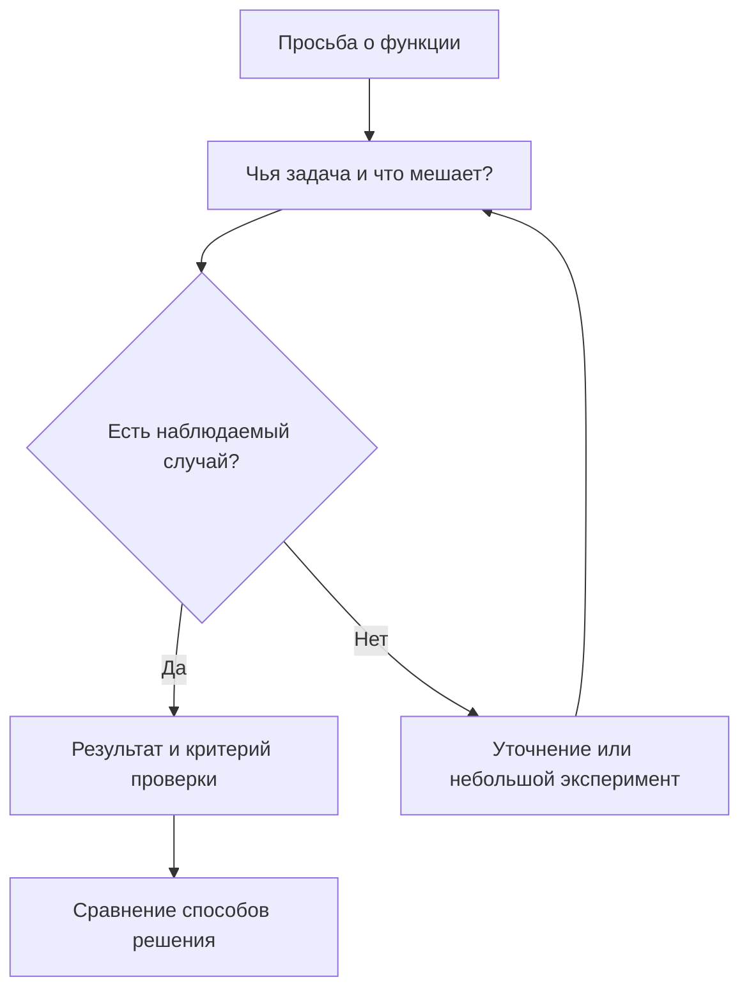

# Проба ментора GPT — сначала задача, потом агент

> [!abstract] Зачем
> Агент может добросовестно выполнить неудачную постановку. Здесь ты потренируешься превращать просьбу «сделай AI» в задачу с понятным результатом, проверкой и границами — на примере «Второго мозга».

**Статус:** временный демонстрационный фрагмент по мотивам `0.BIZ.01`, а не выданное занятие. **Дата:** 16.11.2026. **Время:** 45–60 минут вместе с материалами и тренажёром. Удаляется после обсуждения по твоему сигналу. В трекер, долги и зачёт не входит; мини-тест по настоящей Сессии 13 остаётся в Сессии 14.

**Как идти:** М1 → задание 1; М2 → задание 2; М3 → задания 3–4. Ответы — сразу под вопросами. Все числа в кейсах учебные: это не замеры твоей работы.

> [!note] Проверка пробного тренажёра
> Проверены синтаксис JavaScript, расчёты на 240 сочетаниях параметров, граничные случаи, ссылки на элементы и отсутствие внешних запросов. Визуальная проверка и прохождение в браузере не выполнены: политика браузерного доступа заблокировала открытие локального файла. Поэтому это прототип, а не полностью принятая основная сессия. Открывается вручную из папки проекта. Указанный шаблоном навык `artifact-design` в доступных навыках и проверенных локальных каталогах не найден; использованы сами критерии `Шаблоны/Демо.md`.

| Шаг | Результат | Время |
|---|---|---|
| Предсказание и М1 → задание 1 | Три полезных вопроса заказчику | 10–12 мин |
| М2 → задание 2 | Эксперимент с выбором решения | 10–15 мин |
| М3 → задание 3 | Постановка задачи для агента | 15–20 мин |
| Задание 4 и отчёт | Защита своего решения | 5–8 мин |

## 🔮 Предскажи — 1 минута, без оценки

Коллега просит: «Сделай бота, чтобы больше не искать по папкам». Достаточно ли этой фразы, чтобы согласовать критерий готовности? Назови один неизвестный факт, который сильнее всего повлиял бы на твоё решение.

**Ответ:**

## 📚 Материалы

> [!tip] Минимум для заданий
> Всё необходимое находится ниже. Внешние сервисы, API, установка программ и доступ к настоящим документам не нужны. Это сокращённая проба формата; полный объём `0.BIZ.01` она не заменяет.

### М1. Просьба, проблема и результат

**Просьба** обычно уже предлагает способ: «сделай бота», «добавь векторную базу». **Проблема** описывает, что мешает конкретному человеку в конкретной ситуации. **Результат** — что должно измениться и как это заметить.

Пример: сотрудник просит «приложение для бронирования переговорки». Из разговора выясняется: три раза в неделю две команды приходят в одну комнату одновременно, потому что используют разные календари. «Появилось приложение» ещё не означает, что конфликты исчезли. Нужен единый источник бронирований; приложение — один из способов его организовать.

Другой пример: инженер просит «ускорить SQL». Если отчёт формируется ночью, а утром всё равно ждёт ручного согласования два часа, ускорение запроса с 20 до 5 секунд может почти не изменить рабочий процесс. Сначала полезно выяснить, какое ожидание действительно мешает.

Вопрос нужен, если ответ изменит постановку или выбор. «Вам удобен умный бот?» подталкивает к согласию. «Покажите последний случай, когда не удалось найти нужное» даёт наблюдение. Для каждого вопроса полезно уметь закончить фразу: **«Если узнаю X, изменю Y»**.

### М2. Варианты сравнивают после выбора критерия

Сначала сформулируй, что оптимизируешь. Скорость, удобство, стоимость и приватность могут вести к разным решениям. **Жёсткое ограничение** определяет, можно ли вообще рассматривать вариант; выгодой по другой метрике оно не компенсируется.

Пример расчёта на другой задаче: еженедельная выгрузка оборудования выполняется 8 раз. Вручную — 5 минут на выгрузку: `8 × 5 = 40 минут`. Скрипт оставляет 1 минуту проверки на выгрузку и требует 15 минут обслуживания в неделю: `8 × 1 + 15 = 23 минуты`. Экономия — 17 минут в неделю. Если запуск один, получаем 5 против 16 минут: вывод меняется. Часы первоначальной разработки здесь не учтены; для решения о внедрении их придётся добавить отдельно.

Другой пример: публичный прайс можно обрабатывать внешним сервисом, а внутренний документ, который запрещено передавать наружу, — нельзя. Сначала проверяют допустимость, затем сравнивают время. В реальном проекте ещё понадобятся замеры качества, денег и надёжности; одна диаграмма времени их не заменяет.

> [!example] 🎮 Тренажёр «До того как строить» — 10–15 минут
> Открой [[Материалы/Демо/DEMO_GPT_Настоящая_задача.html|Открыть тренажёр]] в браузере.
> **Миссия:** сначала предскажи результат, затем меняй число обращений. Найди наименьшее целое число обращений, при котором автоматизация быстрее обоих альтернативных вариантов. Затем проверь, остаётся ли этот вариант допустимым при запрете передачи документов наружу. Числа и правила полностью заданы в тренажёре.
> Результат эксперимента — в задании 2. Все данные вымышленные. Тренажёр не обращается к моделям и не читает файлы; записи не сохраняются после перезагрузки страницы.

### М3. Постановка, которую можно проверить

Короткой постановке достаточно шести частей: **для кого; ситуация и проблема; результат; критерии приёмки; ограничения; что сейчас не делаем**. Если данных нет, пиши «требует уточнения», а не изобретай факт. Рабочую гипотезу можно предложить, но её нужно так и обозначить.

Пример на другой задаче: «Для дежурного инженера собрать список принтеров без связи за последние 30 минут из готового тестового журнала. На наборе из 20 записей список содержит ровно устройства, соответствующие условию; записи без времени вынесены отдельно. Настройки устройств не меняем; автоматическое восстановление не входит». Здесь проверяется результат, а не наличие красивого интерфейса.

Ещё пример: «Для звукорежиссёра собрать список аудиофайлов с клиппингом. На тестовых файлах с известными пиками показать имя и время первого превышения. Оригиналы не изменять. Автоматическое исправление звука — вне задачи». Способ анализа можно обсуждать после согласования результата.

**Форма критерия:** «При таких входных данных → наблюдается такой результат». Отдельно полезен случай отсутствия данных: что показать вместо уверенного, но неподтверждённого ответа. Критерий «не ошибается» не задаёт проверку; конкретный тестовый набор задаёт, но не доказывает отсутствие всех будущих ошибок.

> [!danger] 🗡 Как это ломают
> Если приёмка проверяет только наличие отчёта, исполнитель может создать убедительный отчёт без подтверждённого результата. Поэтому источник и наблюдаемое состояние важнее формулировки «готово».

> [!info]- Глубже — по желанию
> Подумай о цене ошибочного решения: не найти нужную заметку, сослаться не на тот фрагмент, показать документ тому, кому нельзя. Эти ошибки имеют разную цену. Позже это станет частью eval-набора и контракта автономии. Сейчас достаточно заметить разницу; изучения новых терминов для сдачи не требуется.

## ✏️ Задания

### 1. Три вопроса до реализации — 8 минут

**Зачем:** выяснить задачу до выбора технологии, чтобы агент не построил хорошо работающую ненужную функцию.

📖 **Сначала:** [[#М1. Просьба, проблема и результат|М1]].

**Дано.** Ты проектируешь учебную функцию для «Второго мозга». Заказчик — его пользователь — пишет: «Добавь умный поиск. Я не хочу снова разбирать то, что уже проходил». Пока неизвестно, что именно он пытается найти, где это хранится и что считает удачным результатом. Доступна беседа с заказчиком. Код писать рано.

**Что сдать:** три разных уточняющих вопроса. К каждому — какое решение зависит от ответа. Не выбирай модель или базу данных до разговора.

**Образец формы на другом случае:** «Вопрос: кто должен видеть список оборудования? → Решение: нужен ли единый список или разные представления по отделам».

**Критерий:** три вопроса без навязанного ответа; у каждого указано конкретное решение, которое он помогает принять. Термины и объём текста сами по себе баллов не добавляют.

**Ответ:**

| Вопрос | Какое решение зависит от ответа |
|---|---|
| | |
| | |
| | |

### 2. 🔧 Руками: проверь, когда меняется выбор — 10–15 минут

**Зачем:** увидеть, почему «самое автоматизированное» решение может проиграть по заданному критерию, а самое быстрое — оказаться недопустимым.

📖 **Сначала:** [[#М2. Варианты сравнивают после выбора критерия|М2]].

**Дано:** учебные числа внутри тренажёра. Считаем только время пользователя и обслуживания за неделю. Качество вариантов условно одинаковое; стоимость первоначальной разработки исключена. Допустимость облачной обработки регулируется отдельным условием.

**Что сделать:**

а) Пройди разминку «Заявки на печать». Запиши первоначальный прогноз и фактические три времени.

б) В основном случае «Поиск по заметкам» найди наименьшее целое `N`, при котором автоматическая сводка **строго быстрее** двух остальных вариантов. Запиши времена при `N−1` и `N`.

в) Пройди третий случай с запретом передачи документов наружу. Назови допустимый вариант при текущем `N` и объясни, почему нельзя просто выбрать минимум времени среди всех вариантов.

**Образец формы на другом случае:** «При 4 запусках: вручную 20 мин, скрипт 19 мин. Выбрал скрипт по времени; первоначальные затраты здесь не считались». Эти числа не относятся к тренажёру.

**Критерий:** есть прогноз, наблюдения из трёх случаев, проверка границы на двух соседних значениях и объяснение ограничения. Можно приложить итог тренажёра вместо перепечатывания чисел. Слова тренажёра не заменяют твой вывод.

**Ответ:**

### 3. Постановка задачи «Найди мою прошлую ошибку» — 15–20 минут

**Зачем:** дать агенту проверяемую задачу, в которой результат для пользователя отделён от способа реализации.

📖 **Сначала:** [[#М3. Постановка, которую можно проверить|М3]].

**Дано — ответы учебного заказчика.** Это вымышленный кейс, а не новые требования к настоящему полигону:

- Перед занятием пользователь хочет найти свою прежнюю ошибку по указанной теме и объяснение исправления.
- Сейчас он вручную просматривает старые проверки. Для эксперимента выделен небольшой синтетический набор; настоящие заметки не используются.
- В наборе три записи: `S1.md` содержит раздел «Проверка», тема `копирование`, ошибка `изменил исходный словарь`, исправление `создать отдельную копию`; `S2.md` содержит раздел «Проверка», тема `поиск`, ошибка `потерял граничный элемент`, исправление `проверить границы диапазона`; `S3.md` — справочная лекция о копировании без личной ошибки и без раздела «Проверка».
- На ввод `копирование` заказчику нужна запись о **своей ошибке**, фрагмент исправления и ссылка на файл-источник. Справочная лекция сама по себе результатом не считается.
- Если нужной ошибки в наборе нет, пользователь хочет явное сообщение об отсутствии результата.
- На этом шаге тема задаётся точной строкой. Синонимы и семантический поиск пока не нужны.
- Исходные файлы не изменяются и не передаются внешним сервисам. Поиск выполняется только по разрешённому тестовому набору.

**Что сдать:** постановку на 150–220 слов: шесть частей из М3 и **три конкретных критерия приёмки**. Один критерий проверяет найденный результат, второй — отсутствие нужной записи, третий — соблюдение одной из границ. Ограничение, которое осталось вне этих трёх критериев, всё равно явно укажи в постановке. Функции, код, фреймворк и выбор модели не требуются.

**Образец формы на другой задаче:** «На входе журнал с отключённым `Printer-A` и доступным `Printer-B` → в списке только `Printer-A`». Для проверки запрета можно описать наблюдение: «После запуска содержимое входных файлов совпадает с сохранённой копией».

**Критерий:** названы пользователь и проблема; результат отделён от технологии; три критерия имеют вход/условие и наблюдаемый итог; все ограничения и границы явно сохранены; отсутствующие требования не выданы за слова заказчика. Рабочие допущения допустимы с пометкой и обоснованием.

**Ответ:**

### 4. Защити одно решение — 5 минут

**Зачем:** показать собственное понимание после работы с материалами и агентом.

📖 **Сначала:** вернись к своей постановке в задании 3.

**Дано:** коллега предлагает немедленно расширить функцию: «Пусть сама исправляет старые ответы — так будет полезнее».

**Что сдать:** ответ коллеге в 3–5 предложениях. Скажи, принимаешь ли это в текущую задачу; сошлись на конкретное ограничение; предложи, какой отдельный вопрос пришлось бы согласовать, прежде чем обсуждать такую функцию. Не переписывай всё ТЗ.

**Образец формы на другом случае:** «Автоперезапуск сервера сейчас не добавляю: согласована только диагностика. Для отдельной задачи сначала нужно выяснить допустимый простой».

**Критерий:** решение, основание из вводных и один содержательный вопрос для возможного расширения. Совпадения с формулировками ментора не требуется.

**Ответ:**

## ✍️ Короткий отчёт

- **Время:**
- **Что было неясно в задании:**
- **Подсказки / что делал агент:**
- **Демо: 1–5 · что было полезно или лишним:**

## ✅ Проверка — место для ментора

Это демонстрация. Оценки, зачёт и записи в трекер не ставятся. Если решишь выполнить — разберём по объявленным критериям. Замечания сверх них будут предложениями, а не скрытыми требованиями. Карточки и настоящий мини-тест по этой пробе автоматически не создаются.
