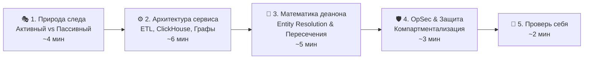
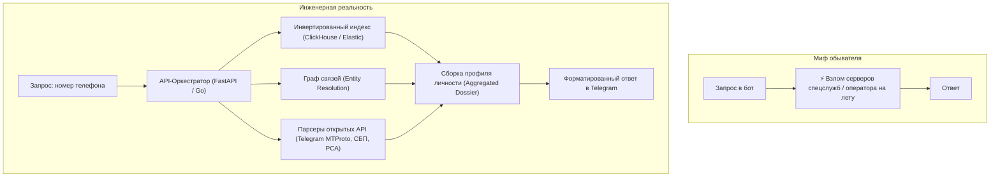
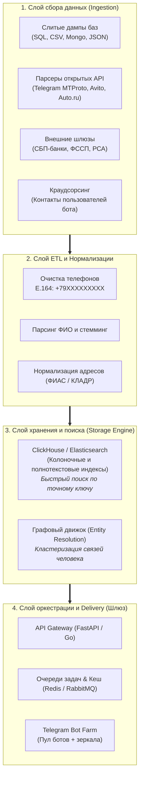
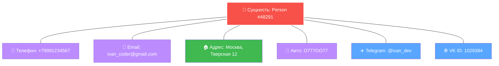

# 🕵️ Анатомия деанонимизации в сети и архитектура OSINT-агрегаторов

> **Дата:** 24.10.2026 · **К занятиям:** `0.SEC.01` (Модель угроз), `0.SEC.03` (Секреты и утечки), `0.CTF.02` (Форензика), `1.AIS.10` (Безопасность данных и 152-ФЗ) · **Время на чтение:** ~20 мин

> [!abstract] Зачем
> Развенчать иллюзию «магического хакерского взлома» и понять реальную инженерную изнанку деанонимизации: как устроены агрегаторы утечек (по типу некогда гремевшего «Глаза Бога»), почему реляционные базы не справляются с поиском связей, как работает Entity Resolution в графах данных и почему цифровая гигиена — это не «стереть историю браузера», а строгое математическое разделение контекстов.
> Для инженера агентных систем те же самые архитектурные паттерны (ETL, инвертированные индексы, Entity Resolution, графы связей) являются фундаментом при проектировании GraphRAG и корпоративных хранилищ знаний.

---

## 1. Введение: Магия «пробива» vs Промышленная инженерия данных

Когда обыватель слышит о ботах класса «Глаз Бога» (Eye of God), SmartSearch или QuickOsint, у него возникает иллюзия «киберпанка»: бот якобы отправляет эксплойты в реальном времени, взламывает камеры наблюдения или имеет прямой закрытый доступ к серверам МВД и ФСБ.

**Реальность куда прозаичнее и интереснее с инженерной точки зрения:**
Подобные боты — это **высоконагруженные распределённые поисковые системы и графовые агрегаторы данных (Data Aggregation & Entity Resolution Platforms)**. 
Они не «взламывают» вас в момент отправки команды `/start`. Они лишь сопоставляют введённую зацепку (Seed: номер телефона, ник, авто, email) с десятками терабайтов уже давно украденных, утекших или публично распарсенных баз данных.

---

## 2. Анатомия цифрового следа: Из чего собирается профиль

Деанонимизация — это процесс связывания абстрактного сетевого идентификатора (псевдонима, Telegram ID, криптокошелька) с физической персоной (ФИО, паспорт, адрес проживания). 

Цифровой след делится на три фундаментальных слоя:

### 2.1. Активный след (то, что пользователь отдаёт добровольно)
- **Уникальные никнеймы:** Человек регистрируется на форуме по играм в 2012 году как `alex_wolf_99`, затем использует этот же ник на Хабре, в GitHub и в Telegram. Если на старом форуме 2012 года была брешь и утекла база с email `alex.ivanov@mail.ru`, вся цепочка замыкается.
- **Повторяющиеся пароли:** Утечка базы с форума содержит не просто логин, а хеш пароля (или открытый пароль). Если у пользователя один пароль на 10 сайтах, поиск по хешу/паролю связывает все его аккаунты между собой.
- **Аватарки и фотографии:** Поиск по картинкам (Reverse Image Search, нейросетевые сервисы распознавания лиц вроде FindClone / NtechLab / PimEyes). Одно селфи на аватаре анонимного аккаунта деанонимизирует через распознавание геометрии лица.
- **Стилометрия:** Специфические речевые паттерны, редкие слова, профессиональный жаргон, пунктуация.

### 2.2. Пассивный и технический след (то, что отдаёт устройство и сеть)
- **IP-адрес и тайминги:** Фиксация сетевых соединений. Сами по себе IP-адреса динамические, но при сопоставлении с логами провайдера дают точный договор.
- **Browser Fingerprinting (Цифровой отпечаток браузера):** Даже без cookies сайт может различить вас с точностью >95%:
  - *Canvas Fingerprint:* незаметный рендеринг 2D-графики (зависит от видеокарты, драйверов и сглаживания шрифтов в ОС).
  - *WebGL / AudioContext:* микроразличия в обработке звуковых сигналов и 3D-шейдеров на конкретном оборудовании.
  - *Список системных шрифтов, разрешение экрана, глубина цвета, часовой пояс.*

### 2.3. Экосистемный след (самый уязвимый вектор)
- **Телефонный номер как универсальный супер-ключ:** В РФ и СНГ номер мобильного стал главным первичным ключом человека: к нему привязаны банки, Госуслуги, доставка еды, мессенджеры, такси и каршеринг.
- **Утечки адресных баз доставки и ритейла (СДЭК, Яндекс.Еда, Delivery Club):** Это «золотая жила» деанонимизаторов. В этих базах в одной строке хранятся:
  $$\text{Телефон} \longleftrightarrow \text{ФИО} \longleftrightarrow \text{Точный адрес (дом, подъезд, этаж, код домофона)} \longleftrightarrow \text{Сумма трат}$$

---

## 3. Архитектура поискового агрегатора: Как был устроен «Глаз Бога»

Рассмотрим инженерную архитектуру крупного OSINT-агрегатора. Система состоит из четырёх главных слоёв.

### 3.1. Слой 1: Источники сырых данных (Data Ingestion)

1. **Архивные утечки баз данных (Breach Dumps):**
   - Дампы интернет-магазинов, медицинских лабораторий (Гемотест), сервисов доставки, служб экспресс-доставки (СДЭК), баз автострахования (РСА, ЕАИСТО).
   - Объём: десятки миллиардов строк, сотни терабайт сырых данных.
2. **Синхронизация с Telegram через MTProto API:**
   - Это ключевая «фишка» бота. Telegram не даёт искать пользователя по номеру телефона через строку поиска приложения, если номер скрыт настройками приватности.
   - **Но!** Telegram позволяет импортировать контакты из телефонной книги через API (`contacts.importContacts`).
   - Агрегатор держит ферму из тысяч «прогретых» сессий Telegram на виртуальных номерах. Бот пачками заливает номера телефонов в адресные книги этих сессий. Telegram послушно отвечает: *«Контакт +7999... зарегистрирован, его внутренний `user_id` = 12345678, никнейм = `@username`, имя = Иван»*. 
   - Так формируется база связок: **`Телефон` $\longleftrightarrow$ `Telegram ID` $\longleftrightarrow$ `Никнейм`**.
3. **Шлюзы Системы быстрых платежей (СБП):**
   - Перебор банков: отправка запроса на перевод 1 рубля по номеру телефона возвращает имя, отчество и первую букву фамилии получателя (например, *«Иван Иванович И.»*). Это позволяет валидировать реальность ФИО без взлома банков.
4. **Краудсорсинг (схема GetContact):**
   - Пользователи, устанавливая бесплатные определители номеров или запуская ботов, часто сами открывают доступ к своим записным книжкам. Из записных книжек сотен людей собираются теги: *«Ваня шиномонтаж», «Иван брат Лены», «Иван Должник»*.

---

### 3.2. Слой 2: Нормализация и очистка (Data Cleaning & ETL)

Сырые дампы отвратительны по качеству. Один и тот же номер может быть записан как:
`8-999-123-45-67`, `+7(999)1234567`, `79991234567`, `8 999 123 45 67`.

Пайплайн очистки (на Go / Spark):
- **Телефоны:** приводятся к строгому стандарту **E.164** (для РФ: `79XXXXXXXXX` в виде `uint64` для экономии памяти).
- **ФИО:** очистка от мусорных символов, капитализация, разделение на Фамилия/Имя/Отчество.
- **Госномера авто:** удаление пробелов, унификация латиницы и кириллицы (буквы `А, В, Е, К, М, Н, О, Р, С, Т, У, Х`).
- **Хеширование паролей:** детектирование алгоритма (MD5, SHA1, NTLM, Bcrypt) и сверка с радужными таблицами (rainbow tables) для восстановления исходного пароля.

---

### 3.3. Слой 3: Хранение, индексация и Entity Resolution

> [!warning] Почему реляционная база (PostgreSQL / MySQL) здесь умрёт?
> Попытка выполнить `JOIN` по 15 таблицам размером по 200 миллионов строк с условием `WHERE phone = ... OR email = ...` положит дисковую подсистему реляционной СУБД за секунды.

Поэтому архитектура строится на связке двух специализированных систем:

#### А. Сверхбыстрый колоночный поиск (ClickHouse / Elasticsearch)
- **ClickHouse** идеален для логов и плоских списков: он хранит данные в сжатом виде по колонкам с разреженными индексами (sparse primary keys).
- Поиск по точному номеру телефона среди **20 миллиардов записей** в ClickHouse занимает **15–40 миллисекунд**.

#### Б. Графовая модель и алгоритм Entity Resolution (Разрешение сущностей)
Самая сложная задача: как понять, что:
- Заказ в «Еде» на имя *«Ванёк»* с телефоном `+7999...`
- Объявление на Avito о продаже шин от *«Ивана»* с почтой `ivan99@gmail.com`
- Профиль ВКонтакте `id987654` с именем *«Иван Иванов»*
...это **один и тот же человек**?

Для этого строится граф знаний (**Knowledge Graph**):
- **Вершины (Nodes):** `Person` (личность-кластер), `Phone`, `Email`, `Address`, `CarPlate`, `PasswordHash`, `TelegramAccount`.
- **Рёбра (Edges):** `USES_PHONE`, `LIVES_AT`, `REGISTERED_WITH`, `DRIVES_CAR`.

**Алгоритм слияния вершин (Graph Clustering):**
1. Каждому ребру присваивается вес доверия ($W \in [0, 1]$).
   - Точный телефон в договоре страхования + паспорт = вес $0.99$.
   - Одинаковое имя «Иван» = вес $0.05$ (слишком распространённое).
   - Совпадение редкого пароля `K$9x_Lp#2020` = вес $0.95$.
2. При превышении порога уверенности кластеры сущностей сливаются (Merge Nodes) в единый паспорт профиля.

---

### 3.4. Слой 4: Доставка, бот и отказоустойчивость

Почему именно Telegram-бот, а не веб-сайт?
1. **Неуязвимость для классической блокировки РКН:** Веб-сайт с персональными данными блокируется по домену и IP за считанные дни. Telegram-бот работает внутри зашифрованного MTProto-туннеля мессенджера.
2. **Анонимность разработчиков и платежей:** Создатели бота используют сеть промежуточных API-серверов за Cloudflare, оплату принимают через криптовалюты (USDT, TON) или дроп-эквайринги.
3. **Ротация ботов:** При блокировке конкретного юзернейма бота Telegram-платформой по жалобам правообладателей/регуляторов, создатели поднимают новое «зеркало» (бот-клиент) за 60 секунд — база данных при этом остаётся нетронутой на бэкенде.

---

## 4. Математика деанонимизации: Атака пересечения множеств

Многие считают: *«Я не оставляю паспорт в сети, у меня скрыт номер в Telegram, значит, я анонимен»*. Это заблуждение разбивается о дискретную математику и теорию множеств.

### 4.1. Теорема Латаньи Суини (Latanie Sweeney)
В 2000 году исследовательница из Гарварда доказала, что **87% жителей США могут быть однозначно идентифицированы всего по трём признакам:**
1. 5-значный почтовый индекс (ZIP-код)
2. Пол (мужской / женский)
3. Полная дата рождения

Каждый из этих параметров сам по себе не является секретом и не идентифицирует человека. Но на их **пересечении** почти всегда оказывается ровно 1 человек!

### 4.2. Практическая триангуляция в OSINT
Представьте город с населением $1\,000\,000$ человек.

$$\begin{aligned}
|A| &= 50\,000 \quad \text{(люди, подключённые к базовой станции у метро «Сокол» в 19:00)} \\
|B| &= 1\,200 \quad \text{(владельцы синих автомобилей Hyundai Solaris в округе)} \\
|C| &= 80 \quad \text{(подписчики закрытого чата любителей виниловых пластинок)}
\end{aligned}$$

Если события независимы, математическое ожидание числа людей на пересечении:
$$N = 1\,000\,000 \times \left(\frac{50\,000}{1\,000\,000}\right) \times \left(\frac{1\,200}{1\,000\,000}\right) \times \left(\frac{80}{1\,000\,000}\right) = 0.048 \approx 0 \text{ или ровно } 1 \text{ человек!}$$

> [!important] Правило одного «грязного контакта»
> Вы можете годами использовать Tor, VPN и анонимные псевдонимы. Но достаточно **один раз**:
> - Заказать пиццу на съемную квартиру с анонимной SIM-карты,
> - Оплатить анонимный хостинг личной банковской картой,
> - Подключиться к домашнему Wi-Fi без VPN с «секретного» телефона,
> 
> ...и в графе данных появляется **неразрывное ребро**. Графовый движок агрегатора мгновенно объединяет оба кластера в одну сущность.

---

## 5. Защита и операционная безопасность (OpSec)

В кибербезопасности защита строится не на иллюзии «абсолютной невидимости», а на **модели угроз** (`0.SEC.01`): от кого конкретно мы защищаемся?

| Нарушитель | Инструменты | Против кого защищает OpSec? |
|---|---|---|
| **Уровень 1: Бытовой сталкер / мошенник** | Покупные боты («Глаз Бога» и зеркала), поиск в Яндексе/Google | 🛡 **Защищает на 99%:** чистка тегов в GetContact, скрытый номер в Telegram, отсутствие совпадений в никах. |
| **Уровень 2: Корпоративная безопасность / Частные детективы** | Платные закрытые дампы, СБП-пробив, кредитные истории, инсайдеры в банках | 🟡 **Защищает частично:** строгая изоляция рабочих и личных номеров, виртуальные карты. |
| **Уровень 3: Государственные спецслужбы** | СОРМ-3, DPI, биллинг базовых станций, официальные запросы операторам | ❌ **Не защищает гражданский OpSec:** здесь работают только физическая изоляция оборудования и отказ от радиоинтерфейсов. |

### Принцип строгой компартментализации (Compartmentalization)
Если вам требуется изолированная цифровая личность (для исследований безопасности, CTF, журналистики):
1. **Никаких общих идентификаторов:** ни единого общего email, номера, логина или пароля.
2. **Изоляция среды:** отдельная виртуальная машина (Whonix на базе KVM/VirtualBox) или чистая ОС на флешке (Tails).
3. **Чистые сетевые каналы:** выход строго через защищённые туннели без DNS-утечек (DNS Leaks).
4. **Очистка метаданных:** удаление EXIF из фотографий перед публикацией (`exiftool -all= photo.jpg`).

---

## 6. Мостик к инженерии агентных систем и безопасности

Почему эта тема критически важна для будущего архитектора агентных систем?

1. **GraphRAG и корпоративные базы знаний:**
   Архитектура деанон-бота — это зеркальное отражение корпоративного поискового агента. Когда вы строите GraphRAG для enterprise-клиента, вы решаете ту же задачу Entity Resolution: объединить документы из почты, тикетов Jira, логов Git и файлов Confluence в единый граф сущностей предприятия.
2. **Утечки данных через LLM-агентов (Prompt Data Leakage / 152-ФЗ):**
   Если агент имеет доступ к внутренней базе клиентов и выходит в интернет через поисковые инструменты, существует риск косвенной инъекции (Indirect Prompt Injection, `0.AIS.01`): вредоносный сайт в выдаче может заставить агента слить фрагменты PII (персональных данных) во внешний веб-хук.
3. **Отравление данных (Data Poisoning):**
   Агрегаторы данных уязвимы к умышленному вбросу фиктивных дампов. Если злоумышленник внедряет в публичные утечки ложные связи, граф связывает невинного человека с чужими аккаунтами.

---

## 🎮 Интерактивное демо

Для наглядного изучения работы Entity Resolution, графов связей и математики пересечения множеств открывайте интерактивное демо:

- **Локальный файл в хранилище:** [[Материалы/Демо/0.SEC — Граф деанонимизации и Entity Resolution.html]]
- **Открыть артефакт в интерфейсе:** [[Материалы/Демо/0.SEC — Граф деанонимизации и Entity Resolution.html|Открыть демо]]

**Что покрутить в демо (~3-5 мин):**
1. Вкладка **«1. Симулятор графа связей»**: выберите seed (Telegram-ник, телефон или номер машины) и нажмите *«Запустить деанон-поиск»* — посмотрите, как цепочка обратных индексов от дампа к дампу восстанавливает итоговый профиль.
2. Вкладка **«2. Атака пересечения множеств»**: покрутите ползунки объёма баз данных и посмотрите, как три «безобидных» фильтра в миллионном городе сужают круг подозреваемых до 1 человека.
3. Вкладка **«3. Пайплайн данных»**: разберите 4 инженерных слоя системы.

---

## 🎯 Проверь себя (Микрозадача на закрепление)

Представьте сценарий расследования:
> Специалист по безопасности анализирует утечку данных. У него есть:
> 1. Анонимный аккаунт на хакерском форуме с ником `matrix_reloaded` и адресом `neo2024@protonmail.com`.
> 2. Утечка старой базы игрового сервера Minecraft за 2018 год, где зарегистрирован пользователь с ником `matrix_reloaded`, почтой `vanya_pro_2004@mail.ru` и хешем MD5 `5f4dcc3b5aa765d61d8327deb882cf99` (пароль `password`).
> 3. Утечка базы заказов суши за 2023 год, где фигурирует почта `vanya_pro_2004@mail.ru`, телефон `+7 (916) 111-22-33` и адрес доставки *«ул. Строителей, д. 4»*.
> 4. Анонимный Telegram-аккаунт хакера `@zerocool`, зарегистрированный на неизвестный номер. Однако в базе того же игрового сервера Minecraft 2018 года у пользователя `vanya_pro_2004` был указан точно такой же пароль `password`.

**Вопрос:**
Какое **одно ключевое ребро** в этой цепочке является самым слабым и почему именно оно позволяет деанонимизировать владельца аккаунта `matrix_reloaded`? А где в этой цепочке может возникнуть ложноположительное срабатывание (False Positive)?
