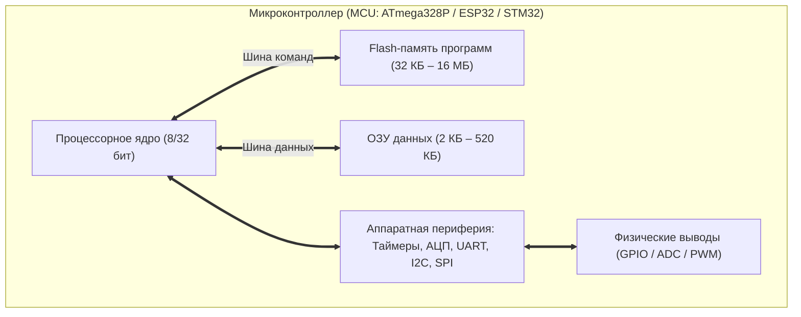
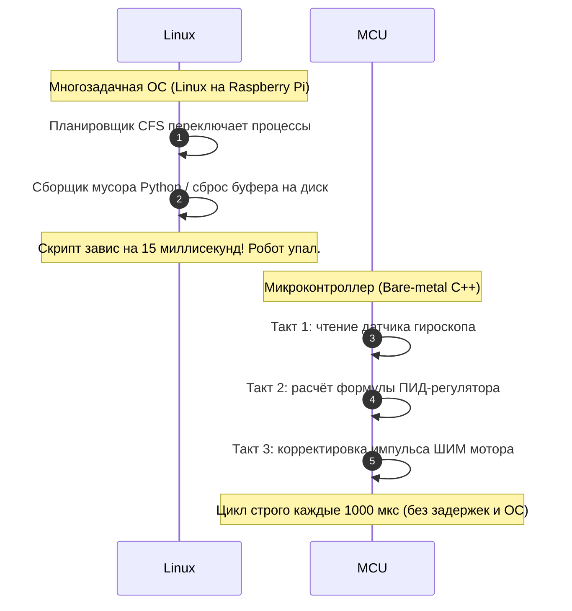
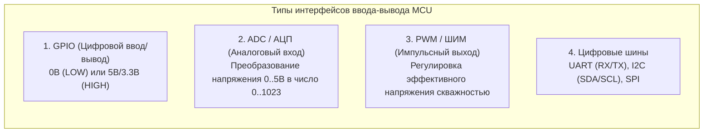
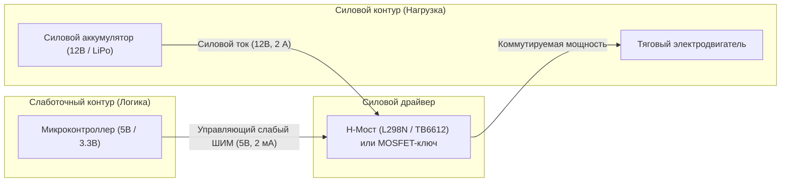
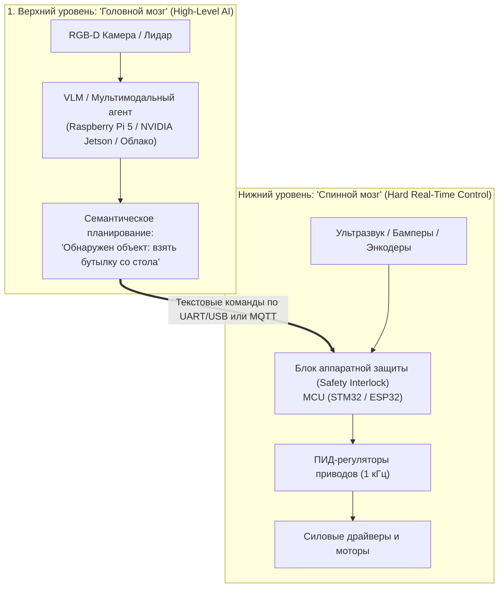

# 🤖 Микроконтроллеры, Arduino и роботы с нуля

> **Дата:** 24.10.2026 · **К занятию:** `0.PAI.01` (с мостиком к `0.LOW.01`, `0.OS.01`, `0.SEC`) · **Время на чтение:** ~15 мин

> [!abstract] Зачем
> Разобрать устройство микроконтроллеров (MCU), логику взаимодействия с физическим миром (GPIO, АЦП, ШИМ, шины) и понять архитектурную роль MCU как детерминированного аппаратного предохранителя (Safety Interlock) в автономных агентных системах и робототехнике (Physical AI).

> [!example] 🎮 Интерактивное демо — «Микроконтроллер, Пины и Безопасность Робота»
> ▶ **[[Материалы/Демо/0.PAI.01 — Микроконтроллер, пины и безопасность робота.html|Открыть интерактивное демо]]** · Копия в хранилище: `Материалы/Демо/0.PAI.01 — Микроконтроллер, пины и безопасность робота.html` · ~5 мин
> Что покрутить:
> 1. Пощёлкай цифровой выход GPIO, покрути аналоговый вход АЦП (0–5В $\to$ 0–1023) и форму ШИМ-импульса со скважностью.
> 2. Сравни подключение нагрузки напрямую (выгорание ножки на 40 мА) и через силовой драйвер H-моста.
> 3. Запусти робота навстречу стене: посмотри, как аппаратный предохранитель (Safety Interlock) на частоте 1 кГц принудительно рубит моторы вопреки ошибочной команде LLM верхнего уровня.


---

## 1. Микроконтроллер (MCU) vs Обычный процессор (CPU)

В персональном компьютере или одноплатнике (Raspberry Pi 5) установлен **микропроцессор (MPU / CPU)**:
- Чип требует внешней оперативной памяти (DDR), накопителя (NVMe/SD), сложной схемы стабилизации питания и охлаждения.
- Процессор рассчитан на многозадачную ОС и терафлопсы вычислений, потребляя от десятков до сотен ватт.

**Микроконтроллер (MCU — Microcontroller Unit)** — это законченный компьютер, интегрированный на один кремниевый кристалл:



| Характеристика | Обычный ПК (x86 CPU) | Одноплатник (Raspberry Pi 5) | Классическая Arduino Uno (ATmega328P) | Современный стандарт (ESP32) |
|---|---|---|---|---|
| **Разрядность и частота** | 64 бит, ~4–5 ГГц | 64 бит (ARM), 2.4 ГГц | 8 бит (AVR), **16 МГц** | 32 бит (2 ядра Tensilica), **240 МГц** |
| **ОЗУ (SRAM)** | 16–64 ГБ | 4–8 ГБ | **2 КБ** (2048 байт) | **520 КБ** |
| **Память программ** | 1 ТБ NVMe SSD | 32–64 ГБ MicroSD | **32 КБ Flash** | **4–16 МБ Flash** |
| **Архитектура памяти** | Фон Неймана | Фон Неймана | **Гарвардская** (Flash и SRAM разделены) | Модифицированная Гарвардская |
| **Окружение** | Windows / Linux | Полноценный Linux | **Bare-metal (без ОС)** | Bare-metal или **FreeRTOS** |
| **Потребление тока** | 65–300 Вт | 5–15 Вт | **~0.1 Вт** | **~0.5 Вт** (с Wi-Fi / BLE) |
| **Стоимость чипа** | $200–$600 | $60–$90 | **$1.5–$2** | **$2.5–$4** |

> [!info]- Подробности: Что такое Arduino на самом деле?
> Arduino — это не производитель микросхем. Это экосистема:
> 1. **Аппаратная плата:** готовая печатная плата вокруг стороннего микроконтроллера (чипа Microchip ATmega328P) со стабилизатором напряжения на 5В/3.3В, кварцевым резонатором на 16 МГц и микросхемой USB-UART для прошивки.
> 2. **Программная обёртка (Wiring API):** набор библиотек на C++, упрощающих работу с регистрами до человекопонятных функций `pinMode()` и `digitalWrite()`.

---

## 2. Предсказуемость реального времени (Hard Real-Time): почему здесь нет ОС

Зачем использовать чип с 2 килобайтами памяти, если можно поставить микрокомпьютер с Linux и писать на привычном Python?

Причина — **детерминизм времени исполнения (Hard Real-Time)**:



- В ОС общего назначения (Linux/Windows) работает вытесняющий планировщик. Процесс может быть прерван на миллисекунды системным прерыванием, работой сети или сборщиком мусора. Для экрана монитора задержка 15 мс незаметна; для балансирующего робота или дрона это потеря равновесия и авария.
- В микроконтроллере выполняется **только одна скомпилированная программа**. Нет виртуальной памяти, нет планировщика ОС — код напрямую манипулирует регистрами кремния.

### Анатомия прошивки

```cpp
// 1. Однократная инициализация периферии при старте питания
void setup() {
  pinMode(13, OUTPUT); // Сконфигурировать ножку 13 как цифровой выход
}

// 2. Бесконечный детерминированный цикл
void loop() {
  digitalWrite(13, HIGH); // Подать логическую единицу (+5В)
  delay(1000);            // Аппаратная пауза
  digitalWrite(13, LOW);  // Сбросить в ноль (0В / GND)
  delay(1000);
}
```

---

## 3. Физический уровень: Входы, Выходы и Цифровые протоколы

Все взаимодействия с миром осуществляются через металлические выводы — **пины (Pins)**.



### 3.1. Разбор интерфейсов

1. **GPIO (General-Purpose Input/Output):**
   - В режиме `INPUT` пин замеряет наличие логического уровня (нажатие кнопки, концевой датчик).
   - В режиме `OUTPUT` пин подключает ножку к шине питания или земле через внутренний комплементарный MOSFET-ключ.
2. **АЦП (ADC — Analog-to-Digital Converter):**
   - Переводит плавное изменение аналогового сигнала (датчик освещённости, термистор, аналоговый стик джойстика) в цифровое значение. При 10-битном АЦП диапазон составляет $0 \dots 1023$ (шаг дискретизации $\approx 4.88$ мВ).
3. **ШИМ (PWM — Pulse-Width Modulation):**
   - Имитирует аналоговое управление мощностью цифровым сигналом за счёт изменения **скважности (Duty Cycle)** при постоянной частоте (обычно 500–1000 Гц):
     - Скважность 0%: постоянный уровень 0В (мотор остановлен);
     - Скважность 50%: 50% периода 5В, 50% 0В (эффективное напряжение 2.5В, вращение вполсилы);
     - Скважность 100%: постоянные 5В.
4. **Интерфейсные шины обмена данными:**
   - **UART (Serial):** асинхронный дуплексный канал из двух линий (`TX` — передача, `RX` — приём). Стандарт обмена с ПК и GPS-модулями.
   - **I2C (Inter-Integrated Circuit):** полудуплексная двухпроводная шина (`SDA` — данные, `SCL` — синхросигнал). Позволяет адресно подключать **до 127 датчиков** (IMU-гироскопы, барометры, OLED-экраны) на одну пару проводов.
   - **SPI:** высокоскоростной синхронный протокол (линии `MOSI`, `MISO`, `SCK`, `CS`) со скоростями до десятков мегагерц (SD-карты, TFT-дисплеи).

---

## 4. Силовая электроника: почему мотор сжигает микроконтроллер

> [!warning] Критическое ограничение кремния MCU
> Максимальный ток через один цифровой вывод микроконтроллера составляет **не более 20–40 мА** (0.02–0.04 А).
> Для пуска типового коллекторного мотора игрушки или робота требуется ток от **1 до 3 Ампер** при напряжении 12В. Прямое подключение мотора к пину вызывает моментальное тепловое разрушение выходного каскада микроконтроллера.

Схема робототехники всегда разделяется на **слаботочную часть управления** и **силовую часть питания**:



- **Для включения/выключения мощной нагрузки:** используется полевой транзистор (**MOSFET**) или реле с гальванической развязкой (оптопарой).
- **Для управления направлением и скоростью колёс:** используется **H-мост (H-Bridge)** — конфигурация из 4 транзисторов, позволяющая менять полярность подачи питания на обмотку двигателя.
- **Для точного позиционирования манипуляторов:** применяются **сервоприводы** (со встроенным редуктором, потенциометром обратной связи и собственным драйвером) или **шаговые двигатели** (с драйверами типа A4988).

---

## 5. Архитектура Physical AI (`0.PAI`): Двухуровневая система управления

Современный физический ИИ-агент (робот-пылесос, манипулятор или робособака) строится по биологическому принципу разделения «коры больших полушарий» и «спинного мозга»:



### Аппаратный предохранитель (Safety Interlock) в безопасности агентов

> [!important] Роль MCU в концепции AI Safety
> Мультимодальные модели (VLM/LLM) подвержены галлюцинациям, задержкам вывода и атакам Prompt Injection (например, через текст на дорожном знаке или футболке).  
> **Микроконтроллер выступает абсолютной границей безопасности:**
> 1. Даже если агент верхнего уровня отдаст команду «полный газ вперёд» (`{"speed": 100}`), микроконтроллер на частоте 1000 Гц считывает дальномер и при приближении к препятствию ближе 10 см **аппаратно отключает ШИМ моторов**, игнорируя верхний уровень.
> 2. При зависании верхнего уровня микроконтроллер по таймауту (Watchdog) переводит систему в безопасный режим (Fail-Safe Stop).

---

## 🎯 5. Проверь себя

> [!question] Вопросы для самопроверки
> 1. В чём разница между чтением данных с датчика через АЦП и чтением через шину I2C?
> 2. Каким образом ШИМ-сигнал на цифровом пине позволяет регулировать обороты электродвигателя постоянного тока?
> 3. Почему в архитектуре автономного мобильного робота нельзя возложить аварийную остановку при столкновении исключительно на нейросеть верхнего уровня?

> [!info]- Ответы для сверки — раскрыть
> 1. АЦП замеряет простое аналоговое напряжение на датчике и оцифровывает его в одно число (например, сопротивление терморезистора). I2C — это цифровой протокол: датчик содержит свой собственный встроенный контроллер и передаёт в микроконтроллер готовые байтовые пакеты данных с контрольными суммами по адресному каналу.
> 2. ШИМ не меняет амплитуду напряжения (она остаётся 5В), а быстро включает и выключает питание. За счёт механической и индуктивной инерции обмоток ротора эффективный интегральный ток оказывается пропорционален скважности импульсов, изменяя крутящий момент и обороты.
> 3. Модель верхнего уровня работает с переменной задержкой (инференс занимает от 100 мс до секунд), может зависнуть из-за сборки мусора ОС или дать сбой из-за оптической иллюзии/инъекции. Защитный барьер реального времени должен срабатывать гарантированно за миллисекунды на уровне детерминированного микроконтроллера.
