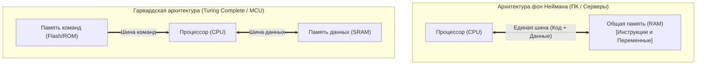
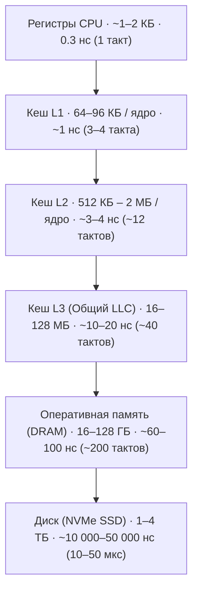
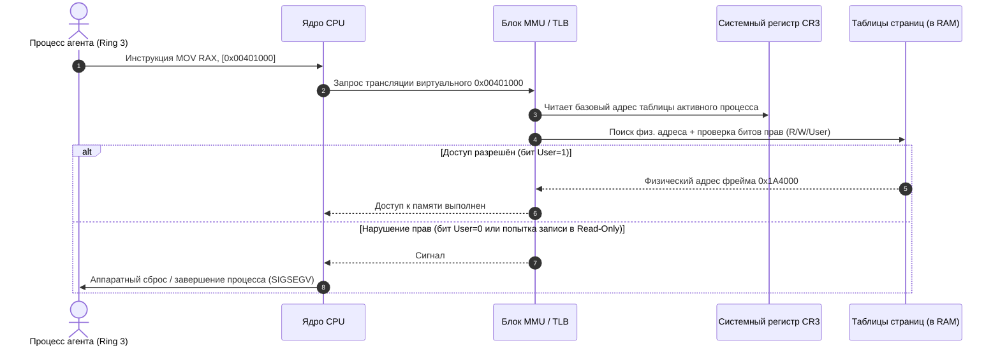
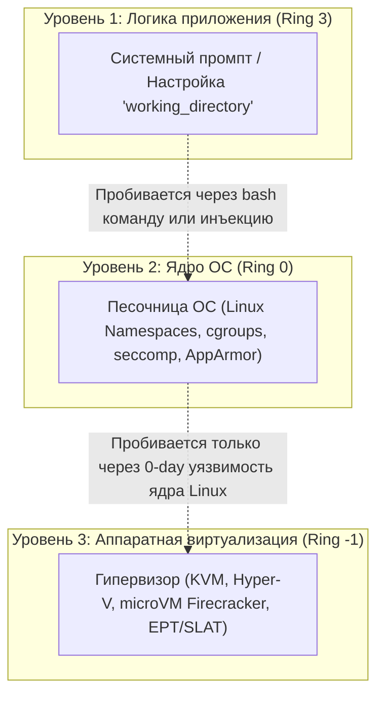

# 🧠 От игры к железу: архитектуры, кеши, виртуальная память и изоляция

> **Дата:** 24.10.2026 · **К занятию:** `0.LOW.01` (с мостиком к `0.OS.01`, `0.OS.08`, `0.AIN.02`, `0.SEC`) · **Время на чтение:** ~15 мин

> [!abstract] Зачем
> Понять, как аппаратные механизмы процессора (кеш-линии, MMU, регистр CR3, кольца защиты Ring 0/3) определяют скорость работы программ и формируют непреодолимые границы изоляции для ИИ-агентов. Без понимания «железа» невозможно спроектировать безопасную песочницу или объяснить, почему промпт-инструкция не защищает от побега из среды.

> [!example] 🎮 Интерактивное демо — «Кеши CPU, MMU и Кольца защиты»
> ▶ **[[Материалы/Демо/0.LOW.01 — Кеши, память и кольца защиты.html|Открыть интерактивное демо]]** · Копия в хранилище: `Материалы/Демо/0.LOW.01 — Кеши, память и кольца защиты.html` · ~5 мин
> Что покрутить:
> 1. Сравни обход массива и связного списка — оцени разницу задержек (1 нс vs 100 нс) и Cache Misses.
> 2. Попробуй выполнить команду `MOV CR3` из Ring 3 и посмотри на аппаратное исключение General Protection Fault (`#GP`).
> 3. Запусти трассировку `SYSCALL` и проверь отсечение несанкционированного доступа к файлам на уровне Ring 0.

---

## 1. Архитектуры компьютеров: Фон Нейман, Гарвард и что ещё существует

Когда обсуждают архитектуру вычислителя, разделяют два вопроса:
1. **Как организована память для кода и данных** (Фон Нейман vs Гарвард).
2. **Как физически организован вычислительный поток** (классический CPU vs SIMD/GPU vs тензорные матрицы NPU).

### 1.1. Архитектура фон Неймана vs Гарвардская архитектура

| Параметр | Фон Нейман (Принстонская) | Гарвардская архитектура | Модифицированная (современные x86/ARM) |
|---|---|---|---|
| **Шина памяти** | Одна общая для инструкций и данных | Физически раздельные шины команд и данных | Единая шина в DRAM, раздельная в кеше L1 (`L1i` и `L1d`) |
| **Гибкость** | Высокая (программа генерирует код в RAM и сразу исполняет) | Низкая (код зашит в ROM/Flash на этапе сборки) | Высокая снаружи, максимальная скорость внутри |
| **Безопасность памяти** | ⚠️ Риск: переполнение буфера превращает данные в исполняемый код | 🛡 Железная: данные из RAM в принципе не могут стать кодом | 🛡 Требует аппаратного бита `NX` (No-Execute) в MMU |
| **Где применяется** | Универсальные ОС (Linux, Windows) | Микроконтроллеры (AVR, PIC), DSP-процессоры | Десктопы, серверы, смартфоны |

> [!info]- Подробности: Почему современные CPU внутри стали Гарвардскими?
> В современных процессорах снаружи (на материнской плате) используется архитектура фон Неймана: планки DDR общие для программ и данных.
> Но внутри процессорного ядра шина разделяется:
> - **`L1i` (Instruction Cache):** хранит только инструкции.
> - **`L1d` (Data Cache):** хранит только данные.
> Это устраняет «бутылочное горлышко фон Неймана» (Von Neumann bottleneck) — ядро может за один такт одновременно считывать команду и забирать операнды.

### 1.2. Другие вычислительные парадигмы

> [!note] За пределами скалярного CPU
> - **SIMD / SIMT (GPU):** один декодер управляет тысячами АЛУ, параллельно выполняющих одну операцию над разными ячейками массива (пиксели, матрицы весов).
> - **Систолические матрицы (Google TPU / NPU):** сетка АЛУ без промежуточной записи в регистры. Числа прокачиваются сквозь матрицу волнами, выполняя умножение матриц с накоплением (`A * B + C`).
> - **Dataflow / Нейроморфные чипы (Intel Loihi):** нет счётчика команд (`PC`). Операция выполняется асинхронно по факту прибытия данных на входы.

---

## 2. Кеш-память: реальные объёмы и принципы локальности

### 2.1. Иерархия задержек и объёмов

> [!warning] Физический парадокс SRAM vs DRAM
> Почему нельзя сделать 32 ГБ памяти прямо на кристалле из L1-кеша?
> 1. **Площадь и транзисторы:** Ячейка DRAM — это 1 транзистор и 1 конденсатор. Ячейка SRAM (кеш) — это **6 транзисторов**. 32 ГБ SRAM заняли бы гигантский кристалл кремния стоимостью в десятки тысяч долларов.
> 2. **Скорость света:** В кремнии сигнал распространяется со скоростью ~15–20 см/нс. Если чип памяти физически велик, свет и ток за 1 такт (0.2 нс) просто не успеют дойти от угла кристалла до АЛУ.

### 2.2. Как угадать, что кешировать: 3 механизма кремния

Программа не управляет кешем вручную — этим занимается кремниевый контроллер. 95% попаданий в кеш (**Cache Hit**) обеспечиваются тремя принципами:

1. **Кеш-линия (Cache Line = 64 байта):** Память никогда не читается по 1 байту. При чтении одного числа контроллер зачерпывает из RAM блок в 64 байта подряд.
2. **Локальность обращений:**
   - **Временна́я (Temporal):** обратился к переменной `total` в цикле — держи её в L1, к ней обратятся снова через наносекунду.
   - **Пространственная (Spatial):** читаешь `arr[0]` — значит, через миг понадобятся `arr[1]`, `arr[2]` (они уже в L1 благодаря 64-байтной кеш-линии).
3. **Алгоритм вытеснения LRU (Least Recently Used):** Когда L1 переполнен, выселяется строка, к которой дольше всего не было обращений. Если строка была изменена процессором (бит `Dirty`), она сбрасывается в L2/RAM (**Write-Back**).

> [!tip] Вывод для разработчика и инженера
> Последовательный обход плотного массива (C, Go, NumPy) использует аппаратный предвыборщик (**Prefetcher**) и работает со скоростью L1-кеша (~1 нс).  
> Прыжки по указателям в динамической куче (несвязанные объекты Python, связные списки) на каждом шаге провоцируют **Cache Miss** с ожиданием ответа из DRAM в 100 нс (в 100 раз медленнее!).

---

## 3. Виртуальная память (MMU) и связь с режимами процессора (Ring 0 / Ring 3)

В задании по `0.LOW.01` была выдвинута гипотеза: *«Режим ядра и виртуальная память связаны тем, что ядро видит физическую память, а режим пользователя изолирован через виртуальные ссылки»*.  
Ниже приведено точное устройство этого механизма на уровне регистров CPU.

### Связка MMU и колец защиты

1. **Регистр `CR3` (Control Register 3):** содержит физический адрес корня таблицы страниц текущего процесса. При переключении контекста планировщик ядра загружает в `CR3` адрес таблицы нового процесса — и процессор мгновенно переходит в изолированное адресное пространство.
2. **Аппаратный запрет в Ring 3:** команда записи в регистр `CR3` (`MOV CR3, ...`) является **привилегированной**. Если процесс в Ring 3 попытается её выполнить, процессор сгенерирует аппаратное прерывание `#GP` (General Protection Fault) и передаст управление ядру.
3. **Биты `U/S` (User/Supervisor) в таблице страниц:** каждая страница памяти помечена флагом доступа. Страницы ядра имеют бит `Supervisor`. Даже зная виртуальный адрес системных структур, код в Ring 3 аппаратно не может прочитать или изменить их.

> [!important] Формула изоляции
> Виртуальная память (MMU) — это **стены клетки**, которые не дают процессу увидеть память соседей.  
> Режим пользователя (Ring 3) — это **замок на двери клетки**: он запрещает процессу самому менять параметры MMU и таблицы страниц.

---

## 4. Слои изоляции: от рабочей директории до виртуальной машины

Когда coding-агенту выдаются права на запуск инструментов, безопасность опирается на один из уровней изоляции:

| Уровень изоляции | Механизм | Где проверяется | Устойчивость к взлому |
|---|---|---|---|
| **Промпт / Рабочая папка** | Проверка путей в коде агента | Ring 3 (пользовательский код) | ❌ Нулевая: обходится через CLI-команды `cd ..`, `cat /etc/passwd`, Indirect Injection |
| **Песочница контейнера** | `chroot`, Linux namespaces, фильтрация `seccomp` | Ring 0 (ядро ОС) | ⚠️ Высокая: фильтрует системные вызовы (`syscall`), но общее ядро остаётся поверхностью атаки |
| **Виртуальная машина (microVM)** | Аппаратная виртуализация (VT-x, AMD-V, вложенные таблицы EPT) | Ring -1 (аппаратный гипервизор) | 🛡 Максимальная: свой экземпляр ядра ОС, изоляция памяти на уровне контроллера CPU |

---

## 🎯 5. Проверь себя

> [!question] Вопросы для самопроверки
> 1. Почему обход связного списка из $10^6$ элементов работает медленнее обхода обычного массива того же размера, даже если алгоритмическая сложность у обоих $O(N)$?
> 2. Что произойдёт на уровне процессора, если агент скомпилирует бинарник и выполнит машинную инструкцию перезаписи регистра `CR3` в режиме пользователя?
> 3. В какой момент процессор переключается из Ring 3 в Ring 0, если скрипту агента нужно прочитать файл с диска?

> [!info]- Ответы для сверки — раскрыть
> 1. Элементы массива расположены в памяти непрерывно — чтение первого элемента загружает в L1-кеш 64-байтную кеш-линию с последующими элементами (Spatial Locality + Prefetcher). Узлы связного списка разбросаны по куче в произвольных адресах: каждый переход по указателю вызывает Cache Miss и простой процессора на 60–100 нс при обращении к DRAM.
> 2. Аппаратный блок декодирования команд CPU определит, что текущий уровень привилегий (CPL) равен 3, а инструкция `MOV CR3` требует уровня 0. Процессор прервёт выполнение, сгенерирует исключение General Protection Fault (`#GP`) и передаст управление обработчику ядра ОС, который завершит процесс аварийно.
> 3. Переключение происходит аппаратно при исполнении процессором инструкции `SYSCALL` (или `SYSENTER`/`INT 0x80`). CPU переводит селектор в Ring 0 и принудительно прыгает на фиксированный адрес обработчика системных вызовов в ядре.
