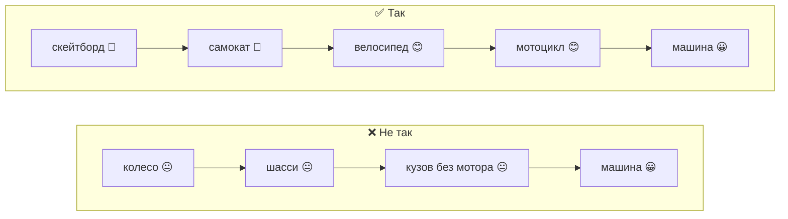
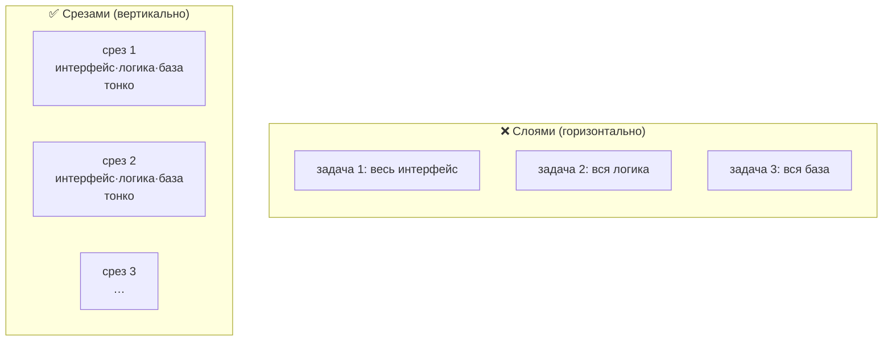

# ✂️ Нарезка задач: вертикальные срезы (Humanizing Work) и скейтборд (Книберг)

> **Дата:** 30.10.2026 · **К занятию:** `0.AIN.05` «Скоуп и декомпозиция задач» ([[Фаза 0/Недели/Неделя 02 (26.10–01.11)/Сессия 7 — 0.AIN.05|Сессия 7]]) · **Время:** 📌 ~13 мин + 🔍 ~10 мин
> **Источники** (сверены с оригиналами 30.10.2026):
> - Richard Lawrence, Peter Green — [The Humanizing Work Guide to Splitting User Stories](https://www.humanizingwork.com/the-humanizing-work-guide-to-splitting-user-stories/) (Humanizing Work; дата обновления на странице не указана);
> - Henrik Kniberg — [Making sense of MVP](https://blog.crisp.se/2016/01/25/henrikkniberg/making-sense-of-mvp) (блог Crisp, 25.01.2016).

> [!warning] Задания Сессии 7 — твои
> Примеры здесь нарочно из других областей: 1С, бэкапы, бытовое. Агент мониторинга из заданий 2–3 не разбирается. Чем платишь за нарезку срезами — тоже нет: это вопрос задания 3, обсудим после его сдачи.

## Оглавление

| Раздел | Слой | ≈ Время |
|---|---|---|
| [[#1. Зачем две статьи вместе]] | 📌 обязательно | 1 мин |
| [[#2. Книберг — колесо против скейтборда]] | 📌 обязательно | 5 мин |
| [[#3. Humanizing Work — как резать]] | 📌 обязательно | 7 мин |
| [[#4. Спайк — последнее средство]] | 🔍 по желанию | 2 мин |
| [[#5. Как это ложится на работу с агентом]] | 🔍 по желанию | 3 мин |
| [[#6. Девять приёмов на чужих примерах]] | 🔍 по желанию | 4 мин |
| [[#7. Проверь себя]] | 🔍 по желанию | 2 мин |

---

## 1. Зачем две статьи вместе

Обе статьи про одно — **как делить большое так, чтобы каждый кусок работал сам по себе**, — но с разных концов:

- **Книберг** отвечает на «**зачем**»: вещь, которой можно пользоваться рано, учит тебя тому, чего на бумаге не видно;
- **Humanizing Work** отвечает на «**как**»: девять приёмов разрезать задачу и два правила, как выбрать удачное разбиение.

Для тебя это не про продуктовый менеджмент. Агент берёт задачу за один заход, а ты принимаешь её за одно ревью. От того, как нарезано, зависит, сможешь ли ты вообще проверить, что он сделал.

---

## 2. Книберг — колесо против скейтборда

### Картинка, которую все копируют

В верхнем ряду команда честно делает машину по частям. Но колесом нельзя ездить, и заказчик до последнего шага получает ноль пользы и ноль поводов что-то поправить. Книберг называет это «испорченным agile»: итерации есть, а обратной связи нет.

В нижнем ряду каждый шаг — **законченная вещь, решающая ту же задачу**: добраться из A в B. Скейтборд — не «недоделанная машина», а первое, чем уже можно ехать. Хуже машины, но ехать можно, и на нём заказчик первый раз скажет «а мне вообще-то надо в дождь».

> [!tip] Главная мысль
> Режь не продукт, а **потребность**. Заказали «машину», а потребность — «добраться из A в B». Скейтборд, самокат и велосипед решают её же, только хуже. Колесо не решает её вообще.

### Машина может и не понадобиться

Книберг прямо пишет: в конце может оказаться велосипед или кабриолет, а не та машина, которую заказывали. Иногда заказчик останавливается на самокате, потому что ему хватило. При нарезке «колесо → шасси → кузов» узнать это можно только после того, как всё построено.

Аналогия из 1С. Заказали «полную интеграцию с банком». Сделали первым шагом загрузку выписки из одного банка в одну организацию — и выяснилось, что бухгалтеру 80% боли снимает уже это, а «автоматическое разнесение по договорам» ему не нужно: он не доверяет автомату и всё равно перепроверяет.

### Какие слова вместо MVP

Термин MVP Книберг считает испорченным: каждый понимает «viable» по-своему, а на деле часто выходит «минимально выпускаемый хлам». Он предлагает три ступени:

| Ступень | Что это | Цель |
|---|---|---|
| **Earliest Testable Product** | первое, с чем человек может что-то сделать | получить обратную связь |
| **Earliest Usable Product** | первое, чем пользуются по своей воле | проверить, что польза есть |
| **Earliest Lovable Product** | то, что полюбят и за что заплатят | продукт |

Обрати внимание: «**Earliest**» вместо «Minimum». Важно не «как можно меньше», а «как можно раньше в руки».

### Примеры из статьи

- **Spotify, 2006:** первый прототип проверял один вопрос — можно ли играть музыку мгновенно, без ожидания. Тестировали на друзьях и семье.
- **Minecraft:** первую публичную версию сделали за шесть дней, потом выпускали версии десятками, и игроки помогали её править.
- **Полиция Швеции:** систему для ноутбуков в патрульных машинах сначала проверили в одном регионе на узком наборе дел, потом расширяли — получилось. Следующую систему делали «большим взрывом», сразу целиком, — провал с ущербом, который оценивают примерно в миллиард евро.
- **Lego:** концепты проверяли на детях бумажными прототипами. Противоположный пример — онлайн-игра Lego Universe: несколько лет большой командой делали сразу «идеально», а через два года после запуска закрыли.

### Оговорки самого Книберга

- Машина — метафора, а не инструкция по постройке машин. Для железа итерации длиннее, чем для софта.
- «Скейтборд» **не значит «плохого качества»**. Он маленький, но должен работать надёжно.
- Ранние версии нужны прежде всего чтобы учиться, а не чтобы радовать заказчика. Заказчику это лучше сказать заранее.

---

## 3. Humanizing Work — как резать

Авторы — Richard Lawrence и Peter Green. Они учат резать задачи с 2005 года, и гайд собирает их опыт в одном месте. Говорят они об «историях» (user stories): **изменение поведения системы, видимое пользователю** — кто, что и зачем.

### Срезы против слоёв

Задача «по одному слою» — это колесо Книберга: по отдельности она **не даёт видимой пользы**, пока не сойдутся остальные слои, и **не независима** — её нельзя выкинуть или переставить без последствий. Вертикальный срез проходит все слои тонко и даёт результат, который видно снаружи. По словам авторов, это даёт ясность, ранний отклик, предсказуемость и меньше лишнего.

Аналогия из инфраструктуры: «перевести офис на новый принтер-сервер». Слоями: сначала все драйверы, потом все очереди, потом все политики GPO. Срезом: один принтер в одном кабинете печатает с одного ПК через новый сервер — весь путь целиком. Дальше — ещё кабинет, ещё модель.

### INVEST — проверка, что задача годится

Перед тем как резать, авторы проверяют задачу по шести буквам:

| Буква | Что значит | По-нашему |
|---|---|---|
| **I** — Independent | независимая | можно сделать, отложить или выкинуть, не ломая другие |
| **N** — Negotiable | обсуждаемая | это не контракт, детали договариваются |
| **V** — Valuable | ценная | после неё что-то видно снаружи |
| **E** — Estimable | оцениваемая | понятно, сколько это примерно |
| **S** — Small | маленькая | влезает в итерацию; авторы — 6–10 таких на итерацию |
| **T** — Testable | проверяемая | есть проверка «готово» |

Чаще всего проваливается **V**. «Задача» без видимой пользы — это обычно кусок слоя или компонент. Авторы советуют не делать её отдельной, а склеить с соседними частями в срез.

### Мета-приём

Почти все девять приёмов (разбор — в разделе 6) — частные случаи одного:
1. найди **главную сложность** задачи;
2. посмотри, какие у неё **варианты**;
3. сведи их к **одному** и сделай полный срез через эту сложность. Остальные варианты — следующими задачами.

Пример из 1С: «загрузка выписок из трёх банков». Главная сложность — форматы банков. Вариантов три. Сводим к одному: первый срез — один банк, но **весь путь**: файл → разбор → документ в базе → видно в журнале. Второй и третий банк — дешёвые добавки к уже работающему.

### Как выбрать хорошее разбиение — два правила

1. **Выбирай разбиение, после которого часть задач можно отложить или выкинуть.** Обычно небольшая часть функций даёт большую часть пользы (правило 80/20). Если одно разбиение показывает «вот это малоценно — можно не делать», а другое нет, второе прячет лишнюю работу.
2. **Выбирай разбиение на куски примерно равного размера.** Восемь условных единиц лучше резать на четыре по два, чем на пять и три: равные куски проще упорядочить.

---

## 4. Спайк — последнее средство

🔍 *По желанию.*

Девятый приём — «вынести спайк», то есть короткое исследование. Авторы ставят его **последним** и советуют сначала попробовать остальные восемь. Логика: обычно знаешь достаточно, чтобы построить хоть что-то, а построенное учит больше, чем исследование на бумаге.

Спайк оправдан, когда **нельзя начать строить, не ответив на вопрос**. Его признаки по гайду: ограничен по времени, а вместо критериев приёмки — **вопросы, на которые нужно ответить**. Сравни с таблицей типов задач в Сессии 7 — там спайк описан так же.

---

## 5. Как это ложится на работу с агентом

🔍 *По желанию.*

| Идея из статей | В работе с агентом |
|---|---|
| Срез даёт видимый результат | Задача агенту — срез: есть **одна проверка «готово»**, которую ты сделаешь руками |
| Колесо не проверить | Агент сделал «весь слой» — ты не можешь проверить, что он стыкуется. Ревью превращается в веру |
| Можно выкинуть часть | После каждого среза можно остановиться. Агентный проект, где всё имеет смысл только целиком, — «большой взрыв» шведской полиции в миниатюре |
| Равные куски | Diff каждой задачи читается за 10–15 минут — эвристика из материалов Сессии 7 |
| Мета-приём | Сначала сложное, но один вариант: один формат, один источник, один пользователь |

> [!danger] 🗡 Как это ломают: «безопасность — потом»
> Восьмой приём — «производительность потом»: сначала сделай, чтобы работало, потом ускоряй. Авторы распространяют его и на безопасность и сами предупреждают, что так копится долг.
> Для агентных систем это опасная лазейка. Права агента — не «ускорение», которое прикручивают в конце. Если первый срез даёт агенту запись, а «ограничим потом», то всё, что агент прочитает до этого «потом», — заметка, письмо, страница — может стать командой (prompt injection). Поэтому ограничения прав входят уже в первый срез. Ровно так ты и сделал на неделе 1: сервер «только чтение» с первого дня, а не «пока пишем, потом закроем».

> [!example]- 🟨 Мостик к интересу `PAI`
> На производстве срез — это «один датчик → ПЛК → экран SCADA», а не «сначала разведём все датчики цеха». Так обычно и запускают пилот на одной линии.

---

## 6. Девять приёмов на чужих примерах

🔍 *По желанию.* Примеры — Тьютора, не из гайда; в гайде свои, про новости и авиабилеты.

| # | Приём | Суть | Пример Тьютора |
|---|---|---|---|
| 1 | Шаги процесса | сначала простой путь насквозь, промежуточные шаги потом | счёт в 1С: сразу в оплату → + согласование руководителя → + казначейство |
| 2 | Операции | «управлять» = создать / прочитать / изменить / удалить | скрипт для AD: создать учётку → заблокировать → удалить |
| 3 | Варианты бизнес-правил | одно правило за раз | скидки: фиксированная → по объёму → по карте клиента |
| 4 | Варианты данных | один вид данных, потом остальные | импорт заметок: только `.md` → + картинки → + PDF |
| 5 | Способы ввода | простой ввод, потом удобный | дата строкой → календарик |
| 6 | Основное усилие | первый вариант дорогой, остальные дёшевы — режь на «первый» и «остальные» | три LLM-провайдера: один со слоем абстракции → остальные (к `1.AGT.17`) |
| 7 | Простой / сложный | простейшая версия, усложнения — отдельно | бэкап: полный одной папки → + инкремент → + шифрование → + ротация |
| 8 | Отложить производительность | сначала работает, потом быстро | отчёт строится минуту → потом за 5 секунд (про безопасность — см. 🗡 выше) |
| 9 | Вынести спайк | короткое исследование с вопросами | см. раздел 4 |

---

## 7. Проверь себя

🔍 *По желанию, не оценивается.* Какой это приём из девяти?

1. «Сначала платежи только картами "Мир", остальные системы — потом».
2. «Сначала заявку в техподдержку можно только создать, закрывать и переоткрывать — следующими задачами».
3. «Сначала поиск работает за 20 секунд, ускорим потом».
4. «Сначала заказ сразу уходит на склад, проверку менеджером добавим следующей задачей».

> [!success]- Ответы — раскрыть
> 1 — основное усилие (6) · 2 — операции (2) · 3 — отложить производительность (8) · 4 — шаги процесса (1).
