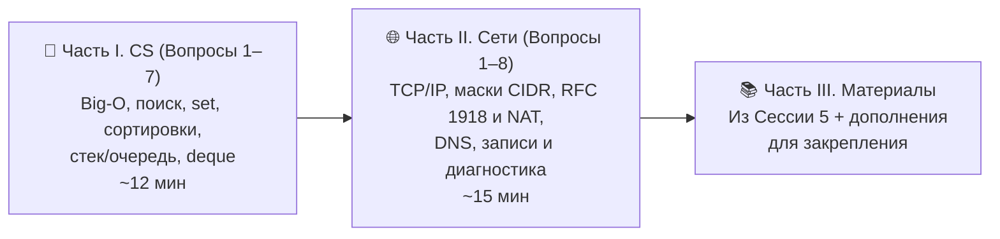
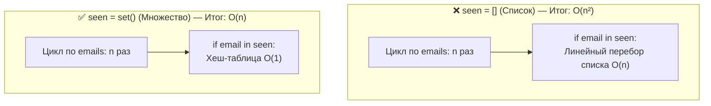
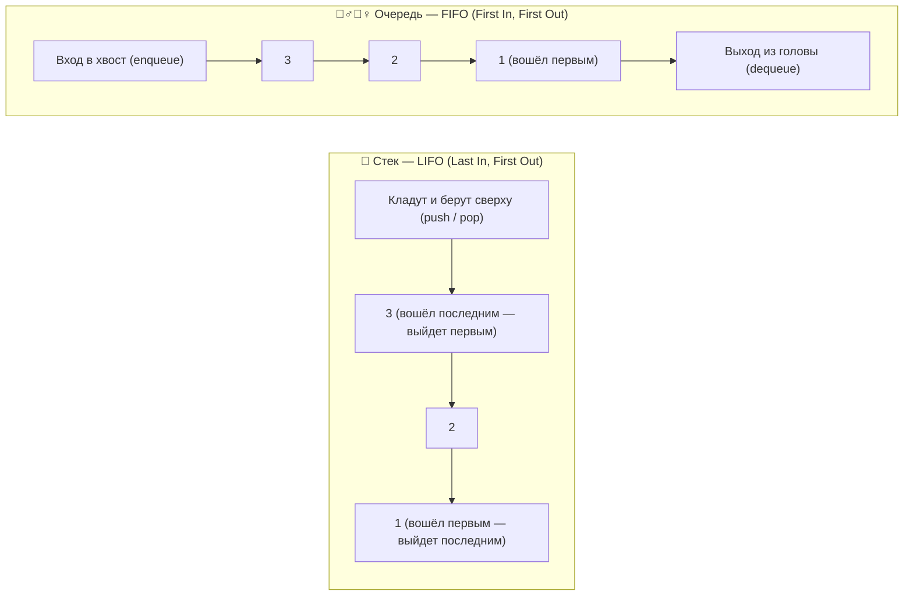
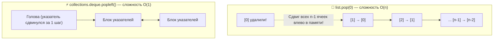
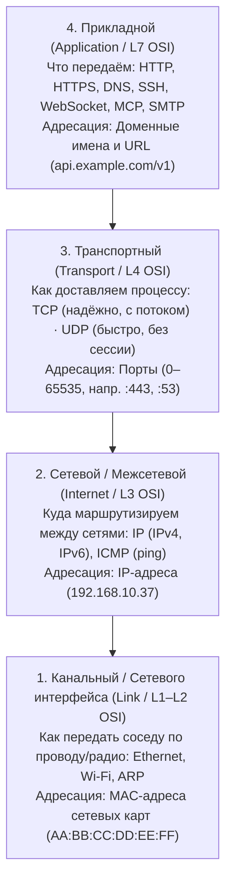
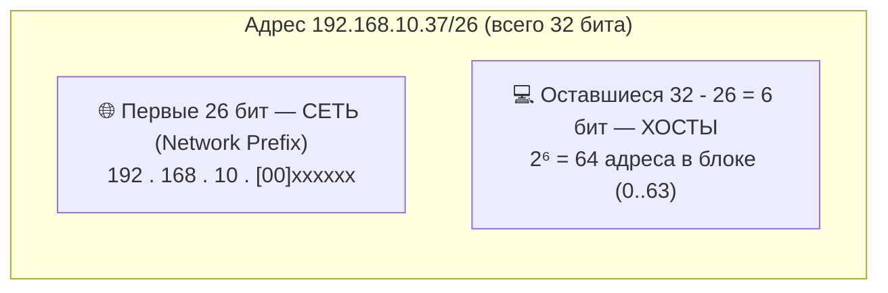
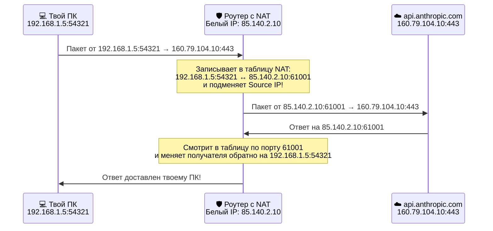
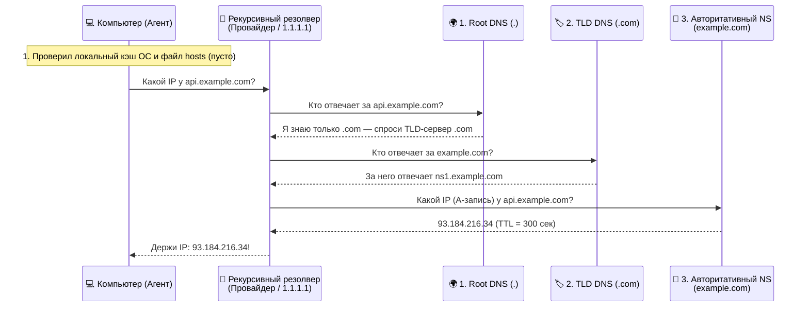
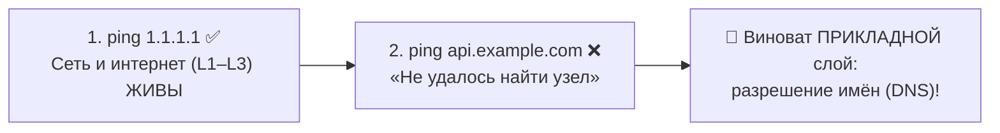

# 🧠 Разбор и повтор `0.CS.01` и `0.NET.01`: Алгоритмы, структуры данных и устройство сетей

> **Дата:** 27.10.2026 · **К занятиям:** `0.CS.01`, `0.NET.01` (с мостиками к `0.CS.05`, `0.NET.02–05`, `0.SEC.01`) · **Время на чтение:** ~25–30 мин

> [!abstract] Зачем этот материал
> Вход-тесты позади, но сухая оценка «сдал / не сдал» не даёт главного — целостной картины в голове. Этот конспект устроен так, как ты попросил: **по каждому из 15 вопросов обоих вход-тестов** (даже тем, где ответ был верным) сначала даётся **общая экспозиция темы** (как механизм работает внутри и зачем он инженеру агентных систем), а затем — **наглядный разбор самого вопроса** со схемами, быстрыми приёмами счёта в уме и подводными камнями. Сюда же перенесены и дополнены все материалы для разбора из Сессии 5.

> [!example] 🎮 Интерактивное демо — «CIDR-калькулятор битов, O(n) vs O(n²) и путь пакета»
> ▶ **[[Материалы/Демо/0.CS.01, 0.NET.01 — Сложность алгоритмов, CIDR-калькулятор и трассировка DNS.html|Открыть интерактивное демо]]** · Копия в хранилище: `Материалы/Демо/0.CS.01, 0.NET.01 — Сложность алгоритмов, CIDR-калькулятор и трассировка DNS.html` · ~5–7 мин
> Что покрутить:
> 1. **Вкладка «CIDR и Маски подсетей»:** двигай ползунок маски от `/16` до `/30` на примерах из теста (`192.168.10.37/26` и `10.0.5.9` в `/22`) — смотри, как режутся 32 бита IP-адреса, откуда берётся «шаг блока» и почему 2 адреса всегда резервируются.
> 2. **Вкладка «Структуры данных в памяти»:** сравни сдвиг элементов в `list.pop(0)` против кольцевого/двусвязного буфера `collections.deque.popleft()`, и линейный перебор `in list` против хеш-таблицы `in set`.
> 3. **Вкладка «DNS и слои TCP/IP»:** прогони пошагово резолв `api.example.com` и симулятор поломки (`ping 1.1.1.1` vs `ping api.example.com`).



---

# 📐 Часть I. Алгоритмы и структуры данных (`0.CS.01` — Вопросы 1–7)

## Вопрос 1. Оценка сложности по времени (Big-O) по коду

### Общая экспозиция: что на самом деле показывает Big-O
Нотация $O(f(n))$ описывает **не секунды и не миллисекунды**, а то, **как масштабируется число элементарных операций** при росте размера входа $n \to \infty$. Константы отбрасываются ($O(2n + 5) = O(n)$), потому что при росте входа в 1000 раз именно степень $n$ определяет, выживет ли сервер или зависнет.

Для ревью кода от агента действует простое визуальное правило:
- **Обращение по индексу массива или ключу хеш-таблицы** (`items[0]`, `d[key]`, `x in my_set`) — **$O(1)$**: адрес в памяти вычисляется одной формулой, размер коллекции не важен.
- **Один цикл по $n$ элементам** (или два последовательных не вложенных цикла) — **$O(n)$**: каждый элемент трогаем фиксированное число раз.
- **Цикл внутри цикла по тем же $n$ элементам** (или скрытый цикл внутри цикла, например `if x in my_list:` внутри `for`) — **$O(n^2)$**: число пар растёт как квадрат.

### Разбор вопроса №1 из теста
```python
# а) Один проход по списку -> O(n)
total = 0
for x in items:
    total += x

# б) На каждый из n элементов внешнего цикла делаем n шагов внутреннего -> n * n = O(n²)
for x in items:
    for y in items:
        if x + y == 10:
            print(x, y)

# в) Прямое чтение первой ячейки по смещению в памяти -> O(1)
result = items[0]
```
> [!check] Твой ответ в тесте
> Отвечено на 100% верно: **а) $O(n)$**, **б) $O(n^2)$**, **в) $O(1)$** с точным объяснением причины.

---

## Вопрос 2. Линейный vs Бинарный поиск

### Общая экспозиция: почему деление пополам даёт логарифм
- **Линейный поиск ($O(n)$):** работает на **любых** данных (даже неотсортированных). В худшем случае (элемент в самом конце или его нет) придётся заглянуть в каждую из $n$ ячеек.
- **Бинарный поиск ($O(\log_2 n)$):** работает **только на отсортированных данных** с быстрым доступом по индексу ($O(1)$, то есть массив/`list`, а не связный список). На каждом шаге мы смотрим в середину оставшегося отрезка и **отбрасываем ровно половину**.

Откуда берётся число шагов $\log_2 n$? Это степень двойки: «сколько раз нужно поделить $n$ пополам, чтобы остался 1 элемент».
Полезная константа для счёта в уме:
$$2^{10} = 1\,024 \approx 10^3 \quad \Longrightarrow \quad \text{каждые } \times 1000 \text{ к размеру данных добавляют всего } +10 \text{ шагов бинарного поиска!}$$

| Размер списка $n$ | Худший случай линейного поиска ($n$) | Худший случай бинарного поиска ($\lceil\log_2 n\rceil$) |
|---|---|---|
| $1\,000$ ($10^3$) | $1\,000$ шагов | $\approx 10$ шагов ($2^{10} = 1024$) |
| $1\,000\,000$ ($10^6$) | $1\,000\,000$ шагов | $\approx 20$ шагов ($2^{20} \approx 1{,}05 \times 10^6$) |
| $1\,000\,000\,000$ ($10^9$) | $1\,000\,000\,000$ шагов | $\approx 30$ шагов ($2^{30} \approx 1{,}07 \times 10^9$) |

### Разбор вопроса №2 из теста
- **Обязательное условие:** список должен быть **отсортирован**.
- **Число шагов для $1\,000\,000$ элементов:** линейному — **$1\,000\,000$**, бинарному — **$\approx 20$ шагов**.

> [!check] Твой ответ в тесте
> Отвечено полностью верно: отсортированный список, 20 шагов и 1 000 000 шагов.

---

## Вопрос 3. Скрытый $O(n^2)$ при поиске дублей и замена `list` на `set`

### Общая экспозиция: самая частая ошибка LLM-агентов в коде
Когда агент пишет код без вложенных `for`, кажется, что алгоритм линейный. Но оператор `in` устроен по-разному для разных структур данных:
- **`x in my_list` — это скрытый цикл $O(n)$:** Python идёт от `my_list[0]` до конца и сравнивает каждый элемент.
- **`x in my_set` или `x in my_dict` — это хеш-таблица $O(1)$ в среднем:** Python вычисляет `hash(x)`, сразу прыгает в нужную корзину памяти и проверяет наличие за 1 операцию.



### Разбор вопроса №3 из теста
В коде агента:
1. Внешний цикл `for email in emails:` крутится $n$ раз.
2. Внутри него `if email in seen:` по списку `seen = []` делает в среднем $n/2$ сравнений $\Rightarrow \sum_{i=1}^{n} i = \frac{n(n-1)}{2} = \mathbf{O(n^2)}$. На 100 000 email-адресов это $\approx 5$ миллиардов операций (скрипт «зависнет»).
3. **Замена:** меняем `seen = []` на `seen = set()` (и `seen.append(email)` на `seen.add(email)`). Проверка `email in seen` становится $O(1)$, а вся функция ускоряется до **$O(n)$**.

> [!check] Твой ответ в тесте
> Отвечено отлично: точно указал скрытый последовательный проход `if email in seen` внутри цикла, замену на `set` (и его методы) и итоговую сложность $O(n)$.

---

## Вопрос 4. Алгоритмы сортировки и что внутри `sorted()` в Python

### Общая экспозиция: почему $O(n \log n)$ — предел для сортировок сравнением
- **Простые (квадратичные) сортировки — $O(n^2)$:**
  - **Сортировка пузырьком (*Bubble Sort*):** попарно сравниваем соседние элементы и меняем их местами, «всплывая» максимумом в конец.
  - **Сортировка выбором (*Selection Sort*)** и **вставками (*Insertion Sort*)**: хороши только на крошечных массивах (до 16–32 элементов) из-за простоты и кеш-локальности процессора.
- **Быстрые сортировки «разделяй и властвуй» — $O(n \log n)$:**
  - **Сортировка слиянием (*Merge Sort*):** делим массив пополам до единичных элементов ($\log_2 n$ уровней) и сливаем отсортированные половинки за $O(n)$ на каждом уровне $\Rightarrow$ гарантированные $O(n \log n)$ всегда, но требует $O(n)$ дополнительной памяти.
  - **Быстрая сортировка (*QuickSort*):** выбираем опорный элемент (*pivot*), перекидываем меньшие влево, бо́льшие вправо. В среднем $O(n \log n)$ на месте.
- **Что внутри Python `sorted()` и `.sort()` — алгоритм *Timsort*:**
  Это гибрид **Merge Sort + Insertion Sort** (придумал Тим Петерс для Python в 2002 году). Он ищет в реальных данных уже отсортированные куски (*runs*), доводит мелкие куски вставками и сливает их как Merge Sort.
  - Худшее и среднее время: **$O(n \log n)$**.
  - Лучшее время (на уже отсортированном или почти отсортированном списке): **$O(n)$**!

### Разбор вопроса №4 из теста
- Примеры $O(n^2)$: **Bubble Sort** (сортировка пузырьком — *обрати внимание на слово: именно Bubble **Sort**, а не Bubble Search!*), Selection Sort, Insertion Sort.
- Примеры $O(n \log n)$: **Merge Sort** (слиянием), QuickSort, HeapSort.
- Сложность встроенной `sorted()` в Python: **$O(n \log n)$** (алгоритм Timsort).

> [!check] Твой ответ в тесте
> Верно назвал сортировку слиянием и $O(n \log n)$ для `sorted()`; маленькая оговорка в термине — написал `bubble search` вместо `bubble sort` (пузырьком сортируют, а не ищут).

---

## Вопрос 5. Стек (LIFO) vs Очередь (FIFO) в реальных системах

### Общая экспозиция: порядок обслуживания задач


- **Стек (LIFO — Last In, First Out / FILO — First In, Last Out):** тарелки в стопке или магазин автомата. Последний положенный элемент забирается первым.
  - *Где в реальных системах:* **стек вызовов функций (Call Stack)** и рекурсия в процессоре/Python; история `Undo` (Ctrl+Z) в редакторах; кнопка «Назад» в браузере; обход графа/дерева в глубину (DFS).
- **Очередь (FIFO — First In, First Out):** живая очередь на кассе. Кто первым встал — тот первым обслуживается.
  - *Где в реальных системах:* **очередь сообщений к агенту** (Telegram-апдейты, задачи в RabbitMQ / Redis / Kafka); буфер пакетов на сетевой карте; пул задач воркерам (Celery); обход графа в ширину (BFS).

### Разбор вопроса №5 из теста
> [!check] Твой ответ в тесте
> Всё по делу: стек — первый уходит последним (LIFO/FILO), пример — рекурсия; очередь — последний уходит последним (первый — первым, FIFO), пример — очередь сообщений агенту.

---

## Вопрос 6. Почему `list.pop(0)` медленный ($O(n)$), а `list.pop()` быстрый ($O(1)$), и что взять для очереди в Python

### Общая экспозиция: как устроен `list` в памяти Python и зачем нужен `collections.deque`
В Python стандартный список `list` — это **не связный список**, а **динамический массив указателей** (непрерывный кусок памяти в RAM, где подряд лежат 8-байтные адреса объектов).



1. **`items.pop()` (с конца) — $O(1)$:** Python просто уменьшает счётчик длины массива на 1 и возвращает последний элемент. Никакие другие ячейки в памяти не двигаются.
2. **`items.pop(0)` (с начала) — $O(n)$:** чтобы индекс `0` снова указывал на первый элемент непрерывного массива, процессору приходится **физически скопировать все оставшиеся $n-1$ указателей на одну ячейку влево**. Если в очереди 1 миллион задач и ты забираешь их в цикле через `pop(0)`, программа выполнит $\approx 500$ миллиардов сдвигов памяти ($O(n^2)$ суммарно)!
3. **Что взять в Python без сторонних библиотек:**
   В **стандартной библиотеке Python** (ставится вместе с Python, никаких `pip install` не нужно!) есть модуль `collections` и в нём двусторонняя очередь **`collections.deque`** (*double-ended queue*):
   ```python
   from collections import deque

   queue = deque(["задача_1", "задача_2"])
   queue.append("задача_3")     # добавить в хвост — O(1)
   first = queue.popleft()      # забрать из головы без сдвига памяти! — O(1)
   ```
   Внутри `deque` устроен как двусвязный список блоков памяти: удаление и с начала (`popleft()`), и с конца (`pop()`) работает за честные **$O(1)$**. *(А для многопоточности и асинхронных агентов в стандартной библиотеке есть `queue.Queue` и `asyncio.Queue`, которые внутри тоже опираются на `deque`.)*

### Разбор вопроса №6 из теста
> [!check] Твой ответ в тесте и что добрать
> Механизм памяти объяснил **идеально**: при `pop(0)` весь массив приходится сдвигать обратно в памяти, а при `pop()` с конца ничего не двигается.
> А вот вторую часть вопроса («что взять вместо списка») теперь забирай в арсенал: **`from collections import deque`** (и его метод **`.popleft()`**) — это встроенная стандартная библиотека Python, не сторонняя!

---

## Вопрос 7. Как растут $O(n)$ и $O(\log n)$ при увеличении входа в 1000 раз

### Общая экспозиция: умножение входа превращается в сложение у логарифма
Главное свойство логарифма из алгебры: **логарифм произведения равен сумме логарифмов**:
$$\log_2(1000 \cdot n) = \log_2(n) + \log_2(1000) \approx \log_2(n) + 10$$

Обрати внимание на тонкость формулировки:
- Для **$O(n)$**: если $n$ выросло **в 1000 раз**, время тоже вырастет **в 1000 раз** ($1000 \cdot n$).
- Для **$O(\log_2 n)$**: если $n$ выросло **в 1000 раз**, число шагов вырастет **НЕ в 10 раз, а НА +10 шагов**!
  Например:
  - Если было $n = 1\,000$ ($\approx 10$ шагов), а стало $n = 1\,000\,000$ ($\approx 20$ шагов) — время выросло всего **в 2 раза** ($20 / 10 = 2$).
  - Если было $n = 1\,000\,000$ ($\approx 20$ шагов), а стало $n = 1\,000\,000\,000$ ($\approx 30$ шагов) — время выросло всего **в 1,5 раза** ($30 / 20 = 1{,}5$).

### Разбор вопроса №7 из теста
> [!check] Твой ответ в тесте и важный нюанс
> Ты верно ответил, что $O(n)$ растёт быстрее и увеличивается в 1000 раз, и верно вспомнил число $10$ ($\log_2 1000 \approx 10$). Главное — держать в голове, что эти $10$ шагов **прибавляются** ($+10$ шагов к прежнему числу), поэтому во сколько раз вырастет время, зависит от стартового $n$ (обычно в $1{,}5\text{–}2$ раза).

---

# 🌐 Часть II. Компьютерные сети (`0.NET.01` — Вопросы 1–8)

## Вопрос 1. Слои модели TCP/IP и инкапсуляция

### Общая экспозиция: зачем сети делят на 4 слоя и как работает «матрёшка»
Чтобы приложение (твой агент) не думало о том, идёт ли сигнал по Wi-Fi, оптике или витой паре, сеть разделена на 4 слоя модели **TCP/IP**. Каждый верхний слой кладёт свои данные внутрь пакета нижнего слоя (это называется **инкапсуляцией**):



| Протокол из теста | Слой TCP/IP | Что именно делает и почему он на этом слое |
|---|---|---|
| **Ethernet** | **1. Канальный (Link)** | Передаёт кадры (*frames*) по кабелю между соседними портами коммутатора по MAC-адресам |
| **ARP** *(Address Resolution Protocol)* | **1. Канальный (на стыке с Сетевым)** | Спрашивает в локальной сети: «У кого IP `192.168.1.1`? Скажите свой MAC-адрес!», чтобы упаковать Ethernet-кадр |
| **IP** *(Internet Protocol)* | **2. Сетевой (Internet)** | Навешивает IP-адреса отправителя и получателя и ведёт пакет через маршрутизаторы (роутеры) по всему миру |
| **TCP** и **UDP** | **3. Транспортный (Transport)** | Добавляют номера портов, чтобы ОС поняла, какой именно программе (браузеру, агенту, SSH) отдать пакет |
| **HTTP** | **4. Прикладной (Application)** | Формат запросов и ответов (`GET / POST`, заголовки, JSON) для веб-приложений и API моделей |
| **DNS** *(Domain Name System)* | **4. Прикладной (Application)** | Прикладная служба-справочник (работает поверх **UDP/53** или **TCP/53**), переводящая имена в IP-адреса |

### Разбор вопроса №1 из теста
> [!warning] Единственная ловушка в твоём ответе №1 — где живёт DNS
> В тесте ты отнёс **DNS** к **Сетевому** уровню вместе с IP. Интуитивно понятно почему («он же про IP-адреса!»), но архитектурно **DNS — это чистый Прикладной уровень**: обычный клиент-серверный протокол, который формирует запрос на порту `53` и отправляет его внутри **UDP** (транспортный слой) и **IP** (сетевой слой). Всё остальное (Ethernet, ARP, IP, TCP, UDP, HTTP) ты разложил безупречно!

---

## Вопросы 2 и 3. Маски подсетей (CIDR): как считать `/26` и `/22` в уме за 15 секунд

### Общая экспозиция: что такое IPv4-адрес и запись `/N`
Любой IPv4-адрес (например, `192.168.10.37`) — это просто **одно 32-битное число**, разбитое для удобства чтения на **4 байта (октета) по 8 бит**, разделённых точками:
$$\underbrace{192}_{8\text{ бит}}.\underbrace{168}_{8\text{ бит}}.\underbrace{10}_{8\text{ бит}}.\underbrace{37}_{8\text{ бит}} \quad (\text{всего } 4 \times 8 = 32\text{ бита, в каждом октете числа от } 0 \text{ до } 255)$$

Запись **`/N` (CIDR-маска)** говорит ровно одну вещь: **«Первые $N$ бит слева — это номер сети (неприкосновенны), а оставшиеся $(32 - N)$ бит справа — это номера компьютеров (хостов) внутри этой сети»**.



> [!tip] Алгоритм «Шага блока» — как считать любую подсеть в уме без перевода в двоичный код
> 1. **Сколько бит осталось хостам?** Вычитаем маску из 32: $H = 32 - N$.
> 2. **Сколько всего адресов в одной такой подсети (шаг блока)?** Возводим двойку в степень $H$: $\text{Размер блока} = 2^H$.
> 3. **Сколько адресов можно раздать хостам?** Всегда вычитаем **2 служебных адреса** из размера блока:
>    - **Самый первый адрес блока** (все биты хоста $= 0$) — это **Адрес самой сети (Network ID)**.
>    - **Самый последний адрес блока** (все биты хоста $= 1$) — это **Широковещательный адрес (Broadcast)** — крик «всем в этой подсети».
>    - Значит, хостам достаётся ровно **$2^H - 2$** адресов!

### Разбор вопроса №2: адрес `192.168.10.37/26`
Считаем по 3 шагам:
1. **Биты хостов:** $32 - 26 = \mathbf{6\text{ бит}}$ (маска больше `/24`, значит режем последний, 4-й октет).
2. **Размер (шаг) блока:** $2^6 = \mathbf{64}$ адреса.
   Нарежем 4-й октет (от 0 до 255) кусками по 64:
   - Блок 1: **`0 .. 63`** $\leftarrow$ число `37` лежит здесь!
   - Блок 2: `64 .. 127`
   - Блок 3: `128 .. 191`
   - Блок 4: `192 .. 255`
3. **Ответ для блока `0 .. 63`:**
   - **Адрес сети (первый):** **`192.168.10.0`** (ты угадал его интуитивно!)
   - **Широковещательный адрес (последний в блоке 0..63):** **`192.168.10.63`**
   - **Сколько адресов можно раздать хостам:** $64 - 2 = \mathbf{62\text{ адреса}}$ (от `192.168.10.1` до `192.168.10.62`).

### Разбор вопроса №3: входит ли `10.0.5.9` в сеть `10.0.0.0/22`?
Маска `/22` меньше, чем `/24` (где менялся бы только последний октет), на **$24 - 22 = 2\text{ бита}$**.
1. Сколько подсетей `/24` склеено в одну сеть `/22`? $2^2 = \mathbf{4\text{ подсети}}$ по 256 адресов (третий октет идёт шагами по **4**: `0..3`, `4..7`, `8..11`...).
   Либо через общее число бит хоста: $32 - 22 = 10\text{ бит} \Rightarrow 2^{10} = 1024$ адреса ($4 \times 256$).
2. Значит, сеть `10.0.0.0/22` охватывает диапазон от **`10.0.0.0` до `10.0.3.255`** (третий октет может быть только `0`, `1`, `2` или `3`).
3. А у адреса `10.0.5.9` в третьем октете стоит **`5`**! Он попадает уже в следующую подсеть `10.0.4.0/22` (диапазон `10.0.4.0 – 10.0.7.255`).
   **Итог:** **Нет, не входит.**

### Шпаргалка по маскам, которые встречаются в работе 99% времени

| CIDR      | Десятичная маска  | Бит на хосты ($32-N$) | Всего адресов ($2^H$) | Хостов ($2^H - 2$)          | Где встречается                                           |
| --------- | ----------------- | --------------------- | --------------------- | --------------------------- | --------------------------------------------------------- |
| **`/32`** | `255.255.255.255` | $0$ бит               | $1$                   | $1$ (конкретный IP)         | Правила файрвола и маршруты на 1 узел (например, в VPN)   |
| **`/30`** | `255.255.255.252` | $2$ бита              | $4$                   | $2$ хоста                   | Точка-точка (туннель между двумя роутерами/VPS)           |
| **`/26`** | `255.255.255.192` | $6$ бит               | $64$                  | $62$ хоста                  | Небольшой сегмент офиса или VLAN                          |
| **`/24`** | `255.255.255.0`   | $8$ бит               | $256$                 | $254$ хоста                 | Стандартная домашняя/офисная подсеть (`192.168.1.0/24`)   |
| **`/22`** | `255.255.252.0`   | $10$ бит              | $1\,024$              | $1\,022$ хоста              | 4 склеенные `/24` (третий октет от `.0` до `.3`)          |
| **`/16`** | `255.255.0.0`     | $16$ бит              | $65\,536$             | $65\,534$ хоста             | Два последних октета любые (`172.17.x.x` в Docker bridge) |
| **`/8`**  | `255.0.0.0`       | $24$ бита             | $16{,}7\text{ млн}$   | $\approx 16{,}7\text{ млн}$ | Большая корпоративная или облачная сеть (`10.x.x.x`)      |

---

## Вопрос 4. Три диапазона частных IPv4-адресов (RFC 1918) и зачем нужен NAT

### Общая экспозиция: почему приватные адреса не ходят в интернет напрямую
В IPv4 всего $2^{32} \approx 4{,}29\text{ млрд}$ адресов — на все смартфоны, ноутбуки, контейнеры и роутеры планеты их давно не хватает. Поэтому стандарт **RFC 1918** выделил **три бесплатных «внутренних» диапазона**, которые разрешено использовать внутри любых локальных сетей без регистрации:

| Диапазон RFC 1918                     | Запись с маской (CIDR) | Как легко узнать                                                      | Где ты видишь его каждый день                                                |
| ------------------------------------- | ---------------------- | --------------------------------------------------------------------- | ---------------------------------------------------------------------------- |
| **`10.0.0.0` – `10.255.255.255`**     | **`10.0.0.0/8`**       | Любой адрес, начинающийся на **`10.`**                                | Корпоративные сети, облачные VPC (AWS/Yandex Cloud), WireGuard/OpenVPN       |
| **`172.16.0.0` – `172.31.255.255`**   | **`172.16.0.0/12`**    | Начинается на **`172.`**, а второе число — строго **от `16` до `31`** | **Docker-контейнеры** по умолчанию (`172.17.0.0/16`, `172.18.0.0/16`) и WSL2 |
| **`192.168.0.0` – `192.168.255.255`** | **`192.168.0.0/16`**   | Любой адрес, начинающийся на **`192.168.`**                           | Домашние роутеры (`192.168.0.1`, `192.168.1.1`) и небольшие офисы            |

*(Плюс два специальных диапазона, которые полезно помнить: **`127.0.0.0/8`** — loopback «сам на себя», включая `127.0.0.1`, и **`100.64.0.0/10`** — операторский CGNAT и сети Tailscale).*

### Зачем нужен NAT (Network Address Translation)?
Маршрутизаторы в публичном интернете **отбрасывают пакеты с частными адресами RFC 1918**, потому что в мире миллионы компьютеров с одинаковым адресом `192.168.1.5` — если сервер Anthropic получит пакет от `192.168.1.5`, он просто не будет знать, в чей именно дом на планете отправлять ответ!



**Что делает NAT на роутере:**
1. Когда твой ПК (`192.168.1.5`) шлёт запрос наружу, роутер **подменяет в заголовке пакета частный IP отправителя на свой внешний («белый») публичный IP** и выделяет уникальный порт, записывая соответствие в свою таблицу трансляции.
2. Когда сервер присылает ответ на белый IP роутера, роутер заглядывает в таблицу, видит, какому внутреннему компьютеру предназначался этот порт, и пересылает пакет обратно на `192.168.1.5`.
*(Именно поэтому из интернета нельзя просто так подключиться к устройству за NAT — пока устройство само не открыло соединение или мы не прокинули обратный SSH-туннель, как делали для твоего Redmi 13 через VPS, в таблице NAT просто нет записи!)*

---

## Вопрос 5. Путь DNS-запроса при холодном кэше

### Общая экспозиция: иерархия DNS — почему ни один сервер не хранит все сайты мира
В DNS используется древовидная иерархия, которая читается **справа налево**: `api . example . com .` (на самом конце всегда есть невидимая точка `.` — корень!).
В процессе участвуют два типа серверов:
1. **Рекурсивный резолвер (Recursive Resolver)** — DNS-сервер твоего провайдера, роутера или публичный `1.1.1.1` / `8.8.8.8`. Твой компьютер спрашивает **только его** («найди мне IP»), а всю беготню по дереву делает он.
2. **Иерархия авторитативных серверов**, которые отвечают за свои этажи дерева:
   - **Root DNS (`.` — корневые серверы, 13 логических кластеров `a.root-servers.net` .. `m.root-servers.net`):** знают только, где лежат серверы доменных зон верхнего уровня (`.com`, `.ru`, `.org`).
   - **TLD DNS (Top-Level Domain — серверы зоны `.com`):** знают только, какие NS-серверы отвечают за конкретный домен `example.com`.
   - **Авторитативный NS-сервер домена (`example.com`):** хранит реальную таблицу записей домена и знает точный IP-адрес поддомена `api.example.com`.



### Разбор вопроса №5 из теста
> [!check] Твой ответ в тесте
> Цепочку в вопросе №5 ты выстроил абсолютно верно: локальный (рекурсивный) DNS $\to$ Root DNS $\to$ TLD (`.com`) $\to$ авторитативный сервер `example.com` $\to$ возврат IP для `api`. Единственная деталь на будущее: первой ступенькой до похода в сеть ОС всегда проверяет локальный файл `hosts` (`/etc/hosts` в Linux или `C:\Windows\System32\drivers\etc\hosts` в Windows).

---

## Вопрос 6. Типы DNS-записей (`A`, `AAAA`, `CNAME`, `MX`, `TXT`) и роль TTL

### Общая экспозиция: DNS — это не только IP-адреса, а универсальный паспорт домена
В тесте ты написал, что `A`, `AAAA`, `CNAME`, `MX`, `TXT` — это «различные представления IP-адреса». На самом деле к IP-адресам напрямую относятся только первые две (`A` и `AAAA`), а остальные хранят совсем другие вещи! Вот полная картина:

| Тип записи | Как расшифровывается и что хранит | Пример значения | Зачем нужна на практике |
|---|---|---|---|
| **`A`** *(Address)* | **IPv4-адрес** хоста (32 бита) | `api.example.com → 93.184.216.34` | Основная запись: переводит доменное имя в классический IPv4-адрес сервера |
| **`AAAA`** *(Quad-A)* | **IPv6-адрес** хоста (128 бит — в 4 раза длиннее IPv4, отсюда четыре буквы A!) | `api.example.com → 2606:2800:220:1::248` | Переводит доменное имя в современный 128-битный IPv6-адрес |
| **`CNAME`** *(Canonical Name)* | **Псевдоним (алиас)** одного доменного имени на другое **имя** (НЕ на IP!) | `api.example.com → prod-lb-123.elb.amazonaws.com` | Позволяет направить свой поддомен на чужой облачный балансировщик или CDN (Cloudflare), где IP часто меняются сами |
| **`MX`** *(Mail Exchange)* | **Почтовый сервер** домена + числовой приоритет | `example.com → 10 mail.example.com` | Указывает, куда доставлять письма для `@example.com` (без неё почта на домен не придёт) |
| **`TXT`** *(Text)* | **Произвольная текстовая строка** | `"v=spf1 include:_spf.google.com ~all"` или `"google-site-verification=..."` | Подтверждение владения доменом, выпуск бесплатных TLS-сертификатов Let's Encrypt (DNS-01 challenge) и защита почты от подделки (SPF, DKIM, DMARC) |

### Что такое TTL (Time To Live) и чем он мешает при смене сервера
- **TTL** — это время в секундах (например, `3600` = 1 час или `86400` = сутки), которое авторитативный сервер сообщает всем кэширующим DNS-резолверам и браузерам: *«Столько секунд можете хранить этот ответ у себя в памяти и не переспрашивать меня»*.
- **Чем мешает при срочном переезде:** если у записи стоял `TTL = 86400` (24 часа) и ты экстренно переключил `A`-запись на новый IP, все DNS-серверы провайдеров, которые успели закешировать старый ответ минуту назад, **ещё сутки будут честно отдавать клиентам и агентам старый (мёртвый) IP-адрес**.
  *(Инженерный приём: если планируется переезд сервера во вторник, то в понедельник заранее понижают TTL до `60` или `300` секунд, ждут вымывания старого кэша, и тогда во вторник переключение проходит за 1–5 минут!)*

> [!check] Твой ответ в тесте
> Про **TTL** ты ответил на 10 из 10. А таблицу назначений **`A` / `AAAA` / `CNAME` / `MX` / `TXT`** выше обязательно держи в голове — особенно `CNAME` (алиас на домен балансировщика/CDN) и `TXT` (верификация домена и сертификаты).

---

## Вопрос 7. TCP против UDP и почему DNS ходит по UDP

### Общая экспозиция: цена надёжности — 3-way handshake в TCP
На транспортном уровне у нас два главных протокола с противоположной философией:

```mermaid
sequenceDiagram
    participant C as 💻 Клиент
    participant S as 🖥 Сервер

    rect rgb(40, 60, 90)
    Note over C,S: 🐢 TCP: сначала 3-way handshake (1 лишний RTT), затем данные с подтверждением
    C->>S: 1. SYN (хочу открыть соединение, мой seq=100)
    S->>C: 2. SYN-ACK (согласен, мой seq=500, жду твой 101)
    C->>S: 3. ACK (соединение установлено!)
    C->>S: 4. Данные (HTTP-запрос)
    S->>C: 5. ACK + Ответ (с контролем порядка и повтором потерь)
    end

    rect rgb(40, 80, 60)
    Note over C,S: ⚡ UDP: без установки соединения — сразу запрос и сразу ответ (1 RTT всего!)
    C->>S: 1. DNS-запрос: "Какой IP у api.example.com?" (1 пакет ~50 байт)
    S->>C: 2. DNS-ответ: "93.184.216.34" (1 пакет ~70 байт)
    end
```



- **TCP (*Transmission Control Protocol*):**
  - **Гарантирует доставку, строгий порядок байтов и отсутствие дублей.**
  - Перед отправкой первого байта данных требует **трёхэтапного рукопожатия (*3-way handshake*: `SYN → SYN-ACK → ACK`)**, tracks номера пакетов, пересылает потерянные и притормаживает при перегрузке сети.
  - *Где используется:* HTTP/1.1, HTTP/2, HTTPS (TLS), SSH, базы данных (PostgreSQL), передача файлов.
- **UDP (*User Datagram Protocol*):**
  - **НЕ гарантирует ни доставку, ни порядок.** Приложение просто «выстреливает» датаграмму в сеть без рукопожатия и без состояния на сервере.
  - *Почему стандартный DNS использует UDP (порт 53):* DNS-запрос крошечный (умещается в один пакет до 512 байт). Если бы перед каждым открытием сайта компьютер тратил время на `SYN → SYN-ACK → ACK` для установки TCP-сессии с DNS-сервером, загрузка каждого нового домена тормозила бы в 2 раза, а DNS-серверам пришлось бы хранить в памяти миллионы открытых TCP-соединений. Если же одиночный UDP-пакет потерялся — клиент просто повторит запрос через таймаут.
  *(К слову: у DNS есть и резервный TCP/53 — он включается, когда ответ огромный и не влезает в UDP-пакет, или при передаче всей зоны между серверами, а также в шифрованном DNS-over-TLS / DNS-over-HTTPS).*

> [!check] Твой ответ в тесте
> Смысл передал верно: TCP — про полноту и сохранность (гарантирует доставку и порядок), UDP — про скорость без накладных расходов на установку сессии, поэтому для короткого вопроса «какой IP?» берут UDP.

---

## Вопрос 8. Послойная диагностика: `ping 1.1.1.1` проходит, а `ping api.example.com` пишет «не удалось найти узел»

### Общая экспозиция: как локализовать сбой за 30 секунд снизу вверх
Когда у агента падает запрос к внешнему API, не нужно гадать — нужно отсечь работающие слои:
1. **`ping 1.1.1.1` работает** $\Rightarrow$ физический кабель/Wi-Fi (L1–L2) жив, IP-адрес и шлюз на твоём ПК настроены верно, NAT на роутере работает, **Сетевой уровень (IP / L3) и выход в интернет полностью исправны!**
2. **`ping api.example.com` пишет «не удалось найти узел» (*could not find host*)** — обрати внимание: он написал **НЕ «превышен интервал ожидания (Request timed out)»**, а именно **«не удалось найти узел»**! Это значит, что `ping` даже не смог отправить ни одного пакета в сеть, потому что **не смог перевести имя `api.example.com` в IP-адрес**.



### Что проверять первым на практике (от ближнего к дальнему!):
В тесте ты предположил, что упал далёкий авторитативный сервер домена. В реальной инфраструктуре чужие авторитативные серверы (особенно у крупных API на Cloudflare/Route53) падают в 1 случае из 10 000, а в 9 999 случаях проблема **ближе к тебе**:
1. **Проверить, отвечает ли твой локальный DNS-сервер (из `ipconfig /all` / `/etc/resolv.conf`), и сравнить с независимым DNS `1.1.1.1`:**
   ```powershell
   # Спрашиваем через текущий системный DNS:
   Resolve-DnsName api.example.com
   # Спрашиваем напрямую публичный резолвер Cloudflare 1.1.1.1 в обход роутера/провайдера:
   Resolve-DnsName api.example.com -Server 1.1.1.1
   ```
   - Если через `-Server 1.1.1.1` IP вернулся, а без него — нет $\Rightarrow$ упал или блокирует домен **DNS-сервер твоего роутера / провайдера / корпоративного VPN**.
   - Если и `1.1.1.1` возвращает `NXDOMAIN` (домен не существует) $\Rightarrow$ проверяем **опечатку в имени хоста** в `.env` агента (`api.exmaple.com`) или действительно проблемы с DNS-зоной самого сервиса.
2. **Проверить локальный файл `hosts` и настройки VPN/прокси** (не перехватывает ли VPN DNS-запросы в сломанный туннель).

---

# 📚 Часть III. Материалы для разбора и закрепления (перенесены из Сессии 5 + дополнены)

### 1. Материалы из Сессии 5 (базовый набор)
- **«Грокаем алгоритмы» (Адитья Бхаргава), главы 1–3:**
  - *Глава 1:* Бинарный поиск и интуиция логарифма $\log_2 n$, шпаргалка по 5 главным классам Big-O.
  - *Глава 2:* Как устроены массивы и связные списки в памяти компьютера (почему чтение по индексу в массиве — $O(1)$, а удаление из начала требует сдвига), сортировка выбором $O(n^2)$.
  - *Глава 3:* Рекурсия и как работает стек вызовов (*Call Stack*) в памяти.
- **[VisuAlgo](https://visualgo.net/)** *(по-английски, интерфейс наглядный, ~10–15 мин)*:
  - Открой разделы **Sorting** (сравни визуально Bubble Sort и Merge Sort на одном массиве) и **Linked List / Stack / Queue** (посмотри анимацию `enqueue` и `dequeue`).
- **Julia Evans — [Networking! ACK!](https://wizardzines.com/zines/networking/)** *(бесплатный рисованный зин про сети, ~20 мин)*:
  - За 15 картинок объясняет пакеты, слои TCP/IP, заголовки, порты, TCP handshake, UDP и NAT без воды.
- **[How DNS Works](https://dnsimple.com/comics/how-dns-works/)** *(комикс DNSimple про путь DNS-запроса, ~10 мин)*:
  - Наглядно в картинках показывает диалог браузера, рекурсивного резолвера, Root-сервера, TLD и авторитативного NS.

### 2. Дополнения от Тьютора (под твои конкретные вопросы из теста)
- **Julia Evans — [How DNS Works (zine)](https://wizardzines.com/zines/dns/)** и тренажёр **[Mess With DNS](https://messwithdns.net/)** *(бесплатная интерактивная песочница от Julia Evans, ~10 мин)*:
  - В песочнице тебе дают настоящий тренировочный поддомен, где можно руками создавать записи `A`, `CNAME`, `TXT`, ставить разный `TTL` и в реальном времени видеть, какие пакеты летят к авторитативному серверу и как кэш держит старый IP!
- **[Python TimeComplexity (официальная Wiki Python)](https://wiki.python.org/moin/TimeComplexity)** *(шпаргалка на 1 экран, ~5 мин)*:
  - Таблица реальной сложности всех операций для `list`, `collections.deque`, `set` и `dict` в CPython (`Average Case` vs `Amortized Worst Case`).
- **[Visual Subnet Calculator (davidc.net)](https://www.davidc.net/sites/default/subnets/subnets.html)** *(интерактивная таблица деления сетей CIDR, ~5 мин)*:
  - Вводишь `10.0.0.0/22` или `192.168.10.0/24` и кликами кнопки `Divide` режешь сеть пополам (`/25`, `/26`, `/27`), сразу видя диапазоны адресов, маску и число хостов.
