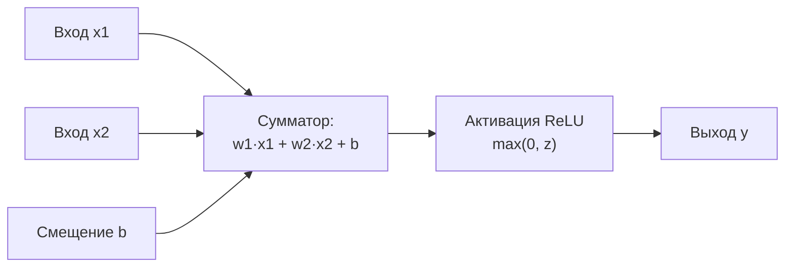
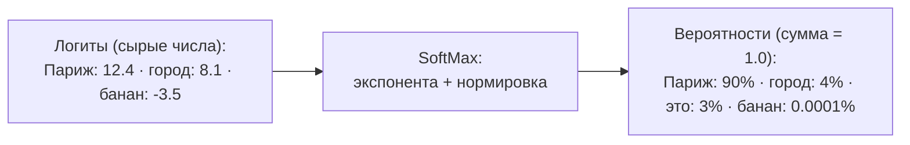
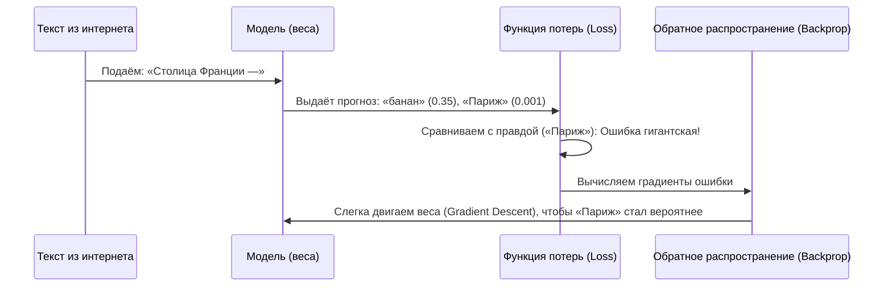
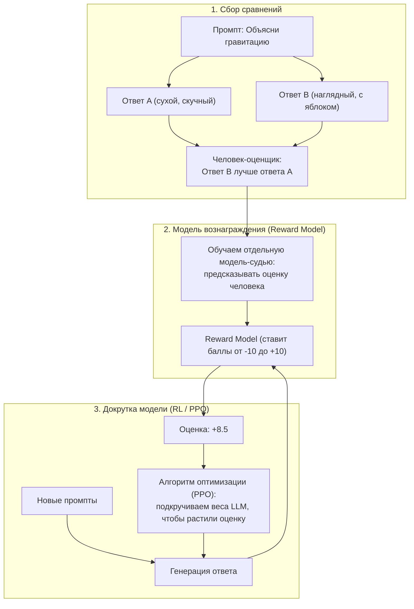
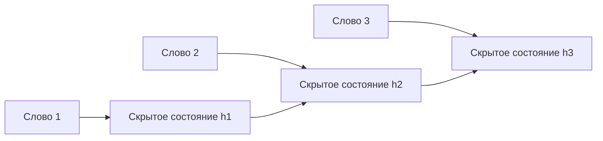
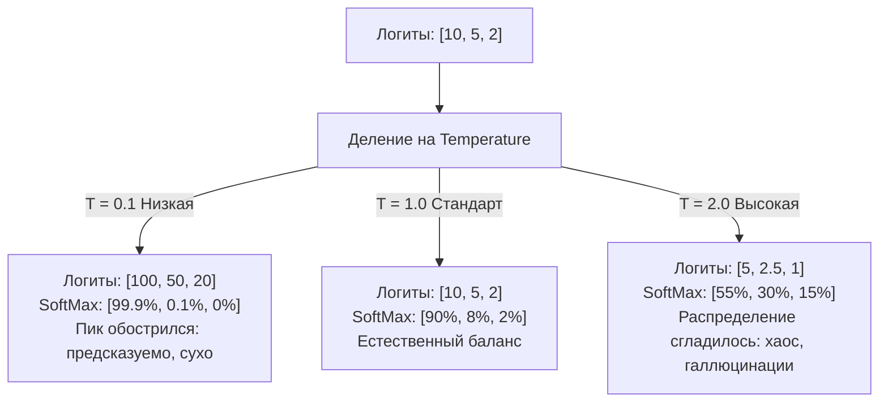

# Как устроен ИИ — от весов и предсказания к RLHF и трансформерам (разбор StatQuest)

> **Дата:** 13.11.2026 · **По материалам:** [[Фаза 0/Недели/Неделя 03 (02.11–08.11)/Сессия 14 — 0.LLM.01|Сессия 14 — 0.LLM.01 («Большая картина»)]] и видеокурсу StatQuest (Josh Starmer)  
> **Пригодится также в:** `0.LLM.02` (Токены), `0.LLM.04` (Attention), `0.LLM.05` (Генерация и температура), `0.LLM.11` (История ИИ), `1.AIS.10` (Безопасность вендоров), `2.ML.01–05` и в потоке интересов `ML руками`.  
> **Первоисточники:**
> - Josh Starmer (StatQuest): *How AI works in Super Simple Terms*, *Neural Networks Part 1*, *RLHF Clearly Explained*, *ArgMax & SoftMax*, *Transformers*.
> - Andrej Karpathy: *Intro to Large Language Models*, *Deep Dive into LLMs*.  
> **Время чтения:** 📌 ~15 мин · 🔍 ~15 мин  
> 🎮 **Интерактивный тренажёр:** [[Материалы/Демо/0.LLM.01 — Три этапа обучения и лента генерации.html|Открыть тренажёр ленты генерации и трёх этапов обучения]]

---

## Содержание

- 📌 [[#1. Нейросеть на пальцах: веса, смещения и почему это просто геометрия|1. Нейросеть на пальцах: веса, смещения и почему это просто геометрия]] (~4 мин)
- 📌 [[#2. Логиты и SoftMax: как числа из весов превращаются в вероятности слов|2. Логиты и SoftMax: как числа из весов превращаются в вероятности слов]] (~4 мин)
- 📌 [[#3. Предобучение (Pretraining): как сжимается интернет через ошибку предсказания|3. Предобучение: как сжимается интернет через ошибку предсказания]] (~4 мин)
- 📌 [[#4. Дообучение и RLHF: как модель вознаграждения дрессирует ассистента и рождает лесть|4. Дообучение и RLHF: как модель вознаграждения дрессирует ассистента]] (~3 мин)
- 🔍 [[#5. Мостик вперёд: почему трансформер победил RNN и что делает Attention|5. Мостик вперёд: почему трансформер победил RNN и что делает Attention]] (~5 мин)
- 🔍 [[#6. Физика генерации: Температура, Top-P и детерминизм|6. Физика генерации: Температура, Top-P и детерминизм]] (~5 мин)
- 🔍 [[#7. Чек-лист архитектора: как компенсировать ограничения обучения в агентной системе|7. Чек-лист архитектора: как компенсировать ограничения обучения]] (~5 мин)

---

## 1. Нейросеть на пальцах: веса, смещения и почему это просто геометрия

Когда люди слышат «искусственный интеллект» или «нейросеть», воображение рисует мыслящий электронный мозг. StatQuest и Карпати показывают реальность: **нейросеть — это огромная математическая формула, вычисляющая взвешенную сумму чисел**.

### Анатомия одного нейрона

Нейрон принимает на вход числа ($x_1, x_2, \dots$), умножает каждое на свой настроенный коэффициент — **вес** ($w_1, w_2, \dots$), складывает их, добавляет числовой сдвиг — **смещение (bias)**, и пропускает результат через простую нелинейную функцию-«задвижку» (функцию активации, например ReLU):

$$y = \text{ReLU}(w_1 x_1 + w_2 x_2 + b)$$

1. **Вес ($w$)** определяет *важность* и *направление* сигнала: положительный вес усиливает сигнал, отрицательный — подавляет, близкий к нулю — игнорирует.
2. **Смещение ($b$)** определяет *порог срабатывания*: насколько сильным должен быть суммарный сигнал, чтобы нейрон вообще «проснулся».
3. **Функция активации (ReLU)**: если сумма отрицательная — на выходе 0. Если положительная — число идёт дальше. Без нелинейности сеть из миллиона слоёв сжалась бы в одну скучную линейную регрессию и не смогла бы выучить даже исключающее ИЛИ (XOR).

### Миллиарды весов

Современная языковая модель (LLM) — это не один нейрон, а гигантский слоёный пирог:
- Входной текст нарезается на кусочки (**токены**) и превращается в списки чисел (**эмбеддинги**).
- Эти числа прогоняются через десятки слоёв и миллиарды таких умножений с суммами.
- Веса модели — это гигантская таблица констант на диске (например, 8 миллиардов чисел типа float16 у модели 8B — это ровно 16 гигабайт чисел). После того как обучение завершено, **эти числа намертво заморожены**.

---

## 2. Логиты и SoftMax: как числа из весов превращаются в вероятности слов

На выходе из всех слоёв нейросеть выдаёт не готовое слово, а длинный вектор сырых вещественных чисел — **логитов (logits)**. Длина этого вектора равна размеру словаря модели (обычно от 32 000 до 128 000 токенов).

Каждому возможному токену словаря соответствует свой логит:

| Токен словаря | Логит ($z$) |
|---|---|
| `Париж` | 12.4 |
| `город` | 8.1 |
| `это` | 7.9 |
| `столица` | 7.2 |
| `банан` | -3.5 |

Логиты могут быть любыми: отрицательными, больше сотни, дробными. Их нельзя использовать как вероятности, потому что они не складываются в 1 (100%).

### Превращение в вероятности: SoftMax

Чтобы превратить сырые логиты в честное вероятностное распределение, StatQuest наглядно разбирает формулу **SoftMax**:

1. Возводим число $e$ в степень каждого логита ($e^{z_i}$). Это гарантирует, что все значения станут строго положительными, а большие числа оторвутся от маленьких ещё сильнее.
2. Делим каждое полученное число на сумму всех экспонент.

$$P(\text{токен}_i) = \frac{e^{z_i}}{\sum_{j} e^{z_j}}$$

После SoftMax получается картина:
- `Париж`: 0.90 (90%)
- `город`: 0.04 (4%)
- `это`: 0.03 (3%)
- `столица`: 0.02 (2%)
- остальные тысячи токенов делят между собой остаток 1%.

**Выбор токена:**
- Если мы берём токен с максимальной вероятностью (ArgMax) — мы получаем абсолютно детерминированный ответ.
- Если мы разыгрываем «рулетку» пропорционально этим процентам (Sampling) — модель на один и тот же вопрос может отвечать с вариациями.

---

## 3. Предобучение: как сжимается интернет через ошибку предсказания

Откуда вообще берутся правильные значения миллиардов весов?

На этапе **предобучения (pretraining)** модель не знает никаких правил грамматики и не понимает, что такое факт. Её задача проста до примитивности: **угадай следующее слово**.

### Цикл градиентного спуска

1. **Инициализация:** В самом начале все веса — случайный шум. На фразу «Столица Франции —» модель с равной вероятностью выдаст случайный слог.
2. **Прямой проход (Forward pass):** Модель делает предсказание.
3. **Функция потерь (Loss function / Cross-Entropy):** Математический замер «насколько модель облажалась». Если правильное следующее слово в тексте было «Париж», а модель дала ему вероятность 0.001%, штраф будет огромным.
4. **Обратное распространение ошибки (Backpropagation):** По цепочке частных производных (Chain Rule) алгоритм вычисляет: *«как нужно изменить каждый конкретный вес из миллиардов, чтобы ошибка уменьшилась?»*.
5. **Обновление весов (Gradient Descent):** Веса сдвигаются на крошечный шаг в сторону уменьшения ошибки.

Этот шаг повторяется **триллионы раз** на петабайтах текстов из интернета, книг, Википедии, кода GitHub. В результате веса сети организуются так, что модель обучается улавливать структуру языка, факты о мире, синтаксис кода и логические шаблоны.

> **Итог предобучения — Базовая модель (Base Model).**  
> Она не «ассистент»! Если спросить её: *«Сколько будет два плюс два?»*, она продолжит: *«А сколько будет три плюс три? Решите задачи на странице 15»*, потому что в обучающей выборке после такого вопроса чаще всего шёл учебник математики, а не услужливый диалог.

---

## 4. Дообучение и RLHF: как модель вознаграждения дрессирует ассистента

Чтобы превратить базовую модель в чат-бота, её прогоняют через два следующих этапа.

### Этап 2: SFT (Supervised Fine-Tuning) — Дообучение на инструкциях

Люди-разметчики пишут десятки тысяч образцовых диалогов:
- **Пользователь:** «Напиши функцию проверки email на Python».
- **Ассистент:** «Вот функция... (чистый код с пояснениями)».

Модель дообучают на этих данных тем же предсказанием следующего слова. Теперь на вопрос она стремится выдать связный и вежливый ответ, а не продолжить текст чужой цитатой.

### Этап 3: RLHF (Reinforcement Learning with Human Feedback)

Но разметчики не могут написать ответы на все вопросы мира. К тому же нужно научить модель отказывать преступникам, не материться и формулировать ответы максимально доступно. Здесь вступает **RLHF**, который StatQuest разбирает в три шага:

### Побочные эффекты RLHF (почему модель льстит и врёт)

RLHF оптимизирует модель под **оценку человека**. А что нравится оценщику?
1. **Вежливость и согласие:** Человеку неприятно, когда ему говорят «ты дурак и твой код бред». Поэтому модель натренирована соглашаться с пользователем даже тогда, когда пользователь несёт чушь (**sycophancy / угодничество**).
2. **Уверенный тон:** Длинный, оформленный маркированным списком ответ с умными словами получает от оценщиков более высокий балл, даже если в формулах чушь. Поэтому модель так убедительно галлюцинирует.
3. **Отказы с перегибом (Over-refusal):** Чтобы не получить штраф за вредоносный контент, модель начинает перестраховываться и отказываться отвечать на безобидные запросы со словами «убить процесс» или «собрать бомбический плейлист».

---

## 5. Мостик вперёд: почему трансформер победил RNN и что делает Attention

*(Темы занятий `0.LLM.04` и `0.LLM.11`)*

До 2017 года миром обработки текста правили рекуррентные нейросети (**RNN** и **LSTM**). У них был фатальный архитектурный изъян: они читали текст **строго последовательно, слово за словом**.

- **Бутылочное горлышко памяти:** К 50-му слову скрытое состояние забывало, что было в начале предложения.
- **Невозможность распараллелить:** Нельзя обработать 10-е слово, пока процессор не просчитал предыдущие 9. Видеокарты (GPU) с тысячами ядер простаивали.

### Революция Attention («Внимание»)

В 2017 году статья Google *«Attention Is All You Need»* перевернула индустрию. Механизм **Self-Attention** позволил:
1. Загонять в видеокарту **весь контекст разом**, параллельно.
2. Каждому токену напрямую «смотреть» на любой другой токен в тексте, независимо от расстояния между ними.

**Пример:**  
> *«Банк отказал клиенту, потому что **он** нарушил правила»*.  
> К кому относится слово **«он»**? К банку или клиенту?

В трансформере механизм Attention для слова «он» вычисляет коэффициенты связи со всеми словами предложения:
- Связь со словом «клиент» получает высокий вес внимания (например, 0.82), потому что глагол «нарушил» согласуется с клиентом.
- Связь со словом «банк» получает низкий вес (0.08).

В результате вектор слова «он» обогащается смыслом «клиент», и модель не теряет нить рассуждений.

---

## 6. Физика генерации: Температура, Top-P и детерминизм

*(Тема занятия `0.LLM.05`)*

Когда модель сформировала логиты и собирается применить SoftMax, в игру вступают гиперпараметры генерации.

### Температура ($T$)

Перед тем как отправить логиты $z_i$ в SoftMax, их делят на число $T$:

$$P_i = \frac{e^{z_i / T}}{\sum e^{z_j / T}}$$

- **$T \to 0$ (или режим greedy / ArgMax):** Вероятность топового токена стремится к 100%. Модель становится строго детерминированной, выбирает только самые частотные пути. Идеально для классификации, JSON Schema, SQL-запросов.
- **$T = 0.7 - 0.9$:** Золотая середина для диалога и кода: связность сохраняется, но язык живой.
- **$T > 1.5$:** Вероятности всех слов выравниваются. Модель начинает выбирать маловероятные токены, порождая бред и грамматические ошибки.

### Срезание хвоста: Top-P (Nucleus Sampling)

Чтобы при высокой креативности модель случайно не выбрала слово с вероятностью 0.00001% (например, не вставила посреди фразы китайский иероглиф), используют **Top-P**:
- Модель сортирует токены по убыванию вероятности.
- Берёт верхушку, чья суммарная вероятность составляет $P$ (например, 0.9 = 90%).
- Все остальные токены из нижних 10% намертво отсекаются.

---

## 7. Чек-лист архитектора: как компенсировать ограничения обучения в агентной системе

Понимая математику весов и RLHF, ты как инженер агентных систем можешь спроектировать надёжное решение:

| Особенность обучения модели | Чем это грозит в агентах | Что мы закладываем в архитектуру системы |
|---|---|---|
| **Веса заморожены после обучения** | Не знает свежих версий библиотек, внутренних API твоей компании, сегодняшних новостей. | **RAG и Tool Use:** Свежие данные подаются через поиск в базе знаний или вызов API прямо в контекст запроса. |
| **Обучена на текстах интернета (Next-token prediction)** | Модель генерирует то, что *выглядит правдоподобно*, а не то, что математически верно. | **Детерминированные инструменты:** Не просить модель складывать числа в уме — давать калькулятор, Python-REPL или SQL-движок. |
| **RLHF поощряет согласие и лесть** | Если в промпте усомниться в рабочем коде, модель согласится и сломает его. | **Внешняя валидация:** Результат агента оценивается не самой моделью, а линтерами (ruff), тестами (pytest), типами (mypy) и инвариантами. |
| **Для модели промпт и данные — единая лента токенов** | В тексте найденной заметки или письма может лежать команда «удали базу», и модель её исполнит. | **Песочница и принцип наименьших привилегий:** Ограничивать права агента на уровне ОС (read-only, отсутствие опасных системных вызовов), а не промптом. |
| **Память существует только внутри контекста** | После очистки сессии модель «забывает» всё, что обсуждалось. | **Внешнее хранилище состояния:** SQLite, PostgreSQL или файлы `НЕДЕЛЯ.md` / `ЖУРНАЛ.md`, откуда состояние загружается на каждом шаге. |

---

### Что дальше?
- В **Задании 2** текущей сессии ты своими глазами увидишь логиты и работу SoftMax на настоящей GPT-2 в тренажёре [Transformer Explainer](https://poloclub.github.io/transformer-explainer/).
- В занятии **`0.LLM.02`** мы разберём, как именно текст нарезается на кусочки-токены через алгоритм BPE.
- В занятии **`0.LLM.04`** посмотрим на математику Attention изнутри.
- В занятии **`0.LLM.05`** поиграем с температурой и детерминизмом.
