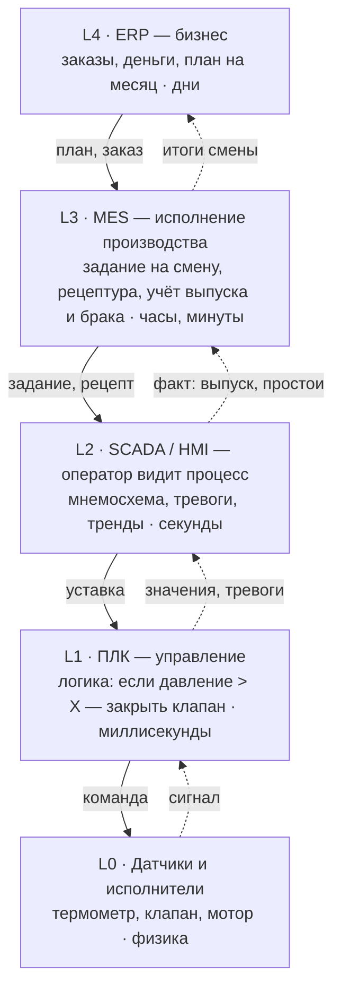
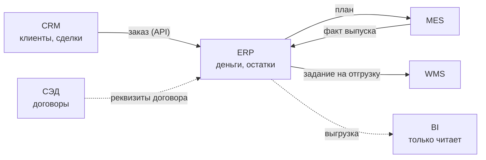

# 🗺 Карта видов ПО: какие системы бывают, кто ими пользуется и где в них агент

> **Дата:** 05.11.2026 · **Вне плана**, по просьбе пользователя (журнал Тьютора, 04.11) · **≈ 30–40 мин** (📌 Минимум — ~25 мин)
> **Опирается на:** `0.PAI.01` «Пирамида автоматизации» ([[Фаза 0/Недели/Неделя 02 (26.10–01.11)/Интерес — 0.PAI.01|интерес]]), письмо начальника в `0.SD.01` ([[Фаза 0/Недели/Неделя 03 (02.11–08.11)/Сессия 11 — 0.SD.01|Сессия 11]]).
> **Углубление в программе:** `1.BIZ.09` «Карта корпоративных систем» (Фаза 1), `2.AGT.09–10` (агент над CRM и 1С через MCP), `PAI` — уровни производства.
> **Источники:** стандарт ANSI/ISA-95 (он же IEC 62264) — уровни предприятия и производства; Purdue Enterprise Reference Architecture (T. J. Williams, Университет Пердью, 1990-е) — откуда взялись L0–L4; ITIL — практики ITSM. Названия продуктов ниже — примеры, чтобы было за что зацепиться, а не рекомендации.

---

## Оглавление

- 📌 Минимум
  - [[#М1. Три вопроса, которые раскладывают любой софт]]
  - [[#М2. Корпоративные системы — «офис» компании]]
  - [[#М3. Завод — уровни L0–L4]]
  - [[#М4. Инфраструктура и безопасность — твой мир]]
  - [[#М5. Как системы говорят друг с другом]]
  - [[#М6. Где здесь агент и как это ломают]]
- [[#🔍 Глубже]]
- [[#Проверь себя]]

---

# 📌 Минимум

## М1. Три вопроса, которые раскладывают любой софт

**Зачем.** Названий систем — сотни, аббревиатур — ещё больше. Запоминать их списком бесполезно. Полезно уметь за минуту понять про незнакомую систему главное: **кто ей пользуется, какие данные она «хозяйничает» и как быстро должна отвечать.** Тогда MES, WMS или СЭД перестают быть буквами.

| Вопрос | Варианты | Пример 1 | Пример 2 |
|---|---|---|---|
| **Для кого?** | Человек · компания (офис) · производство · ИТ-служба | Telegram — для человека | 1С:ERP — для компании |
| **Чьи данные хозяйничает?** | Деньги · клиенты · документы · люди · товар · оборудование · сама ИТ-инфраструктура | CRM — клиенты и сделки | WMS — где на складе какая коробка |
| **Как быстро решает?** | Месяцы → дни → часы → секунды → миллисекунды | ERP — план на месяц | ПЛК — останов насоса за миллисекунды |

**Главная мысль — «хозяин данных».** В компании у каждого вида данных должна быть **одна** система-хозяин: она — источник истины, остальные берут копию. Клиент живёт в CRM, остаток денег — в ERP, приказ — в СЭД. Когда хозяев два, начинаются «у нас в CRM одна цифра, у бухгалтерии другая». Для агента это ключевое: **писать данные он может только в систему-хозяина и только через её правила**, иначе он создаёт тот самый второй источник правды.

---

## М2. Корпоративные системы — «офис» компании

**Зачем.** Это то, что видят люди в офисе и с чем в первую очередь хотят подружить AI-агентов: «пусть агент заводит сделки», «пусть ищет договор». Ты как бывший 1С-ник часть этого знаешь изнутри — здесь общая карта.

| Класс | Расшифровка | Что делает | Кто пользуется | Хозяин каких данных | Примеры |
|---|---|---|---|---|---|
| **ERP** | Enterprise Resource Planning | Деньги, закупки, продажи, склад, производство, зарплата — в одной базе | Бухгалтерия, финансы, снабжение, плановый отдел | Деньги, номенклатура, заказы, остатки | 1С:ERP, 1С:УТ, SAP S/4HANA |
| **CRM** | Customer Relationship Management | Клиенты, сделки, воронка продаж, история общения | Продажи, маркетинг, поддержка | Клиенты, контакты, сделки | Битрикс24, amoCRM, Salesforce |
| **СЭД / ECM** | Система электронного документооборота | Договоры, приказы, согласования, подписи, архив | Канцелярия, юристы, все, кто согласует | Документы и их маршруты | Directum, DocsVision |
| **HRM** | Human Resource Management | Кадры, штатка, отпуска, зарплата, обучение | Отдел кадров, бухгалтерия | Сотрудники и их персональные данные | 1С:ЗУП |
| **WMS** | Warehouse Management System | Адресное хранение: где какая коробка, сборка заказов, ТСД со сканером | Склад, логистика | Ячейки, движения товара внутри склада | 1С:WMS |
| **BI** | Business Intelligence | Дашборды и отчёты поверх данных других систем | Руководители, аналитики | Ничьих: читает копии | Power BI, Яндекс DataLens |
| **Трекеры задач и вики** | — | Задачи, проекты, база знаний | Все, особенно ИТ | Задачи, тексты | Jira, YouGile, Confluence |

**Пара примеров на «хозяина данных», чтобы не склеилось с одним случаем:**
- **Деньги:** счёт клиенту выставили в CRM, но оплата и долг живут в ERP. Агент, который «закрывает сделку как оплаченную» по письму клиента, а не по ERP, создаёт ложную картину.
- **Документ:** договор лежит у юриста в почте и в СЭД. Хозяин — СЭД: там видно, какая версия подписана. Агент, который ищет договор «по почте», найдёт черновик.

**ERP и BI — частая путаница.** ERP **ведёт** учёт: в ней проводят операции. BI только **смотрит**: берёт выгрузку и рисует. Отчёт в BI можно ломать сколько угодно, проводку в ERP — нельзя.

---

## М3. Завод — уровни L0–L4

**Зачем.** Это и есть твой вопрос про MES и L3. Модель родилась в Университете Пердью (отсюда «Purdue model»), а стандарт ISA-95 закрепил её уровни. Делит она завод не по отделам, а **по скорости решений**: чем ниже, тем быстрее и тем дороже ошибка, потому что там физика.

| Уровень | Система | Что решает | Пример 1 | Пример 2 |
|---|---|---|---|---|
| **L4** | ERP (иногда ещё PLM — жизнь изделия, чертежи) | **Что и сколько** выпускать, за какие деньги | «В ноябре — 2 000 банок краски» | «Закупить пигмент к 15-му» |
| **L3** | **MES** — Manufacturing Execution System | **Как выполнить план сегодня**: какую партию на какую линию, по какой рецептуре, сколько вышло и почему простой | «Смена 2: линия 3 — партия 117, рецепт «белый матовый»» | «Простой линии 1 — 40 мин, причина: нет тары» |
| **L2** | SCADA / HMI | **Что происходит сейчас**: оператор видит процесс и реагирует | Мнемосхема: бак 2 — 87% | Тревога: перегрев мешалки |
| **L1** | ПЛК | **Мгновенная логика**, без человека | Давление выше нормы → закрыть клапан | Нажата аварийная кнопка → стоп мотора |
| **L0** | Датчики, приводы | Физика | Датчик температуры | Клапан |

**Граница IT и OT** — между L3 и L4; на самой границе часто ставят «демилитаризованную зону» (её называют уровнем 3.5): прямого хода из офисной сети в цех нет, данные передаются через промежуточные серверы. Выше — офисный ИТ, где падение — это «отчёт не пришёл». Ниже — OT (Operational Technology), где падение — это стоящая линия или авария. Поэтому в OT обновления ставят раз в годы, сеть отрезают, а «перезагрузить и посмотреть» нельзя.

**Где тут 1С:** обычно L4 (1С:ERP), иногда L3 (у 1С есть продукты для оперативного управления производством). Примеры по уровням: MES — Siemens Opcenter; SCADA — WinCC, MasterSCADA.

---

## М4. Инфраструктура и безопасность — твой мир

**Зачем.** Это системы, которыми ИТ-служба управляет самой ИТ. Ты с ними работаешь, но, возможно, не называешь их классами. Агентов здесь внедряют одними из первых: тикеты, алерты, инциденты.

| Класс | Что делает | Хозяин каких данных | Примеры |
|---|---|---|---|
| **ITSM / Service Desk** | Заявки, инциденты, изменения по ITIL | Тикеты, SLA | Naumen Service Desk, Jira Service Management, ServiceNow |
| **CMDB** (часто внутри ITSM) | Реестр: какие серверы, сервисы и кто от чего зависит | Конфигурационные единицы и связи | — |
| **Мониторинг** | Метрики, алерты, графики | Временные ряды, события | Zabbix, Prometheus + Grafana |
| **IAM / каталог** | Учётки, группы, права, вход | Кто есть кто и что ему можно | Active Directory, FreeIPA |
| **SIEM** | Собирает логи безопасности и ищет атаки по правилам | События безопасности | MaxPatrol SIEM, Splunk |
| **Резервное копирование** | Копии и восстановление | Копии данных | Veeam, Кибер Бэкап |

**Пара примеров на «IAM — хозяин прав»:**
- уволенный сотрудник отключён в AD — значит, отключён везде, где вход через AD;
- агенту завели учётку в AD «как у админа, чтобы не мучиться» — теперь у агента права админа во **всех** системах, которые доверяют AD.

---

## М5. Как системы говорят друг с другом

**Зачем.** Почти любая задача «сделай агента» на деле — задача **интеграции**: агент читает одну систему и пишет в другую. Способов немного:

| Способ | Как | Пример 1 | Пример 2 |
|---|---|---|---|
| **API** | Система сама даёт вызовы: REST, SOAP, OData, gRPC | Битрикс24 REST — создать сделку | OData у 1С — прочитать справочник |
| **Вебхук** | Система сама стучится к тебе при событии | «Новая сделка» → вызов твоего URL | «Заявка закрыта» → сообщение в чат |
| **Очередь / шина** | Сообщения через посредника | Kafka между заказами и складом | MQTT от датчиков (`0.PAI.02`) |
| **Обмен файлами** | Выгрузка по расписанию | Ночной XML между 1С и сайтом | CSV из SCADA в Excel |
| **Прямо в базу** | Запросы мимо системы | Отчёт SQL-запросом в базу ERP | — *(почти всегда плохая идея: обходит права и правила системы)* |

---

## М6. Где здесь агент и как это ломают

**Где агенту место.** Хорошо ложится туда, где много текста и рутинных решений, а цена ошибки обратима:

| Где | Что делает агент | Чем рискуем |
|---|---|---|
| CRM | Разбирает входящие письма, предлагает черновик ответа, заводит лид | Ошибочная сделка — исправить легко |
| ITSM | Классифицирует тикет, ищет похожий инцидент, предлагает решение | Неверная категория — заметят |
| СЭД | Ищет договор, сверяет пункты, готовит выжимку | Утечка документа, если права шире нужного |
| ERP | Отвечает на вопросы по остаткам, **готовит** документ на проверку человеку | Проводка «сама» — уже деньги и налоги |
| L2 и ниже | Почти никогда не управляет. Читает тренды, подсказывает оператору, предсказывает поломку | Команда в OT — физика и люди |

Правило большого пальца: **чем ниже по L0–L4 и чем ближе к деньгам, тем меньше агент делает сам и тем больше — «предлагает человеку»** (это `0.AGT.07` «Human-in-the-loop»).

> [!danger] 🗡 Как это ломают
> - **Сервисная учётка с правами «на всё».** Агенту дают учётку интеграции в ERP или AD с полными правами — prompt injection в одном письме превращается в действия во всех системах, куда эта учётка ходит (буква E из STRIDE).
> - **Агент как мост через границу IT/OT.** Агент, которому дали доступ и к почте, и к SCADA, соединяет интернет с цехом — то, что сеть годами разделяла.
> - **«Прямо в базу».** Агент пишет SQL в базу ERP мимо её проверок: ни прав, ни журнала, ни бизнес-правил.

---

# 🔍 Глубже

> [!note]- Как ещё делят софт (по желанию)
> - **По назначению:** системное (ОС, драйверы), инструментальное (компиляторы, IDE, СУБД), прикладное (всё, что выше).
> - **По тому, как продают:** коробка (купил и настроил), заказная разработка, SaaS (облако по подписке), open source. Для агента разница важна: у SaaS есть API, но данные у чужого провайдера; у коробки on-prem данные дома, но API может не быть.
> - **Платформа и конфигурация.** 1С — это *платформа* (движок, язык, СУБД-прослойка), на которой работают *конфигурации*: ERP, УТ, ЗУП. Похоже на Python и программы на нём.
> - **Отраслевые системы.** У каждой отрасли — свои «ERP»: МИС в медицине, АБС в банках, POS и кассы в рознице, TMS в перевозках, EAM/ТОиР — обслуживание оборудования, LIMS — лаборатории, PLM/CAD — конструкторы (Компас-3D, Teamcenter). Разбираются тем же М1: для кого, чьи данные, как быстро.

> [!note]- Почему в OT всё «старое»
> Линия работает 20–30 лет, остановка стоит дороже нового сервера, а сертификация безопасности привязана к конкретной версии. Поэтому Windows XP на SCADA — не лень, а расчёт. Отсюда и подход к безопасности: не «обнови», а «отрежь сеть и следи».

---

## Проверь себя

*Не тест, без оценки — проговорим на встрече.*

1. Ты получаешь письмо: «Сделай агента, который по заявке клиента из Битрикс24 сам резервирует товар на складе». Какие системы задеты, кто из них хозяин остатка, и что агент должен делать сам, а что — предлагать человеку?
2. Начальник цеха просит: «Пусть агент сам меняет уставку температуры в печи, если брак растёт». На каком это уровне L0–L4, и что бы ты ответил?
3. Назови систему у себя на работе, которую ты раньше не относил ни к какому классу. К какому она относится по трём вопросам из М1?
