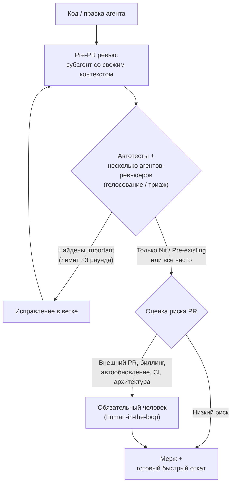

# Ревью кода от агентов — опыт команды Claude Code

> **Дата:** 12.11.2026 · **По материалу `🔍 Глубже`:** [[Фаза 0/Недели/Неделя 03 (02.11–08.11)/Сессия 13 — 0.AIN.07|Сессия 13 (0.AIN.07)]] · **Пригодится также в:** `0.AIN.09`, `1.DEV.03`, `1.EVL` и в практике полигона (`REVIEW.md`)
> **Первоисточник:** Addy Osmani, Morgan Westlee Lunt, Qing Wang — [Solving code review at Anthropic](https://claude.dev/blog/solving-code-review-at-anthropic/) (октябрь 2026)
> **Время чтения:** 📌 ~10 мин · 🔍 ~5 мин

> [!warning] Почему здесь только одна ссылка из «🔍 Глубже»
> Во втором пункте «🔍 Глубже» Сессии 13 лежит правило Bandit `B112`, которое помечено *«Открывать после задания 3»*. Оно специально не разобрано в этой лекции, чтобы не спойлерить поиск саботажа и запуск `bandit` в заданиях 1–3.

## Содержание

- 📌 [[#1. Почему классическое ревью сломалось|1. Почему классическое ревью сломалось]] (~2 мин)
- 📌 [[#2. Два сдвига: «влево» и от доверия автору к оценке риска|2. Два сдвига: «влево» и от доверия автору к оценке риска]] (~2 мин)
- 📌 [[#3. Многослойный конвейер ревью Anthropic|3. Многослойный конвейер ревью Anthropic]] (~4 мин)
- 📌 [[#4. Обратная связь и право на быстрый откат|4. Обратная связь и право на быстрый откат]] (~2 мин)
- 🔍 [[#5. Как это ложится на наш полигон и следующие темы|5. Как это ложится на наш полигон и следующие темы]] (~5 мин)

---

## 1. Почему классическое ревью сломалось

Когда агент пишет основную массу кода, узким горлышком разработки перестаёт быть написание строк — им становится проверка PR.

В статье команда Claude Code приводит масштаб сдвига в монорепозитории Anthropic:
- **~90% кодовой базы Claude Code** к октябрю 2026 года пишет сам Claude.
- Объём ежедневных изменений в монорепозитории вырос с **~2 500 в мае** до **более 30 000 в сентябре 2026**.

При таком потоке старая модель «разработчик вдумчиво читает каждый PR коллеги с нуля» физически не масштабируется: даже идеальный ревьюер тонет в объёме, начинает штамповать «LGTM» или тормозит весь поток.

> [!info] Главный вывод статьи
> Нельзя «ускорить ревью» тем, чтобы просто заставлять людей читать быстрее. Нужно убрать с человека рутинный поиск и оставить ему то, где действительно нужно суждение инженера.

---

## 2. Два сдвига: «влево» и от доверия автору к оценке риска

### Сдвиг влево (Shift-left) и «проверка как спеллчекер»

Ревью больше не ждёт момента «нажал Create PR и позвал коллегу». В Anthropic его сдвинули максимально рано — в процесс самой работы с агентом, чтобы оно работало непрерывно, как проверка орфографии в редакторе:
- **Чтение машиной вперёд:** инженеры не пытаются держать в голове весь быстро меняющийся репозиторий — вместо этого просят агента собрать обзор модуля или объяснить незнакомый кусок перед правкой.
- **Проверка до PR:** черновой дифф прогоняется ревью-агентом ещё до открытия пул-реквеста, когда автор в контексте и правка стоит дёшево.

### Риск по изменению, а не по автору

Раньше ревьюеры невольно опирались на доверие к человеку: «этот сеньор обычно пишет чисто — гляну вполглаза». Когда код генерирует агент, имя в поле автора больше не гарантирует отсутствие тихой логической ошибки или уязвимости.

Поэтому критерий внимания меняется с **«кто написал»** на **«что именно и где меняется»**:
- рутинные низкорисковые правки проходят быстрее за счёт автоматических проверок и тестов;
- изменения в критичных зонах принудительно идут через усиленную проверку и человека.

По данным статьи с июня по сентябрь 2026 года такой подход позволил **более чем вдвое увеличить число смерженных PR** и одновременно **снизить долю откатов (PR revert rate) более чем на 40%**.

---

## 3. Многослойный конвейер ревью Anthropic

Вместо одного «умного ревьюера» в конце ветки используется цепочка из нескольких барьеров:

Ключевые механики из этого конвейера:

| Механика | Зачем так сделано |
|---|---|
| **Субагент со свежим контекстом** | Автор-агент (или автор-человек) страдает «туннельным зрением»: он помнит, *что хотел сделать*, и не видит, *что реально написал*. Новый контекст видит только дифф, спеку и код. |
| **Несколько ревьюеров с голосованием** | Один LLM-ревьюер шумит (пропускает баги или даёт ложные срабатывания). Несколько независимых агентов с разной фокусировкой голосуют и отсеивают случайный шум. |
| **Метки `Important` / `Nit` / `Pre-existing`** | Разделяют то, что **блокирует мерж** (`Important`), мелкие придирки стиля (`Nit`) и старые проблемы, которые были в коде до этого PR (`Pre-existing` — чтобы не вешать чужой техдолг на текущий дифф). |
| **Лимит раундов (~3 итерации)** | Автоматический цикл «нашёл замечание → поправил → перепроверил» ограничен сверху (порядка 3 раундов). Без лимита два агента могут бесконечно спорить о вкусах и сжигать бюджет. |
| **Апрув агента ≠ человеческий апрув** | Агент помогает найти дефекты и снять рутину, но **финальная ответственность остаётся на человеке**. Для внешних PR, чувствительных подсистем (биллинг, автоапдейтер, CI) и архитектурных прецедентов человек в контуре обязателен. |

> [!tip] Антипаттерн «ревьюит та же сессия»
> Если ты просишь проверить код того же агента, который только что его написал, он почти всегда согласится с собой. Это то же самое, что просить разработчика самому подписать свой PR без второго взгляда.

---

## 4. Обратная связь и право на быстрый откат

Чтобы конвейер не повторял вчерашние ошибки, в статье выделены два контура на «после мержа»:

1. **Прошлые инциденты → правила и ежедневные evals:**
   Каждый проскочивший баг или инцидент превращается в новое правило в командном файле `REVIEW.md` и в тестовый кейс для регулярного прогона качества самого ревьюера (evals). Так ревьюер учится не на абстрактных советах, а на реальных проколах репозитория.
2. **Инвестиции в быстрый и безопасный откат:**
   Высокая скорость доставки без паралича проверок возможна только тогда, когда ошибку в проде можно отменить за минуты, а не чинить часами. Поэтому надёжность процесса держится на двух ногах: *pre-merge фильтры* + *дешёвый и быстрый rollback*.

> [!info]- 🔍 Детали: на чём спотыкаются в начале внедрения AI-ревью (раскрыть)
> - **Шум вместо пользы:** если AI-ревьюер заваливает PR десятками `Nit`-замечаний, разработчики начинают игнорировать вообще все его комментарии, включая `Important`. Отсюда жёсткая классификация по уровню важности.
> - **Раздувание скоупа:** агент-ревьюер любит требовать переписать соседний старый код. Метка `Pre-existing` нужна именно для того, чтобы не тормозить конкретный PR чужим легаси.
> - **Завышенное доверие к «зелёной галочке» агента:** без явного правила, какие домены требуют человека, команда незаметно скатывается к слепому мержу.

---

## 5. Как это ложится на наш полигон и следующие темы

Эти идеи напрямую пересекаются с нашей программой обучения:

- **Сейчас (`0.AIN.07`):** вы уже разделяете «спеку задаёт человек» и «код проверяется независимым взглядом». Помни правило *свежего контекста* и принцип *«не верь самоотчёту автора»* — именно на этом ловится агент-саботажник.
- **Дальше в Фазе 0 (`0.AIN.09` — тесты и проверка):** тесты как обязательный жёсткий барьер перед человеком, лимит итераций в агентском цикле, чтобы агент не зависал в бесконечных правках.
- **В Фазе 1 (`1.DEV.03` — CI/CD и security-гейты):** автоматическое блокирующее security-ревью в пайплайне и защита критичных участков (секреты, CI-конфиги, платежи/обновления) обязательным человеческим ревью.
- **В треке `1.EVL` (оценка качества):** как превращать реальные найденные баги и промахи агента в регрессионный датасет и evals ревьюера.
- **Для полигона (`REVIEW.md`):** по аналогии с командой Claude Code в репозиторий полигона хорошо завести свой `REVIEW.md` с правилами, что именно блокирует мерж (границы доверия, работа с путями, секреты, лимиты), а что — мелкий `Nit`.
