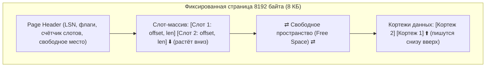
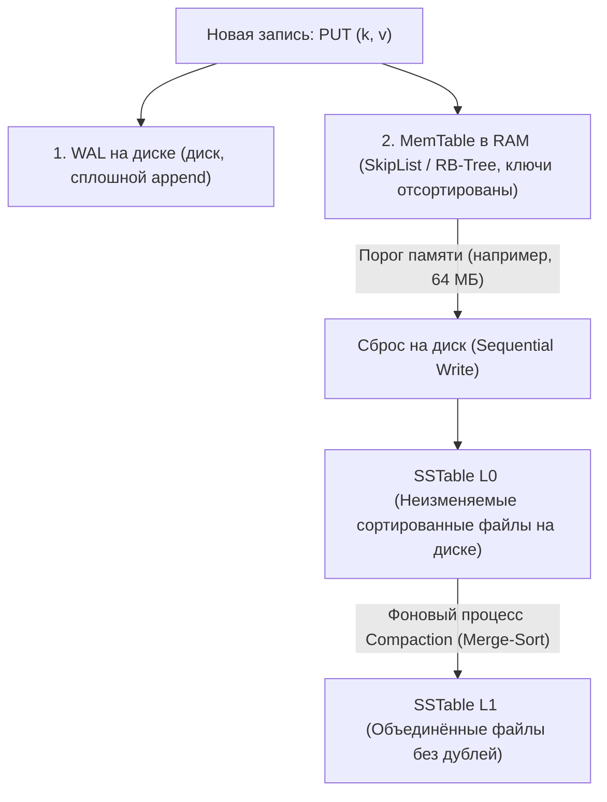
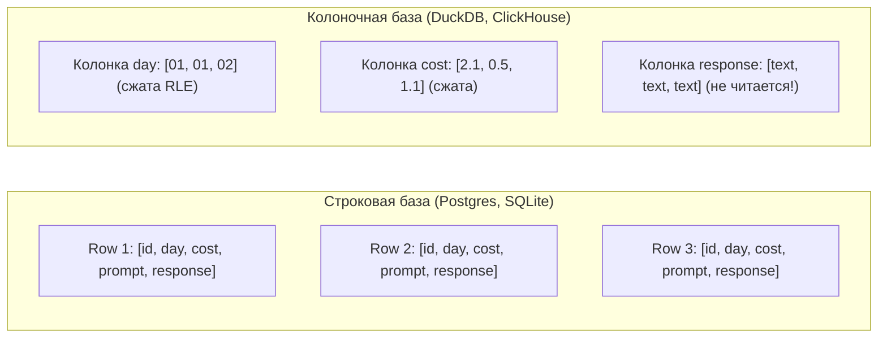

# Устройство хранилищ изнутри — от страниц B-Tree и LSM-деревьев до колоночного сжатия

> **Дата:** 13.11.2026 · **По материалу `🔍 Глубже`:** [[Фаза 0/Недели/Неделя 03 (02.11–08.11)/Интерес — 0.SQL.02|Интерес 0.SQL.02 (Какие бывают хранилища изнутри)]] · **Пригодится также в:** `0.SQL.06`, `1.DAT.00`, `1.DAT.04`, `1.RAG.01` и при проектировании полигона «Второй мозг»
> **Первоисточники:** 
> - Martin Kleppmann — *Designing Data-Intensive Applications* (глава 3 «Storage and Retrieval»)
> - Andy Pavlo — *CMU 15-445/645 Database Systems* (лекции 03–06: Storage Architecture, Buffer Pool, Trees & Hash Tables)
> **Время чтения:** 📌 ~15 мин · 🔍 ~15 мин  
> 🎮 **Интерактивный тренажёр:** [[Материалы/Демо/0.SQL.02 — Устройство хранилищ — B-Tree, LSM и колоночный движок.html|Открыть интерактивное демо]]

---

## Содержание

- 📌 [[#1. Фундаментальный компромисс: почему нет «идеальной» базы|1. Фундаментальный компромисс: почему нет «идеальной» базы]] (~3 мин)
- 📌 [[#2. Анатомия страничного движка (Andy Pavlo / CMU 15-445): B-Tree и Slotted-Page|2. Анатомия страничного движка: B-Tree и Slotted-Page]] (~4 мин)
- 📌 [[#3. Движки LSM-Tree: почему они побеждают на записи (Martin Kleppmann)|3. Движки LSM-Tree: почему они побеждают на записи]] (~4 мин)
- 📌 [[#4. Колоночные СУБД: разворот на 90 градусов и сжатие векторов|4. Колоночные СУБД: разворот на 90 градусов и сжатие векторов]] (~2 мин)
- 📌 [[#5. Сводная матрица 9 семейств хранилищ|5. Сводная матрица 9 семейств хранилищ]] (~2 мин)
- 📌 [[#6. Как выглядят запросы к разным базам и чем они отличаются|6. Как выглядят запросы к разным базам и чем они отличаются]] (~5 мин)
- 🔍 [[#7. Где архитекторы наступают на грабли: скрытая цена технологий|7. Где архитекторы наступают на грабли: скрытая цена технологий]] (~8 мин)
- 🔍 [[#8. Чек-лист выбора хранилища для агентных систем|8. Чек-лист выбора хранилища для агентных систем]] (~7 мин)

---

## 1. Фундаментальный компромисс: почему нет «идеальной» базы

В разработке часто возникает иллюзия: *«Возьму современную быструю базу, она решит всё»*. В реальности любая база данных упирается в физику кремния и магнитных пластин:

1. **Случайный доступ (Random I/O) всегда дороже последовательного (Sequential I/O).**  
   Даже на сверхбыстрых NVMe SSD чтение или запись случайных 4 КБ блоков в 5–20 раз медленнее, чем чтение сплошного потока байт подряд. На HDD этот разрыв достигает сотен и тысяч раз из-за движения физической головки.
2. **Память читается страницами.**  
   ОС и процессор не умеют читать с диска один байт или одно число `cost_rub = 12.5`. Минимальная единица обмена между диском и памятью — **страница (block/page)**, обычно 4 КБ или 8 КБ. Если из 8 КБ вам нужно одно число в 8 байт, вы всё равно тащите с диска все 8 192 байта.
3. **Треугольник усиления (Amplification Trade-off):**
   - **Write Amplification (усиление записи):** сколько байт пишется на диск на 1 байт полезных данных.
   - **Read Amplification (усиление чтения):** сколько байт читается с диска, чтобы отдать 1 полезный байт.
   - **Space Amplification (усиление места):** во сколько раз размер базы на диске больше реального объёма чистых данных.

Любой движок базы данных — это компромисс между этими тремя величинами.

---

## 2. Анатомия страничного движка: B-Tree и Slotted-Page

Традиционные реляционные СУБД (**PostgreSQL, SQLite, MySQL InnoDB, MS SQL**) родились в эпоху, когда базы создавались под банковские транзакции и учётные системы (OLTP): найти клиента, списать деньги, записать заказ.

### Архитектура Slotted-Page

Как упаковать в фиксированную страницу размером 8 КБ строки переменной длины (например, текст заметки или комментария)?

Если просто писать строки подряд, при изменении длины строки придётся двигать весь хвост страницы, а все внешние индексы, указывающие на байтовое смещение, сломаются. Инженеры СУБД придумали архитектуру **Slotted-Page**:



- **Адрес записи (Record ID / Tuple ID):** внешние индексы (B-Tree) хранят не байтовое смещение, а пару: `(Page_ID, Slot_Number)`.
- **Что происходит при UPDATE:** если кортеж изменился в размере, СУБД двигает его внутри области данных страницы и меняет только число `offset` в слоте. Внешний B-Tree индекс **не трогается вообще**, потому что номер слота не изменился.

### Почему СУБД не доверяет кэшу операционной системы (Buffer Pool)

Энди Павло (Andy Pavlo) в курсе CMU 15-445 подчёркивает: **хорошая СУБД презирает кэш операционной системы**.

Почему СУБД реализует свой собственный менеджер буферного пула (**Buffer Pool Manager**) в оперативной памяти вместо простого `mmap()`:
1. **Грязные страницы (Dirty Pages) и WAL:** ОС не знает правил транзакций ACID. ОС может сбросить изменённую страницу на диск до того, как записался журнал предзаписи (WAL) — и при сбое питания база будет разрушена.
2. **Умный Pre-fetching:** СУБД знает план запроса. Если идёт `Seq Scan`, СУБД заранее читает следующие 100 страниц, а ОС может только гадать.
3. **Вытеснение страниц (Eviction Policy):** алгоритм LRU в ОС страдает от «загрязнения сканированием» (один `SELECT *` вымывает из кэша горячие индексы). В СУБД используются адаптивные алгоритмы: **LRU-K** или **2Q**.

### Индекс B+Tree

Над страницами строится сбалансированное дерево:
- Внутри промежуточных узлов лежат только ключи-разделители и номера дочерних страниц.
- Все реальные данные или указатели на кортежи лежат строго в **листьях**.
- Все листья связаны двусвязным списком — это делает сканирование диапазонов (`BETWEEN '2026-11-01' AND '2026-11-15'`) элементарным проходом по цепочке страниц.
- **Ветвление (Fan-out):** типичный узел содержит 100–500 ключей. При ветвлении 100 дерево глубиной всего в **4 уровня** адресует $100^4 = 100\,000\,000$ страниц (около 800 ГБ данных). Поиск любой записи требует всего 3–4 обращения к диску (а первые 2–3 уровня всегда лежат в RAM).

---

## 3. Движки LSM-Tree: почему они побеждают на записи

Если B-Tree так хорош, зачем изобрели **LSM-Tree** (Log-Structured Merge-Tree)?

### Слабость B-Tree: Случайная перезапись (In-place updates)
В B-Tree каждая вставка, удаление или обновление — это перезапись страницы 8 КБ прямо на её месте на диске. Если ключи поступают не по порядку (UUID, хеши, разные пользователи), диск испытывает адский шторм случайных операций записи.

### Решение LSM: Запись только последовательно (Append-Only)

Мартин Клеппман в DDIA описывает фундаментальный переход: **мы никогда не перезаписываем данные на диске**.



1. **Запись молниеносна:** вставка идёт в `WAL` (последовательный сброс на диск) и в структуру `MemTable` в памяти (красно-чёрное дерево или SkipList). Ответ клиенту возвращается мгновенно.
2. **SSTable (Sorted String Table):** когда MemTable заполняется, она сбрасывается на диск как один непрерывный отсортированный файл. Файлы SSTable **неизменяемы (immutable)**.
3. **Compaction (Слияние):** фоновый поток берёт несколько SSTable-файлов и сливает их, как в сортировке слиянием (Merge Sort). Если один ключ обновлялся 5 раз, старые версии отбрасываются, остаётся только свежая.
4. **Фильтры Блума (Bloom Filters):** как прочитать ключ, не зная, в каком он файле? Перед обращением к SSTable проверяется компактный битовый фильтр Блума в RAM. Если фильтр сказал *«ключа здесь нет»*, диск даже не опрашивается.

> **Кто использует LSM:** RocksDB (ядро многих NoSQL), Cassandra, ScyllaDB, LevelDB, SQLite4/LSM, DuckDB (для временных сливов), ClickHouse (движок MergeTree).

---

## 4. Колоночные СУБД: разворот на 90 градусов и сжатие векторов

Реляционные базы хранят кортеж `(id, date, model, cost, prompt, response)` вместе.  
Но что происходит в аналитике (OLAP), когда у вас таблица на 100 млн строк, и начальник просит: *«Посчитай среднюю стоимость вызова за ноябрь»*?

```sql
SELECT avg(cost_rub) FROM calls WHERE day >= '2026-11-01';
```

В строковой СУБД:
- Чтобы сложить 8-байтные числа `cost_rub`, база вынуждена вычитать с диска гигабайты текста `prompt` и `response`, которые просто лежат рядом в каждой строке!

### Разворот колонок:
В **DuckDB** и **ClickHouse** данные лежат вертикально:
- Файл/блок `day`: `[01.11, 01.11, 01.11, 02.11, ...]`
- Файл/блок `cost_rub`: `[2.14, 0.50, 1.12, 3.80, ...]`
- Файл/блок `prompt`: `[...]`

База читает с диска **только колонку `cost_rub` и `day`**. Всё остальное не поднимается в память вовсе!



### Сжатие и векторизация:
1. **Экстремальное сжатие:** когда в колонке лежат одинаковые типы данных подряд (например, даты или статус `"ok"`), работают специализированные алгоритмы:
   - **RLE (Run-Length Encoding):** `("ok", 50000 раз)` занимает 6 байт вместо мегабайта.
   - **Dictionary Encoding:** строки заменяются на 1-байтные целые числа.
   - **Delta Encoding:** для возрастающих дат/ID хранятся только разницы `(+1, +1, +2)`.
2. **Векторизованное исполнение (SIMD):** процессор загружает пачку из сотен чисел в регистры AVX-512 и суммирует их за считанные такты.

---

## 5. Сводная матрица 9 семейств хранилищ

Подробная классификация внутреннего устройства, сильных сторон и цены каждого семейства:

| Семейство | Как лежат данные внутри | Что дёшево (O) | Чем платим (компромисс) | Примеры | Где место в архитектуре |
|---|---|---|---|---|---|
| **Строковое реляционное** | Страницы по 8 КБ (Slotted-Page), строки вместе, B+Tree индексы | Найти/поменять строку по PK за $O(\log N)$, строгие транзакции ACID | Тяжёлая аналитика по миллионам строк читает весь диск | PostgreSQL, MS SQL, MySQL, 1С клиент-серверная | Основной источник истины (System of Record), бизнес-сущности |
| **Колоночное** | Колонки отдельно плотными сжатыми массивами (RLE, Delta) | Агрегаты (`avg`, `sum`, `group by`) по терабайтам данных | Точечный update одной строки стоит очень дорого; частые одиночные INSERT просаживают базу | ClickHouse, DuckDB, Snowflake | Аналитика, витрины данных, журнал вызовов LLM, биллинг |
| **Ключ-значение в памяти** | Хеш-таблица в RAM ($O(1)$) + фоновый снимок/журнал | Чтение и запись за суб-миллисекунды | Память стоит дорого; при падении без fsync можно потерять последние секунды | Redis, Memcached, Dragonfly | Кэш, счётчики rate-limit, активные сессии диалога агента |
| **LSM-хранилище** | MemTable в RAM + последовательный сброс в SSTable на диск | Колоссальная скорость непрерывной записи потоком | Read Amplification: поиск может обойти несколько SSTable, фоновый Compaction ест I/O | RocksDB, Cassandra, ScyllaDB | Журналы телеметрии, события IoT, финансовые тики, таймсерии |
| **Документное** | Документы целиком (BSON/JSON), B-Tree или WiredTiger | Достать и сохранить сложный объект с вложенностями без `JOIN` | Целостность связей между коллекциями ложится на плечи кода; дублирование данных | MongoDB, Couchbase | Профили пользователей, гибкие конфиги, каталоги с произвольными полями |
| **Поисковое** | Обратный индекс (Inverted Index): терм → список ID документов + BM25 | Полнотекстовый нечёткий поиск по словам, опечаткам и синонимам | Огромный размер индекса на диске; обновление индекса асинхронно | Elasticsearch, OpenSearch, Meilisearch | Поиск по базе знаний, логам серверов (ELK), документации |
| **Векторное** | Граф близости векторов (HNSW, IVF-PQ) в оперативной памяти | Поиск $K$ ближайших соседей (KNN) по косинусному расстоянию | Поиск приближённый (ANN); индекс требует гигабайты RAM; медленная вставка | Qdrant, Milvus, Chroma, pgvector | Семантический поиск RAG, память смыслов агента, дедупликация |
| **Объектное** | Блобы без структуры на пуле дисков по ключу-хэшу | Хранение петабайт файлов по копеечной цене, надёжность 99.999999999% | Нельзя изменить 10 байт внутри файла — только перезаписать весь объект | S3, MinIO, Ceph | Скан-копии документов, фото, дампы моделей, артефакты пайплайнов |
| **Встраиваемое (Embedded)** | База встроена в процесс приложения как библиотека, 1 файл на диске | Ноль сетевого оверхеда, ноль администрирования, портативность | Плохо держит сотни одновременно пишущих клиентов (блокировка файла) | SQLite, DuckDB, 1С файловая (`1Cv8.1CD`) | CLI-утилиты, локальный софт, edge-устройства, полигон «Второй мозг» |

---

## 6. Как выглядят запросы к разным базам и чем они отличаются

Каждое семейство баз данных решает свою задачу, и язык запросов напрямую отражает то, как данные лежат внутри. Возьмём типовую задачу: **«Журнал LLM-вызовов агента и сессия пользователя»**. Посмотрим, как к ней обращаются в разных движках:

### 1. Строковая реляционная (PostgreSQL / SQLite) — Декларативный SQL
Ты описываешь **что** получить, а планировщик базы сам выбирает индекс (B-Tree) и строит план:
```sql
-- Точечный поиск по первичному ключу (B-Tree индекс, 1 страница с диска)
SELECT id, model, cost_rub, status FROM calls WHERE id = 123456;

-- Транзакция списания баланса (ACID: всё или ничего)
BEGIN;
UPDATE users SET balance = balance - 2.14 WHERE id = 42;
INSERT INTO calls (user_id, model, cost_rub) VALUES (42, 'claude-3-5-sonnet', 2.14);
COMMIT;
```

### 2. Колоночная (DuckDB / ClickHouse) — Аналитический SQL и прямые файлы
Синтаксис похож на SQL, но акцент — на агрегатах, фильтрации колонок и работе с форматами данных (Parquet, Arrow, CSV) напрямую:
```sql
-- Агрегат по колонкам (читает только 2 колонки из 11):
SELECT model, count(*) AS total_calls, round(avg(cost_rub), 2) AS avg_cost
FROM calls
WHERE day >= '2026-11-01'
GROUP BY model
ORDER BY total_calls DESC;

-- DuckDB умеет читать Parquet-файлы с диска напрямую без импорта:
SELECT model, count(*) FROM 'logs/*.parquet' WHERE latency_ms > 4000 GROUP BY model;
```

### 3. Ключ-значение в памяти (Redis) — Командный протокол (RESP)
Никакого SQL нет. Ты вызываешь прямые команды над структурами данных в RAM. Память агента (последние 20 сообщений):
```text
# Добавить сообщение в конец списка диалога
RPUSH session:user_42 "Пользователь: Найди заметку по STRIDE"

# Обрезать список, оставив ровно последние 20 сообщений (хвост диалога):
LTRIM session:user_42 -20 -1

# Поставить время жизни (TTL) — сессия сгорит через 24 часа бездействия:
EXPIRE session:user_42 86400

# Мгновенно достать все сообщения для контекста LLM:
LRANGE session:user_42 0 -1
```

### 4. LSM-хранилище (RocksDB / LevelDB) — Встраиваемый K/V API
База не слушает сетевой порт, у неё нет сервера. Это C++ или Python библиотека, встроенная в твой бинарник. Данные пишутся через `Put` в MemTable:
```python
# Быстрая потоковая запись (append в WAL + вставка в память):
db.put(b"call:20261113:123456", b'{"model":"haiku","tokens":450}')

# Точечное чтение по отсортированному ключу:
data = db.get(b"call:20261113:123456")

# Быстрый диапазонный итератор (SSTables отсортированы!):
it = db.iterator()
it.seek(b"call:20261113:")
for key, value in it:
    process(key, value)
```

### 5. Документная (MongoDB) — JSON/BSON Query DSL
Данные — гибкие JSON-документы. Запросы строятся через вложенные JSON-фильтры:
```javascript
// Поиск по вложенным полям документа без JOIN:
db.calls.find({
  "user.id": 42,
  "metrics.tokens.total": { $gt: 5000 },
  "tags": { $in: ["security", "audit"] }
});

// Атомарное обновление поля внутри вложенного объекта:
db.calls.updateOne(
  { _id: ObjectId("6734c5...") },
  { $set: { "status": "approved", "reviewed_at": new Date() } }
);
```

### 6. Поисковая (Elasticsearch / OpenSearch) — JSON DSL полнотекстового поиска
Запросы идут по HTTP через REST API. Движок разбирает морфологию, опечатки и считает вес совпадения по BM25:
```json
POST /calls/_search
{
  "query": {
    "bool": {
      "must": [
        {
          "match": {
            "response": {
              "query": "ошибка авторизации токена",
              "fuzziness": "AUTO"
            }
          }
        }
      ],
      "filter": [
        { "term": { "status": "fail" } }
      ]
    }
  }
}
```

### 7. Векторная (Qdrant / pgvector) — Поиск по геометрии смыслов (KNN)
Запрос — это не текст и не ID, а массив из сотен чисел (координат в векторном пространстве смыслов):
```python
# Поиск в Qdrant (выделенная векторная БД через HNSW):
results = client.search(
    collection_name="notes",
    query_vector=[0.0125, -0.0431, 0.0891, ...], # 1536 чисел от embedding-модели
    limit=5,
    query_filter=models.Filter(
        must=[models.FieldCondition(key="author", match=models.MatchValue(value="mentor"))]
    )
)
```
Или через SQL в PostgreSQL с расширением `pgvector`:
```sql
-- Оператор <=> считает косинусное расстояние между векторами:
SELECT title, 1 - (embedding <=> '[0.0125, -0.0431, ...]') AS similarity
FROM notes
ORDER BY embedding <=> '[0.0125, -0.0431, ...]'
LIMIT 5;
```

### 8. Объектное хранилище (S3 / MinIO) — HTTP REST блобов
Никакого поиска по содержимому файла, никаких выборок по колонкам. Только ключ (путь) и бинарный поток:
```python
import boto3
s3 = boto3.client('s3')

# Загрузка скана акта или фото товара:
s3.put_object(
    Bucket="warehouse-docs",
    Key="2026/11/akt_priemki_42.pdf",
    Body=pdf_bytes,
    ContentType="application/pdf"
)

# Чтение файла целиком (потоком):
obj = s3.get_object(Bucket="warehouse-docs", Key="2026/11/akt_priemki_42.pdf")
file_stream = obj['Body'].read()
```

### Главные отличия мышления при составлении запросов:
| Семейство | В чём ментальная модель запроса | Что передаём на вход | Что получаем на выходе |
|---|---|---|---|
| **SQL (Row/Col)** | Декларативная алгебра (`SELECT`, `JOIN`, `GROUP BY`) | Текст SQL-запроса | Таблицу строк или колонок |
| **Key-Value (Redis)** | Прямые команды над RAM-структурами (`GET`, `RPUSH`, `INCR`) | Имя ключа + аргументы команды | Конкретное значение, список или число |
| **LSM (RocksDB)** | Встроенный курсор/итератор по бинарным ключам | Байт-строка ключа или префикс | Байты значения |
| **Document (Mongo)** | Фильтрация вложенных деревьев JSON | JSON-дерево операторов (`$gt`, `$in`) | Массив JSON-документов |
| **Search (Elastic)** | Полнотекстовый нечёткий поиск по обратному индексу | JSON DSL с весами и опечатками | Документы, отсортированные по BM25 |
| **Vector (Qdrant)** | Геометрический поиск ближайших соседей (KNN) | Вектор чисел `[f32, ...]` | Ближайшие точки с оценкой близости (0..1) |
| **Object (S3)** | Файловая передача по HTTP | Ключ пути `/bucket/key` | Бинарный поток байтов (файл целиком) |

---

## 7. Где архитекторы наступают на грабли: скрытая цена технологий

### Грабли 1. «PostgreSQL спасёт от всего, возьмём его на всё»
PostgreSQL — великолепная база. Но когда в неё начинают писать по 50 000 событий в секунду от агентов и параллельно строить по ним аналитику:
- Механизм **MVCC** в Postgres при каждом `UPDATE` создаёт новую версию строки (фактически `INSERT` новой и пометка старой мёртвой).
- База распухает (bloat), автовакуум (`VACUUM`) начинает непрерывно молотить диск, отбирая ресурсы у рабочих запросов.
- **Вывод:** для логов вызовов и аналитики лучше сгружать данные пачками в DuckDB/ClickHouse, оставляя Postgres только для критичных транзакций.

### Грабли 2. Векторный индекс HNSW съел всю оперативку
Алгоритм **HNSW (Hierarchical Navigable Small World)** строит многоуровневый граф, где узлы — это векторы, а рёбра — связи по сходству.
- Чтобы поиск работал за миллисекунды, этот граф **обязан целиком жить в RAM**.
- 1 миллион векторов размерности 1536 (OpenAI `text-embedding-3-small`) с графом связей съедает **~8–12 ГБ оперативной памяти**.
- Если RAM не хватает, ОС начинает сбрасывать память в swap — и скорость поиска падает с 5 мс до 4 секунд на запрос!

### Грабли 3. Файловая блокировка SQLite / 1С файловой
Встраиваемые базы (SQLite, файловая 1С) работают через блокировки операционной системы на уровне файла.
- Читать могут многие одновременно.
- Но как только один процесс начинает операцию **WRITE**, он блокирует файл для всех остальных писателей (а в старых версиях — и для читателей).
- Если 10 агентов попытаются одновременно логировать свои шаги в одну SQLite базу без режима `WAL` (Write-Ahead Logging), они мгновенно упрутся в ошибку `database is locked`.

---

## 8. Чек-лист выбора хранилища для агентных систем

Когда вы проектируете систему (или полигон «Второй мозг»), задайте 5 вопросов:

1. **Каков профиль нагрузки (Read/Write Ratio)?**
   - 99% чтение, 1% запись → строковая реляционная с индексами или встраиваемая.
   - 90% быстрая запись потоком, 10% чтение → LSM (RocksDB) или append-only log.
2. **Как именно мы читаем?**
   - По уникальному ID одну запись целиком → Key-Value, B-Tree (Redis, SQLite, Postgres).
   - Агрегация двух колонок по миллиону строк → Колоночная (DuckDB, ClickHouse).
   - По смыслу вопроса («найди похожее») → Векторная (Qdrant, pgvector).
   - По ключевым словам («найди опечатку в артикуле») → Поисковая (Elasticsearch, Meilisearch).
3. **Нужна ли строгая транзакционность (ACID)?**
   - Баланс счёта, списание остатка склада → только строгие реляционные транзакции.
   - История переписки бота → достаточно документной или Key-Value с периодическим сбросом.
4. **Объём данных против оперативной памяти:**
   - Данные влезают в RAM сервера → Redis, in-memory SQLite, DuckDB.
   - Данные растут на сотни гигабайт → дисковые СУБД с умным Buffer Pool.
5. **Где граница развёртывания?**
   - Локальная утилита, CLI или встраиваемый плагин → SQLite, DuckDB (ноль зависимостей).
   - Распределённая корпоративная система → PostgreSQL, ClickHouse, S3.

---

> 🎮 Не забудьте попробовать все три концепции вживую: [[Материалы/Демо/0.SQL.02 — Устройство хранилищ — B-Tree, LSM и колоночный движок.html|Интерактивный тренажёр: Slotted-Page, LSM и Колоночный бенчмарк]].
