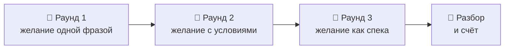

# 🎉 Ивент интересов · Неделя 01 · «Злой джинн»

> [!abstract] Зачем
> Для развлечения — и чтобы почувствовать на своей шкуре, как агент исполняет **ровно то, что написано**. Джинн выполняет желания буквально и с удовольствием находит лазейки. Твоя задача — загадать желание так, чтобы лазеек не осталось.

**Время:** ~1 ч · **Дата выдачи:** 25.10 · **Формат:** «Спека-обманка» (каталог ROADMAP, `AIN`) в декорациях сказки · без оценки, ничего не блокирует

---

## 📜 Вводные

Ты нашёл лампу. Из неё вылез джинн-бюрократ: служил тысячу лет в канцелярии и исполняет желания **строго по тексту**. Он не врёт и не нарушает написанного — но всё, о чём ты промолчал, решает сам, и всегда в свою пользу.

**Твоё желание на все три раунда одно:** *«Пусть завтра в 7:00 на кухне меня ждёт завтрак для всей семьи».* Семья — четыре человека, у младшего аллергия на орехи. Кухня с газовой плитой, холодильник, продукты на неделю. Джинн готовит руками робота-повара.

## 🎲 Правила

1. **Три раунда.** В каждом ты пишешь желание в чат, джинн исполняет его и рассказывает, что вышло. Каждую лазейку он объявляет: «Лазейка: …».
2. **Раунд 1** — одна фраза. **Раунд 2** — до пяти условий. **Раунд 3** — по шаблону спеки: цель, вход, выход, ошибки, критерии приёмки, ограничения и не-цели, безопасность. Можно коротко.
3. **Счёт:** джинн получает очко за каждую лазейку, ты — за каждую закрытую лазейку прошлого раунда, которую он больше не может использовать. Новые лазейки он ищет всегда.
4. **Честная игра:** джинн не придумывает законы физики и не нарушает того, что написано. Если лазейка спорная — спорь, решает здравый смысл.
5. **Финал:** разбор — какие типы дыр оказались у тебя (размытая цель, нет критериев, не описаны ошибки, нет ограничений, не подумали о безопасности) и какой раздел спеки закрыл больше всего.

> [!tip] Как начать
> Напиши агенту: **«Джинн, начинаем»**. Ведущий — агент в роли джинна (правило 29). Игра идёт в разговоре; итог он впишет сюда.

---

## 🏁 Итог

**Счёт (джинн : ты):**

**Самая обидная лазейка:**

**Что закрыло больше всего лазеек:**

**Ответ (2–3 строки: что из этого перенесёшь в свои спеки):**

---

## ✍️ Отчёт

- **Время (сколько ушло):**

---

## 🗒 Разбор *(Ментор, без оценки)*

*(короткий разбор после игры)*
