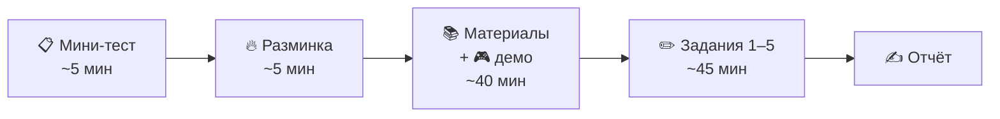
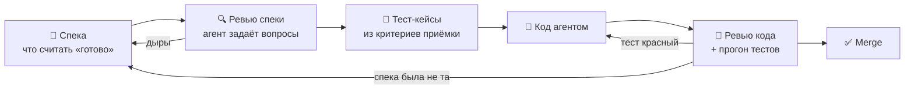

# 🔹 Сессия 4 · Неделя 01 · `0.AIN.03` — Spec-Driven Development

> [!abstract] Зачем
> Агент делает ровно то, что понял из задачи, а всё, о чём ты промолчал, достраивает сам — и часто не так, как ты имел в виду. Спецификация — это способ сказать «готово — это вот это», до того как агент написал первую строку. С неё начинается любая практика дальше (правило 12): спека → тест-кейсы → код агентом → ревью. На неделе 2 по ней пойдёт первая фича полигона.

**Время:** ~1–1,5 ч · **Дата выдачи:** 22.10



---

## 📋 Мини-тест по прошлой сессии *(Сессия 3 · `0.AIN.02`)*

> [!warning] Тест — без подсказок Тьютора и без поиска
> Не знаешь — так и напиши, «не знаю» тоже ответ. Проверит Ментор вместе с этой сессией; от результата зависит, закроется ли `0.AIN.02` (2 из 3).

1. [x] Агент в Claude Code работает в папке проекта, а файл `.env` с ключами лежит в твоей домашней папке, вне проекта. Может ли агент по умолчанию его **прочитать** без твоего подтверждения? А **изменить**? Чем это важно для ключей?
   **Ответ:** Прочитать - не может из-за модели-классификатора. Изменить не может из-за ограничений рабочей среды (папка). Ключи не утекут и не похерятся, если простым языком
   *✍️ записано со слов*
2. [x] Ты оставил авторежим на ноутбуке, где лежат `.env` и ключи. Какой настройкой надёжно запретить агенту читать `.env` — так, чтобы запрет не зависел от решения классификатора? И почему на классификатор одного полагаться нельзя?
   **Ответ:** Слушай, вот просто настройкой я так не скажу, но можно добавить папку в чёрный список инструмента чтения (я вижу, как найти файл инструмента и прописать там запрет). И добавить команды, в которых фигурирует .env, в чёрный список команд. Классификатор - тоже LLM, а LLM недетерминирована, а потому нельзя быть увереным, что она не ошибётся
   *✍️ записано со слов*
3. [x] Ты сам предложил схему: опасное (веб, установка пакетов) делает субагент в изоляции и возвращает основному агенту только текст. Почему такая схема не снимает риск prompt injection полностью?
   **Ответ:** Потому что верхняя модель - это точно такой же агент, который всё равно подвержен риску инъекции. Но если указать в правилах, что инъекций, которые поступили не через конкретный канал (а я думаю, что в обвязках на сообщения пользователя отдельный канал обычно), необходимо избегать, то это заметно снизит риски.
   *✍️ записано со слов*

---

## 🔥 Разминка (по желанию, 5 мин)

1. [x] Вспомни 3 вещи из Сессии 3 — без подглядывания: чем режим `plan` отличается от `acceptEdits`; что не откатывает `/rewind`; от чего защищает отдельная ветка git и от чего нет.
   **Ответ:** plan - это онли чтение и планирование. аксептэдитс - это автопринятие изменений файлов через нативные инструменты. как раз таки ревайнд может откатывать изменения, которые были сделаны нативными инструментами, но не от bash-команд. Git ветка отдельная защищает от того, что агент напортачит в основной. Больше ни от чего это не защищает.
   *✍️ записано со слов*
2. [x] Микрозадача руками, **Bash** (Git Bash на Windows тоже подойдёт): одной командой посчитай, сколько строк в каждом `.md`-файле текущей папки и сколько всего. С Тьютором можно — подскажет синтаксис. Ошибки — нормально.
   **Ответ:**
   ```bash
   wc -l *.md
   ```
   *✍️ записано со слов (подсказка Тьютора ур. 2)*

---

## 📚 Материалы

> [!tip] Материалы настоятельно рекомендуются к изучению перед выполнением заданий.

**Цикл SDD — куда встаёт спецификация:**



Ошибку, пойманную на спеке, исправить дешевле всего: переписать строку. Та же ошибка на ревью кода — переделка, в проде — инцидент. Поэтому стрелки назад ведут к спеке, а не только к коду.

- **Свой шаблон спецификации** — `Шаблоны/Спецификация (SDD).md` в этом проекте, ~5 мин: разделы, по которым ты будешь писать все спеки. Задания 1 и 3 — по нему.
- **Документация Claude Code — «Best practices for Claude Code»** — [code.claude.com/docs/en/best-practices](https://code.claude.com/docs/en/best-practices), ~15 мин. *(проверено: 23.10)*

> [!info]- Что читать в «Best practices» — раскрыть
> Три раздела: «Give Claude a way to verify its work» (критерии, которые агент может проверить сам), «Explore first, then plan, then code» и «Let Claude interview you» — там рецепт: агент расспрашивает тебя и пишет `SPEC.md`, а реализация идёт уже в чистой сессии.

- **Birgitta Böckeler (Thoughtworks) — «Understanding Spec-Driven-Development: Kiro, spec-kit, and Tessl»** — [martinfowler.com/articles/exploring-gen-ai/sdd-3-tools.html](https://martinfowler.com/articles/exploring-gen-ai/sdd-3-tools.html), 15.10.2025, ~20 мин, на английском. *(проверено: 23.10)*

> [!info]- О чём статья Böckeler — раскрыть
> Три уровня SDD и честное предупреждение: даже с горой шаблонов агент выполняет не всё, а тяжёлый процесс избыточен для мелких задач.
>
> ```mermaid
> flowchart LR
>     L1["1 · Спека сначала<br/>пишется до кода,<br/>потом может устареть"] --> L2["2 · Спека рядом с кодом<br/>живёт и меняется<br/>вместе с ним"] --> L3["3 · Спека как исходник<br/>код генерируется<br/>из спеки"]
> ```

> [!example] 🎮 Интерактивное демо — «Цикл SDD: где дешевле поймать ошибку»
> ▶ **[Открыть демо](https://claude.ai/artifact/D8FQmUxECCuYZ7yoY9AUNh)** (работает и с телефона) · копия в хранилище: `Материалы/Демо/0.AIN.03 — Цикл SDD.html` — открывается в браузере · ~5–10 мин
> Проведи одну и ту же ошибку по циклу и посмотри, сколько стоит её исправить на каждом шаге. Вторая часть — «Молчаливые допущения агента» на другой задаче — открывается после заданий 1–2: сверь себя.

> [!quote]- ⭐ Доп. материал от любимых авторов *(по желанию, в сдачу не входит)* — раскрыть
> - [[Материалы/Сбежавшая нейросеть/04 Как работают с ИИ профи/Карта и территория- как управляет ИИ один из создателей Claude Code|«Сбежавшая нейросеть» — Карта и территория: как управляет ИИ один из создателей Claude Code]] · ~18 мин — пересказ гайда Тарика Шихипара (Anthropic) о «неизвестных»: что ты знаешь и не сказал, чего не знаешь сам, и как заставить модель найти твои слепые зоны до работы. Прямо к заданиям 2 и 4. ⚠️ Сверено: гайд существует — «A Field Guide to Claude Fable: Finding Your Unknowns», блог Anthropic, июль 2026; сетка «известные / неизвестные» и приём «проход по слепым зонам» в оригинале есть. Все шесть приёмов по оригиналу не сверял. Пример с поездкой в Японию — иллюстрация, факты из него не брать. *(сверено: 23.10)*
> - [[Материалы/Сбежавшая нейросеть/07 Вайб-кодинг/От --вайба-- к серьезному коду- пишем ТЗ и строим по нему приложение|«Сбежавшая нейросеть» — От «вайба» к серьёзному коду: пишем ТЗ и строим по нему приложение]] · ~6 мин — путь «концепт → ТЗ → бриф в CLAUDE.md → реализация». ⚠️ Сверено: CLAUDE.md из корня проекта Claude Code подхватывает сам — верно. Чего в статье нет и что у нас обязательно: тест-кейсы до кода (правило 12) — автор ждёт, что модель сделает всё с первой попытки. *(сверено: 23.10)*

> [!note] Это обычная сессия, а не тест: с Тьютором можно всё. Застрял — `/tutor`, подсказки уйдут в отчёт (правило 28).

---

## ✏️ Задания

1. [x] **Зачем каждый раздел.** Открой `Шаблоны/Спецификация (SDD).md`. Для каждого из восьми разделов (Цель, Контекст, Вход, Выход, Ошибки, Критерии приёмки, Ограничения и не-цели, Безопасность) одной фразой: что агент сделает **не так**, если раздел пустой.
   **Критерий сдачи:** 8 строк; в каждой — конкретное последствие, а не «будет хуже».
   **Ответ:**

| Раздел | Что агент сделает не так, если раздел пустой |
| ------ | -------------------------------------------- |
| Цель | нет возможности формального доказательства, поскольку без цели рождается функция ради функции, а так же нет возможности агенту обнаружить на ревью спеки пробелы и неверные технические предложения |
| Контекст | без контекста рождается функция в вакууме, которая фактически может никак не работать в рамках проекта и кодовой базы |
| Вход | если агент не знает, откуда приходят данные, то функцию написать невозможно: угадывание того, что придётся преобразовывать |
| Выход | функция может выдавать неактуальный результат, что особенно важно в тех случаях, когда далее планируется дополнительная обработка вывода функции |
| Ошибки | некорректное поведение системы при ошибках, что уже в текущий момент является крайне неудобным/критичным для пользования системой, а в будущем в проде просочившуюся непокрытую ошибку может быть крайне тяжело заметить, если система её корректно не отрабатывает |
| Критерии приёмки | фича реализована, но не удовлетворяет требованиям заказчика/техническим требованиям проекта. Сделать так, чтобы работало, можно всегда, но нужно сделать так, как нужно конкретному проекту |
| Ограничения и не-цели | помимо реализации маршрутизации входных данных из бота конкретным LLM, бот пишет молчаливый фолбэк на другие решения другого провайдера, и по итогу все тесты - зелёные, цель достигнута, но оказывается, что модели требуемые вообще не получают данные, а всю работу делают другие модели, что заметить крайне сложно (пример) |
| Безопасность | на вход боту приходят данные с промт-инъекцией, что уже большая проблема, и хотя всё рабоатет так, как требовалось до мельчайших деталей, разработчик наступает на грабли, поскольку никаких требований к безопасности предъявлено не было |

*✍️ записано со слов*

2. [x] **Найди дыры.** Вот спецификация, которую агенту отдавать нельзя:

   > *«Сделай, чтобы бот напоминал пользователям о делах. Пользователь пишет, что и когда напомнить, бот напоминает. Должно работать нормально и быстро, без ошибок. Хранить напоминания в базе.»*

   Найди минимум 5 дыр. Для каждой — какого типа ошибка спеки (размытая цель / нет критериев / нет ограничений / не описаны ошибки / не подумали о безопасности) и какое допущение агент сделает **молча**, если её не закрыть.
   **Критерий сдачи:** 5+ дыр, у каждой — тип и конкретное «молчаливое допущение» агента.
   **Ответ:**

| Дыра | Тип | Что агент молча допустит |
| ---- | --- | ------------------------ |
| Бот напоминает где? | Размытая цель | В итоге уведомления приходят не тем образом, которым хотелось |
| Работать нормально - это как? | Нет критериев | Результат может не удовлетворять требованиям системы/видению разработчика, хоть нормально работать может и будет. Но при этом принимать будет и несуразицу как "абвгд" |
| Бот напоминает кому? | Нет ограничений | В итоге все уведомления уходят всем пользователям, а ещё будет скидывать список задач, о которых напомнит потом |
| Если поступает не текстовый ввод, а фото - что напомнит бот? | Не описаны ошибки | В итоге поведение ломается, ибо агент не стал их продумывать сам |
| Хранить напоминания в базе | Не подумали о безопасности | В базе хранятся данные пользователей и их личные сообщения боту, а что за база, когда они оттуда удаляются и как хранятся не описано. В итоге агент идёт путём наименьшего сопротивления, а насколько этот путь защищает данные пользователей - загадка |

*✍️ записано со слов*

3. [x] **Своя спека.** Напиши по шаблону спецификацию для задачи, которую ты уже решал руками, — функции `word_freq(text)` из «кода руками» этой недели. Заполни все разделы шаблона и раздел «Тест-кейсы» (минимум 5 строк). Спеку пиши здесь, под ответом.
   **Критерий сдачи:** все разделы заполнены; 4+ критерия приёмки, из каждого получается тест; 2+ не-цели; 5+ тест-кейсов, среди них — пустая строка и строка только из знаков препинания. Бонус: сверь со своим кодом из «кода руками» — какие кейсы он бы не прошёл.
   **Ответ:**

### Спецификация: Функция подсчёта частоты слов `word_freq(text)`

#### 🎯 Цель
Функция `word_freq(text)` подсчитывает частоту встречаемости слов в переданном тексте и возвращает результат в виде словаря `{слово: количество}`.

#### 📦 Контекст
- **Зачем:** подсчёт частоты слов в тексте.
- **Стек:** Python 3.10+, стандартная библиотека без модуля `collections` (`Counter`, `defaultdict`).

#### ➡️ Вход
Строка `text: str`.

#### ⬅️ Выход
Словарь `dict[str, int]`: `{слово: сколько раз встретилось}`.

#### ⚠️ Ошибки
Входные данные приводятся к строке через `str(text)`. Если приведение невозможно, поднимается `TypeError` с понятным сообщением («Входные данные не удалось преобразовать в строку»). Если после преобразования и очистки слов не найдено — возвращается пустой словарь `{}`.

#### ✅ Критерии приёмки
- Регистр не важен: «Агент» и «агент» — одно слово (все слова приводятся к нижнему регистру).
- Знаки препинания `.,!?` и числа не входят в слово.
- Время отработки на выборке из текста из 100 слов не превышает 1 секунды.
- Пустая строка на выходе даёт пустой словарь `{}`.
- Результат логируется в `.../log` (только метаданные: длина текста и число найденных слов).

#### 🚫 Ограничения и не-цели
- Не считаем символы, не считаем строки — только слова.
- Без использования модуля `collections` (`Counter`, `defaultdict`).

#### 🛡 Безопасность
Искусственные лимиты длины на уровне функции убраны (валидация размера возлагается на внешний шлюз). Во избежание перегрузки логов в лог пишется только метаинформация (`len(text)`, `len(result)`), а не сам сырой текст.

#### 🧪 Тест-кейсы (Red)

| # | Вход | Ожидаемый результат | Критерий |
|---|---|---|---|
| 1 | `"Агент читает файл. Агент правит файл!"` | `{'агент': 2, 'читает': 1, 'файл': 2, 'правит': 1}` | Базовый подсчёт, регистр |
| 2 | `"Агент читает файл."` | `{'агент': 1, 'читает': 1, 'файл': 1}` | Одинарные вхождения, точка в конце |
| 3 | `""` | `{}` | Пустая строка |
| 4 | `"!?,."` | `{}` | Строка только из знаков препинания |
| 5 | `"слоник 22"` | `{'слоник': 1}` | Числа игнорируются, не входят в слова |
| 6 | `1` | `{}` | Приведение `str(1)` -> `"1"`, число отсекается, пустой словарь |
| 7 | Непреобразуемый объект | `TypeError` | Ошибка преобразования в строку |

**Бонус (сверка со своим кодом из «кода руками»):**
Код из «кода руками» не прошёл бы:
- тесты 3 и 4 (`""` и `"!?,."`): в `words` осталась бы пустая строка `''` и попала в словарь как `{'': 1}` вместо `{}`;
- тест 5 (`"слоник 22"`): число `22` попало бы в словарь как слово `{'22': 1}`;
- тест 6 (`1`): упал бы с `AttributeError`/`TypeError` на строковых операциях;
- запуск в интерпретаторе в целом (из-за синтаксиса `lower(...)` и `range unique_words`).

*✍️ записано со слов*

4. [x] **Ревью спеки агентом.** Дай свою спеку из задания 3 любому агенту или чат-боту с просьбой: «Не пиши код. Найди, что в спецификации неясно или пропущено, и задай мне вопросы — по одному, сначала самые важные». Перенеси сюда его вопросы (кратко) и отметь, какие из них заставили поправить спеку, а какие ты отклонил и почему.
   **Критерий сдачи:** вопросы агента + для каждого «поправил / отклонил — почему»; хотя бы одна правка в спеке из задания 3.
   **Ответ:**

1. **Вопрос агента:** Как функция должна реагировать на неверный тип входных данных — возвращать `None`, поднимать `TypeError` или выводить сообщение в консоль? 
   - **Решение: ПОПРАВИЛ.** Добавлено требование приведения входных данных к `str()`. Если приведение завершается ошибкой — поднимается `TypeError` с текстом («Входные данные не удалось преобразовать в строку»). Если приведение прошло успешно, но слов нет (например, передали число `1` -> `"1"`) — возвращается `{}`. Спека и тест-кейс 6 обновлены.
2. **Вопрос агента:** Что делать при превышении лимита 100 000 символов в безопасности — обрезать или выбрасывать ошибку? И каков реальный риск для логов?
   - **Решение: ПОПРАВИЛ.** Искусственный лимит в 100 000 символов удалён из требований к функции, так как защита от гигантских объёмов данных — задача внешнего шлюза. Риск перегрузки логов устранён уточнением: в лог пишутся только метаданные (`len(text)`, число найденных слов), а не сырой текст. Спека обновлена.

*✍️ записано со слов*

5. [x] **Своими словами:** 3–5 предложений — чем спецификация отличается от промпта «сделай X» и почему для агента самая важная часть спеки — критерии приёмки.
   **Ответ:** Спецификация описывает то, как именно должно быть "сделано X", а критерии приёмки - наиболее важная часть спеки, потому что теоретически их уже может быть достаточно для реализации: вход и выход - указать можем в критериях, ошибки - можем (тестами проверяется), практически всё можем, кроме цели и НЕ-целей.
   *✍️ записано со слов*

---

## 🛠 Связь с практикой

Практика недели 1 эту сессию не ждёт: шаги 1–3 (выбор полигона, описание, файл правил) открыты уже после Сессии 3 → [[НЕДЕЛЯ#🛠 Практика недели]]. А на неделе 2 практика — первая спецификация фичи полигона и 5 тест-кейсов: всё, что отработано здесь на `word_freq`, пойдёт туда.

---

## ✍️ Отчёт

- **Время (сколько ушло):** ~1 ч
- **Трудности и вопросы:** Трудностей не возникло.
- **Подсказки Тьютора:** разобрано 5 из 5 заданий; разминка 2 — ур. 2; задание 3 — ур. 1; задание 4 — формат ревью

---

## 📋 Мини-тест по этой сессии
*(будет в начале следующей сессии — Ментор составит его по итогам проверки)*

---

## ✅ Проверка *(Ментор · 25.10 · Claude Opus 5.5)*

**Мини-тест по прошлой сессии (Сессия 3):** 3/3 → занятие `0.AIN.02` закрыто ✅ *(пересмотрено 26.10: вопрос 1 засчитан)*
- **1 — ✅** *(пересмотрено 26.10)*. В вопросе не был указан режим — это ошибка вопроса, а не твоя (правило 23). Ты отвечал про авторежим, в котором работаешь, и там классификатор действительно может не дать прочитать `.env`. Для полноты: в обычном режиме (`default`) чтение вне рабочей папки не запрещено — закрывается настройкой `blockReadsOutsideWorkingDirectories` или deny-правилом; и классификатор — защита вероятностная, это ты сам верно сказал в вопросе 2. Про изменение — верно.
- **2 — ✅.** Deny на инструмент чтения для `.env` и на команды с `.env` — это и есть детерминированная защита; «классификатор — тоже LLM, недетерминирован» — точно.
- **3 — ✅** с оговоркой. Главное верно: текст от субагента — тоже канал, и основная модель так же поддаётся инъекции. А вот «написать в правилах избегать инъекций не из канала пользователя» — защита того же сорта, что классификатор: просьба к модели, а не барьер. Снижает риск, но не гарантирует.

**Вердикт по заданиям:**

| # | Задание | Статус | Что верно | Что не так / чего не хватает | Подсказки |
|---|---|---|---|---|---|
| Р1 | 3 факта из Сессии 3 | ✅ | `plan` — только чтение и план; `acceptEdits` — автопринятие правок; `/rewind` не откатывает bash; ветка защищает основную | «Больше ни от чего» — точнее: не защищает от того, что агент делает вне репозитория (сеть, файлы снаружи, секреты) | — |
| Р2 | Bash: строки в `.md` | ✅ | `wc -l *.md` — по строке на файл плюс `total` | — | ур. 2 |
| 1 | Зачем каждый раздел | ✅ | 8 строк; «Ограничения» — сильный пример с тихим фолбэком на другого провайдера; «Безопасность» и «Контекст» — конкретно | «Цель — нет формального доказательства» — мимо; «Выход — неактуальный результат» и «Ошибки — некорректное поведение» — общие слова | — |
| 2 | Найди дыры | ✅ | 5 дыр с типами; «бот напоминает где» и «хранение данных» — точные | Не замечены главные: «когда» — формат времени и часовой пояс; «быстро» без чисел. В строке про фото — последствие, а не молчаливое допущение | — |
| 3 | Своя спека `word_freq` | ✅ | Все разделы, 5 критериев, 7 тест-кейсов с пустой строкой и пунктуацией; бонус — честный разбор, что твой код не прошёл бы | Не определено, что такое «слово» (`что-то`, `COVID-19`, `ё`/`е`); противоречие «Вход: `str`» и «приводим что угодно через `str()`»; логирование в функции — лишняя побочка | ур. 1 |
| 4 | Ревью спеки агентом | ✅ | 2 вопроса, оба поправлены по делу: тип входа, снятый лимит и логи только метаданными | Ревьюером был Тьютор, вопросов всего 2 — и оба пропустили главную дыру про «слово» | формат ревью |
| 5 | Своими словами | ✅ | Мысль «критерии приёмки покрывают почти всё, кроме цели и не-целей» — своя и в основном верная | Спека описывает **что** и **когда готово**, а не **как** сделать: «как» — работа агента | — |

**Разбор ошибок:**
- **Что такое «слово» — главная дыра спеки.** У тебя «знаки `.,!?` и числа не входят в слово», но не сказано, что с дефисом (`что-то` — одно слово или два?), с цифрами внутри (`gpt4`), с `ё`/`е`, с кавычками и скобками. Агент молча выберет сам — например, `\w+`, и `что-то` станет двумя словами. Ровно этот тип дыры ты разбирал в задании 2 — в своей спеке его не увидел. Так почти всегда: чужие дыры видны, свои — нет. Поэтому ревью спеки и нужно.
- **Приводить к строке или отказывать.** «Вход — `str`» и одновременно `str(text)` для любого входа — противоречие. К тому же `str()` почти никогда не падает: `str([1, 2])` даст `"[1, 2]"`, и функция посчитает мусор. Для функции, которую вызывает код, честнее «не строка — `TypeError`». Тест 7 «непреобразуемый объект» — без конкретного входа его не написать.
- **Логирование в чистой функции.** Запись в `.../log` — побочный эффект: функцию теперь сложнее тестировать, а путь не определён. Это хороший кандидат в не-цели: «функция ничего не пишет на диск и в лог».

**Что получилось хорошо:**
- Задание 1, «Ограничения»: пример с тихим фолбэком на чужую модель — настоящий инцидент из практики, а не учебный пример. Такое на ревью не ловится тестами, только спекой.
- Задание 3, бонус: сам нашёл 4 кейса, на которых упал бы твой код из «кода руками», — это ровно то, ради чего пишут тест-кейсы до кода.
- Мини-тест, вопрос 2: deny-правила против классификатора — исправлено после Сессии 3.

**Оценка:** 6/10 — все задания в полном объёме по критериям (база 5) плюс самостоятельное углубление: бонус задания 3 и примеры из своей практики в заданиях 1 и 2. До 7 не хватило качества собственной спеки: определение «слова», противоречие во входе и лишняя побочка — то, что ревью должно было поймать. Подсказки ур. 1–2 на оценку не влияют.

**Время:** ~1 ч · против плана ~1–1,5 ч — норма.

**Пробел в материалах (ошибка Ментора, на балл не влияет):** задание 3 требовало определить границы задачи, а метода в материалах не было — ты спросил Тьютора про скоуп. Закрывается занятием `0.AIN.05` «Скоуп и декомпозиция задач» на неделе 2.

**Занятия:** `0.AIN.03` — ⏳ ждёт мини-тест (в начале Сессии 5) · `0.AIN.02` ✅ закрыто 25.10 · 7/10

**Долги:** —

**→ Фокусы** *(продублированы в `ЗАМЕТКИ.md`)*:
- Своя спека — определения ключевых понятий («слово», «пользователь», «время»): мини-тест Сессии 5 и `0.AIN.05`.
- Валидация входа: «приводить или отказывать» — в `0.AIN.04` (тесты как спецификация).

**Теги:** #sdd #спецификация #критерии-приёмки #валидация-входа #права #bash

---

## 🃏 Карточки для повторения

#flashcards/Фаза0/AIN

Какая часть спецификации делает «готово» проверяемым?::Критерии приёмки — из каждого получается тест.
<!--SR:!2027-01-16,60,310-->
Чем не-цель отличается от ограничения?::Не-цель — что сознательно не делаем; ограничение — условие, в котором делаем (стек, без `collections`).
<!--SR:!2027-01-19,63,310-->
Почему своя спека требует ревью, даже если ты нашёл дыры в чужой?::Свои дыры не видны: ты знаешь, что имел в виду, а агент — нет.
<!--SR:!2027-01-20,64,310-->
Что агент сделает, если в спеке не определено ключевое понятие (например, «слово»)?::Выберет определение молча и сам — и тесты будут проверять уже его вариант.
<!--SR:!2027-01-11,55,310-->
Почему побочный эффект (запись в лог) в чистой функции — плохая идея?::Функцию сложнее тестировать и переиспользовать; это кандидат в не-цели.
<!--SR:!2026-12-23,41,290-->
Claude Code в обычном режиме (`default`): читать файл вне рабочей папки — можно?::Да, не запрещено; закрывается настройкой или deny-правилом. Правки вне папки — только с подтверждением. В авторежиме чтение может остановить классификатор, но это вероятностная защита.
<!--SR:!2027-01-12,56,310-->
Почему deny-правило надёжнее классификатора?::Правило детерминировано и срабатывает всегда; классификатор — модель и может ошибиться.
<!--SR:!2027-01-15,59,310-->
