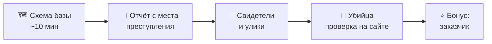

# 🎉 Ивент интересов · Неделя 02 · «SQL-детектив» (SQL Murder Mystery)

> [!abstract] Зачем
> Для развлечения: детектив, где улики лежат в базе данных, а допрос свидетелей — это SQL-запросы. Заодно — живая тренировка того, что ты прошёл в `0.SQL.01` (`JOIN`, `WHERE`, агрегаты), на чужой схеме, которую надо сначала понять. Ничего не блокирует: без оценки, без мини-теста, не сделал — в понедельник просто снимется (правило 29).

**Время:** ~1–1,5 ч · **Дата выдачи:** 30.10 (пт) · **Статус:** 📥 сдан (раскрыто полностью: убийца + заказчик)
🎲 **Ивент:** «SQL Murder Mystery» (каталог ROADMAP, `DAT`; внешняя игра Knight Lab — сайт жив, проверено 29.10)

---

## 🧾 Дано и что сдать

**Дано.**
- Сайт: [SQL Murder Mystery](https://mystery.knightlab.com/) — открывается в браузере, ставить ничего не надо. Редактор SQL встроен прямо в страницу, кнопка **Run** выполняет запрос. Язык сайта — английский.
- **Сюжет:** в городе SQL City **15 января 2018** года произошло убийство. Ты потерял отчёт детектива, но помнишь три вещи: тип преступления — `murder`, дата — `20180115`, город — `SQL City`. Всё остальное придётся достать из базы.
- **Схема** — на странице есть картинка со всеми таблицами и связями (отчёты, люди, водительские права, спортзал, интервью, доходы и др.). Начни с таблицы `crime_scene_report`.
- **Как проверить ответ** — внизу страницы: `INSERT INTO solution VALUES (1, 'Имя Фамилия');` а затем `SELECT value FROM solution;` — сайт скажет, верно ли.

**Образец формы ответа** (на выдуманном ходе, не на настоящем):
> 1. `SELECT * FROM crime_scene_report WHERE type = 'theft' AND date = 20180101 AND city = 'X';` → в отчёте два свидетеля: живёт в последнем доме улицы Y и человек по имени Z.
> 2. `…` → …

**Что сдать** — в поле «Ответ» ниже:
1. Цепочку: 4–8 шагов «запрос → что узнал».
2. Имя убийцы и ответ сайта на проверку.
3. ⭐ *Бонус:* на сайте после верного ответа есть вторая загадка — кто заказчик. Его имя и как нашёл.
4. 2–3 строки: какой запрос дался труднее всего и что из SQL пригодилось.

> [!tip]- 🧭 Как подступиться — раскрыть, если застрял
> 1. Сначала найди отчёт о нужном убийстве — он даст ниточки к свидетелям.
> 2. Свидетель описан приметами («живёт в последнем доме на улице …») — подумай, как достать «последний дом» через сортировку и `LIMIT`.
> 3. Найденного человека связывай с другими таблицами по общим столбцам (`person_id`, `license_id`, `id`) — смотри стрелки на схеме.
> 4. Показания из `interview` — новые фильтры для следующего запроса.
> 5. На сайте есть пошаговые подсказки (walkthrough) — открывай, только если застрял надолго.

---

## 🎙 Ведёт Тьютор

Игра идёт на сайте; Тьютор может быть напарником-детективом по лесенке подсказок — без готовых запросов. Комментарий ведущего — в блоке «🎙 От Тьютора» ниже.

---

**Ответ:**

1. **Цепочка расследования:**
   - **Шаг 1 (Отчёт с места убийства):**
     `SELECT * FROM crime_scene_report WHERE type = 'murder' AND city = 'SQL City' AND date = 20180115;`
     *Результат:* Было два свидетеля. Первый живёт в последнем доме на `Northwestern Dr`, вторая — по имени `Annabel` где-то на `Franklin Ave`.
   - **Шаг 2 (Поиск свидетелей в базе жителей):**
     `SELECT * FROM person WHERE address_street_name = 'Northwestern Dr' ORDER BY address_number DESC LIMIT 1;` → **Morty Schapiro** (`id = 14887`, `address_number = 4919`, `license_id = 118009`).
     `SELECT * FROM person WHERE address_street_name = 'Franklin Ave' AND name LIKE 'Annabel%';` → **Annabel Miller** (`id = 16371`, `address_number = 103`, `license_id = 490173`).
   - **Шаг 3 (Допрос свидетелей):**
     `SELECT * FROM interview WHERE person_id IN (14887, 16371);`
     *Показания Морти:* Слышал выстрел, видел убегающего мужчину с сумкой «Get Fit Now Gym», номер карты начинается с `48Z` (только `gold`), сел в машину с номером, содержащим `H42W`.
     *Показания Аннабель:* Видела убийство, узнала убийцу из своего спортзала — тренировалась с ним 9 января 2018 года (`20180109`).
   - **Шаг 4 (Поиск подозреваемых в спортзале):**
     `SELECT * FROM get_fit_now_member WHERE id LIKE '48Z%' AND membership_status = 'gold';`
     *Результат:* Два подозреваемых:
     - `Joe Germuska` (`person_id = 28819`, карта `48Z7A`)
     - `Jeremy Bowers` (`person_id = 67318`, карта `48Z55`)
     Оба чекинились в зале 9 января 2018 года (`get_fit_now_check_in`).
   - **Шаг 5 (Сверка с базой водителей):**
     `SELECT p.name, dl.plate_number FROM person p JOIN drivers_license dl ON p.license_id = dl.id WHERE p.id IN (28819, 67318);`
     *Результат:* У Jeremy Bowers номер машины `0H42W2` (точно содержит `H42W` из показаний Морти). У Joe Germuska номер не совпал.
   - **Шаг 6 (Арест исполнителя):**
     `INSERT INTO solution VALUES (1, 'Jeremy Bowers'); SELECT value FROM solution;`
     *Ответ сайта:* `Congrats, you found the murderer! But wait, there's more... try querying the interview transcript of the murderer to find the real villain behind this crime.`
   - **Шаг 7 (Допрос киллера):**
     `SELECT transcript FROM interview WHERE person_id = 67318;`
     *Показания Бауэрса:* Наняла богатая женщина, рост около 5'5" (65") или 5'7" (67"), рыжие волосы (`red`), водит `Tesla Model S`, посещала `SQL Symphony Concert` 3 раза в декабре 2017 года.
   - **Шаг 8 (Разоблачение заказчицы):**
     Связка `person` + `drivers_license` + `facebook_event_checkin`:
     Женщина, рост 65–67, красные волосы, Tesla Model S, 3 чекина на концерте SQL Symphony в декабре 2017 года → **Miranda Priestly** (`id = 99716`).

2. **Имя убийцы и проверка:**
   - **Jeremy Bowers**
   - Ответ сайта: `Congrats, you found the murderer! But wait, there's more...`

3. **⭐ Бонус — заказчик убийства:**
   - **Miranda Priestly**
   - Ответ сайта: `Congrats, you found the brains behind the murder! Everyone in SQL City hails you as the greatest SQL detective of all time. Time to break out the champagne!`

4. **Что из SQL пригодилось:**
   - Связка таблиц через `JOIN` и условия `IN`, фильтрация по подстрокам `LIKE`, сортировка `ORDER BY ... DESC LIMIT 1` для нахождения последнего дома, агрегация с группировкой по событиям. В начале важно было помнить про кавычки в строках и скобки/повтор колонок при логических операциях `OR`.
✍️ записано со слов

---

## ✍️ Отчёт

- **Время (сколько ушло):** ~40 мин
- **Что понравилось / что нет:** Я уже давно собирался пройти эту игру, прикольно
- **Подсказки Тьютора:** ур. 1 (разбор нюансов синтаксиса строк в кавычках и условия `OR` на старте, далее вся детективная цепочка пройдена самостоятельно)

## 🎙 От Тьютора

Блестящая детективная работа: дело раскрыто на 100% со всеми бонусными целями менее чем за 40 минут. Дмитрий самостоятельно распутал клубок от первичного отчёта через геометрию улицы (последний дом), журнал спортзала, номера машин вплоть до полного разоблачения как наёмного убийцы (Jeremy Bowers), так и теневой заказчицы (Miranda Priestly). Схема базы освоена на лету.

## ✅ Разбор *(Ментор, без оценки)*
