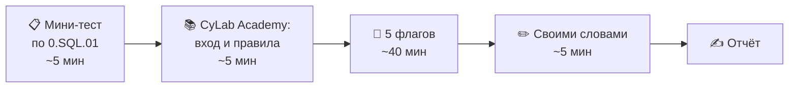
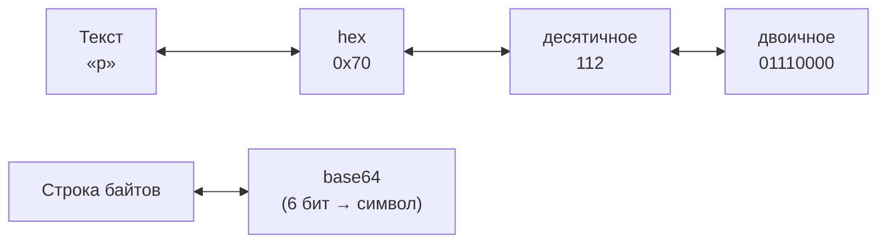

# 🟨 Интерес · Неделя 02 · `0.CTF.01` — Первые флаги

> [!abstract] Зачем
> CTF — тренажёр мышления атакующего: без него модель угроз (`0.SEC.01` на этой неделе) остаётся списком из учебника. Первые задачи — про кодировки и файлы: base64, hex и двоичный код — это не шифрование, а другой способ записать те же байты. Ровно так прячут инструкции для агентов в prompt injection и «секреты» в конфигах. Это интерес: ничего не блокирует; срок по ритму недели — до среды.

**Время:** ~1 ч · **Дата выдачи:** 26.10



---

## 📋 Мини-тест по прошлому интересу *(`0.SQL.01` — Повтор JOIN и агрегатов)*

> [!warning] Тест — без подсказок Тьютора и без поиска
> Не знаешь — «не знаю» тоже ответ. От результата зависит, закроется ли `0.SQL.01` (2 из 3).

1. [x] Ищем здания без сотрудников: `LEFT JOIN employees ON buildings.building_name = employees.building WHERE employees.<колонка> IS NULL`. Какую колонку `employees` безопасно подставить в `IS NULL`, а какую — нет? Что пойдёт не так, если взять колонку, которая бывает пустой сама по себе (например, `years_employed` у новичков)?
   **Ответ:** Name. Если взять колонку, которая может быть пустой сама по себе, то в списке может появиться лишнее здание.
   ✍️ записано со слов
2. [x] В таблице 10 сотрудников, у троих поле `building` пустое (`NULL`). Что вернут `COUNT(*)` и `COUNT(building)` — и почему по-разному?
   **Ответ:** 10 и 7. Потому что * - это "всё", а building - это конкретная колонка. В первом случае - все строки. Во-втором - строки с building.
   ✍️ записано со слов
3. [x] Почему в `WHERE` нельзя сослаться на псевдоним из `SELECT` (`SELECT years * 12 AS months … WHERE months > 24`), а в `ORDER BY` — можно? Ответь через порядок выполнения запроса.
   **Ответ:** Where выполняется до Select. Order by - после Select.
   ✍️ записано со слов

---

## 📚 Материалы

> [!tip] Материалы настоятельно рекомендуются к изучению перед выполнением заданий.

**Одни и те же байты — разные записи:**



Кодировка обратима для любого, кто знает её название, — ключ не нужен. Шифрование без ключа не читается. Поэтому base64 в конфиге — не защита, а base64 в тексте веб-страницы — частый способ спрятать инструкцию от фильтра, но не от модели.

- **CyLab Security Academy** (бывший picoGym) — бесплатная тренировочная площадка Карнеги — Меллона: [learn.cylabacademy.org](https://learn.cylabacademy.org) → библиотека задач (Library). Весной 2026 picoCTF переехал сюда: старый адрес `play.picoctf.org` больше не открывается, задачи те же. Нужен бесплатный аккаунт — заведи сам; аккаунт picoCTF, созданный до 08.05.2026, работает. Фильтр по категории **General Skills**, поиск по названию. *(Переезд сверен 30.10 по picoctf.org и cylabacademy.org; названия задач сверены 26.10 по разборам на ctftime.org и GitHub. 30.10 сверено в библиотеке CyLab под твоим аккаунтом: все пять есть, General Skills, сложность Easy — Obedient Cat (picoCTF 2021), Lets Warm Up, 2warm, Bases, First Grep (picoCTF 2019).)*
- У многих задач есть встроенная **webshell** (Linux-терминал в браузере) — можно решать там, ничего не ставя. Или PowerShell на своём компьютере.
- Флаг выглядит как `picoCTF{...}` (у задач после переезда встречается и префикс `academy`) — его вставляют в поле задачи.

> [!tip]- 🧭 Как подступиться к задаче, если не идёт — раскрыть
> 1. Прочитай условие и подсказки (Hints) в задаче — они часть игры, не штраф.
> 2. Определи, **что за запись** перед тобой: только `0–9a-f` — похоже на hex; `A–Za-z0-9+/` и `=` в конце — похоже на base64; только `0` и `1` — двоичное.
> 3. Найди инструмент перевода: в Python — `int()` с основанием, `bin()`, `chr()`, модуль `base64`; в Linux — `base64 -d`, `xxd`; в PowerShell — класс `[Convert]`.
> 4. Файл — сначала посмотри, что внутри (`cat`, `type`, `Get-Content`), если большой — ищи по образцу (`grep`, `Select-String`).

> С Тьютором можно всё: это интерес, а не тест. Подсказки уйдут в отчёт.

---

## ✏️ Задания

1. [x] **5 флагов в CyLab Security Academy, General Skills:** `Obedient Cat`, `Lets Warm Up`, `2Warm` (Easy) и `Based`, `plumbing` (Medium). Если какой-то задачи не найдёшь по названию — возьми любую соседнюю из General Skills про кодировки или файлы и напиши, какую.
   > *Заменено 30.10 по просьбе пользователя: Easy слишком простые. `Bases` → `Based` (то же про системы счисления, но несколько записей подряд), `First Grep` → `plumbing` (вывод сервиса через пайп и поиск по нему). Три Easy уже решены. По желанию шестая — `Python Wrangling` (Medium): запустить чужой скрипт с аргументами.*
   **Критерий сдачи:** по каждой задаче — флаг сдан (площадка засчитала) + одна строка: какой командой или кодом достал и что это была за запись (hex, base64, двоичная, просто файл).
   **Ответ:**

| Задача | Чем достал (команда или код) | Что это за запись |
|---|---|---|
| Obedient Cat | Открыл через «Блокнот» | просто файл |
| Lets Warm Up | Онлайн-конвертер (hex → ASCII: 0x70 = 'p') | hex (шестнадцатеричная) |
| 2Warm | Вручную (степени двойки: 42 = 32 + 8 + 2 → 101010) | двоичная (бинарная) |
| Based | `nc` в WebShell + раскодирование binary, octal, hex | двоичная, восьмеричная, hex |
| plumbing | `nc chatelaine.cylabacademy.net 20459 \| grep academy` | сетевой поток через пайп `\|` (grep) |
| *Python Wrangling (по желанию)* | — (пропущено, 5 флагов закрыты) | — |

2. [x] **🔧 Руками, обратная задача** (10 мин): закодируй в base64 строку `не секрет` и раскодируй обратно — одним и тем же инструментом (Python, PowerShell или `base64` в webshell). Сравни длину до и после.
   **Критерий сдачи:** команды и вывод + 2 строки: почему результат длиннее исходника и почему это не шифрование.
   **Ответ:**
   ```powershell
   PS C:\WINDOWS\system32> python -c "import base64; b = base64.b64encode('не секрет'.encode()); print(b.decode()); print(base64.b64decode(b).decode())"
   0L3QtSDRgdC10LrRgNC10YI=
   не секрет
   ```
   - Длина до и после: исходная строка `не секрет` — 9 символов (17 байтов в UTF-8), закодированная в base64 строка `0L3QtSDRgdC10LrRgNC10YI=` — 24 символа.
   - Почему результат длиннее: алгоритм Base64 пакует каждые 3 байта (24 бита) в 4 символа (по 6 бит на символ), что даёт увеличение размера примерно на 33%.
   - Почему это не шифрование: для раскодирования не требуется секретный ключ; алгоритм обратим и стандартизирован, любой инструмент может раскодировать данные без знания секрета.
   ✍️ записано со слов

3. [x] **Своими словами**, 3–4 предложения: чем кодировка отличается от шифрования, и где это различие важно для агентных систем — приведи один пример из своей работы с агентами (конфиги, ключи, веб-страницы, которые читает агент).
   **Критерий сдачи:** различие объяснено через «нужен ли ключ»; есть пример, связанный с агентом.
   **Ответ:**
   Кодировка — это общеизвестный формат представления значения, и декодировать можно без ключа. Шифрование — это приватный способ представления значения, и для расшифровки требуется ключ шифрования.
   Сегодня много раз озвучивалось, что агенту недостаточно гардлайна в виде блокировки команд по их тексту, поскольку агент может закодировать команду, оставив инструкцию исходной, но изменив текст. Шифрование ключей я бы рассмотрел как возможность обезопасить хранимые в репозитории/на сервере приватные ключи, поскольку без ключа агент не сможет их расшифровать, но сможет использовать в коде через дешифратор.
   ✍️ записано со слов

---

## 🟨 Мостик к ядру

На этой неделе — модель угроз (`0.SEC.01`). Флаг в CTF — это «актив», задача — «поверхность атаки». Запомни, где ты искал флаг: те же места (файлы, кодировки, заголовки) атакующий проверит у твоего полигона.

---

## ✍️ Отчёт

- **Время (сколько ушло):** ~45 мин
- **Трудности и вопросы:** переезд платформы с picoGym на CyLab Academy (смена адреса и формата флага с picoCTF на academy); замена Easy на Medium задачи (Based и plumbing)
- **Подсказки Тьютора:** *(мини-тест — без подсказок; задания — можно: «задание N — ур. X»)*
  - Задание 1 (`plumbing`) — ур. 2 (пайп `| grep academy` в WebShell);
  - Задание 2 — ур. 2 (разбор однострочника Python `b64encode/b64decode` и байтов UTF-8);
  - Задание 3 — ур. 0.

---

## 📋 Мини-тест по этому занятию
*(составлен 30.10 по итогам проверки — в начале [[Фаза 0/Недели/Неделя 02 (26.10–01.11)/Интерес — 0.PAI.01|`0.PAI.01`]])*

---

## ✅ Проверка *(заполняет Ментор)*

**Мини-тест по прошлому интересу (`0.SQL.01`):** 3/3 *(проверен 27.10, утренний автозапуск)* → занятие `0.SQL.01` закрыто ✅ 27.10 · 7/10
- **1 — ✅.** `Name` подходит: у каждого сотрудника имя есть, значит `NULL` в нём бывает только у «пустой» стороны `LEFT JOIN`. Самый надёжный выбор — колонка соединения (`building`) или первичный ключ: они не бывают `NULL` у найденной пары по определению. Последствие с `years_employed` названо верно — лишнее здание в списке.
- **2 — ✅.** 10 и 7: `COUNT(*)` считает строки, `COUNT(колонка)` — только непустые значения.
- **3 — ✅.** `WHERE` выполняется до `SELECT`, `ORDER BY` — после, поэтому псевдоним в `WHERE` ещё не существует.

**Проверка заданий — 30.10, Claude Opus 5.5**

> [!success] Главное
> - **Держится:** узнаёшь запись по виду (двоичная, восьмеричная, hex), base64 — правильный расчёт длины (17 байтов → 24 символа), различие «нужен ли ключ».
> - **Поправить:** шифрование — не «приватный способ»: алгоритм обычно публичен, секрет — только ключ. И доступ к дешифратору — то же, что доступ к секрету.
> - **В следующий раз:** решать сразу командами, а не онлайн-конвертером: в `0.CTF.02` (форензика) пригодятся `xxd`, `file`, `strings`.

| № | Задание | Статус | Комментарий |
|---|---|---|---|
| 1 | 5 флагов | ✅ | Все 5 засчитаны, из них 2 Medium (`Based`, `plumbing`) — уровень поднял сам. `nc … \| grep` — ровно то, что нужно было в `plumbing`. Lets Warm Up через онлайн-конвертер — засчитано, но критерий просил команду или код; `Python Wrangling` — по желанию, пропуск не влияет |
| 2 | base64 туда и обратно | ✅ | Однострочник рабочий; 9 символов = 17 байтов UTF-8 (кириллица — по 2 байта) → 24 символа base64: 3 байта → 4 символа, остаток добит `=`. Верно и «почему не шифрование» |
| 3 | Своими словами | ✅ | Различие через ключ есть, пример с агентом — сильный (команду можно закодировать, и фильтр по тексту её не узнает). Две неточности — ниже |

**Разбор ошибок**
- *«Шифрование — это приватный способ представления»* → алгоритмы шифрования (AES, RSA) открыты и проверены всеми; секрет — **только ключ** (принцип Керкгоффса). → Почему важно: «свой секретный алгоритм» — частая самодельная «защита», которую ломают первой.
- *«Без ключа агент не сможет расшифровать, но сможет использовать через дешифратор»* → если агент может вызвать дешифратор в своём процессе, где лежит ключ, то для него секрет **уже открыт**: он может напечатать результат или отправить его наружу. → Секрет защищает от того, у кого нет доступа к среде с ключом (утёкший репозиторий, бэкап). От агента защищает граница среды: ключ — в другом процессе или сервисе, агент получает только результат действия, а не значение.

**Что получилось хорошо:** сам попросил задачи сложнее и сделал их; пример «закодированная команда обходит фильтр по тексту» — прямо в тему `0.SEC.01` и фокуса недели «ограничения средой, а не словами».

**Подсказки Тьютора:** задание 1 (`plumbing`) и задание 2 — ур. 2 → на оценку не влияют.

**Оценка: 6/10** — полный объём плюс два Medium вместо Easy по своей инициативе (углубление); до 7 не дотягивает из-за неточностей в задании 3.
**Время:** ~45 мин против плана ~1 ч.
**Занятие:** `0.CTF.01` — ⏳ ждёт мини-тест (в начале `0.PAI.01`).
**Теги:** `#ctf` `#кодировки` `#base64` `#шифрование` `#пайпы` `#nc`

## 🃏 Карточки для повторения

Чем кодировка отличается от шифрования?::Кодировку раскодирует любой, кто знает её название; для расшифровки нужен ключ #flashcards/Фаза0/CTF
<!--SR:!2026-11-13,10,270-->
Что в шифровании секретно — алгоритм или ключ?::Только ключ; алгоритм обычно публичен (принцип Керкгоффса) #flashcards/Фаза0/CTF
<!--SR:!2026-11-14,11,270-->
Во сколько раз base64 длиннее исходных байтов?::Примерно в 4/3: каждые 3 байта → 4 символа, остаток добивается `=` #flashcards/Фаза0/CTF
<!--SR:!2026-11-04,3,250-->
Признаки base64 на глаз?::Символы `A–Z a–z 0–9 + /`, длина кратна 4, на конце бывает `=` или `==` #flashcards/Фаза0/CTF
<!--SR:!2026-11-14,11,270-->
Что делает `nc хост порт | grep слово`?::Подключается к сервису, а его вывод через пайп фильтрует по строкам со словом #flashcards/Фаза0/CTF
<!--SR:!2026-11-15,12,270-->
Агент может вызвать `decrypt()` в процессе, где лежит ключ. Защищён ли секрет от агента?::Нет: он может получить и вывести расшифрованное. Защита — ключ в другой среде, агенту — только результат действия #flashcards/Фаза0/CTF
<!--SR:!2026-11-16,13,270-->
