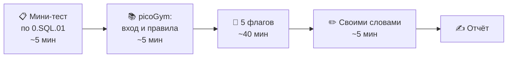
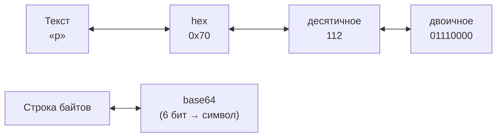

# 🟨 Интерес · Неделя 02 · `0.CTF.01` — Первые флаги

> [!abstract] Зачем
> CTF — тренажёр мышления атакующего: без него модель угроз (`0.SEC.01` на этой неделе) остаётся списком из учебника. Первые задачи — про кодировки и файлы: base64, hex и двоичный код — это не шифрование, а другой способ записать те же байты. Ровно так прячут инструкции для агентов в prompt injection и «секреты» в конфигах. Это интерес: ничего не блокирует; срок по ритму недели — до среды.

**Время:** ~1 ч · **Дата выдачи:** 26.10

---

## 📋 Мини-тест по прошлому интересу *(`0.SQL.01` — Повтор JOIN и агрегатов)*

> [!warning] Тест — без подсказок Тьютора и без поиска
> Не знаешь — «не знаю» тоже ответ. От результата зависит, закроется ли `0.SQL.01` (2 из 3).

1. [ ] Ищем здания без сотрудников: `LEFT JOIN employees ON buildings.building_name = employees.building WHERE employees.<колонка> IS NULL`. Какую колонку `employees` безопасно подставить в `IS NULL`, а какую — нет? Что пойдёт не так, если взять колонку, которая бывает пустой сама по себе (например, `years_employed` у новичков)?
   **Ответ:**
2. [ ] В таблице 10 сотрудников, у троих поле `building` пустое (`NULL`). Что вернут `COUNT(*)` и `COUNT(building)` — и почему по-разному?
   **Ответ:**
3. [ ] Почему в `WHERE` нельзя сослаться на псевдоним из `SELECT` (`SELECT years * 12 AS months … WHERE months > 24`), а в `ORDER BY` — можно? Ответь через порядок выполнения запроса.
   **Ответ:**

---

## 📚 Материалы

> [!tip] Материалы настоятельно рекомендуются к изучению перед выполнением заданий.

**Одни и те же байты — разные записи:**

Кодировка обратима для любого, кто знает её название, — ключ не нужен. Шифрование без ключа не читается. Поэтому base64 в конфиге — не защита, а base64 в тексте веб-страницы — частый способ спрятать инструкцию от фильтра, но не от модели.

- **picoGym** — бесплатная тренировочная площадка picoCTF: `play.picoctf.org` → раздел Practice (picoGym). Нужен бесплатный аккаунт — заведи сам. Фильтр по категории **General Skills**, поиск по названию. *(Страницу бот открыть не смог — сайт запрещает роботов; названия задач сверены по разборам на ctftime.org и GitHub: 26.10.)*
- У многих задач есть встроенная **webshell** (Linux-терминал в браузере) — можно решать там, ничего не ставя. Или PowerShell на своём компьютере.
- Флаг выглядит как `picoCTF{...}` — его вставляют в поле задачи.

> [!tip]- 🧭 Как подступиться к задаче, если не идёт — раскрыть
> 1. Прочитай условие и подсказки (Hints) в задаче — они часть игры, не штраф.
> 2. Определи, **что за запись** перед тобой: только `0–9a-f` — похоже на hex; `A–Za-z0-9+/` и `=` в конце — похоже на base64; только `0` и `1` — двоичное.
> 3. Найди инструмент перевода: в Python — `int()` с основанием, `bin()`, `chr()`, модуль `base64`; в Linux — `base64 -d`, `xxd`; в PowerShell — класс `[Convert]`.
> 4. Файл — сначала посмотри, что внутри (`cat`, `type`, `Get-Content`), если большой — ищи по образцу (`grep`, `Select-String`).

> С Тьютором можно всё: это интерес, а не тест. Подсказки уйдут в отчёт.

---

## ✏️ Задания

1. [ ] **5 флагов в picoGym, General Skills:** `Obedient Cat`, `Lets Warm Up`, `2Warm`, `Bases`, `First Grep`. Если какой-то задачи не найдёшь по названию — возьми любую соседнюю из General Skills про кодировки или файлы и напиши, какую.
   **Критерий сдачи:** по каждой задаче — флаг сдан (picoGym засчитал) + одна строка: какой командой или кодом достал и что это была за запись (hex, base64, двоичная, просто файл).
   **Ответ:**

| Задача | Чем достал (команда или код) | Что это за запись |
|---|---|---|
| Obedient Cat | | |
| Lets Warm Up | | |
| 2Warm | | |
| Bases | | |
| First Grep | | |

2. [ ] **🔧 Руками, обратная задача** (10 мин): закодируй в base64 строку `не секрет` и раскодируй обратно — одним и тем же инструментом (Python, PowerShell или `base64` в webshell). Сравни длину до и после.
   **Критерий сдачи:** команды и вывод + 2 строки: почему результат длиннее исходника и почему это не шифрование.
   **Ответ:**

3. [ ] **Своими словами**, 3–4 предложения: чем кодировка отличается от шифрования, и где это различие важно для агентных систем — приведи один пример из своей работы с агентами (конфиги, ключи, веб-страницы, которые читает агент).
   **Критерий сдачи:** различие объяснено через «нужен ли ключ»; есть пример, связанный с агентом.
   **Ответ:**

---

## 🟨 Мостик к ядру

На этой неделе — модель угроз (`0.SEC.01`). Флаг в CTF — это «актив», задача — «поверхность атаки». Запомни, где ты искал флаг: те же места (файлы, кодировки, заголовки) атакующий проверит у твоего полигона.

---

## ✍️ Отчёт

- **Время (сколько ушло):**
- **Трудности и вопросы:**
- **Подсказки Тьютора:** *(мини-тест — без подсказок; задания — можно: «задание N — ур. X»)*

---

## 📋 Мини-тест по этому занятию
*(будет в начале следующего занятия интереса — Ментор составит его по итогам проверки)*

---

## ✅ Проверка *(заполняет Ментор)*
