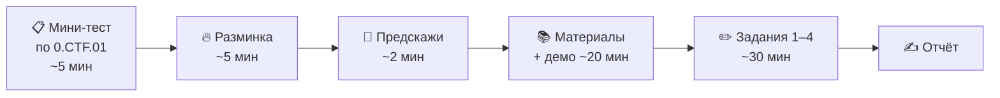
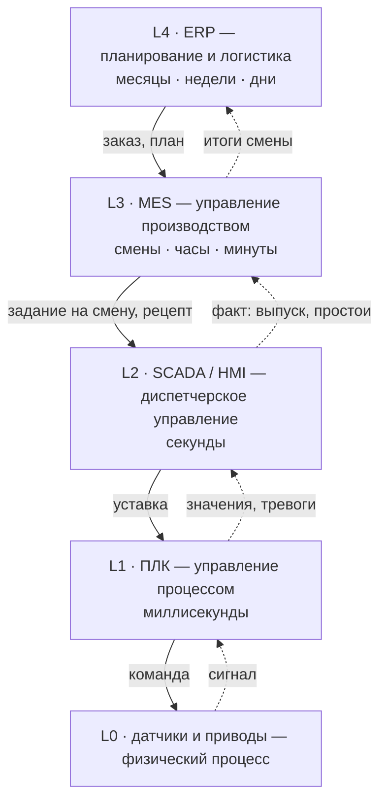

# 🟨 Интерес · Неделя 02 · `0.PAI.01` — Пирамида автоматизации

> [!abstract] Зачем
> Ты пришёл из 1С и инфраструктуры — то есть знаешь верх и середину завода, но не низ. Агентов уже подключают к производству: сводки простоев, ассистенты оператора, советы по уставкам. Чтобы решать, где агенту можно только читать, а где он опасен, нужна карта уровней: кто за какое время принимает решения и сколько стоит ошибка на каждом. Эта карта — основа всех следующих занятий `PAI` (MQTT, Modbus, «агент у станка») и проекта «робот через агента». Это интерес: ничего не блокирует; срок по ритму недели — до пятницы.
> 📰 **Из жизни:** май 2021, Colonial Pipeline (США): вымогатель зашифровал **офисную** IT-сеть компании, а не управление трубопроводом. Компания сама остановила трубопровод почти на неделю — не могла ни выставлять счета, ни быть уверенной, что заражение не дошло до цеха. Что бы сделал ты на их месте — и что должно было стоять между двумя сетями, чтобы останавливать трубу не пришлось?

**Время:** ~1 ч · **Дата выдачи:** 29.10



## 📋 Мини-тест по прошлому интересу *(`0.CTF.01` — Первые флаги)*

> [!warning] Тест — без подсказок Тьютора и без поиска
> Добавлен 30.10, после проверки `0.CTF.01`. Не знаешь — «не знаю» тоже ответ. От результата зависит, закроется ли `0.CTF.01` (2 из 3).

1. [x] Алгоритм AES опубликован, его код может прочитать любой.
   а) Почему от этого зашифрованные им данные не становятся открытыми?
   б) Что тогда держится в секрете?
   **Ответ:**
   а) алгоритм опубликован, а ключ шифрования - всегда разный
   б) что за долбаёб составлят эти вопросы? выше ответил уже
   ✍️ записано со слов

2. [x] Перед тобой две записи: `70 69 63 6f` и `cGljbw==`.
   а) Что это за запись — каждая?
   б) По каким признакам ты это понял?
   **Ответ:**
   а) первая - hex. вторая - base64.
   б) характерные f в первом и == во втором случаях
   ✍️ записано со слов

3. [x] Ключ шифрования лежит в переменной окружения процесса, в котором работает агент-кодер, и агент может вызвать в коде `decrypt(secret)`. Защищён ли секрет от этого агента? Почему?
   **Ответ:**
   Нет, потому что декрипт сможет вернуть расшифровку секрета.
   ✍️ записано со слов

---

## 🔥 Разминка (по желанию, 5 мин)

1. [x] 🃏 **Карточки** (5 мин): в Obsidian — команда «Spaced Repetition: Review flashcards from all notes», пройди те, что подошли по сроку. Таких нет — пропусти пункт.
   **Ответ:** сделал
   ✍️ записано со слов

2. [x] **Микрозадача руками — SQL** (2–4 строки, «полиглот»): есть таблица `devices` со столбцами `name` и `level` (уровень пирамиды, число от 0 до 4). Напиши запрос: сколько устройств на каждом уровне, сверху вниз — от уровня 4 к уровню 0.
   **Ответ:**
   ```sql
   SELECT level, COUNT(*) FROM devices
   GROUP BY level
   ORDER BY level DESC;
   ```
   ✍️ записано со слов

---

## 🔮 Предскажи (2 мин, не оценивается)

На заводе датчик показал перегрев насоса. Кто остановит насос первым — оператор у экрана, мастер смены или сама программа управления — и примерно за какое время: миллисекунды, секунды, минуты? А когда об этом узнает 1С?
**Ответ (догадка до материалов — ошибаться можно; вернёшься к ней в задании 4):**
Программа управления за секунды. в 1С уйдёт через секунды тоже.
✍️ записано со слов

---

## 📚 Материалы

> [!tip] 📌 Минимум для заданий — ~15 мин
> Схема, таблица и демо ниже — этого хватает на все задания. «🔍 Глубже» — по желанию.

**Пирамида: чем выше, тем медленнее и тем дальше от железа**



**ISA-95** (он же IEC 62264) — международный стандарт о том, как связать бизнес-системы завода с системами управления производством. Он делит завод на уровни и описывает, **какими данными обмениваются уровни 3 и 4**: вниз идут заказы и планы, вверх — факт выпуска, расход сырья, простои. Главное, что надо унести:

1. **Время решений растёт снизу вверх.** ПЛК решает за миллисекунды, SCADA — за секунды, MES — за минуты и часы, ERP — за дни и недели. Поэтому авария гасится внизу, а наверх доходит уже итог.
2. **Каждый уровень работает со своей «зернистостью».** ERP не нужна температура насоса раз в 10 мс — ей нужно «выпущено 410 из 500, причина простоя — перегрев».
3. **Граница IT и OT** (Operational Technology — сети и системы, которые управляют физикой) в модели Purdue (на ней обычно строят защиту) проходит между уровнями 4 и 3: выше — офисная IT-сеть, ниже — сеть цеха (MES тоже на стороне цеха). На границе ставят буферную зону DMZ — «уровень 3.5». *(Исправлено 29.10: раньше здесь ошибочно было «между 3 и 2».)*
4. **Где 1С:** 1С:ERP, 1С:УТ, бухгалтерия — уровень 4; 1С:MES «Оперативное управление производством» и интеграции 1С с цехом — уровень 3. Ниже 1С не спускается: там SCADA и программы ПЛК.

| Уровень | Что стоит | Кто работает | Время решений | Пример данных |
|---|---|---|---|---|
| L4 · ERP | 1С:ERP, SAP | плановики, снабжение, бухгалтерия | месяцы · недели · дни | заказ на 500 шт к 15-му |
| L3 · MES | 1С:MES, Siemens Opcenter | мастер смены, технолог, ОТК | смены · часы · минуты | задание на смену, простой 25 мин |
| L2 · SCADA / HMI | WinCC, MasterSCADA | оператор, диспетчер | секунды | мнемосхема, тревога «перегрев» |
| L1 · ПЛК | Siemens S7, ОВЕН ПЛК | инженер АСУ ТП | миллисекунды (цикл 1–100 мс) | «если T > 85 °C — насос стоп» |
| L0 · датчики и приводы | термопары, клапаны, двигатели | КИПиА, механики | физика, непрерывно | ток 4–20 мА с датчика |

> [!warning] Границы уровней в источниках расходятся
> Страница ISA (isa.org) относит датчики к уровню 1, ПЛК — к уровню 2, а SCADA — вместе с MES к уровню 3. Многие вендоры и модель Purdue раскладывают так, как в таблице выше: датчики → ПЛК → SCADA → MES → ERP. Порядок и время реакции от раскладки не меняются — в ответах держись таблицы выше.

> [!example] 🎮 Интерактивное демо — «Пирамида ISA-95»
> ▶ **[Открыть демо](https://claude.ai/artifact/8GrCWENKpmZXQBwGGgjQYN)** (работает и с телефона) · копия в хранилище: [[Материалы/Демо/0.PAI.01 — Пирамида ISA-95.html|Открыть демо]] · ~7 мин
> 🎯 **Миссия:** прогони оба сценария — «Заказ: сверху вниз» и «Перегрев: снизу вверх». Запиши в задание 3: какой уровень реагирует на перегрев первым и за какое время; на каком шаге об аварии узнаёт ERP и сколько к этому моменту прошло; где проходит граница IT и OT. Блок «Куда поставить AI-агента» — разбор задания 4, открывай его только после ответа.

- ISA — [ISA-95 Standard](https://www.isa.org/standards-and-publications/isa-standards/isa-95-standard) — официальная страница стандарта: зачем он, восемь частей, пять уровней; по-английски, ~5 мин *(проверено: 29.10)*.
- Siemens — [ISA-95 framework and layers](https://www.siemens.com/en-us/technology/isa-95-framework-layers/) — уровни 0–4 одной страницей, по-английски, ~4 мин *(проверено: 29.10)*.

> [!info]- 🔍 Глубже — по желанию, ~20 мин — раскрыть
> - Fortinet — [What Is the Purdue Model for ICS Security?](https://www.fortinet.com/resources/cyberglossary/purdue-model) — та же пирамида глазами безопасника: зоны, DMZ «3.5», почему узлы DMZ никогда сами не открывают соединения внутрь OT и почему исходящий трафик из цеха надо резать так же строго, как входящий; ~10 мин *(проверено: 29.10)*.
> - OPC Foundation — [ISA-95 в спецификации OPC UA, раздел 4.2.3](https://reference.opcfoundation.org/specs/OPC-10030/4.2.3) — откуда берутся «миллисекунды — секунды — смены — недели»: что значит «реальное время» на уровнях 2, 3 и 4; ~5 мин *(проверено: 29.10)*.
> - Лекция Тьютора — [[Материалы/Тьютор/Неделя 01 (19.10–25.10)/Микроконтроллеры, Arduino и роботы с нуля|Микроконтроллеры, Arduino и роботы с нуля]] (~15 мин) и её [[Материалы/Демо/0.PAI.01 — Микроконтроллер, пины и безопасность робота.html|демо]] — что происходит внутри уровней 0–1: пины, АЦП, ШИМ и аппаратный предохранитель робота.

> [!danger] 🗡 Как это ломают
> Протоколы нижних уровней (Modbus и многие другие) придуманы для закрытых цеховых сетей и часто не спрашивают, кто прислал команду: кто дотянулся до сети ПЛК, тот может писать уставки. Поэтому атаки на заводы почти всегда идут сверху: фишинг в офисе → IT-сеть → слабое место на границе IT/OT → цех. Самый известный пример — Stuxnet (2010): вредонос подменял программу ПЛК и при этом показывал операторам «всё в норме».

---

## ✏️ Задания

1. [x] **Разложи по уровням.** Для каждой строки — уровень (L0–L4) и одна короткая причина:
   а) заказ клиента в 1С:ERP;
   б) датчик температуры с выходом 4–20 мА;
   в) ПЛК, который по циклу включает и выключает насос;
   г) мнемосхема с тревогами на экране оператора;
   д) расписание смены и учёт простоев;
   е) частотный преобразователь, который крутит двигатель;
   ж) архив значений датчиков за год (historian), из которого строят графики для диспетчера;
   з) Telegram-бот, который в конце смены присылает мастеру сводку простоев.
   **Критерий сдачи:** таблица из 8 строк «что — уровень — почему»; верно хотя бы 6. Где уровень спорный — напиши оба варианта и почему.
   **Ответ:**

| Что | Уровень | Почему |
|---|---|---|
| а) заказ в 1С:ERP | L4 | офисная работа (бизнес-планирование) |
| б) датчик 4–20 мА | L0 | датчик (физический процесс) |
| в) ПЛК с насосом | L1 | ПЛК (миллисекундный цикл управления) |
| г) мнемосхема | L2 | оператор (SCADA/HMI диспетчера) |
| д) расписание смены | L3 | управление производством (уровень смены / MES) |
| е) частотник | L0 | крутит двигатель (силовой привод / исполнительный механизм) |
| ж) historian | L2 | графики для диспетчера (SCADA-архив) |
| з) Telegram-бот | L3 (спорный: L3 / L4) | летит мастеру смены (данные MES), но обёртка чисто айтишная / облачная, поэтому тяготеет к L4 |
✍️ записано со слов

2. [x] **Что идёт по стыку L3 ↔ L4.**
   а) Назови 2 вида данных, которые ERP отдаёт в MES (вниз).
   б) Назови 2 вида данных, которые MES отдаёт в ERP (вверх).
   в) Почему ERP не нужно получать температуру насоса каждые 10 мс? Ответь через время решений уровня 4.
   **Критерий сдачи:** по 2 примера в «а» и «б»; в «в» — 2–3 предложения со ссылкой на время решений.
   **Ответ:**
   а) план производства, спецификации
   б) остатки сырья, факт производства
   в) Потому что ERP напрямую не ведёт производство, и время сигнала до ERP составит слишком длительный срок для своевременного реагирования (уровень L4 мыслит днями и неделями, а авария в железе развивается за доли секунды).
   ✍️ записано со слов

3. [x] **🎮 Миссия демо.** Прогони в демо оба сценария и ответь:
   а) Какой уровень реагирует на перегрев первым и за какое время?
   б) На каком шаге об аварии узнаёт ERP и сколько к этому моменту прошло?
   в) Между какими уровнями проходит граница IT и OT?
   **Критерий сдачи:** три ответа с уровнем и временем из демо.
   **Ответ:**
   а) L0 (физический сигнал датчика 0 мс) / L1 (ПЛК отключает насос за 10 мс)
   б) на пятом шаге (в демо — конец смены, хотя на практике в реальных системах часто оповещают быстрее)
   в) Если по Purdue — между L4 и L3 через буферную прослойку DMZ 3.5. Но поскольку MES работает на стандартной айтишной инфраструктуре, на практике границу часто проводят между L2 и L3.
   ✍️ записано со слов

4. [x] **Куда пустить агента.** Завод хочет «AI-диспетчера» — LLM-агента, который помогает по производству. Реши за архитектора:
   а) С каких уровней агент будет **читать** данные и зачем ему каждый из них?
   б) Куда агенту можно **писать** (или никуда) — и почему не ниже? Опирайся на время реакции уровня и цену ошибки.
   в) Назови 2 ограничения, которые ты поставишь агенту обязательно.
   г) Был ли прав в «🔮 Предскажи»? Если нет — где ошибся.
   **Критерий сдачи:** уровни для чтения с причиной; решение про запись с причиной через время и цену ошибки; 2 конкретных ограничения; строка про «Предскажи». Потом открой в демо «Куда поставить AI-агента» и сверься.
   **Ответ:**
   а) Чтение с уровней L1 и L2:
   - L1 — для диагностики неисправностей: анализ алгоритмов обработки данных с L0 + доступ к сырым телеметрическим данным с L0, которые приходят на L1 (сам L0 напрямую читать не нужно: агент не починит сломанный датчик, а опрос идёт через контроллер).
   - L2 — для доступа к логам происшествий, тревог, запусков оборудования на уровне агрегированных «человеческих» данных и мнемосхем.
   (L4 диспетчеру точно не нужен; L3 зависит от того, нужно ли агенту знать планы смены, но для задач диспетчеризации L1 и L2 достаточно).
   б) Запись: напрямую никуда писать не надо — везде слишком высокая цена ошибки (риск аварии и поломки оборудования). Только формировать отчёты на уровни L2, L3, L4 и давать рекомендации операторам по устранению неполадок на L1 и L0 (Human-in-the-loop). Максимум — аппаратный аварийный стоп на крайний случай, любые изменения логики — только через изолированный отладочный стенд.
   в) Ограничения:
   1. Полное покрытие строгими типизированными инструментами (tool calling) без доступа к системному шеллу / командной строке (минимальный необходимый функционал).
   2. Строгий Read-Only режим по отношению к контроллерам и исполнительным механизмам: агент не имеет права напрямую мутировать уставки в ПЛК в обход подтверждения человека.
   г) В «Предскажи» думал: остановка программы за секунды и в 1С уйдёт тоже за секунды. В реальности ошибся в масштабах времени: ПЛК гасит аварию за миллисекунды (10 мс), а в 1С агрегированные итоги простоя приходят только часами позже (к концу смены).
   ✍️ записано со слов

5. [x] **🔧 Руками** *(по желанию — занятие концептуальное, 10 мин)*: в [[Материалы/Демо/0.PAI.01 — Микроконтроллер, пины и безопасность робота.html|демо Тьютора про микроконтроллер]] запусти робота навстречу стене — сначала с предохранителем (MCU тормозит), потом без него (только LLM).
   **Критерий сдачи:** 2–3 строки: на каком уровне пирамиды стоит этот предохранитель, что он сделал против команды LLM и как это связано с твоим ответом на задание 4.
   **Ответ:**
   Предохранитель стоит на нулевом/первом уровне (L0/L1, контур физических датчиков и микроконтроллера приводов). Остановил движение на дистанции 20 см до препятствия, аппаратно отключив ШИМ моторов вопреки команде модели. Связано с ответом на задание 4 тем, что LLM слишком долго реагирует на низкоуровневые события (инференс занимает секунды против миллисекунд в физическом мире), поэтому критическую защиту и прямое управление приводами нельзя отдавать агенту.
   ✍️ записано со слов

6. [x] **Своими словами** (3–5 предложений): где в пирамиде твой опыт — 1С и инфраструктура — и на каком уровне агенты дадут заводу больше всего пользы при наименьшем риске.
   **Ответ:**
   Мой опыт (1С и инфраструктура) находится на четвёртом уровне (L4). Больше всего пользы агенты дают на четвёртом уровне, если их правильно ограничивать, но в целом они могут нормально работать и на третьем/втором уровнях как полноценные диспетчера и мастера цеха в одном флаконе. Всё равно на текущий момент нужен человеческий наблюдатель (Human-in-the-loop), а вносить правки на уровне 1 без присмотра человека крайне опасно.
   ✍️ записано со слов

---

## 🟨 Мостик к ядру

Граница IT/OT — это **граница доверия**, ровно то, что ты будешь рисовать в модели угроз (`0.SEC.01`, эта неделя или первая сессия недели 3). А правило «чем ниже уровень, тем меньше прав у агента» — тот же принцип, что режимы прав в `0.AIN.02`: Manual и plan — для опасного, auto — только там, где ошибку легко откатить.

---

## ✍️ Отчёт

- **Время (сколько ушло):** ~60 мин
- **Трудности и вопросы:**
  1. Нестыковка границы IT/OT: в тексте материалов написано «между 3 и 2», а в интерактивном демо разделитель визуально стоит между 4 и 3 (как DMZ 3.5 по Purdue).
  2. Слишком широкий и размытый скоуп в задании 4: не заданы границы ответственности «AI-диспетчера», приходится додумывать вводные — Ментору стоит подробнее расписывать контекст и ожидания от агента.
- **Подсказки Тьютора:** разобрано 6 из 6 заданий; задания 1–6 — ур. 0 (всё решено самостоятельно без подсказок); разминка (SQL) — ур. 1 (синтаксис ORDER BY)

---

## 📋 Мини-тест по этому занятию
*(перенесён 02.11 в начало [[Интерес — 0.LOW.02]]; ответы — там)*

1. Датчик показал перегрев насоса.
   а) Какой уровень пирамиды (L0–L4) остановит насос первым?
   б) За какое время — миллисекунды, секунды или минуты?
   **Ответ:**
2. По стыку L3 ↔ L4 идут данные в обе стороны.
   а) Один пример данных, которые ERP отдаёт вниз, в MES.
   б) Один пример данных, которые MES отдаёт вверх, в ERP.
   **Ответ:**
3. Где по модели Purdue проходит граница IT и OT и как называется буферная зона на ней? Ответ — «между Lx и Ly» и название зоны.
   **Ответ:**

---

## ✅ Проверка *(заполняет Ментор)*

*29.10 (чт) · проверил: Claude Opus 5.5*

**Главное.**
- **Держится:** уровни пирамиды и время решений; стык L3 ↔ L4; агенту — чтение и рекомендации, запись в ПЛК — нет.
- **Поправить:** агенту не стоит читать ПЛК напрямую — данные L1 берут из SCADA и архива (L2).
- **Взять дальше:** граница IT/OT как граница доверия — в модель угроз `0.SEC.01` на неделе 3.

> [!warning] Ошибки Ментора — на оценку не влияют
> - **Граница IT/OT в материалах.** В пункте 3 «Главное» было «между уровнями 3 и 2». По модели Purdue граница идёт между L4 и L3, на ней — DMZ «3.5». Демо было верным, материал — нет. Исправлено 29.10. Твой ответ на задание 3в — с обоими вариантами и причиной — засчитан.
> - **Задание 4** — «AI-диспетчер» без конкретной проблемы и результата, вводные пришлось додумывать. Правило «Понятно ли задание» вписано 02.11 (`AGENTS.md`, A2, шаг 3).

### Мини-тест по `0.CTF.01` — 3 из 3

| № | Вердикт | Комментарий |
|---|---|---|
| 1 | ✅ | В секрете — ключ, а не алгоритм: это и есть ответ. Уточнение: дело не в том, что ключ «всегда разный», а в том, что его **не знают**. Подпункты «а» и «б» в вопросе пересекались — ошибка составителя, не твоя. |
| 2 | ✅ | hex и base64 — верно. `==` в конце — признак base64 верный. Для hex признак — пары символов только из `0–9` и `a–f`, а не буква `f`. |
| 3 | ✅ | Нет: агент может вызвать `decrypt` — значит, секрет ему доступен. |

**Итог:** `0.CTF.01` — ✅ закрыто 29.10.

### Вердикт по заданиям

| Задание | Вердикт | Почему |
|---|---|---|
| Разминка, SQL | ✅ | `GROUP BY level` + `ORDER BY level DESC` — верно. |
| 1. Уровни | ✅ 8/8 | Все уровни верные. Спорные (historian, Telegram-бот) — с обоими вариантами и причиной, как просил критерий. |
| 2. Стык L3 ↔ L4 | ✅ | План и спецификации вниз, факт и остатки вверх; «в» — через время решений. |
| 3. Миссия демо | ✅ | L1 за 10 мс; ERP узнаёт в конце смены; граница — оба варианта с причиной. |
| 4. Куда пустить агента | ✅ | Запись — никуда, только рекомендации человеку; два конкретных ограничения; честный разбор «Предскажи». **Поправка:** чтение с L1 напрямую — лишний риск. Опрос ПЛК агентом — это новый вход в сеть цеха и нагрузка на контроллер. Те же данные лежат в SCADA и архиве (L2), читать надо оттуда. |
| 5. 🔧 Демо робота | ✅ | Предохранитель на L0/L1, отключил ШИМ против команды LLM; связь с заданием 4 — через время реакции. |
| 6. Своими словами | ✅ | Опыт — L4, польза при наименьшем риске — L4 и чтение на L3/L2 с человеком в контуре. |

**Подсказки Тьютора:** задания — ур. 0, разминка — ур. 1 (синтаксис `ORDER BY`), на оценку не влияет.

**Оценка: 6/10.** Всё сделано самостоятельно и по критериям. Сверх — спорные места разобраны с обеих сторон, в задании 4 — два конкретных ограничения и оговорка про отладочный стенд. Не 7: в задании 4 чтение с L1 напрямую.

**Время:** ~1 ч · план ~1 ч — норма.

**Занятия:** `0.PAI.01` — ✅ 6/10, ⏳ ждёт мини-тест (в начале `0.LOW.02`). `0.CTF.01` — ✅ закрыто.

**Теги:** #isa-95 #purdue #it-ot #scada #mes #human-in-the-loop

---

## 🃏 Карточки для повторения

#flashcards/Фаза0/PAI

Уровни ISA-95 снизу вверх?::L0 датчики и приводы · L1 ПЛК · L2 SCADA/HMI · L3 MES · L4 ERP.
<!--SR:!2026-11-07,4,270-->
Кто гасит аварию первым и за сколько?::ПЛК (L1) — за миллисекунды; наверх уходит уже итог.
<!--SR:!2026-11-07,4,270-->
Где по Purdue граница IT/OT?::Между L4 и L3, на ней — буферная зона DMZ «3.5».
<!--SR:!2026-11-07,4,270-->
Откуда агенту читать данные цеха?::Из SCADA и архива (L2), а не опросом ПЛК напрямую.
<!--SR:!2026-11-07,4,270-->
Почему агенту не дают писать в ПЛК?::Цена ошибки — авария; LLM реагирует за секунды, физика — за миллисекунды.
<!--SR:!2026-11-07,4,270-->
