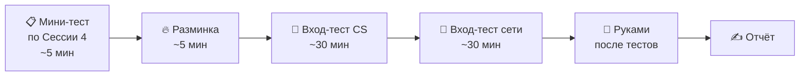

# 🔹 Сессия 5 · Неделя 02 · `0.CS.01` — вход-тест CS · `0.NET.01` — вход-тест сети

> [!abstract] Зачем
> Агент пишет код и настраивает сеть за тебя, а ты решаешь, принять ли это. Чтобы увидеть, что агент выбрал квадратичный алгоритм там, где хватит словаря, или что API модели не отвечает из-за DNS, а не из-за ключа, нужна база — Big-O, поиск, стек и очередь, слои сети, маски и DNS. Тест покажет, что из этого держится, а что повторить.

**Время:** ~1–1,25 ч · **Дата выдачи:** 26.10



> [!warning] Вход-тесты — строго без Тьютора, поиска и запуска кода
> Это диагностика, а не экзамен: ≥ 70% — тема засчитана, ошибки разберём в «Проверке»; меньше — повтор на неделе 3. На вход-тесте недели 1 помощь Тьютора смешала картину — сейчас важно увидеть, что держится **у тебя**. Не знаешь — пиши «не знаю», это тоже ответ. Отвечай коротко, но с «почему», где оно просится.

---

## 📋 Мини-тест по прошлой сессии *(Сессия 4 · `0.AIN.03`)*

> [!warning] Тест — без подсказок Тьютора и без поиска
> Не знаешь — так и напиши: «не знаю» — тоже ответ. Проверит Ментор вместе с этой сессией; от результата зависит, закроется ли `0.AIN.03` (2 из 3).

1. [x] В спеке написано: «функция `greet(user)` здоровается с пользователем по имени». Назови два решения, которые агент примет за тебя молча, и закрой каждое одной строкой спеки.
   **Ответ:** Сам выберет текст приветствия, сам выберет тип входных данных для User. "Текст привествия должен гласить "Привет, *User", "User являетя строкой". Критерии приёмки и входные данные.
   ✍️ записано со слов
2. [x] Функцию `parse_age(value)` вызывает другой код. Ей пришли `"двадцать"` и `None`. Есть два варианта поведения: привести вход как получится (например, вернуть `0`) или выбросить ошибку. Что запишешь в спеку и почему — чем опасен первый вариант?
   **Ответ:** Выбросить ошибку. Потому что первый вариант может привести к ошибкам в логике вычислений, построенных на возврате функции, а так же пользователь будет недоумевать: ему же двадцать лет, так почему в результате логика не сходится, и как мы объясним поведение, которое правильное не по типу, но по смыслу, значение на входе превращает в неправильное на выходе
   ✍️ записано со слов
3. [x] В спеке чистой функции «нормализует номер телефона» есть пункт «пишет каждый вызов в файл лога». Что с этим не так, как это мешает тестам и в какой раздел спеки этот пункт стоило перенести?
   **Ответ:** Непонятно, в каком формате логировать запись и в какой лог конкретно. Тесты можно построить на факте внесения записи в лог, но тесты на лог в нужном формате будут с большой вероятностью псевдо-зелёные, поскольку в лог попадает то, что должно исходя из функции, но не должно исходя из замысла разработчика. Но в целом это критерии приёмки.
   ✍️ записано со слов

---

## 🔥 Разминка (по желанию, 5 мин)

1. [x] Вспомни 3 факта из Сессии 4 (Spec-Driven Development) — без подглядывания.
   **Ответ:** Тупая задача, не хочу. Но самое важное - критерии приёмки. Отсутствие конкретики даёт модели шанс додумать и ошибиться. На ревью спеки ловить ошибку дешевле, чем где бы то ни было.
   ✍️ записано со слов
2. [x] Микрозадача руками (Python, 3–6 строк): дан список `words = ["Агент", "агент", "Файл", "файл", "файл"]`. Посчитай, сколько раз встречается каждое слово **без учёта регистра**, за один проход по списку — через `.get`, без `collections`. Должно получиться `{'агент': 2, 'файл': 3}`.
   **Ответ:**
   ```python
   result = {}
   def word_count(words)
       for word in words:
           result[word.lower()] = result.get(word.lower(), 0] + 1
       return result
   ```
   ✍️ записано со слов

---

## 🧪 Вход-тест `0.CS.01` — алгоритмы и структуры данных (~30 мин)

1. [x] Какая сложность по времени у каждого фрагмента (в нотации O через `n` — длину списка)? Одной строкой — почему.
   ```python
   # а
   total = 0
   for x in items:
       total += x

   # б
   for x in items:
       for y in items:
           if x + y == 10:
               print(x, y)

   # в
   result = items[0]
   ```
   **Ответ:**
   а) O(n) - потому что просто перебираем значения по очереди
   б) O(n квадрат) - потому что сначала проходим элементы по x, потом для каждого - ещё и по y
   в) O(1) - потому что берём конкретный элемент списка по его индексу
   ✍️ записано со слов

2. [x] Линейный и бинарный поиск: какое условие обязательно для бинарного поиска? Сколько шагов (примерно) нужно каждому, чтобы найти элемент в списке из 1 000 000 элементов в худшем случае?
   **Ответ:** Для бинарного поиска - сортированный спискок. 20 шагов для бинарного и 1.000000 для линейного
   ✍️ записано со слов

3. [x] Агент написал проверку дублей:
   ```python
   seen = []
   for email in emails:
       if email in seen:
           print("дубль:", email)
       seen.append(email)
   ```
   Какая у неё сложность и почему? Какую одну замену ты попросишь у агента и что она даст?
   **Ответ:** O(n квадрат) - потому что if проходит seen последовательно как O(n), а предварительно мы уже идём по списку как O(n). Попросить заменить список на множество (и методы соответственно). Тогда поиск по каждому - это O(1) и получается в общем O(n) +-.
   ✍️ записано со слов

4. [x] Назови один алгоритм сортировки со сложностью O(n²) и один — O(n log n). Какой сложности сортировка, которую делает встроенная `sorted()` в Python?
   **Ответ:** O(n квадрат) - bubble search. O(n log n) - сортировка слиянием. Sorted() - O(n log n)
   ✍️ записано со слов

5. [x] Чем стек отличается от очереди? Приведи по одному примеру из реальных систем, где работает стек и где — очередь.
   **Ответ:** Стэк - первый уходит последним. Очередь - последний уходит последним. Очередь - очередь сообщений агенту. Стэк - рекурсия.
   ✍️ записано со слов

6. [x] Почему `items.pop(0)` на длинном списке Python — медленно, а `items.pop()` — быстро? Что взять вместо списка, если нужна очередь?
   **Ответ:** Pop() забирает элемент списка. Если мы забираем первый элемент в списке (0) - весь список приходится сдвигать обратно. Просто Pop() - забирает последний и ничего не двигает. Без сторонних библиотек - ничего. Да и мы это не проходили.
   ✍️ записано со слов

7. [x] O(log n) и O(n): что растёт быстрее, если `n` увеличить в 1000 раз? Во сколько раз примерно вырастет время в каждом случае?
   **Ответ:** (n) растёт быстрее. (n) увеличится так же в тысячу раз, а (log n) - 10.
   ✍️ записано со слов

---

## 🧪 Вход-тест `0.NET.01` — сети (~30 мин)

1. [x] Разложи по уровням модели TCP/IP (канальный, сетевой, транспортный, прикладной): HTTP, TCP, IP, Ethernet, UDP, DNS, ARP.
   **Ответ:** Канальный - Ethernet, ARP; Сетевой - IP, DNS; Транспортный - TCP, UDP; Прикладной - HTTP
   ✍️ записано со слов

2. [x] Адрес `192.168.10.37/26`. Назови адрес сети, широковещательный адрес и сколько адресов можно раздать хостам. Покажи, как считал.
   **Ответ:** Не помню, как считать. Но Сеть 192.168.10.0
   ✍️ записано со слов

3. [x] Входит ли адрес `10.0.5.9` в сеть `10.0.0.0/22`? Почему?
   **Ответ:** Не знаю.
   ✍️ записано со слов

4. [x] Назови три диапазона частных IPv4-адресов. Зачем нужен NAT, если хост с частным адресом ходит в интернет?
   **Ответ:** не помню
   ✍️ записано со слов

5. [x] Что происходит по шагам, когда агент обращается к `api.example.com` и адреса ещё нет ни в одном кеше: кого и о чём спрашивает компьютер, пока не получит IP?
   **Ответ:** Сначала обращаемся к локальному DNS, а тот - root dns - потом к верхнеуровневому доменту com - авторитетному серверу example - возвращает api
   ✍️ записано со слов

6. [x] Для чего записи DNS `A`, `AAAA`, `CNAME`, `MX`, `TXT`? Что означает TTL у записи и чем он мешает, когда ты срочно сменил адрес сервера?
   **Ответ:** Различные представления IP адресса. TTL - время, на которое запись о твоём адресе кэшируют DNS сервера. Если ты сменил адрес - в кэше на время TTL будет лежать старый адрес.
   ✍️ записано со слов

7. [x] TCP или UDP: какой протокол гарантирует доставку и порядок, а какой — нет? Каким обычно ходит DNS-запрос и почему?
   **Ответ:** TCP - про полноту и сохранность данных, а UDP - про скорость. Если нам просто надо узнать IP адрес и как можно быстрее - берут UDP.
   ✍️ записано со слов

8. [x] Запрос агента к API модели падает. `ping api.example.com` пишет «не удалось найти узел», а `ping 1.1.1.1` проходит. Какой слой виноват и что проверишь первым?
   **Ответ:** Скорее всего слой авторитетного сервера. Root мы находим, TDL не найти было бы тоже странно. Проверю аткуальность api.example.
   ✍️ записано со слов

---

## 📚 Материалы — для разбора после теста

> [!tip] Открывай только после того, как ответил на оба теста
> Если тест покажет дыры — эти источники пригодятся для повтора.
> Полный разбор всех вопросов обоих тестов, эти материалы с дополнениями и демо — [[Материалы/Тьютор/Неделя 02 (26.10–01.11)/Разбор и повтор 0.CS.01 и 0.NET.01 — Алгоритмы и Сети|материал Тьютора]].

- «Грокаем алгоритмы» (Адитья Бхаргава) — главы 1–2: бинарный поиск, Big-O, массивы и связные списки.
- [VisuAlgo](https://visualgo.net/) — визуализации поиска, сортировок, стека и очереди (по-английски, интерфейс простой) *(проверено: 26.10)*.
- Julia Evans — [Networking! ACK!](https://wizardzines.com/zines/networking/) — бесплатный зин про сети, ~20 мин *(проверено: 26.10)*.
- [How DNS Works](https://dnsimple.com/comics/how-dns-works/) — комикс DNSimple про путь DNS-запроса, ~10 мин *(проверено: 26.10)*.

---

## ✏️ Задания

1. [ ] ⏸ **🔧 Руками** (10–15 мин, **после тестов**, по желанию): посмотри, как твой компьютер находит адрес. В PowerShell: `Resolve-DnsName api.anthropic.com` и `Resolve-DnsName api.anthropic.com -Type AAAA`; затем `ipconfig /all` — найди свой IP, маску и DNS-сервер.
   **Критерий сдачи:** вывод команд (можно сократить) + 2–3 строки: какие записи вернулись (есть ли `CNAME`), какая у тебя маска и сколько адресов в твоей сети, где это пригодится, когда агент «не видит» API.
   **Ответ:**

---

## ✍️ Отчёт

- **Время (сколько ушло):** ~40 мин
- **Трудности и вопросы:** Руками делать не хочу сегодня, каждый день на работе делаю. Все темы из теста (не только заваленные) по NET я бы засунул кратко с быстрыми и наглядными обхяснениями в сессию на повтор - это знать надо, а я не помню ооооооочень много. Короче, тест заваливать не надо, но просто по каждому вопросу, даже правильному, прогнать объяснение в сессии - это шикарно было бы. повторение. И я подсматривал в Net. Алго помню более менее, но тоже в повторение бы - дать одну сессию на какую-нибуль неделю с объяснениями в сессии к каждому вопросу из входных тестов и общую экспозицию по конкретной теме вопроса. Вот на таком решении я настаиваю! И материалы для разбора перенести в эту сессию и дополнить новыми - там и ознакомлюсь с ними.
  ✍️ записано со слов
- **Подсказки Тьютора:** мини-тест и вход-тесты — без подсказок; разминка 2 — ур. 1 (разбор синтаксиса после ответа); задание 1 («Руками») — пропущено по желанию

---

## 📋 Мини-тест по этой сессии
*(вход-тест мини-теста не требует; по итогам проверки — в разминку следующих сессий)*

---

## ✅ Проверка *(Ментор · 27.10 · утренний автозапуск, Claude Opus 5.5)*

**Мини-тест по прошлой сессии (Сессия 4):** 2,5/3 → занятие `0.AIN.03` закрыто ✅
- **1 — ✅.** Два молчаливых решения названы верно — текст приветствия и тип входа, — и каждое закрыто конкретной строкой спеки («Привет, <имя>», «`user` — строка»). Для полноты: третье — что делать с пустым именем.
- **2 — ✅.** Ошибка, а не `0`: «0 неотличим от настоящего значения, и неверные данные тихо уйдут дальше по логике» — это главное.
- **3 — 🟡.** Верно, что не определены формат и путь лога и что тесты на лог выйдут «псевдо-зелёными». Мимо — главное: функция названа **чистой**, а запись в файл — побочный эффект, это противоречие внутри спеки. Тестам он мешает тем, что нужен файл или подмена (мок), тест зависит от диска и от прошлых запусков. И раздел — не «Критерии приёмки», а **не-цели** («функция ничего не пишет на диск») или «Ограничения»; логирование, если нужно, — забота вызывающего кода.

**Вердикт по заданиям:**

| # | Задание | Статус | Что верно | Что не так / чего не хватает | Подсказки |
|---|---|---|---|---|---|
| Р1 | 3 факта из Сессии 4 | ✅ | Критерии приёмки, «отсутствие конкретики даёт модели додумать», «ревью спеки — самое дешёвое место» — все три верны | — | — |
| Р2 | Счётчик без учёта регистра | 🟡 | Идея верная: один проход, `.lower()`, `.get(…, 0) + 1` — ровно фокус недели 1 | Не запустится: нет `:` после `def word_count(words)`, `0]` вместо `0)`; `result = {}` вне функции — второй вызов продолжит считать в тот же словарь (тот же механизм, что в Сессии 6, задание 4) | ур. 1 (после ответа) |
| CS | Вход-тест `0.CS.01` | ✅ 6/7 (≈ 86%) | Big-O трёх фрагментов, бинарный поиск (≈ 20 шагов против 1 000 000), дубли через множество, стек и очередь с примерами — уверенно | `pop(0)` — механизм верно, но замена есть в стандартной библиотеке: `collections.deque`; рост `log n` — не «в 10 раз» | — |
| NET | Вход-тест `0.NET.01` | ❌ 3,5/8 (≈ 44%) | Путь DNS-запроса (резолвер → корень → `.com` → авторитетный), TTL и кеш, TCP против UDP и почему DNS по UDP | Подсети (`/26`, `/22`), частные диапазоны и NAT, типы записей DNS, уровень DNS и диагностика «имя не находится» | — (подсматривал — со слов) |
| 1 | 🔧 Руками: `Resolve-DnsName`, `ipconfig` | ⏸ | — | Пропущено по желанию: эти команды — каждый день на работе. Засчитываю как известное, без балла | — |

**Вход-тест `0.CS.01` по вопросам:**
1. ✅ а) O(n), б) O(n²), в) O(1) — с верным «почему».
2. ✅ Нужен отсортированный список; ~20 и ~1 000 000 шагов.
3. ✅ O(n²), потому что `in` по списку — линейный проход; множество даёт O(1) на проверку и O(n) в сумме.
4. ✅ «bubble search» — оговорка, имеется в виду пузырьковая сортировка (bubble sort); сортировка слиянием — O(n log n); `sorted()` — O(n log n) (это Timsort).
5. ✅ Стек — LIFO (последним пришёл — первым ушёл), очередь — FIFO; рекурсия (стек вызовов) и очередь сообщений агенту — точные примеры.
6. 🟡 Почему `pop(0)` медленный — верно (сдвиг всех элементов, O(n)). «Без сторонних библиотек — ничего» → неверно: `collections.deque` — часть стандартной библиотеки, `popleft()` за O(1). Её действительно не проходили — поэтому полбалла, а не ноль.
7. 🟡 O(n) растёт быстрее и вырастет в 1000 раз — верно. А `log n` вырастет не **в** 10 раз, а **на** ~10 шагов: log₂(1000) ≈ 10. Было ~20 шагов (n = 10⁶) — стало ~30, то есть примерно в 1,5 раза. Похоже, ты держал в голове именно «+10», но ответ просил «во сколько раз».

**Вход-тест `0.NET.01` по вопросам:**
1. 🟡 Ethernet и ARP — канальный, IP — сетевой, TCP и UDP — транспортный, HTTP — прикладной: верно. **DNS — прикладной** протокол (он сам ходит поверх UDP/TCP, порт 53), а не сетевой.
2. ❌ Адрес сети `192.168.10.0` — верно, но без расчёта, широковещательного адреса и числа хостов. Как считать: `/26` — 26 бит сети, 6 бит хоста → блок 2⁶ = 64 адреса: .0–.63, .64–.127… `.37` в первом блоке → сеть `.0`, broadcast `.63`, хостам — 64 − 2 = 62.
3. ❌ «Не знаю». `/22` — блок 2¹⁰ = 1024 адреса, по третьему октету это 4 подряд: `10.0.0.0–10.0.3.255`. `10.0.5.9` → не входит (он в `10.0.4.0/22`).
4. ❌ «Не помню». `10.0.0.0/8`, `172.16.0.0/12`, `192.168.0.0/16`. NAT подменяет частный адрес на публичный адрес роутера: частные адреса в интернете не маршрутизируются.
5. ✅ Резолвер → корневой → `.com` → авторитетный `example.com` → IP для `api`. Для полноты: сначала кеш ОС и файл `hosts`, и всю цепочку обходит резолвер, а не твой компьютер.
6. 🟡 TTL и почему старый адрес живёт в кешах — точно. Записи — не «представления IP»: `A` — IPv4, `AAAA` — IPv6, `CNAME` — псевдоним на другое имя, `MX` — почтовый сервер домена, `TXT` — произвольный текст (проверки владения домена, SPF).
7. ✅ TCP гарантирует доставку и порядок, UDP — нет; DNS — UDP, потому что запрос и ответ маленькие и нужен быстрый ответ без установки соединения.
8. 🟡 Направление верное — не находится **имя**, а IP-связность есть (`1.1.1.1` пингуется) → виновата служба имён (DNS). Но первым проверяют **свой** резолвер, а не авторитетный сервер: `Resolve-DnsName api.example.com` / `nslookup`, какой DNS-сервер прописан (`ipconfig /all`), файл `hosts`, VPN, который подменяет DNS.

**Разбор ошибок** (главное):
- **Подсети — механизм, а не формула.** Маска `/N` = N бит сети, остальные 32 − N — хосты; размер блока = 2^(32−N); блоки идут ровно с нуля шагами этого размера. Отсюда и адрес сети, и broadcast, и «входит ли адрес» (вопросы 2–3 — одна и та же операция).
- **DNS — прикладной уровень.** Это важно для вопроса 8: «узел не найден» при живом IP — не сеть сломалась, а не работает служба имён поверх неё.
- **Рост `log n`** — прибавляет, а не умножает: при n × 1000 добавляется ~10 шагов. В этом и сила бинарного поиска.
- **Разминка:** `result = {}` снаружи функции — общее изменяемое состояние между вызовами; это тот же механизм, что и ловушка значения по умолчанию (Сессия 6).

**Что получилось хорошо:**
- CS, вопрос 3: замена списка на множество с правильной оценкой «O(n) в сумме» — ровно та правка, которую надо уметь потребовать у агента на ревью.
- NET, вопрос 5: путь DNS-запроса восстановлен целиком и в верном порядке — фундамент для отладки «агент не видит API».
- Честность: «не знаю» вместо угадывания и прямое «подсматривал» в отчёте — благодаря этому видно реальную картину.

**Оценка:** 5/10 — оба вход-теста и мини-тест отвечены в полном объёме и честно (целевой балл). Как и у Сессии 1, это оценка работы, а не знаний: знания — в процентах тестов. «🔧 Руками» было по желанию и на балл не влияет. Подсматривание в тесте сетей на оценку не влияет, но делает его результат ниже порога ещё надёжнее — повтор нужен в любом случае.

**Время:** ~40 мин · против плана ~1–1,25 ч — быстрее (без «Руками»).

**Занятия:**
- `0.AIN.03` — ✅ закрыто 27.10 · 6/10 (мини-тест 2,5/3).
- `0.CS.01` — ✅ закрыто 27.10 (вход-тест ≈ 86%, порог 70% пройден). Разбор всех вопросов с объяснениями — в материале Тьютора (ниже).
- `0.NET.01` — ✅ закрыто 27.10 по твоему решению: вход-тест ≈ 44% < 70%, но без повтора в расписании и без долга *(пересмотрено 27.10)*.

**Твоя просьба — разбор каждого вопроса** *(пересмотрено 27.10 по твоему решению)*: не сессия в расписании, а [[Материалы/Тьютор/Неделя 02 (26.10–01.11)/Разбор и повтор 0.CS.01 и 0.NET.01 — Алгоритмы и Сети|материал Тьютора]] «Разбор и повтор 0.CS.01 и 0.NET.01 — Алгоритмы и Сети» — по каждому из 15 вопросов экспозиция темы и разбор, материалы этой сессии перенесены туда и дополнены, есть демо (CIDR-калькулятор, структуры данных, путь DNS-запроса). Читай в своём темпе, вне плана. Записано в «Корректировки» трекера.

**Долги:** `0.PY.01` и `0.MTH.01` — по плану (Сессии 6 и 8). По сетям долга нет *(пересмотрено 27.10)*.

**→ Фокусы** *(продублированы в `ЗАМЕТКИ.md`)*:
- Сети: подсети через размер блока, частные диапазоны и NAT, типы записей DNS, DNS как прикладной уровень и диагностика «имя не находится» → материал Тьютора, потом `0.NET.02`.
- `collections.deque` и рост `log n` («на», а не «в») → материал Тьютора.
- Общее изменяемое состояние (`result = {}` снаружи функции) → Сессия 6, задание 4.
- Чистая функция + побочный эффект — противоречие в спеке; побочки — в не-цели → `0.AIN.04`.

**Теги:** #вход-тест #big-o #структуры-данных #сети #подсети #dns #sdd #побочные-эффекты

---

## 🃏 Карточки для повторения

#flashcards/Фаза0/CS #flashcards/Фаза0/NET

Как меняется число шагов бинарного поиска, если список вырос в 1000 раз?::Прибавляется ~10 шагов (log₂1000 ≈ 10), а не умножается на 10.
<!--SR:!2026-11-17,14,270-->
Чем заменить список, если нужна очередь (забирать с начала)?::`collections.deque` из стандартной библиотеки — `popleft()` за O(1).
<!--SR:!2026-11-18,15,270-->
Почему `email in seen` для списка `seen` делает проверку дублей квадратичной?::`in` по списку — линейный проход; внутри цикла по n это O(n²). Множество — O(1) на проверку.
<!--SR:!2026-11-14,11,270-->
Сколько адресов хостам в сети `/26` и почему?::62: 32 − 26 = 6 бит хоста → 64 адреса, минус адрес сети и broadcast.
<!--SR:!2026-11-13,10,270-->
На каком уровне TCP/IP работает DNS?::Прикладной; сам ходит поверх UDP (обычно) или TCP, порт 53.
<!--SR:!2026-11-04,3,250-->
Три диапазона частных IPv4-адресов?::`10.0.0.0/8`, `172.16.0.0/12`, `192.168.0.0/16`.
<!--SR:!2026-11-10,7,250-->
`ping` по имени не находит узел, а `ping 1.1.1.1` проходит — что проверить первым?::Свою службу имён: `Resolve-DnsName`/`nslookup`, какой DNS-сервер прописан, файл `hosts`, VPN.
<!--SR:!2026-11-15,12,270-->
Что не так с пунктом «пишет каждый вызов в лог» в спеке чистой функции?::Это побочный эффект — противоречит «чистой»; место ему в не-целях или у вызывающего кода.
<!--SR:!2026-11-04,3,250-->
