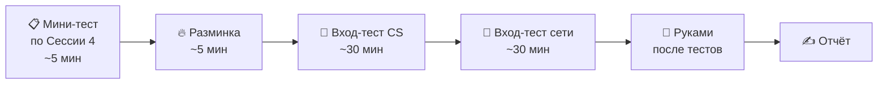

# 🔹 Сессия 5 · Неделя 02 · `0.CS.01` — вход-тест CS · `0.NET.01` — вход-тест сети

> [!abstract] Зачем
> Агент пишет код и настраивает сеть за тебя, а ты решаешь, принять ли это. Чтобы увидеть, что агент выбрал квадратичный алгоритм там, где хватит словаря, или что API модели не отвечает из-за DNS, а не из-за ключа, нужна база — Big-O, поиск, стек и очередь, слои сети, маски и DNS. Тест покажет, что из этого держится, а что повторить.

**Время:** ~1–1,25 ч · **Дата выдачи:** 26.10



> [!warning] Вход-тесты — строго без Тьютора, поиска и запуска кода
> Это диагностика, а не экзамен: ≥ 70% — тема засчитана, ошибки разберём в «Проверке»; меньше — повтор на неделе 3. На вход-тесте недели 1 помощь Тьютора смешала картину — сейчас важно увидеть, что держится **у тебя**. Не знаешь — пиши «не знаю», это тоже ответ. Отвечай коротко, но с «почему», где оно просится.

---

## 📋 Мини-тест по прошлой сессии *(Сессия 4 · `0.AIN.03`)*

> [!warning] Тест — без подсказок Тьютора и без поиска
> Не знаешь — так и напиши: «не знаю» — тоже ответ. Проверит Ментор вместе с этой сессией; от результата зависит, закроется ли `0.AIN.03` (2 из 3).

1. [ ] В спеке написано: «функция `greet(user)` здоровается с пользователем по имени». Назови два решения, которые агент примет за тебя молча, и закрой каждое одной строкой спеки.
   **Ответ:**
2. [ ] Функцию `parse_age(value)` вызывает другой код. Ей пришли `"двадцать"` и `None`. Есть два варианта поведения: привести вход как получится (например, вернуть `0`) или выбросить ошибку. Что запишешь в спеку и почему — чем опасен первый вариант?
   **Ответ:**
3. [ ] В спеке чистой функции «нормализует номер телефона» есть пункт «пишет каждый вызов в файл лога». Что с этим не так, как это мешает тестам и в какой раздел спеки этот пункт стоило перенести?
   **Ответ:**

---

## 🔥 Разминка (по желанию, 5 мин)

1. [ ] Вспомни 3 факта из Сессии 4 (Spec-Driven Development) — без подглядывания.
   **Ответ:**
2. [ ] Микрозадача руками (Python, 3–6 строк): дан список `words = ["Агент", "агент", "Файл", "файл", "файл"]`. Посчитай, сколько раз встречается каждое слово **без учёта регистра**, за один проход по списку — через `.get`, без `collections`. Должно получиться `{'агент': 2, 'файл': 3}`.
   **Ответ:**
   ```python

   ```

---

## 🧪 Вход-тест `0.CS.01` — алгоритмы и структуры данных (~30 мин)

1. [ ] Какая сложность по времени у каждого фрагмента (в нотации O через `n` — длину списка)? Одной строкой — почему.
   ```python
   # а
   total = 0
   for x in items:
       total += x

   # б
   for x in items:
       for y in items:
           if x + y == 10:
               print(x, y)

   # в
   result = items[0]
   ```
   **Ответ:**

2. [ ] Линейный и бинарный поиск: какое условие обязательно для бинарного поиска? Сколько шагов (примерно) нужно каждому, чтобы найти элемент в списке из 1 000 000 элементов в худшем случае?
   **Ответ:**

3. [ ] Агент написал проверку дублей:
   ```python
   seen = []
   for email in emails:
       if email in seen:
           print("дубль:", email)
       seen.append(email)
   ```
   Какая у неё сложность и почему? Какую одну замену ты попросишь у агента и что она даст?
   **Ответ:**

4. [ ] Назови один алгоритм сортировки со сложностью O(n²) и один — O(n log n). Какой сложности сортировка, которую делает встроенная `sorted()` в Python?
   **Ответ:**

5. [ ] Чем стек отличается от очереди? Приведи по одному примеру из реальных систем, где работает стек и где — очередь.
   **Ответ:**

6. [ ] Почему `items.pop(0)` на длинном списке Python — медленно, а `items.pop()` — быстро? Что взять вместо списка, если нужна очередь?
   **Ответ:**

7. [ ] O(log n) и O(n): что растёт быстрее, если `n` увеличить в 1000 раз? Во сколько раз примерно вырастет время в каждом случае?
   **Ответ:**

---

## 🧪 Вход-тест `0.NET.01` — сети (~30 мин)

1. [ ] Разложи по уровням модели TCP/IP (канальный, сетевой, транспортный, прикладной): HTTP, TCP, IP, Ethernet, UDP, DNS, ARP.
   **Ответ:**

2. [ ] Адрес `192.168.10.37/26`. Назови адрес сети, широковещательный адрес и сколько адресов можно раздать хостам. Покажи, как считал.
   **Ответ:**

3. [ ] Входит ли адрес `10.0.5.9` в сеть `10.0.0.0/22`? Почему?
   **Ответ:**

4. [ ] Назови три диапазона частных IPv4-адресов. Зачем нужен NAT, если хост с частным адресом ходит в интернет?
   **Ответ:**

5. [ ] Что происходит по шагам, когда агент обращается к `api.example.com` и адреса ещё нет ни в одном кеше: кого и о чём спрашивает компьютер, пока не получит IP?
   **Ответ:**

6. [ ] Для чего записи DNS `A`, `AAAA`, `CNAME`, `MX`, `TXT`? Что означает TTL у записи и чем он мешает, когда ты срочно сменил адрес сервера?
   **Ответ:**

7. [ ] TCP или UDP: какой протокол гарантирует доставку и порядок, а какой — нет? Каким обычно ходит DNS-запрос и почему?
   **Ответ:**

8. [ ] Запрос агента к API модели падает. `ping api.example.com` пишет «не удалось найти узел», а `ping 1.1.1.1` проходит. Какой слой виноват и что проверишь первым?
   **Ответ:**

---

## 📚 Материалы — для разбора после теста

> [!tip] Открывай только после того, как ответил на оба теста
> Если тест покажет дыры — эти источники пригодятся для повтора.

- «Грокаем алгоритмы» (Адитья Бхаргава) — главы 1–2: бинарный поиск, Big-O, массивы и связные списки.
- [VisuAlgo](https://visualgo.net/) — визуализации поиска, сортировок, стека и очереди (по-английски, интерфейс простой) *(проверено: 26.10)*.
- Julia Evans — [Networking! ACK!](https://wizardzines.com/zines/networking/) — бесплатный зин про сети, ~20 мин *(проверено: 26.10)*.
- [How DNS Works](https://dnsimple.com/comics/how-dns-works/) — комикс DNSimple про путь DNS-запроса, ~10 мин *(проверено: 26.10)*.

---

## ✏️ Задания

1. [ ] **🔧 Руками** (10–15 мин, **после тестов**, по желанию): посмотри, как твой компьютер находит адрес. В PowerShell: `Resolve-DnsName api.anthropic.com` и `Resolve-DnsName api.anthropic.com -Type AAAA`; затем `ipconfig /all` — найди свой IP, маску и DNS-сервер.
   **Критерий сдачи:** вывод команд (можно сократить) + 2–3 строки: какие записи вернулись (есть ли `CNAME`), какая у тебя маска и сколько адресов в твоей сети, где это пригодится, когда агент «не видит» API.
   **Ответ:**

---

## ✍️ Отчёт

- **Время (сколько ушло):**
- **Трудности и вопросы:**
- **Подсказки Тьютора:** *(на вход-тестах и мини-тесте не используются; разминка и «Руками» — можно: «задание N — ур. X»)*

---

## 📋 Мини-тест по этой сессии
*(вход-тест мини-теста не требует; по итогам проверки — в разминку следующих сессий)*

---

## ✅ Проверка *(заполняет Ментор)*
