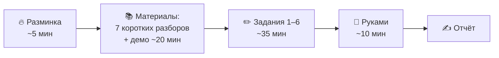
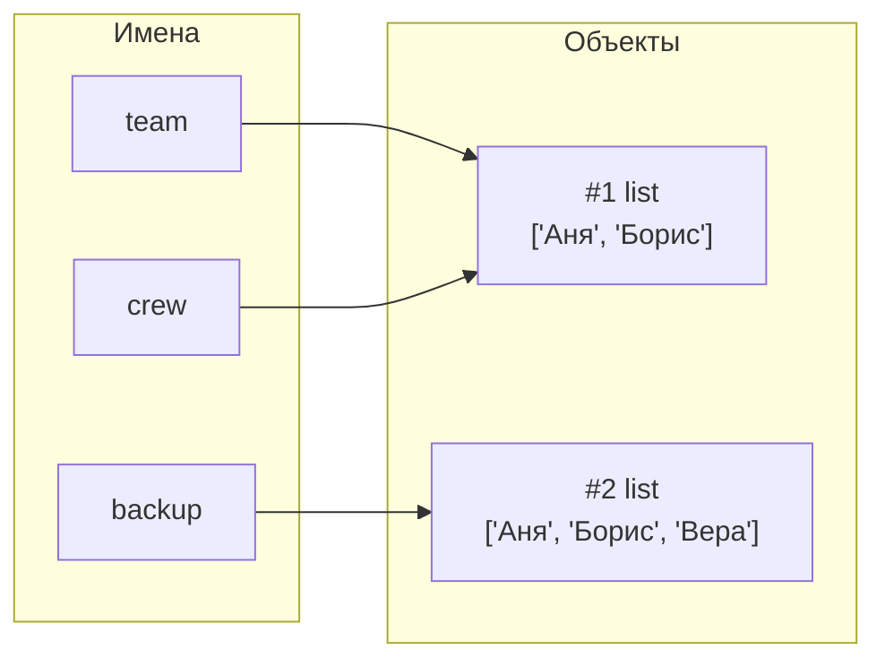

# 🔹 Сессия 6 · Неделя 02 · 🔁 `0.PY.01` — повтор: модель данных и синтаксис

> [!abstract] Зачем
> Агент пишет `crew = team` и думает, что сделал копию; ставит `items=[]` в значение по умолчанию; ловит голый `except:` и глотает ошибку. Это не опечатки, а три самых частых тихих бага в коде, который ты будешь принимать. На вход-тесте 20.10 они и всплыли — закрываем их сейчас, чтобы на неделе 3 (`0.PY.02`, ревью кода агента в `0.AIN.07`) читать код уверенно.

**Время:** ~1–1,25 ч (с «🔧 Руками» — до ~1,5 ч) · **Дата выдачи:** 27.10



> [!info] Мини-теста в этой сессии нет
> Прошлая сессия была вход-тестом — по правилам мини-тест после него не ставится. Это **повторное занятие, а не тест**: с Тьютором можно, по лесенке подсказок (`/tutor`).

---

## 🔥 Разминка (по желанию, 5 мин)

> [!note]- Строка на память, без ответа и без балла — раскрыть
> Режимы прав Claude Code: в настройках `default` — в интерфейсе это **Manual** (спрашивает перед правками и командами); стартует по умолчанию **auto**. «По умолчанию» и `default` — разные вещи.

1. [x] Вспомни 3 факта из Сессии 5 (алгоритмы и сети) — без подглядывания. Можно пропустить.
   **Ответ:** O(1) - самое быстрое время. Сортировка слиянием - O(n log n). Бинарный поиск - O(log n)
   ✍️ записано со слов

2. [x] **Повторение (неделя 1, `0.AIN.01`):**
   а) Назови звенья цикла агента по порядку.
   б) На каком звене веб-запрос агента может стать каналом утечки наружу?
   **Ответ:** Наблюдение - План - Действие. На звене "Действие".
   ✍️ записано со слов

3. [x] **Микрозадача руками** (Python, 1–3 строки): дан `files = ["notes.md", "todo.txt", "plan.md", "README.MD"]`. Одним list comprehension собери имена, которые заканчиваются на `.md` **без учёта регистра**. Должно получиться `['notes.md', 'plan.md', 'README.MD']`.
   **Ответ:**
   ```python
   [f for f in files if f.lower().endwith('.md')]
   ```
   ✍️ записано со слов

---

## 📚 Материалы

> [!tip] Материалы настоятельно рекомендуются к изучению перед выполнением заданий.
> Ты просил на повторе объяснять каждую тему прямо в сессии — ниже семь коротких разборов, по одному на каждую ошибку вход-теста 20.10. Каждый — 1–3 минуты.

**Главная картинка — имя → объект:**



Переменная в Python — ярлык, который висит на объекте. `crew = team` вешает второй ярлык на **тот же** объект; новый объект появляется только когда его явно создают (`list(team)`, `team[:]`, `team.copy()`).

> [!example] 🎮 Интерактивное демо — «Имена и объекты»
> ▶ **[Открыть демо](https://claude.ai/artifact/AG3NknD6gqTo9wFDWZLzpi)** (работает и с телефона) · копия в хранилище: [[Материалы/Демо/0.PY.01 — Имена и объекты.html|Открыть демо]] · ~5–7 мин
> Сценарии 1–2: прошагай код и посмотри, когда у двух имён один номер объекта, а когда появляется новый. Сценарий 3 (значение по умолчанию) — разбор задания 4, открывается вторым нажатием: сначала ответь в файле.

> [!info]- 1 · Изменяемые и неизменяемые типы — раскрыть
> - **Изменяемые** (можно поменять на месте): `list`, `dict`, `set`. Методы вроде `append`, `update`, `add` меняют сам объект — и это видят все имена, которые на него указывают.
> - **Неизменяемые**: `int`, `float`, `str`, `tuple`, `bool`. «Поменять» их нельзя: `y = y + 1` или `s.upper()` создают **новый** объект. Поэтому `str` и `int` не бывают «изменяемыми», даже если имя потом указывает на другое значение.
> - **Ключ словаря** должен быть неизменяемым (точнее — хешируемым): `str`, `int`, `tuple` — можно (`{("Москва", 2026): 5}`), `list` — нельзя, будет `TypeError: unhashable type: 'list'`. Строкой ключ быть не обязан.

> [!info]- 2 · `=` не копирует — раскрыть
> ```python
> a = [1, 2]
> b = a          # второй ярлык на тот же список
> c = a[:]       # новый список с теми же элементами (то же — list(a), a.copy())
> b.append(3)    # меняет общий объект → a и b: [1, 2, 3]
> print(a is b, a is c)   # True False — is сравнивает «тот же ли объект»
> ```
> Копия `a[:]` — **поверхностная**: если внутри списка лежат другие списки или словари, они остаются общими. Глубже — на неделе 3 в `0.PY.02`.

> [!info]- 3 · `d[key]` против `d.get(key)` — раскрыть
> ```python
> d = {"a": 1}
> d["b"]          # KeyError: 'b' — программа падает
> d.get("b")      # None — тихо
> d.get("b", 0)   # 0 — значение по умолчанию; словарь НЕ меняется
> ```
> **Когда что:** ключ обязан быть (например, `"api_key"` в конфиге) — `d[key]`: пусть падает громко и сразу. Ключ необязательный, есть разумное значение по умолчанию (`"timeout"` → 30) — `d.get(key, 30)`. Тихий `None` там, где ключ обязателен, — баг, который всплывёт далеко от причины.

> [!info]- 4 · Comprehension — цикл в одну строку — раскрыть
> Читай справа налево: «для каждого `x` из `items`, если условие, — возьми выражение».
> ```python
> # цикл
> result = []
> for w in words:
>     if len(w) > 4:
>         result.append(w.upper())
> # то же самое
> result = [w.upper() for w in words if len(w) > 4]
> # словарь и множество
> lengths = {w: len(w) for w in words}
> first_letters = {w[0] for w in words}
> ```
> В Python нет цикла `for i = 0; i <= 20` из C и Go. Числа по порядку — `range(начало, конец_не_включая, шаг)`: `range(0, 21, 2)` — это 0, 2, …, 20.

> [!info]- 5 · Изменяемое значение по умолчанию — раскрыть
> `def` выполняется **один раз**, и значение по умолчанию создаётся тогда же. Если это список или словарь, он один на все вызовы.
> ```python
> def log(msg, history=[]):
>     history.append(msg)
>     return history
>
> log("старт")   # ['старт']
> log("стоп")    # ['старт', 'стоп'] — тот же список копит прошлые вызовы
> ```
> Правильный шаблон: по умолчанию `None`, а новый список — внутри функции: `if history is None: history = []`. Это прямое предупреждение из официального учебника Python (раздел «Default Argument Values»).

> [!info]- 6 · `*args` и `**kwargs` — раскрыть
> ```python
> def call(model, *args, **kwargs):
>     print(model, args, kwargs)
>
> call("haiku", 1, 2, temp=0.2)
> # haiku (1, 2) {'temp': 0.2}
> ```
> Первые позиционные аргументы занимают обычные параметры (`model`), остальные позиционные собираются в **кортеж** `args`, именованные — в **словарь** `kwargs`.

> [!info]- 7 · Классы и исключения — раскрыть
> ```python
> class Counter:
>     def __init__(self, start=0):
>         self.value = start              # атрибут объекта — через self
>
>     def add(self, n):
>         if n < 0:
>             raise ValueError(f"n должно быть ≥ 0, пришло {n}")
>         self.value = self.value + n     # без self. это была бы локальная переменная
>
> c = Counter()       # скобки обязательны: Counter без () — сам класс, а не объект
> c.add(5)
>
> try:
>     c.add(-1)
> except ValueError as e:                 # ловим только то, что ожидаем
>     print("Ошибка:", e)
> ```
> **Почему голый `except:` плох:** он ловит всё подряд — опечатку в имени (`NameError`), `KeyboardInterrupt` (Ctrl+C), выход программы. Ошибка в коде превращается в «тихий `None`», и ты не узнаешь о ней. Лови конкретное исключение, которое ожидаешь. Мелочь из теста: `type(3 / 2)` — `<class 'float'>` (`/` всегда даёт float), а `-7 // 2` — это `-4`: `//` округляет вниз, к минус бесконечности.

- Ned Batchelder — [Facts and myths about Python names and values](https://nedbatchelder.com/text/names.html) — классика про имена и значения, по-английски, ~15 мин, по желанию *(проверено: 27.10)*.
- Учебник Python: [Default Argument Values](https://docs.python.org/3/tutorial/controlflow.html#default-argument-values) (раздел 4.9.1) · [List Comprehensions](https://docs.python.org/3/tutorial/datastructures.html#list-comprehensions) (5.1.3) · [Handling Exceptions](https://docs.python.org/3/tutorial/errors.html#handling-exceptions) (8.3) — справочно *(проверено: 27.10)*.
- [Python Tutor](https://pythontutor.com/) — бесплатный визуализатор: вставляешь код, шагаешь и видишь стрелки «имя → объект». Нужен для «🔧 Руками» *(проверено: 27.10)*.

---

## ✏️ Задания

1. [x] **Что выведет?** Для каждого — вывод и одно предложение «почему» через «имя → объект».
   а)
   ```python
   s = "агент"
   t = s
   t = t.upper()
   print(s, t)
   ```
   б)
   ```python
   cfg = {"model": "haiku"}
   new = dict(cfg)
   new["model"] = "opus"
   print(cfg["model"])
   ```
   в)
   ```python
   def f(a, *args, **kwargs):
       print(a, args, kwargs)

   f(1, 2, 3, mode="fast", retries=2)
   ```
   **Критерий сдачи:** точный вывод по каждому пункту (в «в» — с типами скобок) + «почему».
   **Ответ:**
   - **а)** Вывод: `агент АГЕНТ`. `s` указывает на объект строки `"агент"`. `t = s` вешает второй ярлык на тот же объект (копия не создаётся). Метод `.upper()` создаёт новый объект строки `"АГЕНТ"`, на который перевешивается ярлык `t`.
   - **б)** Вывод: `haiku`. `new = dict(cfg)` создаёт новый объект-словарь (поверхностную копию), поэтому изменение значения по ключу в `new` не меняет исходный `cfg`. `print(cfg["model"])` выводит значение по ключу `"model"`.
   - **в)** Вывод: `1 (2, 3) {'mode': 'fast', 'retries': 2}`. `1` идёт в позиционный аргумент `a`, `2, 3` собираются в кортеж позиционных `args`, `mode="fast", retries=2` собираются в словарь именованных `kwargs`.
   ✍️ записано со слов

2. [x] **`[]` или `.get`?** Напиши функцию `get_timeout(cfg)`: возвращает `cfg["timeout"]`, а если ключа нет — `30`. Затем одной строкой: для какого ключа конфига агента ты, наоборот, выбрал бы `cfg[...]` и почему.
   **Критерий сдачи:** функция в 1–2 строки без `if key in` + ключ-пример и причина.
   **Ответ:**
   ```python
   def get_timeout(cfg):
       result = cfg.get("timeout", 30)
       return result
   ```
   Для ключа, где его отсутствие не должно позволять программе выполняться дальше (например, API-ключ провайдера).
   ✍️ записано со слов

3. [x] **Переведи циклы в comprehension** — каждый одной строкой:
   а) список квадратов чётных чисел от 0 до 20 включительно;
   б) словарь `{слово: длина}` для `words = ["агент", "модель", "тест"]`.
   **Критерий сдачи:** две строки, которые работают; в «а» — через `range`.
   **Ответ:**
   ```python
   # а)
   [x*x for x in range(21) if x%2 == 0]

   # б)
   {w: len(w) for w in words}
   ```
   ✍️ записано со слов

4. [x] **Ловушка по умолчанию.** Вернись к функции из вход-теста:
   ```python
   def add(x, items=[]):
       items.append(x)
       return items

   print(add(1))
   print(add(2))
   ```
   а) Что выведут два `print` и почему?
   б) Исправь функцию так, чтобы каждый вызов без `items` начинал с пустого списка.
   **Критерий сдачи:** оба вывода + причина в одном предложении + исправленная функция. Потом открой сценарий 3 демо и сверься.
   **Ответ:**
   - **а)** Выведут `[1]` и `[1, 2]`. Значение по умолчанию создаётся один раз при определении функции (`def`), поэтому вызовы без аргумента `items` мутируют один и тот же объект списка через `.append()`.
   - **б)** Исправленная функция:
   ```python
   def add(x, items=None):
       if items is None:
           items = []
       items.append(x)
       return items

   print(add(1))
   print(add(2))
   ```
   ✍️ записано со слов

5. [x] **Класс `Account` заново.** Баланс при создании — 0 или переданный; метод `deposit(amount)` увеличивает баланс, а при `amount <= 0` выбрасывает `ValueError` с понятным сообщением. Покажи использование: создай счёт, пополни на 100, затем попробуй пополнить на `-5` и поймай ошибку через `try/except` с конкретным исключением, выведи её текст.
   **Критерий сдачи:** класс, который запускается; баланс после пополнения — 100; ошибка поймана и напечатана, программа не упала.
   **Ответ:**
   ```python
   class Account:
       def __init__(self, start=0):
           self.balance = start

       def deposit(self, amount):
           if amount <= 0:
               raise ValueError("Сумма пополнения должна быть больше нуля")
           self.balance += amount

   a = Account()
   a.deposit(100)
   print(a.balance)  # 100

   try:
       a.deposit(-5)
   except ValueError as e:
       print("Ошибка:", e)
   ```
   ✍️ записано со слов

6. [x] **`safe_int(s)` заново:** возвращает `int(s)` или `None`, если строка не число. Ловит только нужное исключение. Одним предложением: какую **конкретную** ошибку скрыл бы здесь голый `except:` — приведи пример опечатки или ситуации.
   **Критерий сдачи:** функция 4–5 строк с `except ValueError` + пример скрытой ошибки.
   **Ответ:**
   ```python
   def safe_int(s):
       try:
           return int(s)
       except:
           if not s.isdigit():
               raise ValueError(f"Передаваемое значение не является числом: {s}")
           else:
               raise TypeError("SMTHNG goes WRONG!!! but thats not tha thing s isnt an int, THATS SOMETHING WORSE MAAAN")
           return None
   ```
   По голому except непонятно, проблема в типе передаваемых данных или в самих данных. В итоге нам попадает на вход уже int, и мы не можем его привести, а причину не знаем. Или попадает "привет", и мы уже по другой причине не можем привести, но тоже не знаем.
   ✍️ записано со слов

7. [x] **🔧 Руками** (10 мин, Python Tutor или свой `python`): вставь код задания 1 «а» и задания 4 (исходную версию) в [Python Tutor](https://pythontutor.com/) и прошагай. Сверь со своими ответами.
   **Критерий сдачи:** скриншот или 2–3 строки: где стрелки двух имён указывали на один объект, совпало ли с твоим ответом, где такой визуализатор пригодится при ревью кода агента.
   **Ответ:**
   Прошагал в Python Tutor:
   - В 1а: вывод `агент АГЕНТ` — видно, как `t` сначала ссылается на тот же объект строки `"агент"`, а при `upper()` создаётся новый объект `"АГЕНТ"`, на который переключается ярлык `t`.
   - В 4: вывод `[1]`, `[1, 2]` — видно, как аргумент `items` при вызовах указывает на один и тот же список в памяти, который мутирует от вызова к вызову.
   С ответами полностью совпало. Визуализатор полезен при ревью кода агента для поиска незаметных мутаций и общих изменяемых состояний.
   ✍️ записано со слов

---

## 🟨 Мостик к интересу *(по желанию)*

Имя в Python — это, по сути, указатель, который язык прячет от тебя: `b = a` копирует адрес, а не данные. В C (`0.LOW.05` «Указатели», неделя 9) это станет явным: `int *p = &x`. Ошибка «две ссылки на один объект» там называется aliasing — и ломает уже не логику, а память.

---

## ✍️ Отчёт

- **Время (сколько ушло):** ~1 ч
- **Трудности и вопросы:** не было
- **Подсказки Тьютора:** разминка 3 — ур. 1 (синтаксис `.endswith`); задание 1 — ур. 1; задание 2 — ур. 1; задание 3 — ур. 1 (границы `range` и чётность); задание 4 — ур. 1 (синтаксис `is None`); задание 5 — ур. 1 (имена методов и `self`); задание 6 — ур. 2 (паттерн `return None` при `except ValueError`)

---

## 📋 Мини-тест по этой сессии
Выдан в начале [[Фаза 0/Недели/Неделя 02 (26.10–01.11)/Сессия 7 — 0.AIN.05|Сессии 7]]: `safe_int` заново, «имя → объект» вместе с `.get`, ошибка в имени метода.

---

## ✅ Проверка *(заполняет Ментор)*

*Проверил: Claude Opus 5.5 · 28.10 (утренний автозапуск среды, запущен вручную)*

**Главное:** держится — «имя → объект», копии, `.get` против `[]`, comprehension, значение по умолчанию, класс с `ValueError` · поправить — `safe_int`: в нём голый `except:` и `raise` вместо `return None`, ровно та ошибка вход-теста, ради которой сессия · в следующую сессию — мини-тест с `safe_int` заново.

**Вердикт по заданиям:**

| # | Задание | Статус | Что верно | Что не так / чего не хватает | Подсказки |
|---|---|---|---|---|---|
| Р1–2 | Разминка: 3 факта, цикл агента | ✅ | O(1), O(n log n), O(log n) — верно; веб-запрос как канал утечки — звено «действие», верно | — | — |
| Р3 | Микрозадача `.md` | 🟡 | Идея верна: `lower()` и фильтр в comprehension | `endwith` → `endswith`: код упадёт с `AttributeError` | ур. 1 |
| 1 | Что выведет | ✅ | а) `агент АГЕНТ`, б) `haiku`, в) `1 (2, 3) {'mode': 'fast', 'retries': 2}`. Все «почему» — через «имя → объект» и копию, со скобками | — | ур. 1 |
| 2 | `[]` или `.get` | ✅ | `cfg.get("timeout", 30)`; API-ключ — через `[]`, «пусть падает» — верно | Мелочь: хватит одной строки `return cfg.get(...)` | ур. 1 |
| 3 | Comprehension | ✅ | `range(21)` с `x % 2 == 0` — граница 20 включена; словарь `{w: len(w) ...}` | — | ур. 1 |
| 4 | Ловушка по умолчанию | ✅ | `[1]`, `[1, 2]`; причина — значение создаётся один раз при `def`; исправление `None` → новый список внутри | — | ур. 1 |
| 5 | Класс `Account` | ✅ | `self.balance`, `ValueError` при `amount <= 0`, `try/except ValueError as e`; баланс 100, программа не падает | — | ур. 1 |
| 6 | `safe_int` | ❌ | Мысль «голый `except` не даёт отличить ошибку типа от ошибки данных» — верная | По критерию: нужен `except ValueError` и `return None`. В ответе голый `except:`, функция никогда не возвращает `None` (`return None` после `raise` недостижим), а `s.isdigit()` внутри `except` сам падает, если пришёл не `str` | ур. 2 |
| 7 | 🔧 Python Tutor | ✅ | Оба случая прошагал: новый объект у `t` после `upper()`, один список на все вызовы `add` | — | — |

**Разбор ошибок:**
- **Задание 6.** Написано: `except:` → внутри `raise ValueError(...)` или `raise TypeError(...)` → `return None`. Как правильно: ловить **только** `ValueError` — его бросает `int("абв")` — и в этой ветке вернуть `None`, ничего не перевыбрасывая. Почему: у функции контракт «число или `None`». Твоя версия на `"абв"` бросает исключение, то есть контракт нарушен. На `safe_int(None)` она падает уже на `s.isdigit()` с `AttributeError` — с непонятной трассировкой и из «не того» места. Конкретная ошибка, которую спрятал бы голый `except:`, у тебя уже названа, хоть и неявно: `int(None)` бросает `TypeError`. Это баг вызывающего кода, а голый `except` выдал бы его за «строка не число». Ещё пример — опечатка `int(z)` вместо `int(s)`: `NameError` проглатывается, функция тихо возвращает `None` на любом входе. Подсказка ур. 2 была ровно про этот шаблон, но в ответ он не попал. Код пиши сам — в мини-тесте Сессии 7.
- **Разминка 3.** `endwith` — такого метода нет, Python ответит `AttributeError: 'str' object has no attribute 'endwith'`. Ошибки в именах методов — фокус с недели 1 (`w.upper` без скобок, `lower(...)` как функция). Разбирать механизм ты стал гораздо лучше, а имена методов всё ещё плывут.

**Что получилось хорошо:**
- Задание 1 «в»: точный вывод с типами скобок — `(2, 3)` кортеж, `{...}` словарь. На вход-тесте 20.10 это было мимо.
- Задание 4: причина в одном предложении («создаётся один раз при `def`») и правильный шаблон `None`. Это главная тихая ошибка вход-теста, теперь закрыта.
- Задание 7: видишь пользу визуализатора именно для ревью кода агента: «незаметные мутации и общие изменяемые состояния». Это прямой мостик к `0.AIN.07`.

**Оценка:** 4/10. Шесть пунктов из семи — чисто, и модель «имя → объект» теперь держится: на вход-тесте (≈ 20%) именно она была корнем ошибок. Но задание 6 не выполнено по критерию, и это не мелочь: «ловить конкретное исключение» — одна из семи тем повтора, а ответ повторяет ошибку вход-теста. По шкале это «база сделана, есть пропуск», а не «всё в полном объёме». Подсказки ур. 1 на оценку не влияют. Ур. 2 в задании 6 — тоже нет (правило 28), а итог задания 6 не засчитан по сути ответа, не из-за подсказки.

**Время:** ~1 ч · против плана ~1–1,25 ч — норма.

**Занятия:** `0.PY.01` — ⏳ ждёт мини-тест (в начале Сессии 7). Вопрос 1 мини-теста — `safe_int` заново: верно — повтор закрыт; нет — `safe_int` уходит в долг к `0.PY.02` (неделя 3).

**Долги:** — (решится мини-тестом)

**→ Фокусы** *(продублировано в `ЗАМЕТКИ.md`)*:
- `except`: ловить конкретное исключение и выполнять контракт функции, а не перевыбрасывать → мини-тест Сессии 7, затем `0.PY.05` «Ошибки и логирование».
- Имена методов `str` (`endswith`, `startswith`, `strip`) → разминки недели 3.

**Теги:** #python #имена-и-объекты #копии #исключения #голый-except #имена-методов

---

## 🃏 Карточки для повторения

#flashcards/Фаза0/PY

Что делает `b = a` для списка?::Вешает второе имя на тот же объект — копии нет; `b.append(...)` увидят оба имени.
<!--SR:!2026-11-19,16,270-->
Три способа сделать поверхностную копию списка `a`?::`a[:]`, `list(a)`, `a.copy()`.
<!--SR:!2026-11-14,11,270-->
`d["k"]` против `d.get("k", 0)`, если ключа нет?::`d["k"]` — `KeyError`, громко; `d.get("k", 0)` — вернёт 0, словарь не меняется. Обязательный ключ — через `[]`.
<!--SR:!2026-11-19,16,270-->
Почему `def f(items=[])` — ловушка?::Значение по умолчанию создаётся один раз при `def` и общее для всех вызовов; шаблон — `items=None`, новый список внутри.
<!--SR:!2026-11-20,17,270-->
Что ловить в `safe_int(s)` и что вернуть?::Только `ValueError` (его бросает `int("абв")`) и вернуть `None`; ничего не перевыбрасывать.
<!--SR:!2026-11-13,10,270-->
Что спрячет голый `except:` в `safe_int`?::`TypeError` от `int(None)` или `NameError` от опечатки — всё станет «не число», баг уйдёт в тишину.
<!--SR:!2026-11-15,12,270-->
`f(1, 2, 3, mode="fast")` при `def f(a, *args, **kwargs)`?::`a=1`, `args=(2, 3)` — кортеж, `kwargs={'mode': 'fast'}` — словарь.
<!--SR:!2026-11-21,18,270-->
