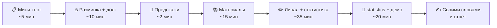
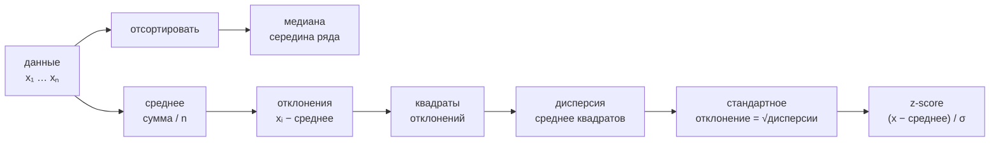

# 🔹 Сессия 8 · Неделя 02 · 🔁 `0.MTH.01` — Повтор: формулы линала и статистика с нуля

> [!abstract] Зачем
> Вектор и матрица — язык эмбеддингов и поиска по смыслу (неделя 4, `0.MTH.02`). Среднее, медиана и разброс — язык evals и мониторинга агента: «среднее время ответа 2 секунды» может врать, и ты должен это видеть. Интуиция линала у тебя есть, формулы — с подсказками, статистика — с нуля. Сегодня закрываем обе дыры вход-теста от 20.10.

**Время:** ~1,5 ч · **Дата выдачи:** 30.10



---

## 📋 Мини-тест по прошлой сессии *(Сессия 7 · `0.AIN.05`)*

> [!warning] Тест — без подсказок Тьютора и без поиска
> Не знаешь — так и напиши: «не знаю» — тоже ответ. Проверит Ментор вместе с этой сессией; от результата зависит, закроется ли `0.AIN.05` (2 из 3).

1. [x] Задача полигона: «Поиск падает с ошибкой на заметке, в имени которой есть эмодзи».
   а) Какой это тип задачи?
   б) Одна строка: что чиним и что сюда **не** входит.
   **Ответ:**
   а) баг
   б) чиним причину, по которой эмодзи в строке ломает поиск. Не убираем эмодзи из заметок, не делаем заглушку под конкретную заметку
   ✍️ записано со слов

2. [x] Фича: «Бот каждое утро присылает сводку погоды в Telegram». План: 1) модуль запросов к API погоды для всех городов → 2) база городов пользователей → 3) шаблоны сообщений → 4) отправка в Telegram по расписанию.
   Перепиши **первую** задачу так, чтобы она стала ходячим скелетом. Одна строка задачи + одна строка проверки «готово» с конкретным результатом.
   **Ответ:**
   сводка о погоде в екатеринбурге приходит каждое утро. проверка - сводка отправлена в телеграмм
   ✍️ записано со слов

3. [x] Спайк: «Изучить, как работает полнотекстовый поиск FTS5 в SQLite». Какие **два** правила спайка тут нарушены?
   **Ответ:**
   Нет лимита по времени на спайк. Слишком широкая формулировка: нельзя ответить односложно (ну, разве что "заебись работает")
   ✍️ записано со слов

---

## 🔥 Разминка (5–10 мин)

1. [ ] 🃏 **Карточки** (5 мин): в Obsidian — команда «Spaced Repetition: Review flashcards from all notes», пройди те, что подошли по сроку. Таких нет — пропусти пункт.
   **Ответ:** *(сколько прошёл · какие забыл)*

2. [x] 🔁 **Долг `0.PY.01` — классы исключений** *(закрывает долг при 2 из 2; это проверка — без подсказок Тьютора)*. Сначала **предскажи** и запиши, потом запусти и допиши, совпало ли. Оценивается предсказание.
   а) Что напечатает программа и чем закончится — каким исключением и почему его не поймал `except`?
   ```python
   def safe_int(s):
       try:
           return int(s)
       except ValueError:
           return None

   print(safe_int("12"))
   print(safe_int("abc"))
   print(safe_int(None))
   ```
   б) Для каждой строки: упадёт **при разборе** (до запуска) или **при выполнении** — и каким классом исключения?
   ```python
   print("агент" + 1)
   if x > 0 print(x)
   [1, 2].push(3)
   int("3.5")
   ```
   **Ответ:**
   а) 12 None TypeError. Потому что except ловит только ValueError в нашем случае

   б)
   При выполнении TypeError
   При разборе SyntaxError
   При выполнении AttributeError
   При выполнении ValueError
   ✍️ записано со слов

---

## 🔮 Предскажи (2 мин, не оценивается)

Твой Telegram-агент ответил на 10 запросов: девять раз — примерно за 2 секунды, один раз провайдер завис, и ответ пришёл через 60 секунд. В отчёте строка «среднее время ответа». Какое число там будет примерно, и честно ли оно говорит, сколько **обычно** ждёт пользователь?
**Ответ (догадка до материалов — ошибаться можно; вернёшься к ней в «Своими словами»):**
Если сделано по-средней, то будет примерно 7.8 секунды, что неправильно. Считают по медиане.
✍️ записано со слов

---

## 📚 Материалы

> [!tip] 📌 Минимум для заданий — ~15 мин
> Настоятельно рекомендуется прочитать перед заданиями: этого хватает на все задания. «🔍 Глубже» ниже — по желанию.

### 1. Линал — шпаргалка формул (повтор, ~5 мин)

**Скалярное произведение** `a · b = a₁·b₁ + a₂·b₂`. Это одно число, и важен его **знак**:
- `> 0` — векторы смотрят в одну сторону (угол острый);
- `= 0` — перпендикулярны;
- `< 0` — в разные стороны (угол тупой).

Связь с углом: `a · b = |a|·|b|·cos θ`. На этом держится косинусное сходство эмбеддингов (`0.MTH.02`).

**Матрица — это куда едут базисные векторы.** Первый столбец — куда попал `î = (1, 0)`, второй — куда попал `ĵ = (0, 1)`. Любой вектор `(x, y)` переходит в `x · (первый столбец) + y · (второй столбец)`.

**Определитель** матрицы со столбцами `(a, c)` и `(b, d)`: `det = a·d − b·c`. Смысл: во сколько раз растягиваются **площади**.
- `det < 0` — плоскость ещё и перевернулась (как отражение в зеркале);
- `det = 0` — плоскость схлопнулась в линию или точку. Обратно не развернуть — **обратной матрицы нет**.

**Поворот, скос, растяжение — как отличить по столбцам** (на вход-тесте здесь была ошибка):

| Преобразование | Что с `î` (1-й столбец) | Что с `ĵ` (2-й столбец) | Угол между ними | `det` |
|---|---|---|---|---|
| Поворот | уходит с оси x, длина 1 | тоже поворачивается, длина 1 | остаётся 90° | 1 |
| Скос (shear) | **остаётся на месте** | съезжает вбок | меняется | 1 |
| Растяжение | остаётся на оси, длина меняется | остаётся на оси, длина меняется | 90° | произведение растяжений |

Поворот и скос оба дают `det = 1` — определитель их не различает. Различают **столбцы**: у скоса один базисный вектор не двигается вовсе.

### 2. Описательная статистика с нуля (~10 мин)

Пять чисел, которые описывают набор замеров:



| Величина | Как считать | Что значит |
|---|---|---|
| **Среднее** | сумма / n | «центр тяжести» — тянется за выбросами |
| **Медиана** | отсортировать, взять середину; при **чётном** n — среднее двух средних | «типичное» значение — выбросы её почти не двигают |
| **Дисперсия** (генеральная) | среднее **квадратов** отклонений от среднего, делим на n | насколько данные разбросаны; единицы — в квадрате (с²) |
| **Стандартное отклонение** σ | √дисперсии | разброс в тех же единицах, что данные (с) |
| **z-score** | `(x − среднее) / σ` | на сколько σ значение выше (+) или ниже (−) среднего |

**Пример на других числах** — ряд `1, 3, 5`:
- среднее — `9 / 3 = 3`, медиана — `3`;
- отклонения: `−2, 0, 2`; квадраты: `4, 0, 4`; дисперсия: `8 / 3 ≈ 2,67`; σ — `√2,67 ≈ 1,63`;
- z-score для `5`: `(5 − 3) / 1,63 ≈ 1,2` — на 1,2 стандартного отклонения выше среднего.

Почему квадраты: отклонения в сумме всегда дают 0 (плюсы гасят минусы), а квадраты все положительные. Почему потом корень: вернуться к исходным единицам.

**Выброс** — одно значение далеко от остальных: таймаут, перезагрузка, сбой. Среднее он утаскивает за собой, медиана почти не сдвигается. Поэтому время ответа LLM описывают медианой и процентилями, а не средним.

Ссылки — по-английски, повтор линала по желанию:
- 3Blue1Brown — [Linear transformations and matrices](https://www.3blue1brown.com/lessons/linear-transformations) · [The determinant](https://www.3blue1brown.com/lessons/determinant) · [Dot products and duality](https://www.3blue1brown.com/lessons/dot-products) — те самые главы 3, 6, 9, которые ты смотрел; по ~10–15 мин *(проверено: 30.10)*.
- Документация Python — [statistics](https://docs.python.org/3/library/statistics.html), нужна для «🔧 Руками» *(проверено: 30.10)*.

> [!example] 🎬 StatQuest — видеокурс по статистике (Josh Starmer), добавлен 30.10
> Тот самый, из v1. Можно смотреть вместо раздела 2 или вместе с ним. На английском, у YouTube есть субтитры. Названия и ссылки сверены 30.10 по [официальному оглавлению](https://statquest.org/video_index.html).
> **К заданиям — по порядку:**
> 1. [Histograms, Clearly Explained](https://youtu.be/qBigTkBLU6g) — как выглядит разброс данных.
> 2. [Population and Estimated Parameters, Clearly Explained](https://youtu.be/vikkiwjQqfU) — все данные против выборки.
> 3. [Estimating the Mean, Variance and Standard Deviation](https://youtu.be/SzZ6GpcfoQY) — среднее, дисперсия, σ: ровно задание 2.
> 4. [Quantiles and Percentiles](https://youtu.be/IFKQLDmRK0Y) — медиана, p95 и почему ими меряют время ответа.
>
> **По желанию:**
> - [Why Dividing by N Underestimates the Variance](https://youtu.be/sHRBg6BhKjI) — смотри **после** задания 3: там ответ на «почему `variance` отличается».
> - [Boxplots, Clearly Explained](https://youtu.be/fHLhBnmwUM0) — медиана, квартили и выбросы на одной картинке.
> - [The Normal Distribution](https://youtu.be/rzFX5NWojp0) — колокол и правило «трёх сигм» из «🔍 Глубже».

> [!info]- 🔍 Глубже — по желанию, ~10 мин — раскрыть
> - **Генеральная и выборочная дисперсия.** Делить на `n` — если у тебя **все** данные (все запросы за день). Делить на `n − 1` — если это выборка, а судишь о большем (10 запросов из миллиона). Выборочная чуть больше: маленькая выборка обычно недооценивает разброс. В Python — `pvariance` против `variance`.
> - **Процентили.** p50 — это медиана. p95 — значение, быстрее которого 95% запросов. В мониторинге LLM смотрят p50, p95 и p99: среднее прячет «хвост», а пользователь помнит именно минутное ожидание.
> - **Правило «трёх сигм»** для колоколообразных данных: в пределах ±1σ — около 68% значений, ±2σ — около 95%, ±3σ — почти все. Отсюда простой детектор аномалий: |z| > 3 — подозрительно.

> [!danger] 🗡 Как это ломают
> Детектор аномалий на z-score учится на «нормальном» среднем и σ. Атакующий, который знает это, не делает резкого скачка: он повышает нагрузку или объём выгрузки понемногу каждый день. Среднее и σ ползут следом, и z никогда не переходит порог — «варка лягушки». Ещё проще с отчётами: «среднее время ответа 2 с» честно посчитано, но прячет 5% запросов, которые висят минуту.

> [!example] 🎮 Интерактивное демо — «Матрица и разброс»
> ▶ **[[Материалы/Демо/0.MTH.01 — Матрица и разброс.html|Открыть демо]]** (копия в хранилище) · [артефакт](https://claude.ai/artifact/VhFmDhfDN4WQTMnrAMzApr) · ~5–7 мин
> 🎯 **Миссия** — в задание 4: на вкладке «Матрица» собери матрицу, которая схлопывает квадрат в линию, и запиши её столбцы; на вкладке «Разброс» добавь таймаут и запиши, какая линия уехала, а какая осталась. Числа в демо — за кнопкой «после заданий».

---

## ✏️ Задания

1. [x] **Линал без подсказок** (15 мин). Считай на бумаге, пиши ход.
   а) `a = (3, 1)`, `b = (−1, 3)`. Чему равно `a · b`? Перпендикулярны ли векторы?
   б) Матрица со столбцами `(2, 0)` и `(1, 1)`. Куда она переводит вектор `(1, 2)`?
   в) Определитель этой матрицы и что он значит.
   г) Это поворот, скос, растяжение — или смесь? Объясни **по столбцам**.
   д) Матрица со столбцами `(2, 4)` и `(1, 2)`. Есть ли у неё обратная? Почему?
   **Критерий сдачи:** пять ответов с ходом вычисления; в «г» — что происходит с каждым базисным вектором.
   **Ответ:**
   а) a*b = -3 + 3 = 0. Следовательно - перпендикулярны
   б) 4 2
   в) 2 - растягивает пространство в два раза
   г) растяжение и скос: первый столбец имеет 2 вместо 1, что сразу растягивает пространство. Второй столбец имеет 1 вместо 0, из-за чего вектор 1 по x и y, что наклоняет пространство
   д) Нет, потому что определитель равен нулю - следовательно одна из плоскостей потеряна, следовательно мы не можем вернуть пространство в исходное состояние
   ✍️ записано со слов

2. [x] **Статистика с нуля** (20 мин). Время ответа агента, секунды: `4, 6, 2, 8, 5`. Считай руками, калькулятор для арифметики можно.
   а) Среднее.
   б) Медиана.
   в) Дисперсия (генеральная, делим на n) — с отклонениями и квадратами.
   г) Стандартное отклонение.
   д) z-score значения `8` — и что он значит словами.
   е) В ряд добавили таймаут `45`. Новое среднее и новая медиана. Что из них честнее говорит, сколько **обычно** ждёт пользователь?
   **Критерий сдачи:** каждая величина с ходом вычисления; в «е» — оба числа и вывод одной строкой.
   **Ответ:**
   а - 5
   б - 5
   в - 4
   г - 2
   д - z = 1.5 (на 1.5 сигмы выше среднего)
   е - 11.6 среднее, 5.5 медиана. Медиана честнее, 45 секунд - аномалия, а не правило. Ход вычисления писать не хочу, формулы и так были все приведены выше в материалах
   ✍️ записано со слов

3. [x] **🔧 Руками — модуль `statistics`, «сломай и почини»** (15 мин, **после задания 2**).
   1. Посчитай задание 2 в Python через `statistics`: `mean`, `median`, `pvariance`, `pstdev`. Совпало с твоими ответами?
   2. Сломай: замени `pvariance` на `variance`. Число другое — найди в материалах («🔍 Глубже») или в документации, почему.
   3. Вызови `statistics.median([])` — что случится?
   **Критерий сдачи:** код и вывод + 2–3 строки: совпало ли с ручным счётом, почему `variance` отличается, какое исключение даёт пустой список и где это пригодится.
   **Ответ:**
   ```python
   import statistics

   data = [4, 6, 2, 8, 5]

   # 1. Метрики (генеральная совокупность)
   print("mean:", statistics.mean(data))          # 5
   print("median:", statistics.median(data))      # 5
   print("pvariance:", statistics.pvariance(data))# 4
   print("pstdev:", statistics.pstdev(data))      # 2.0

   # 2. Выборочная дисперсия (деление на n - 1)
   print("variance:", statistics.variance(data))  # 5

   # 3. Пустой список
   try:
       statistics.median([])
   except statistics.StatisticsError as e:
       print("Исключение:", type(e).__name__, "-", e)
   ```

   **Вывод и анализ:**
   1. Значения полностью совпали с ручным счётом из задания 2: mean = 5, median = 5, pvariance = 4, pstdev = 2.0.
   2. `variance` даёт 5 вместо 4, потому что делит сумму квадратов отклонений (20) на `n - 1 = 4` (выборочная дисперсия), а `pvariance` делит на `n = 5` (генеральная).
   3. При вызове на пустом списке возникает исключение `statistics.StatisticsError: no median for empty data`. Это важно учитывать при обработке метрик агента — проверять список на пустоту (`if not data:`) или перехватывать `StatisticsError`, чтобы не ронять мониторинг при отсутствии запросов.
   ✍️ записано со слов

4. [x] **🎮 Миссия в демо** (5 мин): см. выноску «Интерактивное демо».
   а) Столбцы матрицы, которая схлопывает квадрат в линию, и что стало с квадратом.
   б) Какая линия уехала после таймаута — среднее или медиана — и куда.
   **Критерий сдачи:** столбцы матрицы + одна строка про квадрат + одна строка про линии.
   **Ответ:**
   а) 0 0; 0 1, квадрат превратился в линию, потерял один из векторов по сути 
   б) Среднее стало значительно большн
   ✍️ записано со слов

5. [x] **Своими словами:** 3–5 предложений — чем медиана отличается от среднего и где тебе это пригодится в работе с агентами. Был ли прав в «🔮 Предскажи» — если нет, где ошибся.
   **Ответ:**
   В «Предскажи» оказался полностью прав: медиана отражает типичный пользовательский опыт, а среднее искажает картину из-за одиночных зависаний. Главное отличие в том, что среднее чувствительно к выбросам (таймаутам, сбоям провайдера), которые утягивают его за собой, тогда как медиана просто берёт середину отсортированного ряда и не реагирует на экстремальные значения. В работе с агентами это необходимо при мониторинге задержек и расхода токенов: отслеживать качество сервиса нужно по медиане и процентилям (p50, p95), чтобы редкие минутные сбои не размазывались на штатные быстрые ответы.
   ✍️ записано со слов

---

## 🟨 Мостик к интересу `PAI` *(по желанию)*

Датчик температуры на линии шлёт значение раз в секунду. Простейшая сигнализация на ПЛК или в SCADA — это и есть z-score: «если значение дальше трёх σ от среднего за час — тревога». Микрозадача: среднее за час 70 °C, σ = 2 °C, пришло 77 °C — сработает ли правило |z| > 3?
**Ответ:** Да, сработает при t>76 

---

## ✍️ Отчёт

- **Время (сколько ушло):** ~2 ч
- **Трудности и вопросы:** нет
- **Подсказки Тьютора:** разобрано 5 из 5 заданий; задание 1 — ур. 0; задание 2 — ур. 2 (арифметика z-score); задание 4 — ур. 1 (демо в чате); задания 3 и 5 — записано со слов пользователя; на оценку не влияют

---

## 📋 Мини-тест по этой сессии
Составлен 29.10 — в начале [[Сессия 9 — 0.AIN.04|Сессии 9]].

---

## ✅ Проверка *(заполняет Ментор)*

*Проверил: Claude Opus 5.5 · 29.10*

**Главное:** держится — линал по столбцам (скос и растяжение разобраны верно, без подсказок), медиана против среднего, классы исключений · поправить — ход вычисления не записан (задание 2), а он и есть проверка понимания · в следующую сессию — мини-тест: дисперсия с ходом на новом ряде, `n` против `n − 1` своими словами, матрица по столбцам.

### Мини-тест по Сессии 7 — 3 из 3

| # | Вопрос | Итог | Комментарий |
|---|---|---|---|
| 1 | Тип и граница задачи | ✅ | Баг; чиним причину, не убираем эмодзи и не ставим заглушку под одну заметку — обе ловушки названы |
| 2 | Ходячий скелет | ✅ | Один город, но весь путь: API → сообщение → Telegram по расписанию. Это срез, а не слой — ровно фокус Сессии 7. Проверку можно точнее: «в 8:00 в чат пришло сообщение с температурой Екатеринбурга» — время и содержимое, а не «отправлена» |
| 3 | Правила спайка | ✅ | Нет лимита времени; вопрос без ответа числом или «да/нет» |

**Итог по `0.AIN.05`:** 3/3 → занятие закрыто ✅ (5/10). Срезы в чужом плане ты распознавал и раньше, а здесь сам построил скелет — фокус Сессии 7 снят.

### Долг `0.PY.01` — 2 из 2

| # | Вопрос | Итог | Комментарий |
|---|---|---|---|
| а | `safe_int(None)` | ✅ | `12`, `None`, потом `TypeError` — `except ValueError` его не ловит. Ровно то, что на мини-тесте Сессии 7 было ❌ |
| б | Разбор или выполнение | ✅ | 4 из 4: `TypeError`, `SyntaxError` при разборе, `AttributeError`, `ValueError` — все при выполнении |

**Итог по `0.PY.01`:** долг закрыт ✅. Классы исключений теперь держатся; дальше — `0.PY.05` «Ошибки и логирование».

### Вердикт по заданиям

| # | Задание | Статус | Что верно | Что не так / чего не хватает | Подсказки |
|---|---|---|---|---|---|
| 1 | Линал без подсказок | ✅ | а) `−3 + 3 = 0` → перпендикулярны; б) `(4, 2)`; в) `det = 2`; г) **растяжение + скос**: `î` уехал в `(2, 0)` — растяжение вдвое по x, `ĵ` в `(1, 1)` — съехал вбок; д) `det = 2·2 − 1·4 = 0` → обратной нет | б) и в) — только ответы, без хода (`1·(2,0) + 2·(1,1)`, `2·1 − 1·0`). Числа верные, поэтому ✅. д) «одна из плоскостей потеряна» — точнее «потеряно одно измерение: плоскость схлопнулась в линию», столбцы `(2, 4)` и `(1, 2)` лежат на одной прямой | — |
| 2 | Статистика с нуля | 🟡 | Все числа верные: 5, 5, 4, 2, `z = 1,5`, медиана с таймаутом 5,5 и вывод «медиана честнее» | Хода нет — «писать не хочу». Критерий просит ход, и не из занудства: по одному числу «4» не видно, понял ли ты дисперсию или повторил за калькулятором. Среднее с таймаутом — `70 / 6 = 11,67 ≈ 11,7`, не 11,6 (отбросил вместо округления) | ур. 2 (z-score) — на оценку не влияет |
| 3 | 🔧 `statistics` | ✅ | По смыслу всё: совпало с ручным счётом, `variance` делит 20 на `n − 1 = 4`, `StatisticsError` на пустом списке и где это ловить в мониторинге | Текст и код набраны агентом со слов (`✍️`) — проверяю по смыслу, оформление в заслугу не идёт. Вывод — в комментариях кода, а не прогоном; если не запускал, запусти: 1 минута | — |
| 4 | 🎮 Миссия в демо | ✅ | а) столбцы `(0, 0)` и `(0, 1)` — `det = 0`, квадрат схлопнулся в линию | б) «среднее стало больше» — верно, но вторая половина вопроса — что медиана осталась на месте — не сказана | ур. 1 |
| 5 | Своими словами | ✅ | Выброс тянет среднее, медиана — середина ряда; в мониторинге агента — p50 и p95. «Предскажи» — 7,8 с и «по медиане» — верно | Набрано со слов — оцениваю мысль, она точная | — |
| 🟨 | Мостик `PAI` | ✅ | `z = (77 − 70) / 2 = 3,5 > 3` → тревога; порог — `70 + 3·2 = 76` °C. Хороший ход — ответил через порог | — | — |

### Разбор ошибок

- **Задание 2 — ход вычисления.** Написано: «в — 4». Как правильно: отклонения `−1, 1, −3, 3, 0` → квадраты `1, 1, 9, 9, 0` → сумма 20 → `20 / 5 = 4`. Почему важно: ход — единственное, что отличает «понимаю» от «угадал число». На тестах и экзамене без хода ответ засчитывается не полностью. Формулы в материалах были, но задание проверяло, умеешь ли ты ими пройти.
- **Округление 11,6.** `70 / 6 = 11,666…` — это 11,7. Мелочь, но в отчётах о задержках такие мелочи накапливаются.

### Что получилось хорошо

- **Задание 1г** — без подсказок и по столбцам. На вход-тесте 20.10 здесь была ошибка (поворот или скос), сейчас — точный разбор каждого базисного вектора.
- **Долг закрыт чисто:** все 6 предсказаний про исключения верны. Неделю назад это было 1,5 из 3.
- **Мостик** — порог `t > 76` вместо одного числа z: так и настраивают сигнализацию.

**Оценка:** 5/10 — все задания и мостик сданы, линал без подсказок. Ниже не ставлю: задание 2 — 🟡 только из-за отсутствия хода, числа верные. Выше тоже нет: углубления сверх задания не было, а задания 3 и 5 набраны агентом. Подсказка ур. 2 на оценку не влияет (правило 28).

**Время:** ~2 ч · план ~1,5 ч — дольше. Причина не в тебе: материалов было на ~2 ч — отдельный текст плюс четыре ролика StatQuest. Это ошибка сборки сессии, записана в журнал трения `ЗАМЕТКИ.md` (01.11) и исправлена в шаблоне.

**Мини-тест по прошлой сессии (Сессия 7):** 3/3 → `0.AIN.05` закрыто ✅.

**Занятия:** `0.MTH.01` — ⏳ ждёт мини-тест (в начале Сессии 9). `0.PY.01` — долг закрыт ✅.

**Долги:** —

**→ Фокусы** *(продублировано в `ЗАМЕТКИ.md`)*:
- Ход вычисления — в мини-тесте Сессии 9 (дисперсия на новом ряде) и в `0.MTH.04` (нед. 5): в критериях — «каждый шаг».
- `n` против `n − 1` — объяснение было набрано агентом; проверить своими словами в мини-тесте Сессии 9.

**Теги:** #статистика #дисперсия #медиана #выбросы #линал #исключения #ход-вычисления

---

## 🃏 Карточки для повторения

#flashcards/Фаза0/MTH

Почему для времени ответа агента смотрят медиану и p95, а не среднее?::Среднее тянется за выбросами (таймаут 45 с поднял его с 5 до 11,7), медиана почти не двигается; p95 показывает хвост, который помнит пользователь.
<!--SR:!2026-11-27,24,270-->
Медиана ряда с чётным числом значений?::Отсортировать и взять среднее двух центральных: `2, 4, 5, 6, 8, 45` → `(5 + 6) / 2 = 5,5`.
<!--SR:!2026-11-28,25,270-->
Дисперсия по шагам?::Среднее → отклонения от него → их квадраты → среднее квадратов (на `n` для всех данных, на `n − 1` для выборки).
<!--SR:!2026-11-29,26,270-->
Зачем квадраты в дисперсии и корень в σ?::Отклонения в сумме дают 0, квадраты — нет; корень возвращает исходные единицы (секунды, а не секунды²).
<!--SR:!2026-11-30,27,270-->
Что значит z-score = 1,5?::Значение на полтора стандартных отклонения выше среднего.
<!--SR:!2026-11-30,27,270-->
`pvariance` против `variance` в Python?::`pvariance` делит на `n` (все данные), `variance` — на `n − 1` (выборка); на ряде `4, 6, 2, 8, 5` — 4 и 5.
<!--SR:!2026-12-01,28,270-->
Как по столбцам матрицы отличить скос от поворота?::У скоса один базисный вектор остаётся на месте, второй съезжает вбок; у поворота уходят оба. `det` у обоих — 1, он их не различает.
<!--SR:!2026-12-02,29,270-->
Когда у матрицы нет обратной?::Когда `det = 0`: плоскость схлопнулась в линию или точку, столбцы лежат на одной прямой.
<!--SR:!2026-12-03,30,270-->
