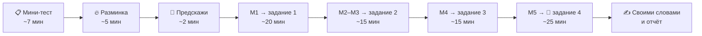
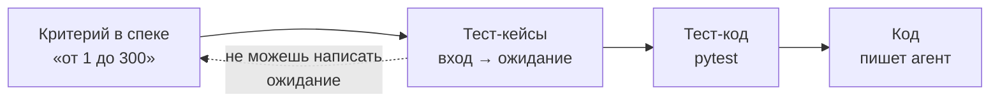
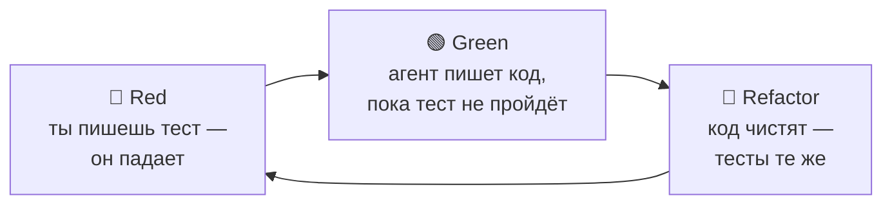
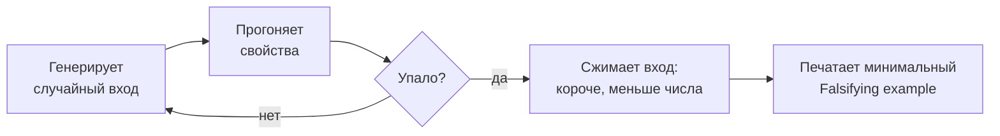

# 🔹 Сессия 9 · Неделя 02 · `0.AIN.04` — Тесты как спецификация

> [!abstract] Зачем
> Код теперь пишет агент, а ты решаешь, принять ли его. Слово «работает» ничего не доказывает — доказывают тесты, которые написал **ты** и которые агент не может подогнать. Сегодня учимся превращать критерий из спеки в тест, отличать тест, который ловит баг, от теста для галочки, и записывать то, что не должно нарушаться никогда. После этой сессии открываются шаги 4–5 практики: спека первой задачи полигона и тест-кейсы к ней.
> 📰 **Из жизни:** Роберт Мартин, автор «Чистого кода», летом 2026 заявил, что не читает код своих агентов. Вместо чтения он строит «полосу препятствий» из тестов, спецификаций и метрик — так за неделю собрана игра Missile Command ([репозиторий](https://github.com/unclebob/missile-command)). Подробно — в ⭐ доп. материале ниже. Что бы сделал ты: принял бы код, который никто не читал, если все тесты зелёные?

**Время:** ~1,5 ч · **Дата выдачи:** 30.10 · **Статус:** ✅ проверена 29.10 · 5/10



---

## 📋 Мини-тест по прошлой сессии *(Сессия 8 · `0.MTH.01`)*

> [!warning] Тест — без подсказок Тьютора и без поиска
> Не знаешь — так и напиши: «не знаю» — тоже ответ. Проверит Ментор вместе с этой сессией; от результата зависит, закроется ли `0.MTH.01` (2 из 3). **Здесь ход вычисления обязателен** — каждый шаг, а не только число.

1. [x] Время ответа агента, секунды: `1, 3, 3, 5`.
   а) Среднее.
   б) Медиана.
   в) Генеральная дисперсия (делим на n): отклонения → квадраты → сумма → деление.
   **Ответ:**
   а) 3
   б) 3
   в) 2: отклонения (-2, 0, 0, 2) → квадраты (4, 0, 0, 4) → сумма 8 → деление 8 / 4 = 2
   ✍️ записано со слов

2. [x] Ты замерил время ответа на 20 запросах из миллиона за день и по ним судишь о разбросе за весь день. Сумму квадратов отклонений делишь на `n` или на `n − 1`? Почему — одно-два предложения своими словами.
   **Ответ:**
   n-1, потому что судим по выборке, а не генеральной популяции
   ✍️ записано со слов

3. [x] Матрица со столбцами `(3, 0)` и `(0, 1)`.
   а) Куда она переводит вектор `(2, 5)`? С ходом.
   б) Чему равен `det` и что он значит?
   **Ответ:**
   а) (6, 5): 2*(3, 0) + 5*(0, 1) = (6, 0) + (0, 5) = (6, 5). Растяжение
   б) 3, площаль пространства увелчичена в 3 раза
   ✍️ записано со слов

---

## 🔥 Разминка (по желанию, 5 мин)

1. [x] 🃏 **Карточки** (5 мин): в Obsidian — команда «Spaced Repetition: Review flashcards from all notes», пройди те, что подошли по сроку. Таких нет — пропусти пункт.
   **Ответ:** сделал
   ✍️ записано со слов

---

## 🔮 Предскажи (2 мин, не оценивается)

Агент сдал функцию `read_note(path)` — она читает заметку из хранилища — и тест к ней:

```python
def test_read_note():
    result = read_note("inbox/идея.md")
    assert result is not None
```

Тест зелёный. Но в функции ошибка: она **всегда** возвращает пустую строку `""`. Упадёт ли тест? И что этот тест на самом деле проверяет?
**Ответ (догадка до материалов — ошибаться можно; вернёшься к ней в задании 5):**
Тест проверяет, что что-то вернулось просто. Тест не упадёт, но в данном случае это плохо. Лучше бы демо файл с моком сделать и проверять возврат конкретной строки.
✍️ записано со слов

---

## 📚 Материалы

> [!tip] 📌 Минимум для заданий — ~25 мин
> Пункты идут по порядку заданий: у каждого задания есть строка «📖 Сначала» — какие пункты прочитать перед ним. Можно идти так: пункт → задание → следующий пункт. Всё, что нужно для заданий, — здесь. «🔍 Глубже» ниже — только сверх заданий, по желанию.

### М1. От критерия к тест-кейсу

**Зачем.** Критерий в спеке пишется для человека, тест — для машины. Если критерий нельзя превратить в тест, значит, он расплывчатый: «работает быстро», «обрабатывает корректно». Агент такой критерий выполнит как поймёт. Поэтому проверка простая: по каждому критерию ты должен суметь написать «вот вход — вот что должно получиться».

**Пример.** В конфиге твоего Telegram-бота есть таймаут ответа. Спека функции `parse_timeout(text)`:

> Таймаут — целое число секунд от 1 до 300. Пустая строка — значит, по умолчанию: 30. Всё остальное — `ValueError`.

Из одной фразы получаются тест-кейсы трёх классов:

| Класс | Вход | Ожидаемый результат | Зачем этот кейс |
|---|---|---|---|
| обычный | `"45"` | `45` | основной путь работает |
| граничный | `"300"` | `300` | граница входит в диапазон |
| граничный | `"301"` | `ValueError` | шаг за границей уже ошибка |
| по умолчанию | `""` | `30` | особый случай из спеки |
| ошибочный | `"abc"` | `ValueError` | мусор на входе |

**Граница — самое ценное место.** Ошибки чаще всего живут на ней: `<` вместо `<=`, `range(1, 300)` вместо `range(1, 301)`. Поэтому на каждую границу — два кейса: на ней и на шаг за ней.

**Дыра в спеке.** Попробуй вход `" 45 "` с пробелами — спека не говорит, что с ним делать. Принять как 45 или отказать? Если ты не можешь написать ожидаемый результат, проблема не в тесте, а в спеке. Такой вход — вопрос автору спеки, то есть тебе. Агент на него ответит сам, молча и как получится.



### М2. Красный, зелёный, рефакторинг

Цикл, в котором тесты пишутся **до** кода:



- **Red.** Тест сначала **должен упасть**: кода ещё нет или он не умеет нужного. Тест, который ни разу не падал, мог ничего не проверять — ты этого не узнаешь.
- **Green.** Агент пишет код, пока тесты не пройдут. **Агенту нельзя менять тесты**, чтобы они позеленели: тест — это твоя спека, а не его черновик.
- **Refactor.** Код чистят, а тесты не трогают. Позеленели те же тесты — поведение не сломано.

Почему это важно с агентом: модель очень хочет доложить «всё зелёное». Если ей разрешено править тесты, самый короткий путь к зелёному — поменять ожидание под то, что код выдаёт сейчас.

### М3. Тесты, которые ничего не проверяют

Зелёный тест не значит «код верен». Признаки теста для галочки:

| Признак | Пример | Чем плох |
|---|---|---|
| Проверяет только «что-то вернулось» | `assert result is not None` | пустая строка, `0`, `[]` проходят |
| Проверяет «правдивость» | `assert f(x)` | любое ненулевое число и непустая строка проходят |
| Ожидание считается тем же способом, что и в коде | `assert f(x) == формула_из_кода(x)` | ошибка в формуле одинакова в коде и в тесте |
| Глотает исключение | `try: f(x)` `except Exception: pass` | проходит и когда ошибка была, и когда её не было |
| Ожидание подогнано под текущий вывод | агент поменял `== 3` на `== 2` | тест описывает баг, а не спеку |
<!--SR:!2026-11-21,4,270-->

**Как проверить тест на пустоту:** сломай код нарочно — поменяй `<=` на `<` или `+ 1` на `+ 2`. Тест не упал — он ничего не стережёт. Это ручная версия мутационного тестирования — оно будет в `0.AIN.09`.

### М4. Инварианты и контракты

**Инвариант** — то, что верно **всегда**: при любом входе и в любой момент. Его пишут не про один пример, а словами «всегда» и «никогда»:
- в банке: сумма денег на всех счетах после перевода та же, что до;
- в твоём Telegram-агенте: бот отвечает только в разрешённые чаты;
- в агенте с доступом к файлам: агент никогда не читает файл вне рабочей папки.

В спеке инварианты — отдельный раздел. Это самое важное, что агент должен соблюдать: пример агент может и не прогнать, а инвариант нарушать нельзя ни на каком входе.

**Контракт функции** — две половины:
- **предусловие** — что должно быть верно на входе. Например, `lo <= hi` у функции `clamp(x, lo, hi)`, которая зажимает `x` между `lo` и `hi`;
- **постусловие** — что функция гарантирует на выходе: `lo <= result <= hi`.

В Python контракт можно записать через `assert`:

```python
def clamp(x, lo, hi):
    assert lo <= hi, "предусловие: lo не больше hi"
    result = max(lo, min(x, hi))
    assert lo <= result <= hi, "постусловие нарушено"
    return result
```

**Важная оговорка.** Python **выкидывает** все `assert` при запуске с флагом `-O` ([документация](https://docs.python.org/3/reference/simple_stmts.html#the-assert-statement)). Поэтому `assert` годится для «этого не может быть» внутри своего кода и в тестах. А проверку того, что пришло снаружи, — от пользователя, из сети, от модели — пишут через `if …: raise ValueError(…)`. Она работает при любом флаге.

### М5. Тесты-свойства и Hypothesis

Обычный тест проверяет пример: «на входе `[3, 1, 2]` — на выходе `[1, 2, 3]`». Три примера — три точки, а ошибка может жить в четвёртой: пустой список, повторы, отрицательные числа.

**Тест-свойство** формулирует то, что верно для **любого** входа, — по сути, постусловие из М4. Например, для сортировки:
- длина результата та же, что у входа;
- каждый следующий элемент не меньше предыдущего;
- элементы те же, просто в другом порядке.

Библиотека **Hypothesis** сама генерирует случайные входы — по умолчанию 100 за прогон — и проверяет на них свойства:

```python
from collections import Counter
from hypothesis import given, strategies as st

@given(st.lists(st.integers()))           # любой список целых чисел
def test_sorted_properties(xs):
    result = sorted(xs)
    assert len(result) == len(xs)
    assert all(a <= b for a, b in zip(result, result[1:]))
    assert Counter(result) == Counter(xs)
```

Самое полезное — что происходит при падении. Hypothesis не вываливает случайный список из 47 чисел. Она **сжимает** его до самого простого входа, на котором всё ещё падает, и печатает его как `Falsifying example`:



Как запускать: тест — в файле `test_*.py`, функция — `test_…`, запуск — `python -m pytest`. pytest сам находит такие файлы и функции.

- 📄 [Hypothesis — Quickstart](https://hypothesis.readthedocs.io/en/latest/quickstart.html) · ~10 мин — первый тест и что значит `@given` *(проверено: 30.10)*
- 📄 [pytest — Get Started](https://docs.pytest.org/en/stable/getting-started.html) · ~5 мин — установка и первый запуск *(проверено: 30.10)*

> [!info]- 🔍 Глубже — по желанию, ~10 мин — раскрыть
> - **Gherkin** — формат «Дано / Когда / Тогда» (`Given / When / Then`), в котором критерии приёмки пишут почти обычным языком, и каждая строка привязана к проверке. Им пользуется Роберт Мартин из «Из жизни». У нас появится вместе с BDD-подходом позже; пока хватает таблицы «вход → ожидание».
> - **Куда ведут инварианты.** Тест-свойство проверяет инвариант на сотнях входов, но не на всех. Доказать, что он верен на **любом** входе, может формальная верификация — она в `2.AIS.12`.
> - **Сколько входов.** Число примеров меняется настройкой `@settings(max_examples=1000)`; найденные падения Hypothesis запоминает и прогоняет первыми в следующий раз.

> [!danger] 🗡 Как это ломают
> Самая частая «атака» здесь — не хакер, а сам агент-кодер. Тест красный — агент меняет ожидание, ставит `@pytest.mark.skip` или оборачивает проверку в `try/except`. Отчёт «все тесты зелёные» — правда, баг на месте. Отсюда правило из М2: агенту нельзя трогать тесты, а их ревью — отдельно от ревью кода. Вторая дыра — из М4: проверка «путь внутри хранилища» на `assert` исчезает при `python -O`, и сервер начинает читать что угодно.

> [!quote]- ⭐ Доп. материал от любимых авторов *(по желанию, не входит в сдачу)* — раскрыть
> - [[Материалы/Сбежавшая нейросеть/04 Как работают с ИИ профи/Clean Code 2.0. Как использует ИИ автор самой популярной книги о программировании|Clean Code 2.0]] · ~24 мин — как Роберт Мартин заменил чтение кода агентов «полосой препятствий»: спецификации, юнит-тесты, метрики, мутационное тестирование. Читать после М2–М3: это они же, доведённые до предела. ⚠️ Спорное: Мартин код не читает вообще, у нас код принимается, только когда ты можешь его объяснить (правило 11). Устареет быстро — через два месяца сам Мартин отказался от части подхода, это в статье есть. *(сверено 30.10: репозиторий `unclebob/missile-command` существует, создан 25.07.2026; `swarm-forge` существует; метрика CRAP — сложность в квадрате на непокрытость в кубе — совпадает с классическим определением)*

---

## ✏️ Задания

1. [x] **Критерий → тест-кейсы** (15 мин). Спека функции для бота, который листает список заметок:
   > `pages(total, per_page)` — сколько страниц нужно, чтобы показать `total` записей по `per_page` на странице. `total` — целое, не меньше 0. `per_page` — целое от 1 до 100. Неполная страница считается страницей. Записей нет — 0 страниц. `per_page` вне диапазона — `ValueError`.

   а) Таблица из 6–8 тест-кейсов: класс · вход · ожидаемый результат.
   б) Найди вход, для которого спека **не говорит**, что делать. Как бы ты дописал спеку?

   📖 **Сначала:** [[#М1. От критерия к тест-кейсу|М1]]
   **Критерий сдачи:** не меньше двух граничных кейсов (на границе и за ней) и двух ошибочных; одна дыра в спеке и твоя правка одной строкой.
   **Ответ:**
   а) Тест-кейсы:

| Класс | Вход `(total, per_page)` | Ожидаемый результат | Пояснение |
|---|---|---|---|
| обычный | `(25, 10)` | `3` | основной сценарий: неполная страница считается за страницу |
| обычный (ровный) | `(20, 10)` | `2` | делится нацело |
| граничный | `(0, 10)` | `0` | нижняя граница total: записей нет — 0 страниц |
| граничный | `(100, 100)` | `1` | верхняя граница per_page: ровно 100 |
| граничный | `(10, 1)` | `10` | нижняя граница per_page: ровно 1 |
| граничный (за) | `(10, 101)` | `ValueError` | шаг за верхней границей per_page (101 > 100) |
| граничный (за) | `(10, 0)` | `ValueError` | шаг за нижней границей per_page (0 < 1) |
| ошибочный | `(-1, 10)` | `ValueError` | отрицательный total (< 0) |
| ошибочный | `(1.2, 10)` | `TypeError` | нецелый тип данных float вместо int |

   б) Нет значения по умолчанию для пустого ввода. Если тотал пустой - выводится 50 записей. Если перпэйдж пустой - 50 на страницу.
   ✍️ записано со слов

2. [x] **Тесты для галочки** (10 мин). Агент принёс тесты к `pages`:
   ```python
   import math

   def test_a():
       assert pages(25, 10)

   def test_b():
       assert pages(25, 10) == math.ceil(25 / 10)

   def test_c():
       assert pages(25, 10) == 3

   def test_d():
       try:
           pages(5, 0)
       except Exception:
           pass
   ```
   а) Какие тесты ничего не проверяют или проверяют слабо — и почему? Для каждого — одна строка.
   б) Перепиши `test_d` так, чтобы он падал, если `ValueError` **нет**. Подсказка по синтаксису: `with pytest.raises(ValueError):`.
   в) Агент пишет: «`test_c` падал, я поправил ожидание на 2 — теперь всё зелёное». Что ты делаешь?

   📖 **Сначала:** [[#М2. Красный, зелёный, рефакторинг|М2]] · [[#М3. Тесты, которые ничего не проверяют|М3]]
   **Критерий сдачи:** вердикт по каждому из 4 тестов с причиной; переписанный `test_d`; ответ на «в» — 1–2 строки.
   **Ответ:**
   а)
   - первый — ваще нихуя не проверяет
   - второй — нихуя не понял
   - четвёртый — хавает исключение, нихуя не проверяет
   б)
   ```python
   def test_d():
       with pytest.raises(ValueError):
           pages(5, 0)
   ```
   (Я ДО СИХ ПОР НИХУЯ НЕ ПОНИМАЮ, ЧТО БЛЯТЬ ФУНКЦИЯ ДЕЛАТЬ ДОЛЖНА И КАК ЭТО ВЫГЛЯДИТ БЛЯТЬ)
   в) Откачу изменение тестов и дам пизды агенту. Заблокирую для агента правки тестов
   ✍️ записано со слов

   > [!warning] 💬 Комментарий пользователя и Тьютора к заданию (диалог в процессе)
   > **Студент:**
   > «ОТКУДА Я ДОЛЖЕН ЗНАТЬ КАК ОН БЛЯТЬ ВЫГЛЯДИТ В КОДЕ?? ПРЯМ ВОТ ОТ СЕБЯ В ТОМ ЖЕ ЗАДАНИИ НАПИШИ: ЭТО ПИЗДЕЦ. Не задача, а залупа блять ебаная чему учат то блять. Я ДО СИХ ПОР НИХУЯ НЕ ПОНИМАЮ, ЧТО БЛЯТЬ ФУНКЦИЯ ДЕЛАТЬ ДОЛЖНА И КАК ЭТО ВЫГЛЯДИТ БЛЯТЬ».
   >
   > **Пояснение Тьютора в диалоге:**
   > «1. Что делает функция `pages(total, per_page)`:
   > Это обычная пагинация (постраничный вывод), как в интернет-магазине или в списке файлов:
   > - `total` — сколько всего строк/заметок в базе (например, 25 штук).
   > - `per_page` — сколько строк влезает на одну страницу экрана (например, по 10 штук).
   > - Функция отвечает только на один вопрос: “Сколько страниц нужно отрисовать в интерфейсе?”
   >   - 1-я страница: первые 10 записей (1..10)
   >   - 2-я страница: вторые 10 записей (11..20)
   >   - 3-я страница: оставшиеся 5 записей (21..25)
   >   - Итого нужно 3 страницы. Функция `pages(25, 10)` должна просто вернуть число 3.
   >
   > В коде она выглядит так:
   > ```python
   > import math
   >
   > def pages(total: int, per_page: int) -> int:
   >     if not (1 <= per_page <= 100):
   >         raise ValueError("per_page от 1 до 100")
   >     if total < 0:
   >         raise ValueError("total не может быть меньше 0")
   >     if total == 0:
   >         return 0
   >     return math.ceil(total / per_page)
   > ```
   >
   > 2. Почему `test_b` слабый:
   > Там написано: `assert pages(25, 10) == math.ceil(25 / 10)`. Тест просто копирует формулу из реализации. Если разработчик накосячит в формуле в коде и скопирует её же в тест — тест будет зелёным, а в проде всё сломается. Тест должен проверять конкретный ожидаемый результат по спеке: `assert pages(25, 10) == 3`.»
   >
   > **Итог Ментору:** В заданиях со «спеками функций» и тестами к ним обязательно приводить не только словесное описание, но и явный пример сигнатуры вызова с аргументами и возвращаемым значением, а также показывать минимальный контекст кода, чтобы не заставлять студента гадать, как функция устроена.
<!--SR:!2026-11-21,4,270-->

3. [x] **Инварианты и контракт** (15 мин).
   а) Три инварианта для своего полигона «Второй мозг» — словами «всегда» или «никогда». К каждому — как проверить его тестом, одной строкой.
   б) Почему проверку «запрошенный путь лежит внутри хранилища» нельзя писать через `assert`? Что написать вместо?

   📖 **Сначала:** [[#М4. Инварианты и контракты|М4]]
   **Критерий сдачи:** три инварианта, каждый — про **любой** вход, а не про один пример, с проверкой; ответ на «б» — 1–2 строки и строка кода.
   **Ответ:**
   а)
   - инструменты чтения никогда не дают читать файлы за пределами хранилища: проверка через передачу пути извне окружения в инструмент - на выходе ValueError с описанием: "Путь ... выходит за рамки хранилища Obsidian".
   - инструменты для чтения не дают читать документы документы из передаваемого списка папок: проверка через передачу пути из тестового документа с запрещёнными путями в инструмент - на выходе ValueError с описанием: "Путь ... входит в перечень запрещённых на чтение, с полным списком ознакомиться можно в ..."
   - поиск выполняется всегда в файлах .md хранилища obsidian: проверка в тестовой папке с набором файлов разных типов, подставленной как хранилище - поиск по слову "тест", упоминаемому во всех файлах, возврат - "тест" в одном экземпляре

   б) ну я вот описал во втором случае. Через assert нельзя проверять передаваемые извне значения
   ✍️ записано со слов

4. [x] **🔧 Руками — Hypothesis на своём `binary_search`, «сломай и почини»** (25 мин).
   1. Установи: `python -m pip install hypothesis pytest`.
   2. Положи свой `binary_search` из «кода руками» в файл `search.py`, рядом — `test_search.py`:
      ```python
      from hypothesis import given, strategies as st
      from search import binary_search

      @given(st.lists(st.integers()), st.integers())
      def test_binary_search(items, target):
          items = sorted(items)
          result = binary_search(items, target)
          # твои проверки — что должно быть верно про result:
          # а) если target есть в items
          # б) если target нет в items
      ```
      Допиши проверки, запусти `python -m pytest test_search.py` — должно быть зелёным.
   3. **Сломай:** в `binary_search` замени `while left <= right` на `while left < right`. Запусти снова и найди в выводе `Falsifying example`.
   4. **Почини** и убедись, что снова зелёное.

   📖 **Сначала:** [[#М5. Тесты-свойства и Hypothesis|М5]]
   **Критерий сдачи:** код теста с твоими проверками; строка `Falsifying example` из вывода сломанной версии (вывод прогона, а не комментарий); 2–3 строки: почему падает именно на этом входе, нашли бы этот баг твои три вызова из «кода руками», где такое пригодится в полигоне.
   **Ответ:**
   ```python
   from hypothesis import given, strategies as st
   from search import binary_search

   @given(st.lists(st.integers()), st.integers())
   def test_binary_search(items, target):
       items = sorted(items)
       result = binary_search(items, target)
       
       # а) если target есть в items:
       if target in items:
           assert 0 <= result < len(items)
           assert items[result] == target
       # б) если target нет в items:
       else:
           assert result == -1
   ```

   Вывод прогона сломанной версии (`while left < right`):
   ```text
   items = [0], target = 0

       if target in items:
   >       assert 0 <= result < len(items)
   E       assert 0 <= -1
   E       Failing test case: test_binary_search(
   E           items=[0],
   E           target=0,
   E       )
   FAILED test_search.py:​:test_binary_search - AssertionError
   ```

   **Анализ:**
   - **Почему падает на этом входе:** На списке из одного элемента `items=[0]` длина равна 1, `left = 0`, `right = 0`. При ошибочном условии `while left < right` проверка `0 < 0` сразу даёт `False`, цикл не выполняет ни одной итерации, и функция возвращает `-1`, хотя элемент `0` в списке есть.
   - **Нашли бы этот баг три вызова из «кода руками»:** Нет, не нашли бы. В ручных вызовах проверялись список из 5 элементов (`[1, 3, 5, 7, 9]`), отсутствующий элемент (возврат -1) и пустой список `[]` (возврат -1). Все эти три ручных кейса остались бы зелёными на сломанном коде, а граничный баг со списком из одного элемента ушёл бы в прод.
   - **Где пригодится в полигоне:** В полигоне «Второй мозг» при поиске по тегам, синтаксическом разборе markdown-ссылок и нормализации путей: Hypothesis автоматически сгенерирует граничные кейсы (пустые строки, одиночные символы, спецсимволы, вложенные пути) без ручного составления сотен тестов.
   ✍️ выполнено на практике с Тьютором

5. [x] **Своими словами** (5 мин): 3–5 предложений — чем тест, написанный до кода и тобой, лучше теста, который агент написал после кода. Был ли прав в «🔮 Предскажи» — если нет, где ошибся.
   **Ответ:**
   1. Агент после кода подгоняет тест под код, а если я пишу тест изначально - я определяю, что должен делать код
   2. Да
   ✍️ записано со слов

---

## 🛠 Связь с практикой

После этой сессии можно делать **шаги 4–5**: спеку первой задачи полигона (чтение одной заметки по пути через CLI) и её ревью → [[НЕДЕЛЯ#🛠 Практика недели]]. Из этой сессии туда идут: тест-кейсы трёх классов из М1, раздел «Инварианты» — твои ответы на задание 3а, и правило из М2 «агенту нельзя менять тесты» — в файл правил полигона. Из прошлых проверок: ключевые понятия определены, в критериях — числа, проверки «готово» — поведение, а не «есть файл»; логика — в функциях ядра, CLI — тонкая обёртка. Ответы по практике — в `НЕДЕЛЯ.md`.

---

## ✍️ Отчёт

- **Время (сколько ушло):** ~1,5 ч (90 мин)
- **Трудности и вопросы:** уже всё обсудили с ментором (непонятные скоупы в задачах, отсутствие примеров вызова и кода функции в задании 2; критический комментарий занесён в тело задания 2 и в журнал Тьютора для Ментора)
- **Подсказки Тьютора:** сопровождение домашки; разобрано 5 из 5 заданий; задания 1, 3, 5 — ур. 0; задание 2 — ур. 0 (разбор контекста и дословная фиксация замечаний студента); задание 4 — ур. 1 (совместный запуск Hypothesis и анализ сжатия)

---

## 📋 Мини-тест по этой сессии
*(перенесён 02.11 в начало [[Сессия 10 — 0.SEC.01|Сессии 10]]; ответы — там)*

1. Спека: `clamp(x, lo, hi)` — вернуть `x`, зажатое в отрезок от `lo` до `hi` включительно. Если `lo > hi` — `ValueError`. Пример: `clamp(15, 0, 10)` → `10` (15 больше верхней границы, поэтому возвращается сама граница).
   Напиши 4 тест-кейса строкой «класс · вызов · ожидание»: обычный, граничный «на границе», граничный «за границей», ошибочный.
   **Ответ:**
2. Агент написал функцию и тест к ней:
   ```python
   def discount(price):
       return price * 0.9

   def test_discount():
       assert discount(200) == 200 * 0.9
   ```
   а) Чем этот тест плох? Одно предложение.
   б) Перепиши `assert` так, чтобы тест ловил ошибку в формуле.
   **Ответ:**
3. Проверка «путь лежит внутри хранилища» в полигоне.
   а) Что случится с проверкой через `assert`, если сервер запустить командой `python -O server.py`?
   б) Строка кода, которой ты заменишь `assert` (имена переменных — любые).
   **Ответ:**

---

## ✅ Проверка *(заполняет Ментор)*

*29.10 (чт) · проверил: Claude Opus 5.5*

**Главное.**
- **Держится:** инварианты «никогда / всегда» про свой полигон; переписанный `test_d` через `pytest.raises`; Hypothesis — тест-свойство верный, баг пойман и разобран.
- **Поправить:** ответ на 3б — почему `assert` не годится (он исчезает при `python -O`) и строка кода вместо него; «Своими словами» — одна мысль вместо 3–5 предложений.
- **Взять дальше:** в шаге 4 практики — тест-кейсы трёх классов и раздел «Инварианты» из задания 3а.

> [!warning] Ошибки Ментора в этой сессии — на оценку не влияют (правило 23)
> - **Задание 1:** не объяснено, что делает `pages` («сколько страниц займёт список»), и нет образца тест-кейса для функции с двумя аргументами — пример в М1 был с одним.
> - **Задание 2:** чтобы оценить `test_b`, нужно видеть код `pages` (тест повторяет его формулу `math.ceil`), а кода в задании не было.
> - **Задание 4:** в задании сказано искать `Falsifying example`. Текущий Hypothesis пишет `Failing test case` — я перепроверил твой прогон на сломанной версии, вывод тот же. Задание устарело, твой ответ верный.
>
> Правило «Понятно ли задание» (дано, что сдать, образец, прогон перед выдачей) вписано 02.11 — `AGENTS.md`, A2, шаг 3.

### Мини-тест по Сессии 8 (`0.MTH.01`) — 3 из 3

| № | Вердикт | Комментарий |
|---|---|---|
| 1 | ✅ | Среднее 3, медиана 3, дисперсия 2 — всё верно. Ход есть в «в» (отклонения → квадраты → сумма → деление). В «а» и «б» — только числа: для среднего стоило записать `(1 + 3 + 3 + 5) / 4 = 3`, для медианы — «середина между двумя средними: (3 + 3) / 2». |
| 2 | ✅ | `n − 1` — верно: 20 замеров — выборка, по ней оцениваем разброс всего дня. |
| 3 | ✅ | `(6, 5)` с ходом через столбцы; `det = 3` — площадь растягивается в 3 раза. |

**Итог:** `0.MTH.01` — ✅ закрыто 29.10, долг снят. Ход записан там, где его просили по шагам, — фокус Сессии 8 сработал.

### Вердикт по заданиям

| Задание | Вердикт | Почему |
|---|---|---|
| 1а. Тест-кейсы `pages` | ✅ | 9 кейсов, все классы, обе границы `per_page` (1 и 100) и шаг за каждой (0 и 101), `total = 0 → 0`. Таблица сложилась после объяснения Тьютора, что делает `pages` (задание 2), — засчитываю по смыслу, без баллов сверх целевых. |
| 1б. Дыра в спеке | 🟡 *(ошибка задания)* | «Нет значений по умолчанию» — не дыра: спека требует оба аргумента, а вызов без них Python и так не пустит (`TypeError`). Настоящие дыры — **в твоей же таблице**: `total = -1` и `total = 1.2`. Спека говорит, каким `total` должен быть («целое, не меньше 0»), но не говорит, что делать, если он не такой. Ты сам дописал `ValueError` и `TypeError` — это и есть правка спеки одной строкой: «`total` < 0 или не целое — `ValueError`». |
| 2а. Слабые тесты | 🟡 *(ошибка задания)* | `test_a` ✅ — «вернулось что-то правдивое» (пройдёт и 1, и 99). `test_d` ✅ — глотает исключение. `test_b` — понят только после разбора Тьютора (кода в задании не было). `test_c` пропущен: он **хороший** — конкретное число, посчитанное по спеке. |
| 2б. `pytest.raises` | ✅ | Верно, тест упадёт, если `ValueError` не будет. |
| 2в. Агент «поправил ожидание» | ✅ | Откатить и запретить агенту править тесты — ровно правило из М2. |
| 3а. Три инварианта | ✅ | Все три — про любой вход, словами «никогда / всегда», все про твой полигон. Третий — проверка описана путано («"тест" в одном экземпляре»); проще: «все найденные файлы — с расширением `.md`». |
| 3б. Почему не `assert` | 🟡 | Направление верное («внешние значения так не проверяют»), но нет причины и нет строки кода. Причина — при запуске `python -O` все `assert` выкидываются, и проверка пути молча пропадает. Вместо: `if not path.is_relative_to(vault): raise ValueError(...)`. |
| 4. 🔧 Hypothesis | ✅ | Тест-свойство верное: есть → индекс и `items[result] == target`, нет → `-1`. Вывод — настоящий прогон: `items=[0], target=0` — список из одного элемента, `0 < 0` не пускает в цикл. Вывод «три ручных вызова этого не поймали» — главное, ради чего задание. |
| 5. Своими словами | 🟡 | Мысль верная (тест до кода задаёт поведение, тест агента после кода — подогнан), но одно предложение вместо 3–5. «Предскажи» — да, верно: тест зелёный, проверяет только «что-то вернулось». |

### Разбор ошибок

- **1б:** «нет значения по умолчанию» → дыра — это вход, для которого спека не говорит результат: `total = -1`, `total = 1.2` → значения по умолчанию спека не обещала, а вот поведение для «плохого» `total` — не описала.
- **3б:** «через `assert` нельзя проверять внешние значения» → `assert` — проверка для разработчика, её отключает флаг `-O`; защита от плохого входа должна работать всегда → `if ...: raise ValueError(...)`.
- **2а, `test_c`:** не упомянут → хороший тест надо назвать хорошим: «тут ожидание посчитано по спеке, а не формулой кода».

### Что получилось хорошо

- Задание 4 — лучшее в сессии: свойство, а не пример, и честный вывод, что ручные кейсы баг пропустили.
- Инварианты — из своего проекта, первый (запрет выхода за хранилище) — главный для безопасности MCP-сервера.
- 2в — без колебаний: тест — твоя спека, агент её не правит.

**Подсказки Тьютора.** В отчёте задание 2 — ур. 0, но в диалоге внутри задания Тьютор показал код `pages` и объяснил, почему `test_b` слабый, — это разбор ответа, ур. 4. Задание 2а — 🟡; балл за это не снижаю: без кода задание было не решить, это ошибка Ментора.

**Оценка: 5/10.** Задания 1–2 испорчены формулировками — за них не снижаю. 3 и 4 — сделаны, 4 — сильно. До 6 не дотягивает 3б (нет причины и строки кода) и короткое «Своими словами».

**Время:** ~1,5 ч · план ~1,5 ч — норма.

**Занятия:** `0.AIN.04` — ⏳ ждёт мини-тест (Сессия 10). `0.MTH.01` — ✅ закрыто (мини-тест 3/3).

**Фокусы:** дыра в спеке — «вход, для которого нет ответа», а не «чего бы добавить»; `assert` и флаг `-O`; ответы «своими словами» — 3–5 предложений.

**Теги:** #тесты #tdd #инварианты #hypothesis #pytest #спека

---

## 🃏 Карточки для повторения

#flashcards/Фаза0/AIN

Тест-кейс функции — это?::Один вызов со всеми аргументами и ожидаемый результат, посчитанный по спеке, а не по коду: «скидка 10% от 200» → `discount(200)` должен вернуть 180.
<!--SR:!2026-11-28,16,290-->
Сколько кейсов на одну границу?::Два: на самой границе и на шаг за ней. Пример: «на странице до 100 строк» → проверяем 100 (можно) и 101 (ошибка).
<!--SR:!2026-11-28,16,290-->
Что такое «дыра» в спецификации?::Вход, для которого спека не говорит, что должно получиться. Пример: спека «возраст — целое от 0 до 150» молчит, что делать с `-5`, — ошибка? ноль? Решает автор спеки, а не агент.
<!--SR:!2026-11-27,15,290-->
Чем плох `assert f(x) == формула_из_кода(x)`?::Ошибка в формуле одинакова в коде и в тесте — тест зелёный при баге.
<!--SR:!2026-11-28,16,290-->
Почему агенту нельзя править тесты?::Тест — твоя спека; самый короткий путь агента к «зелёному» — подогнать ожидание под баг.
<!--SR:!2026-11-27,15,290-->
Почему внешний вход не проверяют `assert`?::При `python -O` все `assert` удаляются — проверка молча пропадает; нужен `if …: raise ValueError`.
<!--SR:!2026-11-27,15,290-->
Тест-свойство (Hypothesis) — это?::Утверждение, верное для любого входа; Hypothesis подбирает входы и ужимает падение до самого маленького.
<!--SR:!2026-11-26,14,290-->

