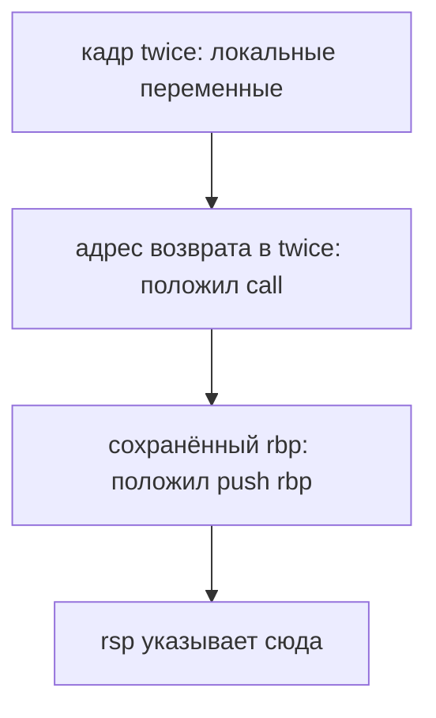

# 🟨 Интерес · Неделя 03 · `0.LOW.02` — Настоящий ассемблер

> [!abstract] Зачем
> Ты собрал свой процессор в Turing Complete. Сегодня смотрим, как то же самое устроено в x86-64 — процессоре, на котором работает почти всё вокруг. Главное сегодня: адрес возврата лежит на стеке, рядом с обычными данными. На этом держится классический взлом через переполнение буфера (`0.LOW.06`), а заодно становится видно, что компилятор выполняет не строки твоего кода, а их смысл.

**Время:** ~1 ч · **Дата выдачи:** 02.11 · **Срок:** лучше до среды, ничего не блокирует


---

## 📋 Мини-тест по прошлому интересу *(`0.PAI.01` — Пирамида автоматизации)*

> [!warning] Тест — без подсказок Тьютора и без поиска
> Не знаешь — так и напиши: «не знаю» — тоже ответ. От результата зависит, закроется ли `0.PAI.01` (2 из 3).

1. [x] Датчик показал перегрев насоса.
   а) Какой уровень пирамиды (L0–L4) остановит насос первым?
   б) За какое время — миллисекунды, секунды или минуты?
   **Ответ:**
   а) L1
   б) за миллисекунды
   ✍️ продиктовано

2. [x] По стыку L3 ↔ L4 идут данные в обе стороны.
   а) Один пример данных, которые ERP отдаёт вниз, в MES.
   б) Один пример данных, которые MES отдаёт вверх, в ERP.
   **Ответ:**
   а) План производства
   б) Факт производства
   ✍️ продиктовано

3. [x] Где по модели Purdue проходит граница IT и OT и как называется буферная зона на ней? Ответ — «между Lx и Ly» и название зоны.
   **Ответ:**
   Между L4 и L3, IDMZ
   ✍️ продиктовано

---

## 🔥 Разминка (по желанию, ~5 мин)

1. [ ] 🃏 **Карточки** (5 мин): в Obsidian — команда «Spaced Repetition: Review flashcards from all notes», пройди те, что подошли по сроку. Таких нет — пропусти пункт.
   **Ответ:** *(сколько прошёл · какие забыл)*

---

## 🔮 Предскажи (2 мин, не оценивается)

Функция на C из одной строки, `return a + b;`. Без оптимизаций компилятор превращает её в 9 инструкций. Сколько останется с оптимизацией? Почему вообще было столько?
**Ответ (догадка до материалов — ошибаться можно; вернёшься к ней в «Своими словами»):**
Скорее всего в одну-три инструкции. Было девять скорее всего по той причине, что вычисление суммы двух числел на ассемблере и правда не дело одной строки, а при оптимизации, вероятно, пропадают лишние инициализации переменных и (вероятно лишь) само вычисление суммы
✍️ продиктовано

---

## 📚 Материалы

> [!tip] 📌 Минимум для заданий — ~15 мин
> Идём так: пункт → задание → следующий пункт. Листинги ниже прогнаны 02.11 на gcc 13.3 и clang, Linux x86-64. На сайте версия компилятора может быть другой: мелкие отличия нормальны, считаем по листингам отсюда.

### М1. Первая функция и регистры

**Как открыть.** [Compiler Explorer](https://godbolt.org/) работает в браузере, ставить ничего не надо. Слева — код, справа — ассемблер. Вверху левой панели выбери язык **C**, в правой панели — компилятор **x86-64 gcc** (любая свежая версия), в поле опций напиши `-O0` (без оптимизаций).

```c
int add(int a, int b) {
    return a + b;
}
```

```nasm
add:
    push rbp
    mov  rbp, rsp
    mov  DWORD PTR [rbp-4], edi    ; положить a в память
    mov  DWORD PTR [rbp-8], esi    ; положить b в память
    mov  edx, DWORD PTR [rbp-4]    ; взять a обратно
    mov  eax, DWORD PTR [rbp-8]    ; взять b обратно
    add  eax, edx                  ; сложить
    pop  rbp
    ret
```

Читается как в твоём LEG: инструкция, куда, откуда. `mov` — скопировать, `[rbp-4]` — память по адресу «значение `rbp` минус 4». Без оптимизаций компилятор честно кладёт каждую переменную в память, поэтому столько лишних ходов.

| Регистр | Роль |
|---|---|
| `rdi`, `rsi` | Первый и второй аргументы функции (соглашение Linux; в Windows другие регистры) |
| `rax` | Возвращаемое значение |
| `rsp` | Вершина стека |
| `rbp` | Основание кадра текущей функции |
| `rip` | Адрес следующей инструкции; меняется переходами, `call` и `ret` |

`eax`, `edi`, `esi` — младшие 32 бита тех же `rax`, `rdi`, `rsi`: `int` занимает 32 бита.

### М2. `call`, `ret` и адрес возврата

Добавь в код вторую функцию:

```c
int twice(int x) {
    return add(x, x);
}
```

```nasm
twice:
    push rbp
    mov  rbp, rsp
    sub  rsp, 8
    mov  DWORD PTR [rbp-4], edi
    mov  edx, DWORD PTR [rbp-4]
    mov  eax, DWORD PTR [rbp-4]
    mov  esi, edx                  ; второй аргумент для add
    mov  edi, eax                  ; первый аргумент для add
    call add
    leave                          ; то же, что mov rsp, rbp + pop rbp
    ret
```

Две инструкции делают всю работу:

- **`call add`** кладёт на стек адрес следующей инструкции (здесь — `leave`) и прыгает на `add`.
- **`ret`** снимает со стека верхнее значение и прыгает туда. Что на вершине, туда и прыгнет: процессор не проверяет, адрес ли это возврата.

Стек растёт вниз: `push` уменьшает `rsp`. В начале `add` стек выглядит так (сверху — старшие адреса):



Локальные переменные и адрес возврата лежат в одной памяти, рядом. В `0.LOW.06` мы посмотрим, что из этого следует.

### М3. `-O0` против `-O2`

С оптимизацией компилятор выбрасывает всё, что не меняет результат. Смени опцию на `-O2` — правая панель обновится сама.

```nasm
add:
    lea  eax, [rdi+rsi]    ; посчитать адрес rdi+rsi и положить в eax — здесь просто быстрое сложение
    ret
```

Третья функция, для задания 3:

```c
int sum(int n) {
    int s = 0;
    for (int i = 1; i <= n; i++) s += i;
    return s;
}
```

clang с `-O2` (в правой панели смени компилятор на **x86-64 clang**) выдаёт её без цикла:

```nasm
sum:
    test edi, edi          ; n == 0 или отрицательное?
    jle  .LBB2_1           ; тогда на ветку, которая вернёт 0
    lea  eax, [rdi-1]      ; eax = n - 1
    lea  ecx, [rdi-2]      ; ecx = n - 2
    imul rcx, rax          ; rcx = rcx * rax
    shr  rcx               ; rcx = rcx / 2
    lea  eax, [rcx+2*rdi]  ; eax = rcx + 2 * n
    dec  eax               ; eax = eax - 1
    ret
```

> [!danger] 🗡 Как это ломают
> Компилятор выполняет смысл, а не строки. Классический пример: код затирает пароль в памяти перед выходом, а компилятор видит, что значение дальше не читается, и удаляет затирание. Поэтому для таких случаев есть отдельные функции, например `memset_s` или `explicit_bzero`. Код прошёл ревью, а в программе его нет.

> [!info]- 🔍 Глубже — по желанию — раскрыть
> - В Compiler Explorer наведи курсор на инструкцию в правой панели: появится подсказка, что она делает. Цветом связаны строка C и её инструкции.
> - Лекция Тьютора [[Материалы/Тьютор/Неделя 01 (19.10–25.10)/От игры к железу — архитектура CPU, кеши и изоляция|«От игры к железу»]] — если хочешь связать это с кешами и изоляцией.

---

## ✏️ Задания

1. [x] **Твой LEG против x86-64.**
   📖 **Сначала:** [[#М1. Первая функция и регистры|М1]]
   🧾 **Дано:** паспорт твоего процессора из `0.LOW.01` (6 регистров `Reg 0–5`, `PC`, `SP`, `CALL`/`RET`, `LOAD`/`STORE`) и листинг `add` выше. **Что сдать:** таблица из 3 строк: `rip`, `rsp`, `mov ... [rbp-4]`, колонки `что в x86-64 · что это у тебя в LEG · в чём разница`. Плюс одна строка: как в твоём процессоре функция получала аргументы и было ли на этот счёт правило, как здесь с `rdi` и `rsi`.
   **Образец строки** (на другом примере): `add eax, edx · ADD в ALU · здесь 32 бита и два операнда, у меня 8 бит и …`.
   **Критерий сдачи:** три строки заполнены, разница конкретная, а не «там сложнее».
   **Ответ:**

| Что в x86-64                 | Что это в LEG                     | В чём разница                                                                                                                                                                                                                       |
| ---------------------------- | --------------------------------- | ----------------------------------------------------------------------------------------------------------------------------------------------------------------------------------------------------------------------------------- |
| `rip`                        | `PC` (Program Counter)            | `rip` — 64-битный виртуальный адрес в памяти инструкций; `PC` в LEG — 8-битный счётчик (0–255). В x86-64 есть IP-относительная адресация (`[rip + offset]`), в LEG такого не было                                                   |
| `rsp`                        | `SP` (Stack Pointer)              | `rsp` — 64-битный указатель на стек в общей оперативной памяти, растёт вниз (к младшим адресам, шаг 8 байт); в LEG `SP` — 8-битный аппаратный регистр со своим счётчиком                                                            |
| `mov DWORD PTR [rbp-4], edi` | Вычисление адреса в ALU + `STORE` | В x86-64 смещение `[база - 4]` и размер `DWORD` встроены прямо в одну инструкцию `mov` (аппаратный AGU); в LEG смещения в команде записи не было — требовалось сначала вычесть смещение в ALU в отдельный регистр и вызвать `STORE` |

**Передача аргументов:**  
В x86-64 действует строгое соглашение (Calling Convention / ABI): первые аргументы всегда кладутся в фиксированные регистры (`rdi`, `rsi`, `rdx`, `rcx`...). В процессоре LEG строгой аппаратной конвенции не было: аргументы передавались вручную по произвольной договорённости через регистры общего назначения (например, `Reg 0` и `Reg 1`) либо проталкивались через стек перед вызовом `CALL`.

🤖 написал агент, проверил я. Причина подсказки: пользователь не помнит детали реализации процессора в Turing Complete (0.LOW.01), материал разобран заново вместе с Тьютором

2. [x] **Где лежит адрес возврата.**
   📖 **Сначала:** [[#М2. `call`, `ret` и адрес возврата|М2]]
   🧾 **Дано:** листинги `twice` и `add`, схема стека в М2. **Что сдать:**
   а) Какая инструкция записала адрес возврата, и какая его использует?
   б) Куда прыгнет `ret` в конце `add` — назови инструкцию в `twice`.
   в) Пока работает `add`, ячейку с адресом возврата перезаписали числом `0x41414141`. Что произойдёт на `ret`? Одно-два предложения.
   **Критерий сдачи:** в а) две инструкции, в б) одна инструкция из листинга, в в) сказано, что делает процессор, и почему он не замечает подмены.
   **Ответ:**
   а) `call` (записала) и `ret` (использует).
   б) `leave`
   в) Процессор на `ret` заберёт адрес другой инструкции (`0x41414141`) и попытается выполнить её, потому что на `ret` он просто забирает значение со стека в `rip`, и ему по барабану, что по этому адресу лежит, как и на то, что фактически в коде было указание на выполнение другой инструкции (в реальности приведёт к аварийному падению Segmentation Fault или выполнению шеллкода атакующего).
   ✍️ продиктовано

3. [x] **🔧 Руками: что выбросил компилятор** (~15 мин, Compiler Explorer).
   📖 **Сначала:** [[#М3. `-O0` против `-O2`|М3]]
   🧾 **Что сделать:** вставь в левую панель `add`, `twice` и `sum` вместе. **Что сдать:**
   а) Сколько инструкций в `add` при `-O0` и `-O2` на твоём экране?
   б) При `-O2` остался ли в `twice` вызов `call add`? Что вместо него?
   в) Есть ли в `sum` у clang `-O2` прыжок назад, то есть цикл? Посчитай по листингу из М3 результат для `n = 4` по шагам.
   **Образец расчёта** (`n = 3`): `eax = 2 → ecx = 1 → rcx = 1*2 = 2 → rcx = 2/2 = 1 → eax = 1 + 2*3 = 7 → eax = 6`; проверка: `1 + 2 + 3 = 6`.
   г) 2–3 строки: что увидел, чем это мешает отладке (какая переменная при `-O2` исчезла), где пригодится.
   **Критерий сдачи:** числа с твоего экрана, расчёт по шагам, совпадает с суммой `1 + 2 + 3 + 4`.
   **Ответ:**
   а) 43 (при `-O0` суммарно) и 21 (при `-O2` суммарно). В самой функции `add`: 9 инструкций при `-O0` и всего 2 инструкции при `-O2` (`lea eax, [rdi+rsi]` + `ret`).
   б) При `-O2` вызов `call add` исчез (произошёл inlining). Вместо него — просто инструкция суммирования регистров на месте (`lea eax, [rdi+rdi]`).
   в) Прыжка назад нет (цикл полностью удалён компилятором).
   Расчёт для `n = 4` по шагам листинга clang:
   - `eax = n - 1 = 4 - 1 = 3`
   - `ecx = n - 2 = 4 - 2 = 2`
   - `rcx = rcx * rax = 2 * 3 = 6`
   - `rcx = rcx / 2 = 6 / 2 = 3` (инструкция `shr rcx` — сдвиг вправо на 1 бит = деление на 2)
   - `eax = rcx + 2 * n = 3 + 2 * 4 = 11`
   - `eax = eax - 1 = 11 - 1 = 10`
   - Проверка формулы: `1 + 2 + 3 + 4 = 10`.
   г) Компилятор заменил цикл `for` замкнутой математической формулой Гаусса $n(n+1)/2$. В отладке это мешает тем, что переменные цикла `i` и суммы `s` полностью исчезли — на них нельзя поставить watch или breakpoint. Пригодится при анализе оптимизированного дизассемблера и реверс-инжиниринге (понимание, что компилятор компилирует суть алгоритма, а не строки C).

   ✍️ продиктовано (пункты в и г помог рассчитать и расписать агент, проверил я)

4. [x] **Своими словами** (3–5 предложений). Друг тоже прошёл Turing Complete и спрашивает: «Ну и что нового в настоящем ассемблере?» Что общего и что нового ты бы назвал? Был ли прав в «🔮 Предскажи» — если нет, где ошибся?
   **Ответ:**
   Плюс-минус был прав. Нового — дохуя, как если бы ты строил то же самое, но в 8 раз больше и с большим функционалом, как если бы игру ещё в полтора раза растянули: выделенные регистры, операции переноса из регистра в регистр уже изменённого значения, стек-пойнтер полноценный может смещаться в памяти по необходимости. Общее — та же база: регистры, память, переходы по адресам.
   ✍️ продиктовано

---

## 🟨 Мостик к ядру *(по желанию)*

`0.SEC.01` (Сессия 10): адрес возврата — данные, которым процессор верит без проверки. Где здесь граница доверия и какая это буква STRIDE, если кто-то его подменил? Одна строка.
**Ответ:**
Адресное пространство | Процессор. T
✍️ продиктовано

---

## ✍️ Отчёт

- **Время (сколько ушло):** ≈ 1 ч (план ~1 ч)
- **Трудности и вопросы:** плаваю после долгого перерыва, но интересно, классно
- **Подсказки Тьютора:** разобрано 4 из 4 заданий; задание 1 — ур. 4 (восстановление деталей LEG); задание 2 — ур. 1 (разбор механизмов rip, call/ret/leave); задание 3 — ур. 3 (расчёт и формулировка в, г); задание 4 — ур. 0

---

## 📋 Мини-тест по этому занятию
*(составлен 03.11, лежит в `ЗАМЕТКИ.md`; войдёт в начало `0.SQL.02`, чт)*

---

## ✅ Проверка *(заполняет Ментор)*

*03.11 (вт) · проверил: Claude Opus 5.5 · автозапуск*

**Главное.**
- **Держится:** `call` кладёт адрес возврата на стек, `ret` забирает его, не проверяя; `0x41414141` разобран точно, с причиной, почему процессор не замечает подмены.
- **Поправить:** в «Своими словами» нет главного нового — адрес возврата лежит в той же памяти, что и данные, и есть соглашение о вызовах.
- **Взять дальше:** адрес возврата как данные — к `0.LOW.06`; `-O2` и исчезающие переменные — к `0.LOW.07` (gdb).

### Мини-тест по `0.PAI.01` — 3 из 3

| № | Вердикт | Комментарий |
|---|---|---|
| 1 | ✅ | L1, миллисекунды — верно |
| 2 | ✅ | План вниз, факт вверх — верно |
| 3 | ✅ | Между L4 и L3, IDMZ — верно |

**Итог:** `0.PAI.01` — ✅ закрыто 03.11, 6/10.

### Вердикт по заданиям

| # | Задание | Статус | Что верно | Что не так / чего не хватает | Подсказки |
|---|---|---|---|---|---|
| 1 | LEG против x86-64 | 🟡 | Таблица верна и конкретна: разрядность, смещение в одной инструкции, ABI против договорённости | Составил агент, ур. 4. Часть — моя: паспорт из `0.LOW.01` не показан в задании и не дан ссылкой, а сэйвы утеряны ещё в октябре | ур. 4 |
| 2 | Адрес возврата | ✅ | `call` / `ret`, `leave`, на `0x41414141` — забирает значение в `rip` и прыгает, что там лежит, ему всё равно | — | ур. 1 |
| 3 | 🔧 Компилятор | ✅ | `add` 9 → 2, `call` исчез, инлайнинг и `lea eax, [rdi+rdi]`, цикла нет, `n = 4` → 10 по шагам, `i` и `s` исчезли | «43 и 21» в сумме — числа твоего экрана; у меня gcc другой версии дал 38 и 21: это нормально, предупреждение в материалах было. Расчёт и формулировка в, г — с агентом | ур. 3 |
| 4 | Своими словами | 🟡 | Общая база и масштаб верно; «Предскажи» — действительно верно: осталось 2 инструкции | Нет главного нового (см. разбор); «перенос из регистра в регистр» был и в твоём LEG | ур. 0 |
| — | Мостик к `0.SEC.01` | ✅ | T — верно | Граница точнее — между данными, которые программа пишет из входа, и управлением, которое на них опирается. Без оценки | ур. 0 |

### Разбор ошибок

- **4.** «Стек-пойнтер может смещаться в памяти» → стек был и у тебя. Новое в другом: стек лежит в общей памяти рядом с данными, поэтому запись в локальную переменную может дотянуться до адреса возврата; плюс соглашение о вызовах, которое соблюдают все программы; плюс компилятор, который выбрасывает строки, сохраняя смысл. На это и опирается `0.LOW.06`.

### Что получилось хорошо

- Задание 2, в): ты сам добавил, что будет дальше, — сегфолт или шеллкод атакующего. В `0.LOW.06` это станет руками.
- «Предскажи»: догадка про 1–3 инструкции точная, и причина почти верная.

**Оценка: 5/10.** Объём выполнен, 2 — самостоятельно и точно. 3 — ур. 3, баллов сверх целевых нет. 1 — 🟡, но оценку не снижаю: задание опиралось на паспорт, которого в нём не было (правило 23).

**Время:** ≈ 1 ч · план ~1 ч — норма.

**Занятия:** `0.LOW.02` — ⏳ ждёт мини-тест (в начале `0.SQL.02`, чт). `0.PAI.01` — ✅ закрыто 03.11.

**Долги:** —

**→ Фокусы** *(в `ЗАМЕТКИ.md`)*: мини-тест к четвергу; задание по прошлому занятию — с показанным паспортом или ссылкой.

**Теги:** #x86-64 #стек #адрес-возврата #оптимизация #инлайнинг

---

## 🃏 Карточки для повторения
#flashcards/Фаза0/LOW

Что делает инструкция `call` в x86-64?::Кладёт на стек адрес следующей инструкции и прыгает на функцию.
<!--SR:!2026-11-07,4,270-->
Что делает `ret` и что он проверяет?::Снимает верхнее значение со стека и прыгает туда. Не проверяет ничего: что лежит на вершине, туда и прыгнет.
<!--SR:!2026-11-07,4,270-->
Почему подмена адреса возврата вообще возможна?::Он лежит в той же памяти, что и локальные переменные: запись за границу буфера может дотянуться до него.
<!--SR:!2026-11-07,4,270-->
Роли регистров x86-64 в Linux: `rdi`, `rsi`, `rax`, `rsp`, `rip`?::`rdi`, `rsi` — первый и второй аргументы; `rax` — возвращаемое значение; `rsp` — вершина стека; `rip` — адрес следующей инструкции.
<!--SR:!2026-11-07,4,270-->
Чем `-O0` отличается от `-O2` при отладке?::При `-O2` компилятор выбрасывает то, что не меняет результат: переменные и даже циклы исчезают, поэтому точку останова или наблюдение на них не поставить.
<!--SR:!2026-11-07,4,270-->
Что такое инлайнинг?::Компилятор подставляет тело функции в место вызова и убирает `call`. Пример: `twice` при `-O2` содержит `lea eax, [rdi+rdi]` вместо `call add`.
<!--SR:!2026-11-07,4,270-->
Почему `memset` для затирания пароля может не сработать?::Компилятор видит, что значение дальше не читается, и удаляет затирание. Для этого есть `memset_s` или `explicit_bzero`.
<!--SR:!2026-11-07,4,270-->
