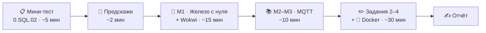
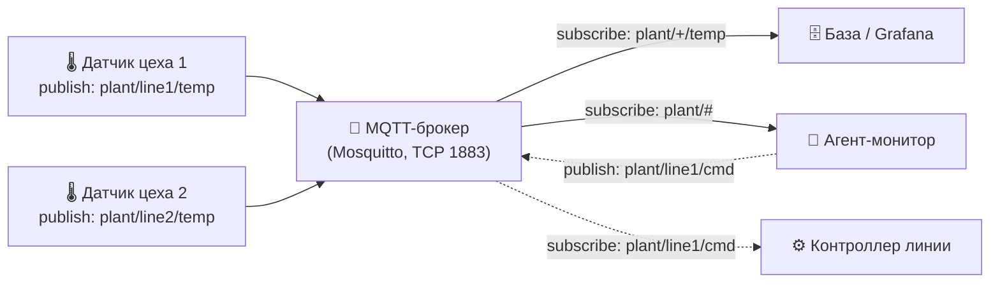

# 🟨 Интерес `0.PAI.02` · Неделя 03 *(внепланово 19.11)* · MQTT + 🔌 Железо с нуля

> [!abstract] Зачем
> В `0.PAI.01` мы разложили производство на уровни ISA-95 от датчиков до ERP. Чтобы проектировать агентов рядом с физическим миром и не допускать опасных ошибок в правах, нужно понимать два нижних звена: откуда на пине контроллера вообще берётся сигнал `0/1` и как этот сигнал через брокер MQTT доезжает до баз, дашбордов и агентов.
> 📰 **Из жизни:** В реальных промышленных и умных сетях (и в открытых сканах вроде Shodan) тысячи брокеров MQTT до сих пор выставлены с настройкой `allow_anonymous true` и без ACL — любой клиент может подписаться на `#` (читать всю телеметрию) или опубликовать команду в управляющий топик. Где ты поставишь границу, прежде чем пускать к такому брокеру AI-агента?

**Время:** ~1–1,25 ч · **Дата выдачи:** 19.11 *(внеплановый слот: сдвигает очередь `PAI` вперёд и возвращает `0.PAI.06` в Фазу 0)*



---

## 📋 Мини-тест по прошлому интересу *(`0.SQL.02` — Какие бывают хранилища изнутри)*

> [!warning] Тест — без подсказок Тьютора и без поиска
> Не знаешь — так и напиши: «не знаю» — тоже ответ. Проверит Ментор вместе с этим занятием; от результата зависит, закроется ли `0.SQL.02` (нужно 2 из 3).

1. [x] Поиск строки по ключу в B-tree таблицы на 300 тыс. строк.
   а) Сколько страниц примерно прочитает база — одну, несколько или все?
   б) Как изменится число шагов, если строк станет в 1000 раз больше?
   **Ответ:**
   а) Несколько
   б) 1-2
   ✍️ продиктовано

2. [x] В файловой базе 1С одновременно проводят документы 15 человек, и все жалуются на ожидание. Что в устройстве встраиваемой базы этому причина? Одно предложение.
   **Ответ:**
   Запись одного пользователя блокирует базу для всех остальных
   ✍️ продиктовано

3. [x] Журнал LLM-вызовов лежит в DuckDB, агент дописывает по одной строке на каждый вызов. Почему такие мелкие вставки неудобны колоночной базе? Одно предложение.
   **Ответ:**
   Не согласен. Дозаписать одну строку не такая уж проблема, как найти одну строку. Записать - добавляем данные к имеющимся. Найти - прочитать все данные в таблице (все колонки). P.S. - уже выяснил, что фактически при записи одной строкой, нам: а) надо выловить данные для каждой из десяти колонок, каждую распаковать, в каждую записать и запаковать обратно.
   ✍️ продиктовано

---

## 🔮 Предскажи (2 мин, не оценивается)

В цехе 50 датчиков температуры отправляют показания каждую секунду, а их данные нужны сразу трём системам: базе для графиков, системе оповещений и AI-агенту.
1. Чем схема «каждый датчик шлёт HTTP-запрос напрямую во все три сервиса» быстро начнёт мешать, и что меняет появление посередине **брокера**?
2. Датчик отправил сообщение `temp = 92°C`, но подписчик-оповещатель в эту секунду потерял сеть на 10 секунд. Дойдёт ли это сообщение, когда подписчик вернётся? От чего это зависит?

**Ответ (догадка до материалов — ошибаться можно; вернёшься к ней в Задании 4):**
1. Во-первых, нужен один источник истины. Во-вторых, очередь может сломаться, если какой-то пакет не дойдёт, какой-то дойдёт позже, данные поплывут. По сути реализовать это адекватно и надёжно — это и есть задача брокера сообщений.
2. Зависит от того, есть ли очередь сообщений и снимается ли сообщение из очереди самим оповещателем при обработке или иначе.
✍️ продиктовано

---

## 📚 Материалы

> [!tip] 📌 Минимум для заданий — ~15 мин
> Блок **«🔌 Железо» (М1)** идёт первым и заменяет разминку: это объяснение с нуля, без расчётов схемотехники и пайки. Дальше — MQTT (М2) и запуск брокера (М3). Всё, что нужно для заданий, — здесь.

### М1. 🔌 Железо с нуля: откуда берётся `0` и `1` на пине

**Три величины — через водопровод (без лишних формул):**
- **Напряжение ($U$, Вольты)** — это «давление» в трубе (например, 3,3 В у ESP32 или 5 В у Arduino относительно земли `GND` — 0 В).
- **Ток ($I$, Амперы / миллиамперы)** — сколько «воды» реально течёт по проводу в секунду.
- **Сопротивление ($R$, Омы)** — насколько узкая труба, мешающая потоку.
- Связь одна — закон Ома: $I = U / R$. Чем меньше сопротивление при том же напряжении, тем больше ток.

**Зачем резистор у светодиода.** Светодиод (LED) почти не ограничивает ток сам. Если воткнуть его напрямую между пином 3,3 В и землёй `GND`, сопротивление в цепи будет крошечным → ток $I = U / R$ резко подскочит и сожжёт либо светодиод, либо выходной пин контроллера. Последовательный резистор (обычно 220–330 Ом) искусственно «сужает трубу» и держит ток в безопасных ~10 мА.

**Цифровой сигнал и пин.** Ножка микроконтроллера (GPIO-пин) настраивается кодом либо как **выход** (`OUTPUT` — сам подаёт ~3,3 В = `HIGH`/`1` или 0 В = `LOW`/`0`), либо как **вход** (`INPUT` — измеряет, что пришло снаружи).

**Зачем кнопке подтяжка (`INPUT_PULLUP`).** Представь пин-вход, к которому подключена кнопка на `GND`, но кнопка **не нажата**. Провод висит в воздухе — он не подключён ни к 3,3 В, ни к 0 В! Такой «плавающий» вход работает как антенна и ловит случайные наводки — `digitalRead()` может хаотично прыгать между `0` и `1`.
Чтобы этого не было, включают встроенный **подтягивающий резистор** (`INPUT_PULLUP`): он мягко «тянет» пин к 3,3 В (`HIGH`), пока кнопка отпущена. Нажал кнопку → пин замкнулся на `GND` → чёткий `LOW` (`0`). Поэтому при `INPUT_PULLUP` логика инверсная: **отпущено = `HIGH`, нажато = `LOW`**.

**Два примера — с разных сторон:**
- *Выход (`OUTPUT`):* контроллер зажигает светодиод или щёлкает транзистором реле, подавая `HIGH` на пин (ток ограничивает резистор).
- *Вход (`INPUT_PULLUP`):* концевик двери шкафа или кнопка «Стоп» замыкает пин на землю `GND`; подтяжка гарантирует, что при размыкании пин не «плавает» от наводок.

- 🔌 Браузерный симулятор (установка не нужна): [Wokwi — ESP32 Button & LED](https://wokwi.com/projects/373812029856893953) *(проверено 19.11)* — готовая схема ESP32 + кнопка + светодиод с резистором, можно сразу жать зелёную кнопку запуска и править `sketch.ino`.
- 📖 *(по желанию, следующий шаг)* [[Материалы/Тьютор/Неделя 01 (19.10–25.10)/Микроконтроллеры, Arduino и роботы с нуля|Лекция Тьютора «Микроконтроллеры, Arduino и роботы с нуля»]].

### М2. MQTT: publish/subscribe, брокер, топики и QoS

В IoT и на производстве устройства часто слабые, сеть нестабильная, а потребителей одних и тех же данных много. Вместо прямых запросов «датчик → каждый сервис» используют **MQTT** — лёгкий протокол поверх TCP с моделью **publish / subscribe** (издатель / подписчик) через центральный **брокер** (например, Eclipse Mosquitto).



Издатели вообще не знают, кто их слушает, а подписчики не знают IP-адресов датчиков — все общаются только через брокер.

**Топики и маски (wildcards).** Топик — это иерархический путь через `/`, как папки (например, `plant/line1/temp` или `home/kitchen/vacuum/cmd`):
- `+` заменяет **ровно один** уровень: `plant/+/temp` поймает `plant/line1/temp` и `plant/line2/temp`, но **не** `plant/line1/motor/temp`.
- `#` заменяет **сколько угодно** уровней в конце: `plant/#` поймает всё под `plant/` (и температуру, и команды, и статусы).

**Три уровня доставки (QoS — Quality of Service):**
- **QoS 0 (at most once — «выстрелил и забыл»):** отправил пакет один раз, без подтверждения. Минимум трафика, но при обрыве сообщение пропадёт.
- **QoS 1 (at least once — «хотя бы раз»):** отправитель хранит сообщение и шлёт повторно, пока не получит подтверждение `PUBACK`. Не потеряется, но при сбое подтверждения может прийти **дубликат** (обработчик должен это учитывать!).
- **QoS 2 (exactly once — «ровно один раз»):** 4-шаговое рукопожатие, без потерь и дублей, но дороже по задержке и ресурсам.

**Что происходит при отвале подписчика.** По умолчанию (чистая сессия) сообщения за время офлайна теряются. Чтобы брокер **копил** сообщения для временно пропавшего подписчика, обычно нужны сразу два условия: постоянная сессия (persistent session, с фиксированным `client_id`) и QoS 1/2. Отдельно есть флаг **`retain`**: брокер запоминает **последнее** сообщение в топике и сразу отдаёт его любому новому подписчику.

| Понятие                | Пример (телеметрия / мониторинг)                                                 | Ещё пример — с другой стороны (управление)                                                                                                |
| ---------------------- | -------------------------------------------------------------------------------- | ----------------------------------------------------------------------------------------------------------------------------------------- |
| **Топик и маска**      | Подписка `plant/+/temp` собирает температуру со всех линий в одну таблицу        | Подписка на `plant/#` у агента случайно цепляет и отладочные, и командные топики                                                          |
| **QoS 0 против QoS 1** | Датчик шлёт температуру раз в секунду: потеря одного пакета при QoS 0 не страшна | Команда «включить вытяжку» или «остановить конвейер» — потеря критична, берут QoS 1 (и идемпотентную команду, чтобы дубликат не навредил) |
| **Флаг `retain`**      | Новый дашборд сразу видит последнюю температуру, не дожидаясь нового замера      | Если по ошибке поставить `retain=True` на команду `reset`, контроллер будет перезагружаться при каждом переподключении                    |

> [!danger] 🗡 Как это ломают
> Сам протокол MQTT не шифрует трафик (порт `1883` — открытый TCP) и по умолчанию в тестовых конфигах часто включают `allow_anonymous true`. Без логина/пароля (или клиентских сертификатов TLS на порту `8883`) и **ACL** (правил «кто куда имеет право писать/читать») любой узел в сети может: 1) подписаться на `#` и подслушать все данные; 2) опубликовать команду в чужой управляющий топик (подмена — **S** и неавторизованное действие — **E** в STRIDE). Формат JSON в сообщении этому никак не мешает — границу держат настройки брокера, TLS и сегментация сети.

### М3. Mosquitto в Docker + Python-клиент `paho-mqtt` 2.x

Для локального опыта нужен только Docker и пакет `paho-mqtt` (`pip install "paho-mqtt>=2.0"`).

1. **Минимальный конфиг `mosquitto.conf`** *(только для локального теста на `127.0.0.1`!)*:
   ```text
   listener 1883
   allow_anonymous true
   ```
2. **Запуск брокера в Docker** (из папки с `mosquitto.conf`):
   ```powershell
   docker run -it --rm -p 127.0.0.1:1883:1883 -v "${PWD}\mosquitto.conf:/mosquitto/config/mosquitto.conf" eclipse-mosquitto
   ```
3. **Современный клиент на `paho-mqtt` 2.x** *(сверено 19.11: в версии 2.x обязательно передаётся `CallbackAPIVersion.VERSION2`, а в `on_connect` приходит `reason_code`, а не старое `rc`)*:
   ```python
   import paho.mqtt.client as mqtt

   def on_connect(client, userdata, connect_flags, reason_code, properties):
       print("Подключено:", reason_code)
       client.subscribe("plant/+/temp", qos=1)

   def on_message(client, userdata, msg):
       print(f"{msg.topic} -> {msg.payload.decode()}")

   client = mqtt.Client(mqtt.CallbackAPIVersion.VERSION2, client_id="sub_demo")
   client.on_connect = on_connect
   client.on_message = on_message
   client.connect("127.0.0.1", 1883, keepalive=60)
   client.loop_forever()
   ```
   Издатель — две строки: `client.connect("127.0.0.1", 1883)` и `client.publish("plant/line1/temp", "42.5", qos=1)`.

> [!info]- 🔍 Глубже — по желанию — раскрыть
> - Документация Eclipse Mosquitto (ACL и `password_file` — как закрыть `allow_anonymous`): [mosquitto.org/documentation/authentication-methods](https://mosquitto.org/documentation/authentication-methods/) *(не сверено на момент 19.11 — проверь, открывается ли раздел на сайте)*.
> - Документация `paho-mqtt` 2.x (миграция с 1.x): [eclipse.dev/paho/files/paho.mqtt.python/html/migrations.html](https://eclipse.dev/paho/files/paho.mqtt.python/html/migrations.html) *(сверено 19.11 через поиск)*.

---

## ✏️ Задания

1. [x] **🔌 Железо в Wokwi: резистор и подтяжка входа** (~12 мин).
   📖 **Сначала:** [[#М1. 🔌 Железо с нуля: откуда берётся `0` и `1` на пине|М1]]
   🧾 **Что сделать:**
   1. Открой [Wokwi — ESP32 Button & LED](https://wokwi.com/projects/373812029856893953) и нажми зелёную кнопку запуска симуляции. Понажимай кнопку на схеме и посмотри, как меняется состояние светодиода (и пина в коде `sketch.ino`).
   2. **Мини-опыт:** предположи, что изменится, если в коде заменить `INPUT_PULLUP` на обычный `INPUT` (без внешнего подтягивающего резистора). Замени, запусти симуляцию и посмотри, что происходит в реальности (в симуляторе поведение может отличаться от реального провода на столе — это тоже честное наблюдение!).
   **Что сдать:**
   - 1–2 строки: что увидел при `INPUT_PULLUP` и после замены на `INPUT`;
   - 2–3 предложения своими словами: а) зачем светодиоду последовательный резистор; б) зачем кнопке нужна подтяжка (`INPUT_PULLUP`) и почему реальный вход без неё опасен в промышленном шкафу.
   **Критерий сдачи:** есть наблюдение из Wokwi и точное объяснение обеих деталей (ток через закон Ома + «плавающий» вход).
   **Ответ:**
   Что увидел:
   В симуляторе ничего не изменилось по причине того, что он не симулирует радиоволны.

   Своими словами:
   а) Чтобы контролировать напряжение, подаваемое на светодиод, с помощью коррекции сопротивления.
   б) Фактически без привязки контакта к земле при отсутствии подачи тока, провод оказался бы приёмником, а фиксируемые значения (1/0) стали бы хаотичными.

   ✍️ продиктовано

2. [x] **Схема топиков, QoS и проверка гипотезы** (~12 мин).
   📖 **Сначала:** [[#М2. MQTT: publish/subscribe, брокер, топики и QoS|М2]]
   🧾 **Дано:** небольшой участок с двумя станками (`cnc1`, `cnc2`): у каждого есть датчик температуры (раз в секунду) и счётчик брака (по событию), плюс общая команда `stop` для остановки станка. К брокеру подключены дашборд (только чтение) и AI-агент (анализ сбоев).
   **Что сдать:**
   а) Таблицу из 3 строк (без отступа): `Поток данных · Топик · QoS (0/1/2) · Почему этот QoS`.
   **Образец строки** (другая система — умный дом):

| Поток данных | Топик | QoS | Почему этот QoS |
|---|---|---|---|
| Датчик освещённости в коридоре (раз в 2 с) | `home/hall/lux` | `0` | Показания частые, потеря одного замера не критична — не тратим лишние подтверждения |

   б) **Проверка гипотезы (1–2 предложения):** ты подозреваешь, что при кратком разрыве сети команда `stop` с `QoS 1` придёт дважды (дубликат). Как проверить это на стенде и почему команда должна быть идемпотентной?
   в) **Что решает сообщение, а что — система (2 предложения):** поможет ли подпись внутри JSON-текста сообщения закрыть утечку телеметрии от чужого подписчика на `#`? Что именно должно это гарантировать в системе?
   **Критерий сдачи:** таблица из 3 строк (температура, счётчик брака, команда `stop`) + проверка про дубликат в б) + разделение «сообщение vs брокер/ACL/TLS» в в).
   **Ответ:**

| Поток данных | Топик | QoS | Почему этот QoS |
|---|---|---|---|
| датчик температуры станка -> брокер | `factory/machines/cnc/+/temperature/` | 0 | Замеры происходят каждую секунду, не так страшно потерять данные, но если выше лимита - 1 или 2, потому что влияет на аварийное завершение работы станка stop, а лучше всего - сигнал напрямую без брокера |
| брокер -> дашборд | `factory/dashboard` | 2 | потеря данных не так страшна, но искажение - существенно. Важна проверка точности данных, дашборд может принимать их не каждую секунду |
| брокер -> AI | `factory/dashboard/errors` | 2 | данные о сбое должны обязательно дойти, но не могут дублироваться: чревато галюцинациями агента |

   б) Искуственно воссоздать отправку Qos 1 и кратковременный разрыв сети с мутирующими временными параметрами через hypothesis и проверить резуьтаты. Если команда не будет идемпотентной, а будет работать как start/stop, то при такой ошибке станок выключится и включится обратно
   в) нет, нужны ACL и шифрование на такой случай

   ✍️ продиктовано

3. [x] **🔧 Руками (15–20 мин): Mosquitto в Docker + эксперимент с подписками (`paho-mqtt` 2.x)**.
   📖 **Сначала:** [[#М3. Mosquitto в Docker + Python-клиент `paho-mqtt` 2.x|М3]]
   🧾 **Что сделать:**
   1. Подними `eclipse-mosquitto` локально в Docker (с `mosquitto.conf` из М3, привязка строго к `127.0.0.1:1883`).
   2. Подготовь два коротких скрипта (`sub.py` и `pub.py` на `paho-mqtt >= 2.0`; написать их может агент, но ты **читаешь код и объясняешь**, зачем в `sub.py` строки `CallbackAPIVersion.VERSION2`, подписка внутри `on_connect` и `loop_forever()`).
   3. **Эксперимент (предположение → наблюдение → объяснение):**
      - До запуска предположи, какие из трёх сообщений поймает подписчик на `plant/+/temp`, а какие — на `plant/#`, если издатель отправит:
        1) `plant/line1/temp` → `"45"`
        2) `plant/line1/motor/temp` → `"78"`
        3) `plant/line1/cmd` → `"stop"`
      - Прогони оба варианта, запиши фактический вывод терминала и сравни с предположением.
      - *(По желанию)* Попробуй опубликовать сообщение с `retain=True` при выключенном подписчике, затем запусти `sub.py` — посмотри, что придёт первым.
   **Критерий сдачи:** вывод `sub.py` для обеих подписок, объяснение 3 строк кода своими словами и 2–3 строки итогов: что увидел, где пригодится, что мешало.
   **Ответ:**
   **1. Предположение (до запуска):**
   1. +
   2. #
   3. #
   *(для флага retain=True: брокер сохранит последнее отправленное значение топика и сразу же отдаст его новому подписчику при его подключении, даже если публикация произошла, когда подписчик был офлайн)*

   **2. Наблюдение (фактический вывод терминала):**

   *Вывод издателя (pub.py):*
   ```text
   Отправка сообщений в брокер 127.0.0.1:1883 (retain=False)...
     [ОТПРАВЛЕНО] plant/line1/temp -> 45
     [ОТПРАВЛЕНО] plant/line1/motor/temp -> 78
     [ОТПРАВЛЕНО] plant/line1/cmd -> stop
   Готово. Все сообщения отправлены.
   ```

   *Вывод подписчика (sub.py) с маской plant/+/temp:*
   ```text
   Ожидание сообщений (plant/+/temp)... Нажмите Ctrl+C для выхода.
   Подключено к брокеру (reason_code: Success)
   Оформлена подписка на топик: plant/+/temp
   [ПОЛУЧЕНО] plant/line1/temp -> 45
   ```

   *Вывод подписчика (sub.py) с маской plant/#:*
   ```text
   Ожидание сообщений (plant/#)... Нажмите Ctrl+C для выхода.
   Подключено к брокеру (reason_code: Success)
   Оформлена подписка на топик: plant/#
   [ПОЛУЧЕНО] plant/line1/temp -> 45
   [ПОЛУЧЕНО] plant/line1/motor/temp -> 78
   [ПОЛУЧЕНО] plant/line1/cmd -> stop
   ```

   *Проверка с retain=True (отправка с флагом при выключенном клиенте, затем старт sub.py):*
   ```text
   Ожидание сообщений (plant/+/temp)... Нажмите Ctrl+C для выхода.
   Подключено к брокеру (reason_code: Success)
   Оформлена подписка на топик: plant/+/temp
   [ПОЛУЧЕНО] plant/line1/temp -> 45
   ```

   **3. Сравнение и объяснение:**
   Фактический результат на 100% сошёлся с гипотезой:
   - Одноуровневый wildcard `+` строго изолирует уровень вложенности, что позволяет собирать однотипные метрики с разных линий (line1, line2) без риска зацепить составные пути узлов (line1/motor/temp).
   - Многоуровневый `#` читает всё дерево, включая посторонние ветки телеметрии и команды управления.
   - Механизм `retain` позволяет новому или перезапустившемуся подписчику мгновенно узнать актуальное состояние без ожидания следующего тика телеметрии.

   **4. Объяснение трёх строк кода sub.py:**
   - `CallbackAPIVersion.VERSION2`: в paho-mqtt 2.x это обязательный параметр инициализации клиента. Он явно фиксирует использование современной версии сигнатур коллбэков (в частности, в on_connect приходит типизированный reason_code вместо устаревшего числового rc), защищая код от скрытых поломок при обновлении библиотеки.
   - Подписка внутри `on_connect` (`client.subscribe(...)`): обеспечивает отказоустойчивость при обрыве сети. Клиент paho-mqtt при потере связи переподключается автоматически; при каждом успешном коннекте заново вызывается on_connect, восстанавливая подписки на брокере. Если бы вызов стоял однократно до или после коннекта, при обрыве брокер мог бы потерять подписки клиента.
   - `loop_forever()`: запускает блокирующий бесконечный цикл обработки сетевых событий в текущем потоке (чтение входящих TCP-пакетов, вызовы on_message, отправка подтверждений PUBACK для QoS 1, поддержание пингов keepalive и автореконнект).

   **5. Итоги:**
   - **Что увидел:** наглядное разделение фильтрации по маскам `+` и `#` и мгновенную отдачу кэшированного значения брокером через флаг `retain`.
   - **Где пригодится:** при проектировании шины сообщений для AI-агентов. Агенту нельзя давать подписку на `#` (он утонет в шуме и отладке), а топики команд и данных критически важно разделять через ACL.
   - **Что мешало:** при вызове из дочерних процессов и пайпов нужно учитывать буферизацию потоков вывода в Python (решается явным `flush=True`).

   🤖 написал агент, проверил я

4. [x] **Своими словами** (~5 мин).
   🧾 **Дано и что сдать:** коллега из IT-инфраструктуры спрашивает: «Зачем городить какой-то MQTT-брокер, если можно просто раз в секунду опрашивать датчики по HTTP? И зачем настраивать ACL, если брокер стоит во внутренней сети?»
   Ответь в **3–5 предложениях** (архитектура publish/subscribe + риск `allow_anonymous true` / `#` внутри сети).
   Отдельной строкой ниже: **был ли прав в «🔮 Предскажи»** — и если нет, где уточнил понимание.
   **Критерий сдачи:** 3–5 предложений ответа коллеге + строка сверки с «🔮 Предскажи».
   **Ответ:**
   Потому что MQTT - это удобно, настраиваемо и надёжно. Считай, безопасную обвязку для опроса датчиков по http уже сделали, и это mqtt. Про ACL - если кто-то влез в сеть, то производству пиздец. Если же кто-то в офисе СЛУЧАЙНО напортачит, то производству пиздец. Как дополнительный рубеж обороны.

   Сверка с «🔮 Предскажи»: был прав по первому вопросу (брокер как надежная обвязка и единый центр); по второму вопросу уточнил роль persistent session и флага retain.
   ✍️ продиктовано

---

## 🟨 Связь с проектом интереса

После проверки `0.PAI.02` и прохождения `0.AGT.02` (неделя 6) откроется проект интереса **«Робот-пылесос через агента / умная комната»** → [[Фаза 0/Проекты/Проекты интересов]].

---

## ✍️ Отчёт

- **Время (сколько ушло):** ~1,5 ч
- **Трудности и вопросы:** нет, кроме долбаёба на тьюторе
- **Подсказки Тьютора:** разобрано 4 из 4 заданий; задание 1 — ур. 2 (разбор плавающего входа и закона Ома); задание 2 — ур. 0; задание 3 — 🤖 (прогон стенда Mosquitto + paho-mqtt проверен пользователем); задание 4 — ур. 0.

---

## 📋 Мини-тест по этому интересу
*(будет в начале следующего занятия интереса — Ментор составит его по итогам проверки)*

---

## ✅ Проверка *(заполняет Ментор)*

**Главное:** держится — [...] · поправить — [...] · дальше — [...]

**Вердикт по заданиям:**

| # | Задание | Статус | Что верно | Что не так / чего не хватает | Подсказки |
|---|---|---|---|---|---|
| 1 | | | | | |

**Разбор ошибок:**
-

**Что получилось хорошо:**
-

**Оценка:** /10 —

**Время:**

**Мини-тест по прошлому интересу (`0.SQL.02`):** /3 —

**Занятие:** `0.PAI.02` —

**→ Фокусы:**
-

**Теги:**

---

## 🃏 Карточки для повторения
*(Ментор добавляет при проверке)*
