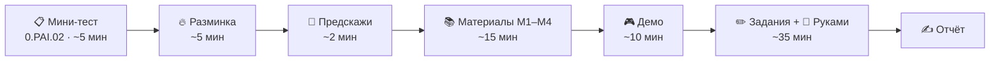
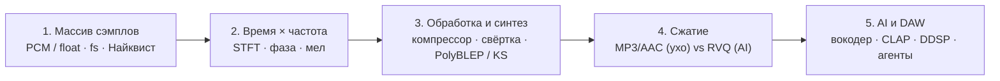

# 🟨 Интерес · Неделя 03 · `0.SND.01` — Панорама: от сэмпла и классического DSP к AI в звуке

> [!abstract] Зачем
> Это **ступень 1** обновлённого потока `SND` (взята внепланово в Фазе 0 из спящего потока; остальные ступени нарезаются на чекпоинте Фазы 0). Цель — собрать **единую инженерную карту всего аудиотракта глазами кода и AI**: от массива сэмплов, Найквиста и классического DSP до мел-спектрограмм, нейрокодеков, DAW и голосовых агентов, не повторяя «учебник звукорежиссёра».
> 📰 **Из жизни:** в 2026 году банки и сервисы всё чаще сталкиваются с клонированием голоса, но детекторы дипфейков, обученные на чистых студийных WAV, резко теряют точность после обычного пересжатия звонка в MP3/Opus — классический DSP напрямую определяет, что «видит» AI-модель.

**Время:** ~1–1,25 ч · **Дата выдачи:** 19.11 *(внеплановый слот недели 3; мини-тест по `0.PAI.02` добавлен заранее по просьбе пользователя — проходи его **после** сдачи [[Интерес — 0.PAI.02]])*



---

## 📋 Мини-тест по прошлому интересу *(`0.PAI.02` — MQTT + 🔌 Железо с нуля)*

> [!warning] Тест — строго после `0.PAI.02`, без подсказок Тьютора и без поиска
> Не подглядывай в материалы `0.PAI.02`; не знаешь — так и напиши «не знаю», это тоже ответ. Проверит Ментор вместе с этой сессией; от результата зависит, закроется ли `0.PAI.02` (нужно 2 из 3).

1. [x] На входной пин микроконтроллера подключили концевой выключатель двери шкафа, но забыли включить подтяжку (`INPUT_PULLUP`) и внешнего резистора нет.
   а) Что будет читать `digitalRead()`, когда дверь открыта (контакт разомкнут) — стабильный `0`, стабильную `1` или что-то другое?
   б) Почему при включённом `INPUT_PULLUP` нажатая кнопка (замкнутая на `GND`) читается как `LOW`, а не `HIGH`?
   **Ответ:**
   а - Значение будет меняться хаотично
   б - потому что земля убирает напряжение
   ✍️ продиктовано

2. [x] Брокер MQTT получил сообщение в топик `home/floor2/kitchen/temp`.
   а) Поймает ли его подписчик на `home/+/temp`? А подписчик на `home/#`?
   б) На управляющий топик `garage/door/toggle` (переключить ворота) случайно поставили флаг `retain=True`. Какая проблема возникнет при каждом переподключении контроллера ворот? Одно предложение.
   **Ответ:**
   а - нет, да
   б - ворота будут открываться/закрываться
   ✍️ продиктовано

3. [x] QoS и безопасность MQTT:
   а) Почему при использовании **QoS 1** обработчик команды на стороне получателя должен быть готов к **дубликатам**? Одно предложение.
   б) На брокере Mosquitto включено `allow_anonymous true`, но в JSON каждого сообщения добавили поле `"sender"` со значением `"agent_1"`. Мешает ли это чужому клиенту в той же сети прочитать телеметрию или отправить поддельную команду, и что на стороне брокера/сети реально закрывает эту дыру?
   **Ответ:**
   а - если издатель (или как его) не получил подтверждение получения сообщения подписчиком, то сообщение отправляется повторно
   б - Нет, закрывают только шифрование и ACL
   ✍️ продиктовано

---

## 🔥 Разминка (по желанию, 5 мин)

1. [x] 🃏 **Карточки** (5 мин): в Obsidian — команда «Spaced Repetition: Review flashcards from all notes», пройди подошедшие по сроку (если накопилось больше 30 — не обязательно все; нет ни одной — пропусти).
   **Ответ:** пройдено
   ✍️ продиктовано
2. [x] Микрозадача на расчёт (без кода, в уме или 1 строкой): аудиоинтерфейс работает на `48 000 Гц`, размер одного буфера DAW — `256` сэмплов. Сколько миллисекунд длится **один** буфер? *(Образец на другом числе: `480` сэмплов при `48 000 Гц` → `480 / 48000 × 1000 = 10.0 мс`.)*
   **Ответ:** 5.3 мс (256 / 48000 * 1000 = 5.33 мс)
   ✍️ продиктовано

---

## 🔮 Предскажи (2 мин, не оценивается)

Есть WAV-запись (`48 000 Гц`), в которой звучат ровно два чистых синуса: `1 000 Гц` и `6 000 Гц`. Инженер готовит датасет для модели речи на `8 000 Гц` и делает наивный ресэмплинг в одну строку на Python — просто берёт каждый 6-й сэмпл (`[samples[i] for i in range(0, len(samples), 6)]`), без предварительного фильтра.

**Вопрос:** что окажется в получившемся файле на месте тона `6 000 Гц` — он исчезнет, станет тише, останется на `6 000 Гц` или превратится во что-то другое?

**Ответ (догадка до материалов — ошибаться можно; вернёшься к ней в «Своими словами»):**
Не предскажу, не знаю
✍️ продиктовано

---

## 📚 Материалы

> [!tip] 📌 Минимум для заданий — ~15 мин
> Четыре коротких блока М1–М4 складывают сквозную карту пути звука от буфера до AI. Можно идти по шагам: блок → соответствующее задание. Всё, что нужно для сдачи, — здесь; «🔍 Глубже» ниже — только на вырост.



### М1. Сигнал в коде: буферы, Найквист/алиасинг и дизеринг

В программе звук — не «волна в воздухе», а **одномерный массив чисел** (обычно `float32` от `-1.0` до `+1.0` внутри DAW и `int16`/`int24` на диске), который читается порциями — **буферами** (например, 64–1024 сэмпла за раз). Две базовые границы цифр, которые напрямую бьют по коду и ML-датасетам:

- **Предел Найквиста (`fs / 2`) и алиасинг.** Частота дискретизации `fs` позволяет однозначно зафиксировать частоты только **строго ниже `fs / 2`**. Всё, что выше `fs / 2`, при выборке или грубом прореживании **не исчезает**, а «складывается» (отражается) обратно в слышимый диапазон по формуле `f_alias = |f − round(f / fs)·fs|`. Чтобы этого не случилось, **до** прореживания ставят антиалиасинговый ФНЧ (LPF), который срезает всё выше нового `fs / 2`.
- **Квантование и дизеринг.** Когда разрядность понижают (например, с 24 бит до 16 или 8 бит для экономии памяти), ошибка округления коррелирует с тихим сигналом и слышна как жёсткие гармонические искажения («ступеньки»). **Дизеринг** (обычно слабый треугольный шум TPDF до округления) превращает эти коррелированные искажения в ровный, малозаметный фоновый шум.

| Понятие | Пример 1 (студия / DAW) | Пример 2 (AI / продакшен) |
|---|---|---|
| **Алиасинг** | Запись тарелок на 48 кГц без антиалиасингового фильтра при грубом даунсэмплинге даёт «металлический звон» в середине | Препроцессинг датасета Whisper (`48 → 16 кГц`) простым прореживанием «каждый 3-й сэмпл» без LPF замусоривает спектр 0–8 кГц фантомными пиками |
| **Дизеринг** | Экспорт мастера из 32-bit float в 16-bit WAV: на тихих хвостах ревера убирает «песок» квантования | Сжатие аудио для дешёвого 8-битного edge-микроконтроллера: без дизеринга тихие фрагменты искажаются ступеньками |

### М2. Почему статической АЧХ мало для тембра: STFT, фазовый вокодер и мел-спектрограмма

Частый вопрос программистов: «Зачем нейросетям сложные аудио-модели, если можно просто снять АЧХ (общий спектр) трека?» Ответ кроется в двух вещах, которые глобальная АЧХ выбрасывает: **время** и **фаза**.

- **Глобальное БПФ (FFT)** показывает, *сколько всего* каждой частоты было за весь файл, но полностью стирает, **когда** она звучала. Если развернуть щипок гитары задом наперёд (reverse), глобальный магнитудный спектр останется **идентичным до шестого знака**, а тембр и восприятие изменятся радикально — потому что атака и затухание поменялись местами (изменилась *фаза*).
- **STFT (оконное преобразование Фурье)** режет сигнал на короткие перекрывающиеся кадры (обычно 20–50 мс) и снимает спектр в каждом кадре — получается **2D-картинка «время × частота»**.
- **Фазовый вокодер** (в классическом тайм-стретче и питч-шифте) растягивает кадры STFT во времени, пытаясь аккуратно пересчитать фазу между соседними окнами. Как только фаза «разъезжается» на резких ударах (транзиентах), звук становится «размазанным / подводным».
- **Мел-спектрограмма и нейро-вокодер.** Большинство классических аудио-нейросетей переводят STFT в **мел-шкалу** (сжатую под логарифмический слух человека) и **выбрасывают фазу**, оставляя только амплитуды. Чтобы превратить сгенерированную мел-спектрограмму обратно в слышимую волну, старый алгоритм (Griffin-Lim) пытается угадать фазу итерациями и часто звучит «металлом». Поэтому в современном AI на выходе ставят **нейро-вокодер** (HiFi-GAN, BigVGAN) — отдельную нейросеть, обученную восстанавливать правдоподобную волну и фазу из мел-картинки.

| Инструмент | Пример 1 (классический звук) | Пример 2 (AI в звуке) |
|---|---|---|
| **STFT и фаза** | Тайм-стретч вокала в DAW фазовым вокодером: тянем темп на 30%, следим за когерентностью фаз на согласных | Разделение стемов (Demucs) и детекция дипфейков: мелкие фазовые нестыковки выдают синтетический голос |
| **Мел + вокодер** | Спектрограмма речи показывает форманты и атаку во времени — то, чего не видно на усреднённой АЧХ | TTS-модель генерирует 2D мел-спектрограмму, а нейро-вокодер (HiFi-GAN) синтезирует из неё PCM-волну |

### М3. Обработка и синтез глазами кода (карта будущих ступеней 4–6)

В коде плагина или DAW привычные звукорежиссёрские инструменты выглядят как очень компактные алгоритмы поверх буфера сэмплов. На этом шаге формулы учить не нужно — важно видеть **суть алгоритма и цену по CPU/задержке**:

| Блок | Как устроен в коде (суть) | Цена и ограничение | Мост в AI (ступени 4–6) |
|---|---|---|---|
| **Компрессор и LUFS** | **Компрессор:** детектор огибающей (envelope follower с attack/release) → расчёт снижения громкости (gain reduction) по порогу и ratio → умножение сэмпла. **LUFS:** фильтр K-взвешивания (имитация кривой слуха) + усреднение мощности блоками по 400 мс | Почти бесплатен по CPU; опция `lookahead` добавляет задержку буфера | Единая нормализация по LUFS в препроцессинге датасетов; нейро-компрессоры (WaveNet/LSTM) |
| **Свёрточный ревер и HRTF** | Выходной сигнал = свёртка сухого звука с «импульсным откликом» комнаты (IR) или ушей (HRTF для бинаурального 3D-звука). В лоб — `O(N·M)` (тормозит); в реальном времени считают через **быструю FFT-свёртку** блоками | Баланс размера блока FFT: меньше блок → ниже задержка, но выше нагрузка на CPU | Дифференцируемые фильтры/реверы в **DDSP** |
| **Алгоритмический синтез (PolyBLEP, FM, Karplus-Strong, MPE)** | **Наивная пила** даёт алиасинг на резком скачке → **PolyBLEP** сглаживает 2 соседних сэмпла полиномом. **FM** — один синус модулирует фазу другого. **Karplus-Strong** — буфер шума длиной `fs / f` + усреднение 2 сэмплов = струна за ~12 строк. **MPE** — MIDI с отдельной экспрессией на каждую ноту (свой канал) | Очень дёшев по CPU, идеален для реального времени и малых буферов (64–128 сэмплов) | **DDSP** (нейросеть крутит параметры классического синтезатора вместо генерации каждого сэмпла) + **Neural Audio Effects** (NAM / ONNX в плагине) |

### М4. Сжатие и мост к AI: психоакустика MP3/AAC против нейрокодеков и эмбеддингов

Классическое сжатие и современный аудио-AI решают схожую задачу — **представить звук компактно**, — но с разной целью:

- **Психоакустика (MP3, AAC, Opus):** опирается на свойства человеческого уха — *частотное маскирование* (громкий тон прячет тихие соседние частоты) и *временное маскирование* (после резкого удара ухо ~50–100 мс хуже слышит тихие детали). Кодек безвозвратно выбрасывает всё, что человек «всё равно не услышит».
- **Нейрокодеки (EnCodec, DAC) и RVQ:** сжимают звук в **дискретные токены** (как слова в LLM!), чтобы трансформер мог предсказывать следующий аудиотокен. Через **остаточное векторное квантование (RVQ)** звук раскладывается по слоям уточнения: 1-й слой держит каркас/мелодию, следующие добавляют тембр, верхние — транзиенты и «воздух».
- **Аудио-эмбеддинги (CLAP, MERT):** сворачивают фрагмент звука в плотный вектор (как текстовые эмбеддинги в `0.LLM.03`), где близкие по тембру, жанру или звучанию треки лежат рядом — даже если у них разная тональность и разная статическая АЧХ.

| Подход | Пример 1 (что сохраняет) | Пример 2 (что ломается / ограничение) |
|---|---|---|
| **Психоакустика (MP3/Opus)** | Речь в звонке при 24 kbps остаётся разборчивой для человека | Срезанные ВЧ и фазовые детали часто **уничтожают признаки**, по которым AI-детектор ловит синтетический голос |
| **Нейрокодек (RVQ) / CLAP** | Позволяет LLM генерировать музыку/речь как поток токенов и искать треки по текстовому описанию («тёплый перегруженный бас») | Требует GPU/быстрого инференса; при малом числе слоёв RVQ «схлопывает» мелкие детали атаки и ревера |

> [!info]- 🔍 Глубже — по желанию, на вырост — раскрыть
> - В следующих ступенях потока `SND` мы сначала разберём «подкапотную» часть звука, DAW и плагинов: **ступени 2–3** — движок DAW, lock-free буферы, АЦП/ЦАП и PDC; **ступени 4–5** — цифровые плагины (EQ, компрессор/лимитер/True Peak, реверы, имиджеры, вокодеры) и аналоговое моделирование (VA, ZDF/WDF, оверсэмплинг/ADAA); **ступень 6** — синтез, DDSP и NAM. Затем — AI в звуке: **ступень 7** — данные и нейро-вокодеры; **ступень 8** — RVQ и эмбеддинги CLAP; **ступень 9** — генерация и разделение; **ступень 10** — детекция дипфейков и C2PA; **ступень 11** — MCP-агент над DAW; **ступень 12** — голосовые агенты.
> - Классическая короткая заметка про реальное время в аудио (пригодится в ступени 2): Ross Bencina, *«Real-time audio programming 101: time waits for nothing»* (`rossbencina.com`, сверим перед ступенью 2).

> [!danger] 🗡 Как это ломают
> 1. **Ломка детекторов пересжатием:** злоумышленник пропускает синтетический голос через обычный голосовой кодек (Opus/MP3/GSM) — психоакустика срезает артефакты вокодера, и детектор, обученный только на чистом WAV, пропускает подделку.
> 2. **Неслышимые команды через нелинейность и алиасинг (DolphinAttack):** ультразвуковой сигнал (> 20 кГц), неслышимый для человека, на нелинейности дешёвого MEMS-микрофона детектируется в слышимый диапазон речи — голосовой ассистент «слышит» команду в тишине.

> [!example] 🎮 Интерактивное демо — «От сэмпла и классического DSP — к AI в звуке»
> ▶ **[[Материалы/Демо/0.SND.01 — От сэмпла и DSP до AI в звуке.html|Открыть демо]]** (офлайн-копия в хранилище, с живым звуком Web Audio API) · ~10 мин
> 🎯 **Миссия:** пройти все 3 ступени (3 предсказания + найти фантомную частоту для `10 000 Гц` при `fs = 16 000 Гц`, найти порог буфера DAW `> 10 мс` при `48 кГц` и починить все 3 узла AI-аудиотракта) — итоги миссии понадобятся в задании 2. Краткий разбор скрыт за кнопкой «только после сдачи заданий».
> ✅ ☑ ручка ☑ предсказание ☑ третья механика ☑ злой случай ☑ миссия с числом ☑ закрытая часть ☑ свой мир ☑ проверено в браузере

---

## ✏️ Задания

1. [ ] **Диагностика по карте тракта (М1–М4).** Ниже — 4 коротких сбоя на стыке цифрового звука, кода и AI. По одному симптому в реальной системе причину на 100% не доказать, поэтому для **каждого** случая укажи две вещи: а) **вероятную причину** из карты М1–М4; б) **одну конкретную проверку**, которая подтвердит или опровергнет твою гипотезу.

   🧾 **Дано и что сдать:** заполни таблицу ниже для всех 4 сбоев.
   *Образец формы ответа на другом случае:*
   *Сбой: при экспорте тихого эмбиента в 8-bit WAV на затухании появился резкий «металлический хруст».*
   *Вероятная причина: ошибка квантования при понижении разрядности без дизеринга (М1).*
   *Проверка: экспортировать тот же фрагмент с включённым TPDF-дизерингом и сравнить спектр/слуховую картину тихого хвоста (хруст должен замениться ровным тихим шумом).*

   📖 **Сначала:** [[#М1. Сигнал в коде: буферы, Найквист/алиасинг и дизеринг|М1]]–[[#М4. Сжатие и мост к AI: психоакустика MP3/AAC против нейрокодеков и эмбеддингов|М4]]
   **Критерий сдачи:** заполнены все 4 строки; в каждой назван конкретный механизм из М1–М4 и предложена реалистичная проверка, которая действительно отличает эту причину от альтернатив.

   **Ответ:**

| # | Симптом в системе | Вероятная причина (механизм из М1–М4) | Одна проверка (подтвердит или опровергнет) |
|---|---|---|---|
| 1 | Пайплайн переводит студийные записи `48 кГц` в `16 кГц` самописным скриптом. После этого на спектрограммах речи и музыки в диапазоне `2–7 кГц` появились паразитные «зеркальные» пики, которых не было в исходнике | | |
| 2 | Банковский детектор голосовых дипфейков давал 92% на тестовом наборе чистых WAV, но в боевых звонках провалился почти до случайного угадывания | | |
| 3 | Самописный VST-синтезатор генерирует пилу простой формулой `2 * phase - 1`. На низких нотах звучит чисто, но в верхнем регистре появляется негармонический «грязный» призвук | | |
| 4 | Новый TTS-движок рисует чёткие мел-спектрограммы, похожие на эталон, но на выходе голос звучит неестественно, с «фазовым металлическим» призвуком | | |

2. [ ] **Выводы из интерактивного демо.** Пройди все 3 ступени стенда [[Материалы/Демо/0.SND.01 — От сэмпла и DSP до AI в звуке.html|0.SND.01]] (кнопку «Открыть краткий разбор» до сдачи не нажимай) и запиши 3 коротких факта (по 1–2 предложения):
   - а) При `fs = 16 000 Гц` (стандарт ASR) без LPF: в какую частоту свернулся входной тон `10 000 Гц`, и что конкретно останавливает включение LPF?
   - б) При `48 кГц` с какого размера буфера DAW длительность **одного** буфера превышает `10 мс`, и какой инженерный компромисс это создаёт при запуске ML-модели внутри плагина?
   - в) В ступени 3 (AI-тракт): какой узел ломал именно детектор дипфейков, а какой — естественность восстановления голоса?

   📖 **Сначала:** [[#М1. Сигнал в коде: буферы, Найквист/алиасинг и дизеринг|М1]]–[[#М4. Сжатие и мост к AI: психоакустика MP3/AAC против нейрокодеков и эмбеддингов|М4]] + интерактивное демо
   **Критерий сдачи:** верные числа в «а» и «б» + точное объяснение компромисса и разделение ролей узлов в «в».
   **Ответ:**

3. [ ] **🔧 Руками (15 мин): лаборатория `snd_lab.py` на чистом Python.**
   В папке `Фаза 0/Недели/Неделя 03 (02.11–08.11)/код_0.SND.01/` лежит готовый скрипт `snd_lab.py` (ничего доустанавливать не нужно — только стандартная библиотека Python). Он прогоняет 3 опыта и создаёт 4 WAV-файла в подпапке `out/` (их можно послушать в плеере или закинуть в DAW):
   1. Ресэмплинг `48 → 8 кГц` без фильтра (`1 000 Гц` + `6 000 Гц`);
   2. Синтез щипка струны **Karplus-Strong** за ~12 строк (`110 Гц`);
   3. Сравнение **глобальной АЧХ** и **покадрового STFT** прямого щипка против его же `reverse`.

   **Что сделать:**
   - Шаг 1. Запусти в терминале (PowerShell):
     ```powershell
     python "c:\Обучение 2.0\Фаза 0\Недели\Неделя 03 (02.11–08.11)\код_0.SND.01\snd_lab.py"
     ```
     Вставь вывод команды целиком (или 3 ключевых блока с числами) и по желанию послушай WAV из `out/`.
   - Шаг 2. Предположи, как изменятся **RMS** и **спектральный центроид** в окнах времени (и звучание щипка), если в `snd_lab.py` (строка вызова `karplus_strong` в `exp2_and_3_karplus_and_timbre`) поменять `decay=0.996` на `decay=0.95` (или поменять `freq=110.0` на `freq=220.0`). Затем внеси правку, перезапусти скрипт, сравни наблюдения с исходным прогоном и объясни расхождение или совпадение в 2–3 предложениях. *(После опыта верни исходное значение или оставь пометку, что изменил.)*

   📖 **Сначала:** [[#М1. Сигнал в коде: буферы, Найквист/алиасинг и дизеринг|М1]]–[[#М3. Обработка и синтез глазами кода (карта будущих ступеней 4–6)|М3]]
   **Критерий сдачи:** вывод исходного запуска `snd_lab.py` + твоё предположение → вывод после изменения одного параметра → 2–3 предложения сравнения и объяснения (почему параметр подействовал именно так в алгоритме Karplus-Strong).
   **Ответ:**

4. [ ] **Своими словами:** объясни в 3–5 предложениях коллеге-программисту без опыта звукорежиссуры, **почему нейросети нельзя просто скормить глобальную АЧХ трека** и как классическая цифровая база (сэмплы, Найквист, STFT/фаза, кодеки) связана с тем, как работают современные AI-аудиомодели. Отдельной строкой напиши, подтвердилась ли твоя догадка из «🔮 Предскажи» (и если нет — где именно была неточность).
   **Критерий сдачи:** 3–5 связных предложений без общих фраз, с опорой на конкретный механизм (время/фаза/маскирование/токены) + честная сверка с «🔮 Предскажи».
   **Ответ:**

---

## 🟨 Мостик к ядру (`0.LLM.02` и `0.LLM.03`, по желанию)

На этой и следующей неделе в ядре идут **токены (`0.LLM.02`)** и **эмбеддинги (`0.LLM.03`)** для текста. В аудио ровно та же пара уже работает в `SND`: нейрокодеки (EnCodec/DAC) режут звук на дискретные токены для трансформера, а CLAP/MERT превращают клип в вектор смысла/тембра. Заметь главное отличие: текст дискретен сам по себе, а звук приходится сначала квантовать (с потерями или через несколько слоёв RVQ).

---

## ✍️ Отчёт

- **Время (сколько ушло):**
- **Трудности и вопросы:**
- **Подсказки Тьютора:** *(заполняет Тьютор, если помогал: «разобрано N из M заданий; задание N — ур. X»)*
- **Демо:** 1–5 · что было непонятно или скучно

---

## 📋 Мини-тест по этой сессии
*(будет в начале следующего занятия интереса — Ментор составит его по итогам проверки)*

---

## ✅ Проверка *(заполняет Ментор)*

**Главное:** держится — [...] · поправить — [...] · в следующую сессию — [...]

**Вердикт по заданиям:**

| # | Задание | Статус | Что верно | Что не так / чего не хватает | Подсказки |
|---|---|---|---|---|---|
| 1 | Диагностика по карте тракта | | | | |
| 2 | Выводы из интерактивного демо | | | | |
| 3 | 🔧 Руками: `snd_lab.py` | | | | |
| 4 | Своими словами + сверка предсказания | | | | |

**Разбор ошибок:**
-

**Что получилось хорошо:**
-

**Оценка:** /10 —

**Время:**

**Мини-тест по прошлому интересу (`0.PAI.02`):** /3 —

**Занятия:** `0.SND.01` —

**Долги:** —
