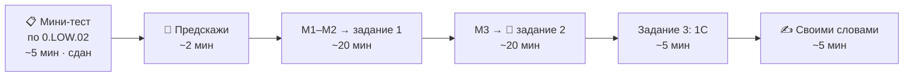
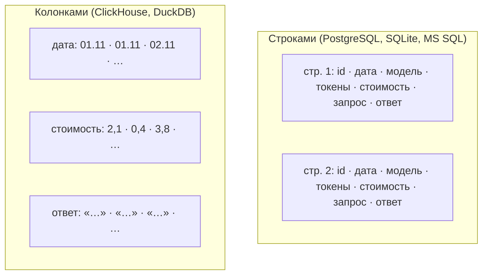

# 🟨 Интерес · Неделя 03 · `0.SQL.02` — Какие бывают хранилища изнутри

> [!abstract] Зачем
> Агентной системе почти всегда нужно несколько хранилищ сразу: журнал вызовов, память агента, векторный индекс, файлы. Выбор хранилища — архитектурное решение, и его цена прячется внутри: в том, как данные лежат на диске. Сегодня не пишем запросы, а смотрим, как устроены разные базы и почему одна и та же таблица в одной базе считается за 5 мс, а в другой — за 350.

**Время:** ~1 ч · **Дата выдачи:** 13.11 (переписан по просьбе: вместо запросов — устройство хранилищ) · **Срок:** выходные или следующая неделя, ничего не блокирует



---

## 📋 Мини-тест по прошлому интересу *(`0.LOW.02` — Настоящий ассемблер)*

> [!warning] Тест — без подсказок Тьютора и без поиска
> Не знаешь — так и напиши: «не знаю» — тоже ответ. От результата зависит, закроется ли `0.LOW.02` (2 из 3).

1. [x] Про пару инструкций `call` и `ret` в x86-64.
   а) Что `call` кладёт на стек?
   б) Проверяет ли `ret`, что снятое со стека значение — действительно адрес возврата?
   **Ответ:**
   а) call кладёт вызов следующей функции (адрес возврата) и прыгает на указанную в call
   б) нет, ret ваще похуй, чё лежит на стэке. раз лежит, значит оно — логика такая
   ✍️ продиктовано

2. [x] Почему запись в локальную переменную функции вообще может дотянуться до адреса возврата? Одно предложение.
   **Ответ:**
   Если функция пишет при переполненном буфере, то может перезаписать не то значение стека, а адрес возврата лежит на стеке.
   ✍️ продиктовано

3. [x] Функция и то, во что её превращает clang с `-O2`:
   ```c
   int sum(int n) {
       int s = 0;
       for (int i = 1; i <= n; i++) s += i;
       return s;
   }
   ```
   ```nasm
   sum:
       test edi, edi
       jle  .LBB2_1
       lea  eax, [rdi-1]
       lea  ecx, [rdi-2]
       imul rcx, rax
       shr  rcx
       lea  eax, [rcx+2*rdi]
       dec  eax
       ret
   ```
   В отладчике на эту сборку не получается поставить наблюдение на переменную `i`. Почему?
   **Ответ:**
   Потому что при сборке и оптимизации цикл заменяется на формулу дабы сразу дать результат, и потому i как элемент только цикла идёт на хуй. И поскольку фактически счётчик итераций проёбан на оптимизации, мы не сможем его отследить при отладке: его уже выкинули.
   ✍️ продиктовано

---

## 🔥 Разминка (по желанию, ~5 мин)

1. [ ] 🃏 **Карточки** (5 мин): в Obsidian — команда «Spaced Repetition: Review flashcards from all notes», пройди те, что подошли по сроку. Таких нет — пропусти пункт.
   **Ответ:** *(сколько прошёл · какие забыл)*

---

## 🔮 Предскажи (2 мин, не оценивается)

К неделе 5 у полигона появится журнал LLM-вызовов. Допустим, через год в нём 300 тыс. строк и 11 колонок: дата, модель, токены, стоимость, текст запроса и ответа. Одна и та же таблица лежит в двух базах — SQLite и DuckDB.
а) Нужна средняя стоимость вызова по дням. Какая база посчитает быстрее и примерно во сколько раз?
б) Нужна одна запись целиком по её номеру. Кто быстрее теперь?
**Ответ (догадка до материалов — ошибаться можно; вернёшься к ней в «Своими словами»):**
а) дак б)скуль из-за индексов думаб
✍️ продиктовано

---

## 📚 Материалы

> [!tip] 📌 Минимум для заданий — ~15 мин
> Идём так: пункт → задание → следующий пункт. Запросы ниже — примеры, чтобы было видно, что база делает; писать свои не нужно.

### М1. Главный вопрос любого хранилища: как данные лежат на диске

Диск и память читаются кусками, а не по байту. Поэтому всё решает, **что лежит рядом**: что рядом, то читается заодно и дёшево.



- **Строками** — вся запись лежит вместе. Дёшево достать одну запись целиком или поменять её. Дорого посчитать среднее по одной колонке: читать придётся все строки со всеми колонками, включая длинные тексты.
- **Колонками** — каждая колонка лежит отдельно. Дёшево посчитать агрегат по паре колонок: читаются только они. Похожие значения подряд хорошо сжимаются — «01.11» тысячу раз подряд занимает почти ничего. Дорого достать одну запись целиком: её куски разбросаны по всем колонкам.

Пример на числах — журнал на 300 тыс. строк. Чтобы получить «среднюю стоимость по дням», строковой базе нужно прочитать все ~200 МБ таблицы. Колоночной — две колонки по несколько мегабайт.

Второй пример, с другой стороны: склад из модели фулфилмента. Каждая отгрузка меняет остаток одной позиции — это «найти одну запись и поменять». Здесь колоночная база проигрывает: правка одной строки задевает много отдельных колонок.

### М2. Семейства хранилищ — что внутри и чем платим

| Семейство              | Как лежат данные внутри                                                                                             | Что дёшево                                    | Чем платим                                                                            | Примеры                                 |
| ---------------------- | ------------------------------------------------------------------------------------------------------------------- | --------------------------------------------- | ------------------------------------------------------------------------------------- | --------------------------------------- |
| Строковое реляционное  | Страницы по 8 КБ со строками + индекс B-tree                                                                        | Найти и поменять запись, транзакции           | Аналитика по всей таблице                                                             | PostgreSQL, MS SQL, 1С клиент-серверная |
| Колоночное             | Каждая колонка отдельно, сжатая; запрос идёт пачками значений                                                       | Агрегаты по миллионам строк                   | Правка одной строки, частые мелкие вставки                                            | ClickHouse, DuckDB                      |
| Ключ-значение в памяти | Хеш-таблица в оперативной памяти                                                                                    | Прочитать по ключу за микросекунды            | Объём ограничен памятью; без настроенного сохранения на диск при сбое данные теряются | Redis                                   |
| LSM                    | Запись — в память и в журнал, потом сбрасывается на диск отсортированными файлами, файлы время от времени сливаются | Очень быстрая запись потоком                  | Чтение может пройтись по нескольким файлам; фоновое слияние ест диск                  | RocksDB, Cassandra                      |
| Документное            | Запись — целый документ (JSON)                                                                                      | Достать объект целиком без склеек таблиц      | Связи между документами и целостность — на тебе                                       | MongoDB                                 |
| Поисковое              | Обратный индекс: слово → список документов, где оно есть                                                            | Найти документы по словам                     | Индекс большой, обновление не мгновенное                                              | Elasticsearch, OpenSearch               |
| Векторное              | Граф соседства векторов (HNSW): близкие по смыслу связаны                                                           | Найти «похожие по смыслу»                     | Ответ приближённый, а не точный; индекс в памяти                                      | pgvector, Qdrant                        |
| Объектное              | Объект целиком по ключу, без структуры внутри                                                                       | Хранить терабайты дёшево                      | Поменять кусок объекта нельзя — только перезаписать целиком                           | S3, MinIO                               |
| Встраиваемое           | Вся база — один файл, движок внутри твоей программы, без сервера                                                    | Ноль настройки, база едет вместе с программой | Много пишущих одновременно — плохо                                                    | SQLite, DuckDB, 1С файловая             |

> [!example] 1С — оба варианта в одной системе
> Файловая база 1С — вся база в одном файле `1Cv8.1CD` и свой встроенный движок. Клиент-серверная — данные в настоящей СУБД (MS SQL, PostgreSQL и другие), с которой работает сервер 1С. Это ровно граница между «встраиваемым» и «строковым реляционным» из таблицы — задание 3 про неё.

### М3. Как это увидеть руками

Скрипт [[код_0.SQL.02/compare.py|compare.py]] в папке `код_0.SQL.02` рядом с этим файлом. Он создаёт синтетический журнал LLM-вызовов на 300 тыс. строк — один и тот же в SQLite и DuckDB — и гоняет на обеих базах один запрос по 5 раз. Наверху файла флаг `QUERY`, три готовых запроса:

| `QUERY` | Запрос | Что он читает |
|---|---|---|
| `"aggregate"` | `SELECT day, round(avg(cost_rub), 2) FROM calls GROUP BY day ORDER BY day` | 2 колонки из 11, но все строки |
| `"lookup"` | `SELECT * FROM calls WHERE id = 123456` | все колонки, но одну строку |
| `"wide"` | `SELECT count(*) FROM calls WHERE response LIKE '%ошибка%'` | самую «толстую» колонку — текст ответа — во всех строках |

Запуск: `uv run --with duckdb python compare.py` (или `pip install duckdb`, затем `python compare.py`). Первый запуск создаёт базы, это 20–40 с. Скрипт печатает медианное время каждой базы, размер файлов и во сколько раз быстрее DuckDB. Файлы баз в git не попадут.

> [!danger] 🗡 Как это ломают
> Самая частая утечка баз — не взлом, а открытая наружу база без пароля: Redis, Elasticsearch, MongoDB, публичный бакет S3. Ключ-значение и поисковые движки часто ставят «для своих» во внутреннюю сеть, а потом сеть меняется. У агентных систем добавляется своё: в векторное хранилище можно подложить документ, который всплывёт как «похожий» и принесёт агенту чужие инструкции (`0.AIS`).

> [!info]- 🔍 Глубже — по желанию — раскрыть
> - 📖 [[Материалы/Тьютор/Неделя 03 (02.11–08.11)/Устройство хранилищ изнутри — от страниц B-Tree и LSM-деревьев до колоночного сжатия|Лекция Тьютора: «Устройство хранилищ изнутри — от страниц B-Tree и LSM-деревьев до колоночного сжатия»]] *(📌 ~15 мин · 🔍 ~15 мин)* + [[Материалы/Демо/0.SQL.02 — Устройство хранилищ — B-Tree, LSM и колоночный движок.html|интерактивный тренажёр]]
> - Мартин Клеппман, «Designing Data-Intensive Applications» (в русском переводе — «Высоконагруженные приложения»), глава 3 «Storage and Retrieval» — эта же тема подробно: от журнала и хеш-индекса до LSM, B-tree и колоночного хранения.
> - CMU 15-445 (Andy Pavlo), лекции про хранение на YouTube — как база раскладывает страницы и строки; к ним вернёмся в `0.SQL.06`.
> - Как выбирать хранилище под задачу — в ядре Фазы 1, `1.DAT.00`; после этого занятия оно пойдёт быстрее.

---

## ✏️ Задания

1. [x] **Хранилища для твоих систем.**
   📖 **Сначала:** [[#М1. Главный вопрос любого хранилища: как данные лежат на диске|М1]], [[#М2. Семейства хранилищ — что внутри и чем платим|М2]]
   🧾 **Дано** — пять видов данных:
   - а) журнал LLM-вызовов полигона (неделя 5): пишется по строке на каждый вызов, читается отчётами «сколько потратили по дням и моделям»;
   - б) память Telegram-агента: последние 20 сообщений диалога по `user_id`, нужны мгновенно на каждый новый вопрос;
   - в) индекс эмбеддингов заметок полигона (неделя 4): найти 5 заметок, близких по смыслу к вопросу;
   - г) остатки на складе из модели фулфилмента: каждая отгрузка меняет одну позицию, ошибиться в остатке нельзя;
   - д) фото товаров и сканы актов приёмки на том же складе.

   **Что сдать:** таблица на 4 строки из 5 на твой выбор. Колонки: `данные · семейство · что внутри делает его подходящим · чем платим`.
   **Образец строки** (на другом случае): `курсы валют для сервиса цен · ключ-значение в памяти (Redis) · чтение по ключу за микросекунды, курс нужен на каждом запросе · без настроенного сохранения курс пропадёт при перезапуске — придётся заново скачать`.
   **Критерий сдачи:** 4 строки; в «что внутри» — устройство из М1–М2 (как лежат данные), а не «он быстрый»; в «чем платим» — конкретная цена для этого случая.
   **Ответ:**

| Данные | Семейство | Что внутри делает его подходящим | Чем платим |
|---|---|---|---|
| Журнал LLM-вызовов (модель и расход токенов с датой) | Колоночная | Отчёт по колонкам расхода моделей за дату за миллисекунды, правки строки не требуются | Конкретные вызовы целиком будут запрашиваться дольше |
| Память Telegram-агента (небольшое количество строк с привязкой к ID) | Ключ-значение в памяти (хеш) | Моментально достаём строки для конкретного ID ($O(1)$) | Не храним всю историю переписки (память ограничена) |
| Индексы заметок | Векторная | Быстрый поиск похожих по смыслу заметок (граф HNSW) | Не всегда получаем то, что конкретно хотели получить (ответ приближённый) |
| Остатки на складе (позиции и их количество) | Строковая реляционная | Пишем по одной строке и можем всегда скорректировать опечатку или ошибку почти мгновенно, количество остатков конкретной позиции быстро подгружается | Количество остатков по всем позициям запрашивать долго (скан всей таблицы) |
| Фото товаров и сканы актов (.png/.jpeg конкретного товара/скана) | Объектная | Храним много относительно тяжёлых файлов при хорошей экономии места в хранилище, данные менять не нужно внутри | Если перепутали акт с фото, то нельзя заменить что-то одно, потому выгружаем заново (перезапись объекта целиком) |

✍️ продиктовано

2. [x] **🔧 Руками: одна таблица, две базы** (~20 мин, [[код_0.SQL.02/compare.py|compare.py]]).
   📖 **Сначала:** [[#М3. Как это увидеть руками|М3]]
   🧾 **Что сделать:** запусти скрипт три раза, меняя `QUERY`. **Что сдать:**
   а) `"aggregate"`: время обеих баз и во сколько раз быстрее DuckDB. Почему — объясни через то, какие колонки читает каждая база.
   б) `"lookup"`: кто быстрее теперь и почему.
   в) `"wide"`: насколько сократился разрыв против а) и почему.
   г) Размеры файлов: почему у DuckDB файл в несколько раз меньше на тех же данных.
   д) 2–3 строки: что увидел, где это пригодится тебе (журнал вызовов полигона, отчёты), что мешало.
   **Образец формы** (числа выдуманы, на другом запуске): `а) SQLite 120 мс, DuckDB 30 мс — в 4 раза; потому что …`.
   **Критерий сдачи:** числа с твоего экрана в а)–г), у каждого — объяснение через устройство из М1; 2–3 строки в д).
   **Ответ:**
   а) **"aggregate"**: SQLite 255.28 мс, DuckDB 4.38 мс — DuckDB быстрее в **58.23 раза**.  
   *Почему:* Запрос агрегирует только 2 колонки (`day` и `cost_rub`). DuckDB с диска поднимает только эти две колонки векторными порциями, игнорируя остальные 9 (включая тяжёлые тексты промптов и ответов). SQLite же хранит данные строками — чтобы посчитать среднее, ему пришлось прочитать с диска все 300 000 строк целиком со всеми 11 полями (все ~196 МБ).

   б) **"lookup"**: SQLite 0.04 мс, DuckDB 0.80 мс — **SQLite быстрее в ~20 раз** (DuckDB 0.05x).  
   *Почему:* SQLite моментально находит страницу B-Tree по первичному ключу `id` и читает готовую contiguous-строку со всеми полями за доли миллисекунды (0.04 мс). DuckDB для `SELECT *` вынужден собрать одну строку по кусочкам из 11 разных независимых колоночных векторов.

   в) **"wide"**: SQLite 401.46 мс, DuckDB 111.78 мс — DuckDB быстрее в **3.59 раза** (разрыв сократился с 58x до 3.6x).  
   *Почему:* Фильтрация идёт по самой «толстой» колонке `response` по всем строкам таблицы. DuckDB всё ещё впереди (читает только одну колонку + векторизованный скан), но основной объём байтов всё равно приходится поднимать с диска и сканировать подстроку `%ошибка%`.

   г) **Размеры файлов:** SQLite 195.8 МБ, DuckDB 42.8 МБ (DuckDB **в 4.6 раза компактнее**).  
   *Почему:* Однотипные данные, лежащие в колонках подряд (целые числа, даты, схожие текстовые токены), сжимаются алгоритмами компрессии (RLE, Bit-packing, Dictionary, ZSTD) на порядки эффективнее, чем разнородные строки целиком.

   д) **Где пригодится:** Наглядно видно разделение труда: для аналитики вызовов LLM и отчётов по расходам полигона идеально подходит DuckDB/Parquet (сжатие в 4.6 раза и аналитика в 58 раз быстрее). Для точечных конфигураций и поиска конкретной заметки по ID — SQLite вне конкуренции благодаря B-Tree ($O(1)$ страницы).

   🤖 написал агент, проверил я

3. [x] **1С: файловая против клиент-серверной** (3–5 предложений, из твоего опыта).
   📖 **Сначала:** [[#М2. Семейства хранилищ — что внутри и чем платим|М2]], выноска про 1С
   🧾 **Что сдать:** вспомни случай, когда базу переводили с файловой на клиент-серверную или когда файловая начинала тормозить. Что было симптомом (сколько пользователей, какие операции, что писали люди)? Объясни это через строку «встраиваемое» таблицы М2: что в устройстве файловой базы этому причина. Нет такого опыта — так и напиши и ответь, когда бы ты сам посоветовал переход.
   **Образец формы:** `Было: … · Симптом: … · Причина в устройстве: … · Что дал переход: …`.
   **Критерий сдачи:** симптом конкретный (числа или операции), причина — через устройство, а не «файловая слабее».
   **Ответ:**
   Я не переводил базы с файловых на серверные. Файловые были либо демо-базы, либо... всё, только они. Тестовые и те были клиент-серверные. Так мне никто и не объяснил, почему для встраиваемых много пишущих - плохо, но суть в том, что хотел ты услшать именно такой ответ: "много пишущих - плохо"
   ✍️ продиктовано

4. [x] **Своими словами** (3–5 предложений). Друг говорит: «Да какая разница, где хранить, — возьму PostgreSQL на всё». Когда он прав, а когда переплатит — назови по одному случаю из заданий 1 и 2. Был ли ты прав в «🔮 Предскажи»? Если нет — где ошибся?
   **Критерий сдачи:** есть случай «прав» и случай «переплатит», с причиной через устройство; есть возврат к «Предскажи».
   **Ответ:**
   Если тебе надо конкретные записи искать с полным объёмом данных о них - возьми постгресс, но если тебе данные из бд нужны для статистики - постгресс слишком тяжеловесная и медленная может оказаться. Да и что ты хранить собриаешься? Документы - есть вариант лучше. Мб, тебе ваще эмбединги нужны. А если моментальный доступ по ключу - это ещё один вариант. Короче, скажи, чё надо, а потом уже посмотрим.

   Я был прав.
   ✍️ продиктовано

---

## 🟨 Мостик к полигону *(по желанию)*

В `docs/design.md` полигона, §12, открыт вопрос: где хранить индекс эмбеддингов и какого провайдера взять — решить до недели 4. Назови два кандидата на хранение индекса из таблицы М2 и по одной цене каждого. Выбор не делай: решение — приёмом «варианты без выбора» на неделе 4.
**Ответ:**

---

## ✍️ Отчёт

- **Время (сколько ушло):** ~1 ч
- **Что было новым или неожиданным:** практический замер разрыва между колоночным и строковым хранением (в 58 раз на агрегатах и в 4.6 раза по размеру файла).
- **Трудности и вопросы:** Нет, намного класснее, чем прошлые sql занятия.
- **Подсказки Тьютора:** разобрано 4 из 4 заданий; задания 1, 3, 4 — ур. 0; задание 2 — 🤖 (прогон бенчмарка проверен пользователем); по запросу пользователя подготовлена лекция по «🔍 Глубже» и интерактивный тренажёр.

---

## 📋 Мини-тест по этому занятию
*(составлен 13.11, лежит в `ЗАМЕТКИ.md`; войдёт в начало следующего занятия интереса — `0.CTF.02`, неделя 4, пн)*

---

## ✅ Проверка *(заполняет Ментор)*

*13.11 (пт) · проверил: Claude Opus 5.5 · вручную*

**Главное.**
- **Держится:** строка или колонка — и сразу цена. Агрегат, точечный поиск и размер файла объяснены через устройство, а «Предскажи» угадано полностью.
- **Поправить:** поиск по B-tree — не O(1), а O(log n). В задании 3 нужен твой совет, когда переходить.
- **Взять дальше:** почему пишущий в базе по сути один — ответ ниже в разборе, глубже — в `0.SQL.03` (WAL и транзакции).

### Мини-тест по `0.LOW.02` — 3 из 3

| № | Вердикт | Комментарий |
|---|---|---|
| 1 | ✅ | а) адрес возврата, б) `ret` ничего не проверяет — верно. 💡 Точнее: `call` кладёт адрес следующей инструкции после себя, а не «вызов следующей функции» |
| 2 | ✅ | Буфер и адрес возврата лежат в одном стеке — переполнение до него дотягивается |
| 3 | ✅ | Цикл заменён формулой, переменной `i` в сборке больше нет |

**Итог:** `0.LOW.02` — ✅ закрыт 13.11, 5/10.

### Вердикт по заданиям

| # | Задание | Статус | Что верно | Что не так / чего не хватает | Подсказки |
|---|---|---|---|---|---|
| 1 | Хранилища для твоих систем | ✅ | 5 строк вместо 4; хеш, HNSW, объект целиком, колонки — через устройство, цены конкретные | 💡 Склад: главная причина строковой базы — транзакции (ошибиться в остатке нельзя), а не скорость правки | ур. 0 |
| 2 | 🔧 SQLite против DuckDB | ✅ | Числа с твоего экрана (58×, 0,05×, 3,6×, файл в 4,6 раза меньше); а–г объяснены верно — колонки, сборка строки из 11 колонок, толстая колонка, сжатие | ❌ д): «SQLite … благодаря B-Tree ($O(1)$ страницы)». Поиск в B-tree — O(log n): несколько страниц от корня к листу. В б) это описано верно («находит страницу B-Tree»), ошибка — в одной формулировке | 🤖 |
| 3 | 1С: файловая против клиент-серверной | 🟡 | Честно: опыта перехода нет | ❌ Задание: «Нет такого опыта — так и напиши и ответь, когда бы ты сам посоветовал переход». Второй части нет. Перечитал: не закрыто. **Но** почему встраиваемой базе плохо от многих пишущих, М2 не объясняла — это дыра материала (правило 23), балл за неё не снижаю | ур. 0 |
| 4 | Своими словами | ✅ | «Прав» — точечные записи целиком; «переплатит» — статистика; причина через устройство — в 2а той же сессии; «Предскажи» — угадал | — | ур. 0 |

### Разбор

- **Почему встраиваемой базе плохо, когда пишут многие** — ответ на твой справедливый вопрос из задания 3. Встраиваемая база — один файл и движок внутри программы, без сервера, который ведёт очередь записей. Поэтому порядок держится блокировкой самого файла или таблицы: пока один пишет, остальные ждут. SQLite пускает одного пишущего на всю базу. Файловая 1С ставит блокировки на целые таблицы: при 10–20 пользователях, которые одновременно проводят документы, очередь растёт, отсюда ожидания и «конфликт блокировок». Если файл лежит на сетевой папке, каждая блокировка идёт ещё и через сеть. Клиент-серверная СУБД блокирует отдельные строки и сама держит очередь. **Когда советовать переход:** одновременно пишут больше нескольких человек или база лежит на сетевом диске.
- **O(log n), а не O(1).** B-tree — дерево страниц: от корня к листу 3–4 чтения даже на миллионах строк, и с ростом таблицы в 1000 раз добавляется лишь пара шагов. O(1) — у хеш-таблицы (Redis), и ты это верно написал в задании 1.

### Что получилось хорошо

- «Предскажи» угадано полностью и с причиной («из-за индексов»).
- В задании 1 к каждой строке — честная цена для этого случая, а не «быстро / медленно».

**Оценка: 5/10.** Объём выполнен. Задание 3 частично, но из-за дыры материала не снижаю. До 6 не хватило: O(1) в 2д и нет совета в 3.

**Время:** ~1 ч · план ~1 ч — норма. Отзыв «намного класснее прошлых SQL-занятий» учтён: поток так и идёт дальше.

**Занятия:** `0.SQL.02` — ⏳ ждёт мини-тест (в начале `0.CTF.02`, неделя 4, пн). `0.LOW.02` — ✅ закрыт.

**Теги:** #хранилища #колоночное #b-tree #duckdb #sqlite

---

## 🃏 Карточки для повторения
#flashcards/Фаза0/SQL

Почему агрегат по паре колонок в колоночной базе быстрее в десятки раз, чем в строковой?::Колоночная читает с диска только нужные колонки, строковая — все строки целиком со всеми полями, включая длинные тексты. Замер на 300 тыс. строк: SQLite ~255 мс против DuckDB ~4 мс.
<!--SR:!2026-11-21,4,270-->
Почему одну запись целиком быстрее достаёт строковая база?::Вся запись лежит рядом на одной странице, и B-tree по ключу ведёт к ней за несколько чтений, O(log n); колоночной надо собрать запись из всех колонок.
<!--SR:!2026-11-21,4,270-->
Поиск по ключу: B-tree против хеш-таблицы — какая сложность?::B-tree — O(log n): путь от корня к листу, 3–4 страницы даже на миллионах строк. Хеш-таблица (Redis) — O(1) в среднем.
<!--SR:!2026-11-21,4,270-->
Почему колоночный файл в разы меньше на тех же данных?::Однотипные значения подряд хорошо сжимаются: повторяющиеся даты, названия моделей, похожие числа. Замер: 196 МБ в SQLite против 43 МБ в DuckDB.
<!--SR:!2026-11-21,4,270-->
Почему встраиваемой базе плохо, когда пишут многие?::Нет сервера с очередью: порядок держится блокировкой файла или таблицы — пишет один, остальные ждут. SQLite — один пишущий на базу; файловая 1С блокирует таблицы целиком.
<!--SR:!2026-11-21,4,270-->
Векторный индекс (HNSW) — чем платим?::Ответ приближённый: самая близкая заметка может не попасть в выдачу; индекс держится в памяти.
<!--SR:!2026-11-21,4,270-->
Объектное хранилище (S3) — чем платим?::Поменять кусок объекта нельзя — только перезаписать объект целиком.
<!--SR:!2026-11-21,4,270-->
