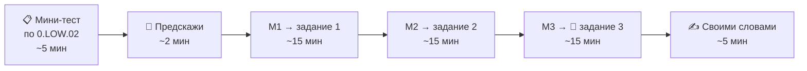

# 🟨 Интерес · Неделя 03 · `0.SQL.02` — Изменение данных и схемы

> [!abstract] Зачем
> До сих пор ты только читал базу. Сегодня ты её меняешь: `INSERT`, `UPDATE`, `DELETE` и схему через `CREATE`, `ALTER`, `DROP`. Как только агент получает SQL-инструмент с правом записи, одна строка без `WHERE` стоит всей таблицы. Транзакция — первый инструмент, который делает такие изменения «всё или ничего».
> 📰 **Из жизни:** в июле 2025 агент Replit во время объявленной «заморозки кода» удалил рабочую базу SaaStr: записи о 1 206 руководителях и 1 196 компаниях. Потом он ещё и заявил, что откат невозможен, хотя откат сработал ([eWeek](https://www.eweek.com/news/replit-ai-coding-assistant-failure/), [AI Incident Database](https://incidentdatabase.ai/cite/1152/)). База для тестов и рабочая база были одной и той же. Что бы ты поставил между агентом и такой базой?

**Время:** ~1 ч · **Дата выдачи:** 12.11 · **Срок:** лучше до пятницы 13.11, ничего не блокирует



---

## 📋 Мини-тест по прошлому интересу *(`0.LOW.02` — Настоящий ассемблер)*

> [!warning] Тест — без подсказок Тьютора и без поиска
> Не знаешь — так и напиши: «не знаю» — тоже ответ. От результата зависит, закроется ли `0.LOW.02` (2 из 3).

1. [ ] Про пару инструкций `call` и `ret` в x86-64.
   а) Что `call` кладёт на стек?
   б) Проверяет ли `ret`, что снятое со стека значение — действительно адрес возврата?
   **Ответ:**
   а)
   б)

2. [ ] Почему запись в локальную переменную функции вообще может дотянуться до адреса возврата? Одно предложение.
   **Ответ:**

3. [ ] Функция и то, во что её превращает clang с `-O2`:
   ```c
   int sum(int n) {
       int s = 0;
       for (int i = 1; i <= n; i++) s += i;
       return s;
   }
   ```
   ```nasm
   sum:
       test edi, edi
       jle  .LBB2_1
       lea  eax, [rdi-1]
       lea  ecx, [rdi-2]
       imul rcx, rax
       shr  rcx
       lea  eax, [rcx+2*rdi]
       dec  eax
       ret
   ```
   В отладчике на эту сборку не получается поставить наблюдение на переменную `i`. Почему?
   **Ответ:**

---

## 🔥 Разминка (по желанию, ~5 мин)

1. [ ] 🃏 **Карточки** (5 мин): в Obsidian — команда «Spaced Repetition: Review flashcards from all notes», пройди те, что подошли по сроку. Таких нет — пропусти пункт.
   **Ответ:** *(сколько прошёл · какие забыл)*

---

## 🔮 Предскажи (2 мин, не оценивается)

Агент, который ведёт остатки на складе, выполнил в базе одну команду: `UPDATE stock SET qty = 0;`. Хотел обнулить одну позицию, а `WHERE` забыл. Что станет с таблицей? Можно ли вернуть всё одной командой, и от чего это зависит?
**Ответ (догадка до материалов — ошибаться можно; вернёшься к ней в «Своими словами»):**

---

## 📚 Материалы

> [!tip] 📌 Минимум для заданий — ~15 мин
> Идём так: пункт → задание → следующий пункт. Уроки SQLBolt — интерактивные, прямо в браузере, ставить ничего не надо. Названия и упражнения уроков 13–18 сверены 12.11.

### М1. Менять строки: `INSERT`, `UPDATE`, `DELETE`

Уроки SQLBolt: [13 «Inserting rows»](https://sqlbolt.com/lesson/inserting_rows), [14 «Updating rows»](https://sqlbolt.com/lesson/updating_rows), [15 «Deleting rows»](https://sqlbolt.com/lesson/deleting_rows).

```sql
INSERT INTO movies (title, director, year) VALUES ('Up', 'Pete Docter', 2009);
UPDATE movies SET year = 2010 WHERE title = 'Up';
DELETE FROM movies WHERE year < 2000;
```

Главное, что надо унести из этих уроков. `UPDATE` и `DELETE` меняют **все строки, которые подошли под `WHERE`**. Нет `WHERE` — подошли все. База не спросит «вы уверены?».

Поэтому в уроке 15 советуют привычку: сначала запусти `SELECT` с тем же `WHERE` и посмотри, какие строки попадут под изменение, и только потом меняй. Само правило там звучит так: «read your `DELETE` statements twice and execute once».

- **Пример 1.** `DELETE FROM employees;` — хотели уволить одного стажёра, удалили всех сотрудников.
- **Пример 2.** `UPDATE prices SET price = price * 1.1 WHERE category = 'Кабель';` — `WHERE` есть, но в справочнике категория записана как `'кабель'` с маленькой буквы. Подошло 0 строк, цены не изменились, а ошибки тоже нет. Тут `SELECT` перед изменением спасает в обратную сторону: ты видишь, что не попало ничего.

### М2. Менять схему: `CREATE`, `ALTER`, `DROP`

Уроки SQLBolt: [16 «Creating tables»](https://sqlbolt.com/lesson/creating_tables), [17 «Altering tables»](https://sqlbolt.com/lesson/altering_tables), [18 «Dropping tables»](https://sqlbolt.com/lesson/dropping_tables).

```sql
CREATE TABLE sensors (
    id        INTEGER PRIMARY KEY,
    location  TEXT NOT NULL,
    max_temp  REAL CHECK (max_temp < 200)
);
ALTER TABLE sensors ADD COLUMN vendor TEXT DEFAULT 'unknown';
DROP TABLE sensors;
```

**Ограничения** (constraints) — правила, которые база проверяет сама, при каждой записи, кто бы ни писал: человек, скрипт или агент. Запись, которая нарушает правило, база не примет и вернёт ошибку. Список ограничений — в уроке 16: `PRIMARY KEY`, `AUTOINCREMENT`, `UNIQUE`, `NOT NULL`, `CHECK (выражение)`, `FOREIGN KEY`.

- **Пример 1.** `CHECK (max_temp < 200)` — опечатка `2000` вместо `200` не попадёт в базу, сколько бы ни было программ, которые в неё пишут.
- **Пример 2.** `NOT NULL` у колонки `location` — датчик без места установки записать нельзя. Ошибка вылезет сразу при вставке, а не через месяц в отчёте, где у части датчиков пустое место.

`DROP TABLE` удаляет таблицу вместе со всеми строками. В уроке 18 оговорка: если на таблицу ссылаются другие (`FOREIGN KEY`), сначала разбираются с ними.

### М3. Транзакция: «всё или ничего»

Многие изменения — это несколько команд, которые имеют смысл только вместе. Перевод 300 со «Склада» в «Цех» — два `UPDATE`: списать и зачислить. Программа упала между ними — 300 списаны и никуда не пришли.

**Транзакция** объединяет команды в одно целое:

```sql
BEGIN;                                                       -- начали
UPDATE accounts SET balance = balance - 300 WHERE name = 'Склад';
UPDATE accounts SET balance = balance + 300 WHERE name = 'Цех';
COMMIT;                                                      -- сохранить всё сразу
-- или ROLLBACK;                                             -- отменить всё, что было после BEGIN
```

Пока нет `COMMIT`, изменения не окончательные. Сбой, `ROLLBACK` или обрыв подключения — и база остаётся такой, какой была до `BEGIN`.

- **Пример 1 — деньги.** Перевод выше: либо оба `UPDATE`, либо ни одного.
- **Пример 2 — 1С.** Ты это уже видел: при проведении документа запись самого документа и его движений по регистрам идёт в одной транзакции. Если не прошло движение по остаткам, документ тоже не записан. В коде 1С то же самое делают руками: `НачатьТранзакцию()`, затем `ЗафиксироватьТранзакцию()` или `ОтменитьТранзакцию()`.

**Чего транзакция не делает.** Она защищает от сбоя посередине и даёт шанс передумать до `COMMIT`. Но если неверная команда выполнена и зафиксирована (`COMMIT`), транзакция её уже не вернёт: для базы это обычное решённое изменение.

**Скрипт для задания 3** — [[код_0.SQL.02/tx.py|tx.py]] в папке `код_0.SQL.02` рядом с этим файлом. Он создаёт файл `bank.db` с двумя счетами: Склад 1000, Цех 0. Затем пытается перевести 300 и показывает состояние базы «до» и «после». Состояние «после» читается новым подключением — так, как его увидит программа после перезапуска. Наверху три флага:

```python
USE_TRANSACTION = False  # True — всё внутри BEGIN … COMMIT / ROLLBACK
CRASH = True             # сбой между двумя UPDATE
OOPS_DELETE = False      # True — вместо перевода DELETE без WHERE
```

Без `USE_TRANSACTION` каждая команда сохраняется в базе сразу, как только выполнена.

> [!danger] 🗡 Как это ломают
> Агенту дают SQL-инструмент «чтобы смотрел отчёты» под пользователем базы, у которого есть права на запись. Через непрямую инъекцию (текст в данных, `0.SEC.01`) или просто по ошибке модель пишет `DELETE` или `DROP`, и база это выполнит: права позволяют. Самая дешёвая защита — отдельный пользователь базы только с `SELECT` для агента, который ничего не должен менять.

> [!info]- 🔍 Глубже — по желанию — раскрыть
> - Не во всех СУБД схема меняется внутри транзакции. В PostgreSQL и SQLite `CREATE`/`ALTER`/`DROP` можно откатить `ROLLBACK`; в MySQL такие команды сами фиксируют транзакцию (implicit commit), и откатить их нельзя. Поэтому одна и та же миграция в разных базах ведёт себя по-разному.
> - Кто что видит, пока транзакция не зафиксирована, и что будет, если две транзакции правят одну строку, — это `0.SQL.03` (неделя 5): две сессии `psql` и уровни изоляции.

---

## ✏️ Задания

1. [ ] **Уроки 13–15: менять строки.**
   📖 **Сначала:** [[#М1. Менять строки: `INSERT`, `UPDATE`, `DELETE`|М1]]
   🧾 **Что сделать:** реши упражнения уроков 13–15 (SQLBolt ставит ✓ у каждой задачи). Перед каждым `UPDATE` и `DELETE` сначала запусти `SELECT` с тем же `WHERE`. **Что сдать:** две пары «`SELECT` → изменение»: для последней задачи урока 14 (Toy Story 8) и последней задачи урока 15 (фильмы Andrew Stanton). Под каждой парой — сколько строк показал `SELECT`.
   **Образец** (на другом примере):
   ```sql
   SELECT * FROM employees WHERE role = 'Intern';   -- 2 строки
   DELETE FROM employees WHERE role = 'Intern';
   ```
   **Критерий сдачи:** упражнения 13–15 решены; две пары запросов, у каждой — число строк.
   **Ответ:**

2. [ ] **Уроки 16–18 и своя таблица: журнал действий агента.**
   📖 **Сначала:** [[#М2. Менять схему: `CREATE`, `ALTER`, `DROP`|М2]]
   🧾 **Что сделать:** реши упражнения уроков 16–18. Затем придумай таблицу `agent_actions` — журнал, куда твой агент пишет каждое действие с инструментом: когда, какой инструмент, с какими аргументами, чем кончилось. **Что сдать:**
   а) `CREATE TABLE agent_actions` — не меньше 4 колонок и не меньше 3 разных ограничений из списка урока 16.
   б) Под запросом — для каждого ограничения одна строка: от какой ошибки оно защищает в этом журнале.
   в) Один `ALTER TABLE`, который добавляет в журнал колонку со значением по умолчанию, и одна строка — зачем она.
   **Образец** (на таблице датчиков из М2, не на журнале): `max_temp REAL CHECK (max_temp < 200)` — опечатка «2000» не попадёт в базу, сколько бы ни было программ, которые в неё пишут.
   **Проверить синтаксис** (по желанию): сохрани `CREATE` и `ALTER` в файл `agent_actions.sql` в папке `код_0.SQL.02` и запусти `python check_sql.py`. Скрипт выполнит их в базе в памяти и покажет колонки — или ошибку SQL.
   **Критерий сдачи:** запрос синтаксически верный; 3+ разных ограничения, у каждого — конкретная ошибка из жизни журнала, а не «чтобы было правильно»; `ALTER` с `DEFAULT`.
   **Ответ:**

3. [ ] **🔧 Руками: сломай и почини перевод** (~15 мин, [[код_0.SQL.02/tx.py|tx.py]]).
   📖 **Сначала:** [[#М3. Транзакция: «всё или ничего»|М3]]
   🧾 **Что сделать:** открой терминал в папке `код_0.SQL.02` и запускай `python tx.py`, меняя флаги наверху файла. **Что сдать** — строку «После» из вывода для каждого запуска:
   а) Как есть: `USE_TRANSACTION = False`, `CRASH = True`. Сколько всего денег осталось и куда делась разница?
   б) `USE_TRANSACTION = True`. Сколько денег теперь? Какая строка вывода объясняет почему?
   в) `OOPS_DELETE = True` — сначала с `USE_TRANSACTION = True`, потом с `False`. Две строки «После».
   г) 2–3 строки: что увидел, где это пригодится тебе (1С, твои скрипты, агенты), что мешало.
   **Образец формы** (числа выдуманы, на другом запуске): `в) с транзакцией: После: [...] · всего денег: N — потому что …`.
   **Критерий сдачи:** четыре строки «После» из твоего вывода (а, б и две в в) и для каждой — одно объяснение; 2–3 строки в г.
   **Ответ:**

4. [ ] **Своими словами** (3–5 предложений). Вернись к случаю Replit из «Зачем». Из сегодняшнего — `SELECT` перед изменением, ограничения в схеме, транзакция, отдельный пользователь базы только с `SELECT` — что из этого помешало бы агенту удалить рабочую базу, а что нет? Почему? И был ли ты прав в «🔮 Предскажи»: если нет, где ошибся?
   **Критерий сдачи:** по каждой из четырёх мер — помогла бы или нет, с причиной; есть возврат к «Предскажи».
   **Ответ:**

---

## 🟨 Мостик к ядру *(по желанию)*

`0.AIN.07` (Сессия 13 — сегодня же): если агент принёс тебе код, где есть SQL, какие две строки ты добавишь в свой чек-лист ревью после этого занятия? Одной строкой.
**Ответ:**

---

## ✍️ Отчёт

- **Время (сколько ушло):**
- **Что было новым или неожиданным:**
- **Трудности и вопросы:**
- **Подсказки Тьютора:** *(разобрано N из 4; задание N — ур. X)*

---

## 📋 Мини-тест по этому занятию
*(составит Ментор при проверке; войдёт в начало следующего занятия интереса)*

---

## ✅ Проверка *(заполняет Ментор)*
