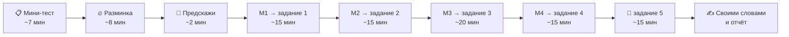
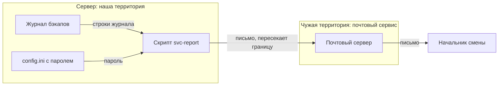
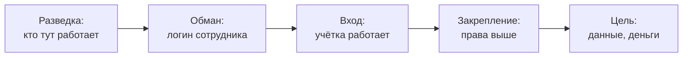

# 🔹 Сессия 10 · Неделя 03 · `0.SEC.01` — Модель угроз

> [!abstract] Зачем
> Агент с доступом к твоим файлам — это новая дверь в систему, и «закрыть всё» нельзя. Модель угроз отвечает на вопрос, какие двери есть, кто в них пойдёт и какую закрыть первой. Сегодня строим её для полигона: раздел «данные и угрозы» в design doc на этой неделе будет опираться на эту работу.
> 📰 **Из жизни:** 26.10 стартап Cathedral заявил, что его агенты за 12 часов попали во внутренние системы Anthropic. Вошли не через Claude, а через стороннее ПО для администрирования и продаж. Anthropic подтвердила доступ к ограниченному набору систем и сказала, что переписка клиентов, код и веса моделей не затронуты, а часть активности её мониторинг заметил раньше отчёта ([Decrypt, 26.10](https://decrypt.co/381860/ai-agents-hack-anthropic-business-systems-12-hours)). Что бы ты проверил у себя первым?

**Время:** ~1,5–1,75 ч · **Дата выдачи:** 02.11



---

## 📋 Мини-тест по прошлой сессии *(Сессия 9 · `0.AIN.04`)*

> [!warning] Тест — без подсказок Тьютора и без поиска
> Не знаешь — так и напиши: «не знаю» — тоже ответ. Проверит Ментор вместе с этой сессией; от результата зависит, закроется ли `0.AIN.04` (2 из 3).

1. [x] Спека: `clamp(x, lo, hi)` — вернуть `x`, зажатое в отрезок от `lo` до `hi` включительно. Если `lo > hi` — `ValueError`. Пример: `clamp(15, 0, 10)` → `10` (15 больше верхней границы, поэтому возвращается сама граница).
   Напиши 4 тест-кейса строкой «класс · вызов · ожидание»: обычный, граничный «на границе», граничный «за границей», ошибочный.
   **Ответ:**
   Обычный - (5, 0, 8) - 5
   Граничный - (3, 0, 3) - 3
   За границей - (5, 0, 4) - 4
   Ошибочный - (7, 8, 5) - ValueError
   +Ошибочный - (5, 6, 8) - ValueError *x>lo, спека не фиксирует подобный случай приемлемым*
   ✍️ продиктовано

2. [x] Агент написал функцию и тест к ней:
   ```python
   def discount(price):
       return price * 0.9

   def test_discount():
       assert discount(200) == 200 * 0.9
   ```
   а) Чем этот тест плох? Одно предложение.
   б) Перепиши `assert` так, чтобы тест ловил ошибку в формуле.
   **Ответ:**
   а) дублирует логику функции, однохуйственно саму функцию как ожидаемый результат функции записать
   б) Ну он вообще и так поймает: как бы он буквально на выходе ожидает саму функцию дублированную. Но вообще: assert discount(100) == 90
   ✍️ продиктовано

3. [x] Проверка «путь лежит внутри хранилища» в полигоне.
   а) Что случится с проверкой через `assert`, если сервер запустить командой `python -O server.py`?
   б) Строка кода, которой ты заменишь `assert` (имена переменных — любые).
   **Ответ:**
   а) Строка будет игнорироваться интерпретатором, проверка не будет запускаться.
   б) if not path_in_vault("C:/Project"): raise ValueError
   ✍️ продиктовано

---

## 🔥 Разминка (по желанию, ~8 мин)

1. [x] 🃏 **Карточки** (5 мин): в Obsidian — команда «Spaced Repetition: Review flashcards from all notes», пройди те, что подошли по сроку. Таких нет — пропусти пункт.
   **Ответ:** Готово
   ✍️ продиктовано

2. [x] **Повторение `0.AIN.02`.** Claude Code в режиме Manual (в настройках — `default`). В папке проекта лежит `.env` с ключом.
   а) Агент решил прочитать этот файл. Спросит ли он разрешения?
   б) Чем запрещают такое чтение надёжно — и почему это надёжнее просьбы в `AGENTS.md`? Одно предложение.
   **Ответ:**
   а) нет, чтение разрешено
   б) добавить имя файла и путь в блэклист - тогда никак вообще не сможет.
   ✍️ продиктовано

3. [x] **Микрозадача на Go** (полиглот; запуск — [go.dev/play](https://go.dev/play/), без установки). Тот же подсчёт слов, что на неделе 1. Допиши тело цикла — одна строка.
   ```go
   package main

   import (
       "fmt"
       "strings"
   )

   func wordFreq(text string) map[string]int {
       counts := map[string]int{}
       for _, w := range strings.Fields(strings.ToLower(text)) {
           // твоя строка
       }
       return counts
   }

   func main() {
       fmt.Println(wordFreq("Кот кот пёс")) // map[кот:2 пёс:1]
       fmt.Println(wordFreq(""))            // map[]
   }
   ```
   **Ответ:**
   ```go
   counts[w]++
   ```
   ✍️ продиктовано

---

## 🔮 Предскажи (2 мин, не оценивается)

Полигон — только чтение, инструментов записи нет вообще. Что самое плохое может случиться с твоими данными при таком устройстве?
**Ответ (догадка до материалов — ошибаться можно; вернёшься к ней в «Своими словами»):**
если у агента нет доступа к другим инструментам и командной строке - утечка информации. А так-то что угодно, у MCP нет инструментов НЕ == у агента нет инструментов
✍️ продиктовано

---

## 📚 Материалы

> [!tip] 📌 Минимум для заданий — ~20 мин
> Идём так: пункт → задание → следующий пункт. Сквозной пример во всех пунктах — один, «отчёт о бэкапах». Свою систему разбираешь в заданиях.

### М1. Что защищаем и от кого

**Зачем.** Без модели угроз защита строится от того, что вспомнилось: поставили антивирус, а пароль лежит открытым на общем диске. Модель угроз — это короткий разговор из четырёх вопросов: что мы строим, что может пойти не так, что с этим делаем, хорошо ли получилось.

**Пример — «отчёт о бэкапах».** Ночью скрипт на сервере читает журнал бэкапов под сервисной учёткой `svc-report`, считает ошибки и отправляет письмо начальнику смены. Пароль почтового ящика лежит в `config.ini` рядом со скриптом.

**Актив** — то, потеря или подмена чего реально вредит. Не только данные:

| Актив | Почему ценен | Где лежит |
|---|---|---|
| Пароль почтового ящика | С него можно рассылать письма от имени компании | `config.ini` на сервере |
| Учётка `svc-report` | Если у неё лишние права, взлом скрипта становится взломом сервера | Служба на сервере |
| Доверие к письму | Начальник смены считает: письма нет или «всё ок» — бэкапы в порядке | У него в голове |

**Нарушитель** — не только хакер в капюшоне. Четыре типа, которые стоит перебирать всегда: **внешний** (фишинг, подбор пароля), **свой** (коллега с доступом к серверу), **поставщик** (подрядчик, вендор, библиотека с обновлением), **ошибка** (сам удалил, скрипт сломался). У агентов появляется пятый: **автор документа**, который агент прочитает, — инструкция, спрятанная в тексте заметки или письма.

**«Где живёт ключ и кто до него дотянется»** — отдельный вопрос про каждый секрет. Сам алгоритм шифрования или способ хранения секретом не является; секрет — ключ. `config.ini` с правами «читают все пользователи сервера» — значит, ключом владеют все пользователи сервера.

### М2. Потоки данных и границы доверия

**Зачем.** Дыры почти всегда там, где данные переходят с одной территории на другую. Поэтому рисуем не архитектуру, а потоки.

**Граница доверия** — линия, за которой меняется, кому мы верим: другой владелец, другая сеть, другая учётка, чужой сервис. **Поверхность атаки** — все места, куда снаружи можно подать вход. Граница IT/OT из `0.PAI.01` — такая же линия: поэтому на ней и стоит буферная зона.



Здесь границу пересекает один поток: письмо. Но и журнал стоит проверить: кто ещё может в него писать? Если кто угодно — строки журнала тоже приходят «снаружи», хотя лежат на нашем диске.

Запись того же списком: `Журнал → Скрипт : строки журнала : граница нет, если писать в журнал может только служба бэкапов`.

### М3. STRIDE: шесть вопросов к каждому потоку

**Зачем.** Чтобы не зависеть от того, что пришло в голову. Берём поток, пересекающий границу, и задаём ему шесть вопросов. Часть ответов будет «не применимо» — это тоже результат, если есть причина.

Поток «скрипт → письмо начальнику»:

| Буква | Что это | Вопрос | На примере | Ещё пример — с другой стороны |
|---|---|---|---|---|
| **S** Spoofing | Подмена личности | Можно выдать себя за другого — человека, программу, сервер? | Кто-то шлёт письмо «ошибок нет» от имени скрипта | Наоборот: скрипт сам отдал пароль поддельному почтовому серверу — подменили адрес `smtp` |
| **T** Tampering | Подмена данных | Можно незаметно изменить данные, код или настройки, которым верим? | Правят журнал, и в письме — ноль ошибок | В PyPI подменили библиотеку: меняется не поток, а код, которому мы верим |
| **R** Repudiation | Отказ от действия | Можно потом сказать «это не я» — и доказать обратное нечем? | Кто менял `config.ini` — следа нет | Агент удалил файл; в логе «выполнено», но чья была команда — твоя или из инъекции — не понять |
| **I** Information disclosure | Утечка | Узнает ли лишнее тот, кому не положено? | Письмо с именами серверов переслали наружу | Текст ошибки показывает строку подключения к базе вместе с паролем |
| **D** Denial of service | Отказ в обслуживании | Можно остановить работу или сделать её неподъёмной? | Журнал вырос до 50 ГБ, скрипт упал, письма нет, никто не заметил | Агент зациклился и за ночь сжёг месячный лимит API |
| **E** Elevation of privilege | Рост прав | Можно сделать больше, чем положено по правам? | `svc-report` — админ сервера: взлом скрипта даёт весь сервер | Текст чужой статьи в заметке выполняется агентом с твоими правами: автор делает то, на что прав у него нет |

*(Второй пример и общие вопросы добавлены 03.11: буква — про свойство, а не про один сценарий.)*

**Что с этим делать.** Каждой угрозе — вероятность и ущерб по шкале Н/С/В, сверху списка — В/В. Мера защиты конкретная: не «усилить безопасность», а «права на `config.ini` — только `svc-report`».

**Чего STRIDE не делает:** не находит всё и не закрывает ничего сам. Это чек-лист, чтобы не забыть класс проблем.

### М4. Атака — это цепочка

**Зачем.** Ты просил показать путь целиком, от разведки до взлома. Настоящая атака редко сводится к одной дыре: каждый шаг даёт то, что нужно для следующего. Отсюда главный вывод для защиты: разорвать цепочку можно в любом звене, и не обязательно закрывать все.



На примере: разведка находит имя начальника смены → письмо от «службы поддержки» с поддельной страницей входа → вход в почту → в переписке пароль от `svc-report` → доступ к серверу с бэкапами.

Разрывают там, где дешевле всего и где защита не зависит от внимания человека. «Обучить всех не кликать» работает вероятностно; второй фактор на входе останавливает украденный пароль независимо от того, кто кликнул.

> [!danger] 🗡 Как это ломают
> Настоящая цепочка: группа Storm-0940 через фреймворк ARTEX (мультиагентный пентест на LLM) скомпрометировала ConnectWise Cloud Backup и через его облачные приложения вошла к клиентам, а в ряде случаев добралась до ролей в каталоге. Попытки входа — более чем в 2 250 тенантов; в нескольких случаях от выбора цели до привилегированного доступа прошло меньше 3 часов ([Microsoft, 21.10](https://www.microsoft.com/en-us/security/blog/2026/10/21/storm-0940-uses-artex-agentic-ai-connectwise-supply-chain-compromise/)). Подрядчик с доступом к клиентам — готовая граница доверия, которую редко рисуют.

> [!info]- 🔍 Глубже — по желанию, ~20 мин — раскрыть
> - [Threat Modeling Cheat Sheet — OWASP](https://cheatsheetseries.owasp.org/cheatsheets/Threat_Modeling_Cheat_Sheet.html) — четыре вопроса, потоки данных, границы доверия и STRIDE на примере *(проверено: 02.11)*
> - [STRIDE в Threat Modeling Tool — Microsoft](https://learn.microsoft.com/azure/security/develop/threat-modeling-tool-threats) — определения категорий от авторов метода *(ссылка найдена поиском 02.11, текст страницы не открывал)*
> - [[Материалы/Тьютор/Неделя 01 (19.10–25.10)/Деанонимизация в сети и архитектура OSINT-агрегаторов|Лекция Тьютора про OSINT]] — как выглядит шаг «разведка» изнутри
> - `Шаблоны/Модель угроз.md` — полная форма. Сегодня не заполняем: полная модель угроз полигона — на неделе 13

---

## ✏️ Задания

**Дано для заданий 1–3 — полигон «Второй мозг» в том виде, каким он станет к неделе 8:**
- MCP-сервер (stdio) на твоём компьютере, инструментов записи нет; к нему подключён Claude Code.
- Читает хранилище Obsidian: твои ответы, лекции Тьютора, личный архив статей по подписке. Путь — в настройке `OBSIDIAN_VAULT_PATH`.
- Локальный индекс эмбеддингов (неделя 4) — только по своим файлам, статьи по подписке провайдеру не уходят.
- LLM-сводка через облачную модель (неделя 5): куски текста уходят провайдеру, нужен API-ключ, есть лог стоимости.
- Код пишет агент-кодер в `C:\Projects\second-brain`, зависимости ставятся из PyPI.

1. [x] **Активы, нарушители и ключ.**
   📖 **Сначала:** [[#М1. Что защищаем и от кого|М1]]
   🧾 **Что сдать:** а) таблица из 3 активов полигона: актив · почему ценен · где лежит. б) 3 нарушителя разных типов: тип · что именно он может сделать с полигоном (одно предложение). в) API-ключ недели 5: где ты его будешь хранить, и кто до него дотянется (назови хотя бы двоих, агента-кодера учти).
   **Образец формы** (на отчёте о бэкапах): `Пароль ящика · рассылка от имени компании · config.ini на сервере` и `Свой · коллега с доступом к серверу читает config.ini и пишет письма от имени скрипта`.
   **Критерий сдачи:** активы — не только «заметки»; у каждого нарушителя конкретное действие, а не «может навредить»; в пункте в) назван конкретный файл или механизм.
   **Ответ:**

а)

| Актив | Почему ценен | Где лежит |
|---|---|---|
| API-ключ | Доступ к балансу API-ключа | `.env` |
| Исходный код | Возможность мутации кода для доступа к записям, в том числе заблокированным, и операциям с ними, внедрение инструкций по работе с инструментами для агента | `C:/Projects/second-brain` |
| `OBSIDIAN_VAULT_PATH` | Доступ к чтению файлов директории | `.env` |

б)
- Поставщик — вредоносная библиотека в исходном коде проекта.
- Ошибка — случайная реализация инструментов изменения файлов и дальнейшая ошибка агента при работе с ними.
- Автор документа — чтение записки с вредоносным prompt-injection.
- Свой — агент Claude Code, который при создании заметки был подвержен атаке, и оставил инъекцию внутри заметки.

в) В `.env`, а дотянусь я и всё, кодеру там тоже делать особо нехуй. Пусть скрипт-настройщик просто ебанёт для редактирования `.env` и внедрения параметров окружения.

✍️ продиктовано

2. [x] **Потоки и границы.**
   📖 **Сначала:** [[#М2. Потоки данных и границы доверия|М2]]
   🧾 **Что сдать:** 5–7 потоков полигона, схемой Mermaid или списком: `откуда → куда : какие данные : пересекает ли границу и какую`. Начни с запроса: от Claude Code к серверу.
   **Образец формы** — запись списком в конце М2.
   **Критерий сдачи:** есть поток к облачному провайдеру и поток содержимого заметки обратно к модели; минимум две границы названы словами (не просто «граница»), и поверхность атаки перечислена одной строкой.
   **Ответ:**
   claude code ->| облачный провайдер : тексты заметок : пересекает границу личного ПК и внешней сети
   заметка -> инструмент чтения содержимого заметки : тексты заметок : не пересекает границ
   инструмент чтения содержимого заметки -> claude code : тексты заметок : не пересекает границу
   скрипт-настройщик окружения -> .env MCP : секреты, API-ключи, пути заблокированных директорий : не пересекает границу
   статья с внешнего веб-ресурса в заметку ->| скрипт копирования содержимого веб-страницы -> заметка хранилища : содержимое статьи : пересекает границу внешней сети и хранилища, имеется поверхность атаки: промт-инъекция может быть внедрена в исходное содержание статьи
   ✍️ продиктовано

3. [x] **STRIDE на одном потоке.**
   📖 **Сначала:** [[#М3. STRIDE: шесть вопросов к каждому потоку|М3]]
   🧾 **Что сдать:** выбери из задания 2 один поток, пересекающий границу, и пройди по нему все 6 букв: таблицей `буква · угроза на этом потоке, или «не применимо, потому что…» · вероятность · ущерб · мера`. Затем одной строкой: какая угроза первая в работу и почему.
   **Образец одной строки:** `D · журнал вырос до 50 ГБ, скрипт упал, письма нет · С · В · лимит на чтение и письмо «отчёт не собран» при сбое`.
   **Критерий сдачи:** все 6 букв закрыты; мера у строк с В конкретна (что и где меняется); хотя бы одно «не применимо» с причиной или честное объяснение, почему таких нет.
   **Ответ:**

Поток: `статья с внешнего веб-ресурса в заметку ->| скрипт копирования содержимого веб-страницы -> заметка хранилища : содержимое статьи : пересекает границу внешней сети и хранилища`

| Буква | Угроза на этом потоке | Вероятность | Ущерб | Мера |
|---|---|---|---|---|
| S | Ресурс автора статей может быть взломан | Н | С | Статьи отсылаются внешней модели-классификатору перед добавлением в основную директорию статей |
| T | Исходный код скрипта копирования статьи может быть скомпрометирован и мутирован на изменение содержания | Н | В | Скрипт копирования компилируется в `.exe` файл, менять который можно только с правами администратора |
| R | Не применимо, поскольку единственный, кто мог бы так сказать — автор статей. Он навряд ли будет нам что-либо в целом говорить | — | — | — |
| I | Исходный код скрипта копирования статьи может быть скомпрометирован и мутирован на пересылку информации | Н | Н | Решается в пункте T |
| D | Статья может оказаться слишком крупной для обработки скриптом / перегружающей хранилище | Н | Н | Скрипт сигнализирует при объёме текста более 1.000.000 символов и требует подтверждение администратора на обработку, обрабатывает в несколько итераций |
| E | Исходный код скрипта копирования статьи может быть скомпрометирован и мутирован на выполнение любых операций на ПК | Н | В | Решено в пункте T |

Первая в работу: E — мера идентична двум другим пунктам, но риск гораздо выше: символически первая.

✍️ продиктовано

4. [x] **Разорви цепочку.** Ты пришёл инженером в ООО «Тёплый дом» (вымышленная компания, 400 сотрудников). Прошлой весной конкуренту по рынку зашифровали базу, директор спрашивает: «С нами так можно? И что сделать на этой неделе, бюджета почти нет?» Ты прошёл по инфраструктуре и составил вероятный путь:
   1. **Разведка.** На сайте вакансий и в профилях видны имена админов и бухгалтера, формат почты `i.ivanov@`. В публичном репозитории подрядчика лежит конфиг с адресом VPN.
   2. **Обман.** Бухгалтеру приходит письмо «Акт сверки» со ссылкой, он вводит логин и пароль на поддельной странице.
   3. **Вход.** С этим логином и паролем заходят в VPN и почту: второго фактора нет.
   4. **Рост прав.** На общем файловом сервере лежит скрипт бэкапа с паролем `svc-backup`, файл читают все сотрудники; `svc-backup` — администратор на всех серверах.
   5. **Цель.** Копия базы 1С уходит наружу, база и бэкапы шифруются, требуют выкуп.

   📖 **Сначала:** [[#М4. Атака — это цепочка|М4]]
   🧾 **Что сдать:** а) таблица по 5 шагам: `шаг · буквы STRIDE · мера защиты · сколько стоит примерно (часы работы или деньги)`. б) Одна мера на эту неделю — какую назовёшь директору и почему именно её, 2–3 предложения. в) Что останется открытым после неё — одно предложение.
   **Образец строки** (на другом случае): `Подбор пароля к RDP · S · закрыть RDP снаружи, вход через VPN с MFA · 2 часа админа`.
   **Критерий сдачи:** мера привязана к шагу, а выбор на этой неделе обоснован ценой и тем, что именно он разрывает; в) честно называет остаток риска.
   **Ответ:**

а)

| Шаг | Буквы STRIDE | Мера защиты | Сколько стоит примерно |
|---|---|---|---|
| 1. Разведка | I | Убрать имена админов вообще из публичного доступа, конфиг в `.gitignore`, вычистить его из репозитория ко всем хуям вообще | 1–3 часа |
| 2. Обман | S | Блок на письма с недоверенных почтовых ящиков, если почтовый клиент свой — в спам и помечаются как «Отправитель не относится к компании» | 1–2 часа |
| 3. Вход | I, E | Подключение к сети VPN / Почту не с корпоративного и не с доверенного IP отправляет Alert администраторам, если сразу оба фактора, то блок до апрува админа | 1–2 часа |
| 4. Рост прав | E | Оставить скрипт, как службу, убрать файл из общего доступа | 40 минут |
| 5. Цель | I, T, D | Платить в надежде / пересобирать базы с нуля | Овердохуя бабла / времени или сразу и того, и другого |

б) Шаг 3, тогда о проблеме становится известно сразу и можно оперативно её устранить. Но можно сразу добавить ещё 4 (супер важно и быстро), 1 и 2. Тогда по потолку — 8 часов, умещается в один рабочий день даже в таком виде.

в) Если только 3, то пароли всё равно могут утечь.

✍️ продиктовано

5. [x] **🔧 Руками: путь наружу** (~15 мин, «сломай и почини»). Запускать в любой новой папке **вне хранилища**; нужен только Python 3.9+. Полигон закрывает это спекой, а здесь ты увидишь, как это выглядит вживую.

   Создай такую структуру и файл `read_note.py`:
   ```text
   demo/
     secret.txt        ← любая строка, например «секрет»
     vault/note.md     ← любая строка, например «заметка»
     read_note.py
   ```
   ```python
   from pathlib import Path

   VAULT = Path("vault")

   def read_note(rel: str) -> str:
       return (VAULT / rel).read_text(encoding="utf-8")

   print(read_note("note.md"))
   print(read_note("../secret.txt"))
   ```
   Шаги:
   а) Запусти из папки `demo` командой `python read_note.py`. Что вывел второй `print`?
   б) Почини функцию с той же сигнатурой так, чтобы `read_note("note.md")` работал как раньше, а `read_note("../secret.txt")` падал с `ValueError`. Понадобятся два метода `pathlib`: [`Path.resolve()`](https://docs.python.org/3/library/pathlib.html#pathlib.Path.resolve) и [`PurePath.is_relative_to()`](https://docs.python.org/3/library/pathlib.html#pathlib.PurePath.is_relative_to). Обе части пути надо привести к одному виду, а проверять — до чтения файла.

   **Критерий сдачи:** вывод до и после починки, код функции + 2–3 строки: что увидел, какая это буква STRIDE, где пригодится в полигоне.
   **Ответ:**

   а) До починки второй `print` выводит содержимое внешнего файла: `секрет` (произошёл Path Traversal — выход за пределы папки `vault` через `../`).

   Вывод до починки:
   ```text
   заметка
   секрет
   ```

   б) Исправленный код функции:
   ```python
   from pathlib import Path

   VAULT = Path("vault").resolve()

   def read_note(rel: str) -> str:
       target = (VAULT / rel).resolve()
       if not target.is_relative_to(VAULT):
           raise ValueError(f"Путь '{rel}' выходит за пределы хранилища")
       return target.read_text(encoding="utf-8")

   print(read_note("note.md"))
   try:
       print(read_note("../secret.txt"))
   except ValueError as e:
       print("Ошибка перехвата:", e)
   ```

   Вывод после починки:
   ```text
   заметка
   Ошибка перехвата: Путь '../secret.txt' выходит за пределы хранилища
   ```

   - **Что увидел:** Простая конкатенация путей `VAULT / rel` без предварительного вычисления абсолютного канонического пути легко обходится через `..`, позволяя прочитать любой файл в системе, к которому есть права у процесса.
   - **Буква STRIDE:** **T** (Tampering — искажение/подмена входного параметра пути), которое приводит к **I** (Information Disclosure — утечка данных из закрытых областей).
   - **Где пригодится:** В первой функции полигона `src/reader.py` (шаги 1–3 практики недели 3), где проверка `target.resolve().is_relative_to(VAULT.resolve())` до чтения файла является базовым инвариантом безопасности.

   🤖 написал агент, проверил я. Ментору: пользователь ранее не пользовался данными библиотеками и методами, с кодом он ознакомился и разобрал его

6. [x] **Своими словами** (3–5 предложений). Коллега говорит: «Сервер только читает, значит, модель угроз не нужна». Что ты ему ответишь? Был ли ты прав в «🔮 Предскажи» — если нет, где ошибся?
   **Ответ:**
   Я всё сказал в "Предскажи"
   ✍️ продиктовано

---

## 🛠 Связь с практикой

Угрозы из заданий 1–3 пойдут в раздел «данные и угрозы» короткого design doc. Сам design doc — шаг 2 практики, после следующей сессии (`0.SD.01`) → [[НЕДЕЛЯ#🛠 Практика недели]]. Шаг 1 (доправка спеки) открыт уже сейчас; находки задания 5 сверь с порядком проверок в спеке.

---

## 🟨 Мостик к интересу *(по желанию)*

`PAI`: завод из `0.PAI.01`, AI-агент делает сводки простоев и читает данные из SCADA и архива. Какой поток этого агента пересекает границу IT/OT и какой буквой STRIDE ты бы начал? Одна строка.
**Ответ:**
Поток SCADA -> возврат сводки с L3 на L4. I, утечка информации
✍️ продиктовано

---

## ✍️ Отчёт

- **Время (сколько ушло):** ≈ 3 ч (план ~1,5–1,75 ч)
- **Трудности и вопросы:** Новая тема для меня, глубоко погружался, потому и так долго. Интересно очень
- **Подсказки Тьютора:** разобрано 6 из 6 заданий; задания 1–4, 6 — ур. 0; задание 5 — ур. 4 (код функции написал агент, пользователь ознакомился и разобрал)
- От пользователя: главное, что в задании 5 понял, почему и как. Сам бы всё равно не написал интуитивно - гуглил бы как минимум, либу не знаю же

---

## 📋 Мини-тест по этой сессии
*(составлен 03.11 — в начале [[Сессия 11 — 0.SD.01]])*

---

## ✅ Проверка *(заполняет Ментор)*

*03.11 (вт) · проверил: Claude Opus 5.5 · автозапуск; **перепроверено 03.11 по твоим возражениям**: оценка 4 → 5, мини-тест 2,5 → 3, задания 1а, 2, 3, 5, 6 → ✅; **пересмотрено 03.11 по новым правилам проверки** (минус — с цитатой требования, метки ❌/💡/⚖, спор): оценка 5 → 6*

> [!warning] Ошибки проверки Ментора — исправлены (правило 23)
> - **1а:** назвал `OBSIDIAN_VAULT_PATH` «не активом», хотя в М1 актив — «то, потеря или **подмена** чего реально вредит». Подменённый путь — чтение откуда угодно. Ты прав.
> - **Задание 4, шаг 3:** прочитал твою меру как «только алерт». В ответе написано: «если сразу оба фактора, то блок до апрува админа». Это преграда, она останавливает вход, и в) «остаётся утечка паролей» при ней верно. Критика про «ночью никто не прочитает» была мимо. Цена в б) тоже есть: 1–2 ч и «по потолку 8 часов».
> - **Задание 3:** написал, что инъекции в таблице нет. Она есть под S: взлом ресурса автора и классификатор на входе.
> - **Задание 2:** мерил по тому, чего нет в критерии (PyPI). Образца строки «поверхность атаки» в задании и в М2 не было. «К серверу» надо было писать «к MCP-серверу».
> - **Задание 5:** в материалах нет примера с `resolve()` и `is_relative_to()`, только ссылки на документацию. Нужна была выноска «🧭 Как подступиться» (A2, шаг 3). Причина подсказки — мой пропуск, поэтому статус ✅, а не 🟡 (правило 23).
> - **Задание 6:** задание переспрашивало то, что ты уже сказал в «Предскажи». Ответ по существу есть.
> - **Мини-тест, вопрос 1:** просил 4 кейса, все 4 верны. Снимать полбалла за пятый, которого не просил, — лишнее.

**Главное.**
- **Держится:** «у MCP нет инструментов ≠ у агента нет» (главный вывод занятия, сам в «Предскажи»); заражённый агент оставляет инъекцию в заметке; поток статей снаружи; мера с блоком до апрува на шаге 3; подмена пути как угроза.
- **Поправить:** шаг 5 — мера до атаки, а не после; в 1в запрет на уровне ОС записать в design doc, в ответе его не было.
- **Взять дальше:** в design doc — и содержимое хранилища в активах, и `OBSIDIAN_VAULT_PATH`; если хочешь классификатор внешней моделью — запись в журнал решений, он меняет прежнее решение.

### Мини-тест по Сессии 9 (`0.AIN.04`) — 3 из 3

| № | Вердикт | Комментарий |
|---|---|---|
| 1 | ✅ | Четыре кейса верны. Замечание без снижения. Ты написал: «`(5, 6, 8) - ValueError` *x>lo, спека не фиксирует подобный случай приемлемым*». В вопросе: «вернуть `x`, зажатое в отрезок от `lo` до `hi` включительно. Если `lo > hi` — `ValueError`». Здесь `x = 5`, `lo = 6`, то есть `x` меньше `lo`. Отдельной строки про `x < lo` в вопросе **нет**: единственное основание для `6` — слово «зажатое», а пример дан только на верхнюю границу, `clamp(15, 0, 10)` → `10`. Поэтому «кейс неверен» было сказано слишком твёрдо: это твоё чтение неполной формулировки, пример на нижнюю границу должен был дать я |
| 2 | ✅ | а) Верно: тест повторяет формулу. б) `assert discount(100) == 90` — ожидание посчитано отдельно от кода. «И так поймает» верно наполовину: если формулу **потом** поменяют, тест упадёт. Если агент **сразу** ошибся, ошибка одинакова в коде и в тесте. Мой вопрос этого не разделял |
| 3 | ✅ | а) Верно: при `-O` `assert` выбрасывается. б) `if not ...: raise ValueError` — верно |

**Итог:** `0.AIN.04` — ✅ закрыто 03.11, фокус про `assert` и `-O` снят.

### Разминка

- **Карточки, Go** ✅ — `counts[w]++` верно: у отсутствующего ключа значение `0`.
- **`.env` в Manual:** а) ✅ верно, ошибка теста недели исправлена. б) ✅ Блэклист в настройках — верно. Уточнение: по [документации](https://code.claude.com/docs/en/permissions) (проверено 03.11) правило `Read` закрывает файловые инструменты и команды вроде `cat`, но не `grep -r` из той же папки и не скрипт, который сам открывает файл. Полностью — песочница на уровне ОС.

### Вердикт по заданиям

| # | Задание | Статус | Что верно | Что не так / чего не хватает | Подсказки |
|---|---|---|---|---|---|
| 1а | Активы | ✅ | Ключ, код, путь к хранилищу: у всех причина, критерий выполнен | Замечание: само содержимое хранилища в design doc тоже впиши | ур. 0 |
| 1б | Нарушители | ✅ | Поставщик, ошибка, автор документа; «агент оставил инъекцию в заметке» — настоящая находка: заражение, которое переживает сессию | — | ур. 0 |
| 1в | Где живёт ключ | 🟡 | Механизм назван: `.env`, скрипт-настройщик | ❌ Требовалось: «кто до него дотянется (назови хотя бы двоих, агента-кодера учти)». Написано: «дотянусь я и всё, кодеру там тоже делать особо нехуй». Агент-кодер работает под твоей учёткой и файл прочтёт, а запрета в ответе нет. Перечитал 1б и 2: там его тоже нет, не закрыто. Запрет правами ОС ты назвал в споре 03.11, он верный, но это новое по существу: статус не меняет, идёт в оценку как углубление | ур. 0 |
| 2 | Потоки и границы | ✅ | Поток к провайдеру и заметка обратно, две границы словами; поток статей снаружи — сам, его не было в «дано» | 💡 Можно добавить поток «ответ модели → Claude Code»: на нём инъекция становится вызовом инструмента | ур. 0 |
| 3 | STRIDE | ✅ | Все 6 букв, меры у В конкретны, «не применимо» с причиной; инъекция под S; единая точка входа — связный довод | ⚖ R: «не применимо» против «через месяц не докажешь, откуда пришла инъекция» — см. разбор. 💡 `.exe` защищает только вместе с правами на запись | ур. 0 |
| 4 | Цепочка | 🟡 | Шаги 1, 2, 3, 4 — рабочие меры; блок до апрува; шаг 4 за 40 минут; «закрыть за день всё дешёвое»; цена и остаток риска названы | ❌ Шаг 5. Требовалось: «таблица по 5 шагам: шаг · буквы STRIDE · мера защиты». Написано: «Платить в надежде / пересобирать базы с нуля». Это действия после атаки, а не защита. Перечитал б) и в): меры для шага 5 там нет, не закрыто. 💡 Шаг 3: в образце задания вход по чужому паролю — S («Подбор пароля к RDP · S»), а у тебя I, E: это верные следствия, но не первая буква | ур. 0 |
| 5 | 🔧 Путь наружу | ✅ | Работает: прогнал код 03.11, вывод тот же. Механизм разобран | Код написан агентом и разобран; подсказка ур. 4 из-за моего пропуска: примера в материалах не было, поэтому не 🟡 | ур. 4 |
| 6 | Своими словами | ✅ | Ответ есть в «Предскажи», и он верный | — | ур. 0 |
| — | Мостик к `PAI` | ✅ | Стык L3 → L4, I — верно | Без оценки | ур. 0 |

### Разбор по существу

- **1в, ключ.** В ответе: «дотянусь я и всё, кодеру там тоже делать особо нехуй». Запрета там нет, поэтому написанное читается как «незачем». Твоя поправка 03.11 — запретить доступ к файлу правами — верная: `.env` закрыт правами ОС, агент запущен под другой учёткой или в песочнице, и тогда он не прочитает файл никаким скриптом. Остаётся один, кто дотянется: процесс сервера, которому ключ нужен, и все библиотеки внутри него. Поэтому ещё лимит расходов у провайдера. Подробно — `0.SEC.03`.
- **2, «Заметка → Claude Code: границы нет».** Замечание снято: твоя разметка верна. Claude Code сам по себе просто обвязка, поток локальный, а чужой текст пересекает границы там, где ты их и отметил: статья → хранилище и Claude Code → провайдер. Дополнить можно одним потоком: ответ модели → Claude Code. Вред случается на нём: так инъекция становится вызовом инструмента.
- **3, R.** Причина «автор вряд ли что-то скажет» отвечает не на весь вопрос. Он шире: через месяц нашёл инъекцию, сможешь ли доказать, откуда и когда она пришла? Без URL, даты и хеша — нет. Мера рабочая, и работы в ней немного: несколько строк в скрипте копирования.
- **3, меры.** Единая точка входа — довод верный для угрозы «подменён скрипт». Но у потока есть входы и помимо скрипта: например, текст заменён в дороге или на сайте. Классификатор ищет инъекцию, это рабочий слой защиты. Он снижает риск, но не убирает: это тоже модель, и текст статьи может быть написан так, чтобы обмануть и её. Внешняя модель меняет решение «статьи по подписке не уходят провайдеру», поэтому — строка в журнал решений или классификатор локально. `.exe`: защищает не компиляция, а права на запись (ACL на файле, Python тут ни при чём, например `icacls`); их можно поставить и на `.py`, но тогда защищать надо ещё импортируемые модули и библиотеки. Сборка в один `.exe` это упрощает: файл один. Так что мера рабочая, если права поставлены.
- **4, шаг 3, буква.** Образец в самом задании: «`Подбор пароля к RDP · S`». Вход по чужому паролю — S. I и E, которые ты назвал, — верные следствия: почта и файлы через VPN. Цена 1–2 ч выглядит оптимистично: «корпоративное устройство» надо как-то определять, например сертификатом.
- **4, шаг 5.** В файле — «Платить в надежде / пересобирать». Твоя поправка 03.11: бэкапы на отдельном сервере с отдельным паролем ✅ верное направление. Добавить: копия, которую нельзя удалить или зашифровать с основного сервера (офлайн или без права удаления), и проверка восстановления. На шаге 4 — ещё смена пароля `svc-backup`: файл читали все.
- **5, буква.** В ответе I названа, утечка описана верно, замечания нет. Уточнение про T: это подмена чужих данных, например путь заменили по дороге от того, кто вызывал, к функции. В `read_note("../secret.txt")` вызывающий сам передал такой путь, поэтому здесь главная буква I, а T появится, если путь подменяет кто-то посередине. Или через инъекцию (твоё уточнение 03.11): текст в заметке заставляет агента вызвать чтение с таким путём. Тогда цепочка T → E → I: подменён контекст модели, агент действует твоими правами, секрет утекает. В design doc полигона это стоит записать именно так.

### Что получилось хорошо

- «🔮 Предскажи» — точнее, чем ждал задание.
- 1б: отравление памяти агента (в программе — `0.AIS.03`), дошёл сам.
- Задание 2: реальный вход через статьи снаружи, которого нет в «дано».
- Задание 4: блок до апрува и «за день закрываем всё дешёвое» — так и говорят с директором.
- Задание 5: разобрал незнакомый код и честно написал, как было.

**Оценка: 6/10** *(было 5; пересмотрено 03.11 по правилу «Спор по проверке», сценарий B)*. После цитатной проверки ❌ осталось два: 1в и шаг 5 задания 4. Из-за них объём не полный, и это минус от целевых 5. Углубление сверх задания весомее этого минуса:
- в файле: отравление памяти агента в 1б (тема `0.AIS.03`, сам), поток статей снаружи в 2, блок до апрува на шаге 3;
- в споре: цепочка T → E → I через инъекцию в задании 5, запрет на ключ правами ОС, изолированные бэкапы на шаге 5, верная граница «Claude Code — обвязка» в задании 2.

Из 14 тезисов проверки ты отбил 11 полностью. По двум (1в, шаг 5) дал верную меру уже в споре. Один (R) остался спорным. Такая защита сама по себе показывает понимание темы. До 7 не дотягивает: оба ❌ — настоящие пробелы в сданном ответе, а верные меры по ним появились, только когда на них указали. `✍️ продиктовано` — оформление таблиц в заслугу не ставлю, задание 5 (ур. 4) в баллы сверх целевых не идёт.

**Время:** ≈ 3 ч · план ~1,5–1,75 ч — дольше почти вдвое: новая тема и глубокое погружение, плюс лекция Тьютора.

**Занятия:** `0.SEC.01` — ⏳ ждёт мини-тест (в начале Сессии 11). `0.AIN.04` — ✅ закрыто 03.11 (мини-тест 3/3).

**Долги:** —

**→ Фокусы** *(в `ЗАМЕТКИ.md`)*: ключ: запрет правами ОС, остаётся процесс сервера; мера до атаки на шаге «цель»; `pathlib` — объяснить `reader.py` перед шагом 3 практики.

**Теги:** #модель-угроз #stride #секреты #prompt-injection #цепочка-атаки #path-traversal

---

## 🃏 Карточки для повторения
*(таблицы-шпаргалки добавлены 03.11 по просьбе пользователя; остальные — при проверке)*

#flashcards/Фаза0/SEC

Схема потоков данных (DFD) — из каких элементов состоит?
?
| Элемент | Что это | Пример (скрипт шлёт отчёт о бэкапах на почту) | Ещё пример (агент читает заметки) |
|---|---|---|---|
| Внешняя сущность | Кто-то вне нашей системы, им мы не управляем | Начальник смены, почтовый сервис | Автор статьи, облачная модель |
| Процесс | То, что обрабатывает данные | Скрипт отчёта | MCP-сервер, Claude Code |
| Хранилище | Где данные лежат | Журнал бэкапов, `config.ini` с паролем | Хранилище Obsidian, индекс эмбеддингов, `.env` |
| Поток | Данные, которые идут от одного элемента к другому, с подписью «что именно» | «строки журнала», «пароль», «письмо» | «текст заметки», «ответ модели с вызовом инструмента» |
| Граница доверия | Линия, за которой меняется, кому верим: другой владелец, сеть, учётка, чужой сервис | Между сервером и почтовым сервисом | Между твоим ПК и провайдером модели; между чужим текстом и командами агенту |
<!--SR:!2026-11-26,14,290-->

STRIDE — шесть букв: что значит, какой вопрос задаём потоку, что нарушено?
?
| Буква | Угроза | Вопрос к потоку | Что нарушено | Пример | Ещё пример — с другой стороны |
|---|---|---|---|---|---|
| **S** Spoofing | Подмена личности | Можно выдать себя за другого — человека, программу, сервер? | Подлинность | Письмо «ошибок нет» шлёт не скрипт, а чужак от его имени | Скрипт сам отдал пароль поддельному почтовому серверу |
| **T** Tampering | Подмена данных | Можно незаметно изменить данные, код или настройки, которым верим? | Целостность | Правят журнал — в отчёте ноль ошибок | В PyPI подменили библиотеку — изменился код, а не поток |
| **R** Repudiation | Отказ от действия | Можно потом сказать «это не я» — и доказать обратное нечем? | Неотказуемость (след действий) | Кто менял конфиг — следа нет | Агент удалил файл: чья была команда — твоя или из инъекции — по логу не понять |
| **I** Information disclosure | Утечка | Узнает ли лишнее тот, кому не положено? | Конфиденциальность | Отчёт с именами серверов переслали наружу | Текст ошибки показывает строку подключения к базе с паролем |
| **D** Denial of service | Отказ в обслуживании | Можно остановить работу или сделать её неподъёмной? | Доступность | Журнал вырос до 50 ГБ, скрипт упал, письма нет — никто не заметил | Агент зациклился и за ночь сжёг месячный лимит API |
| **E** Elevation of privilege | Рост прав | Можно сделать больше, чем положено по правам? | Авторизация (минимум прав) | Служебная учётка скрипта — админ: взлом скрипта = весь сервер | Текст чужой статьи выполняется агентом с твоими правами |
<!--SR:!2026-11-28,16,290-->

Секрет лежит в `.env`, агенту «незачем» его читать. Значит ли это, что он защищён?::Нет: «незачем» и «не может» — разные вещи. Агент и библиотеки работают под твоей учёткой и прочитают файл, пока это не запрещено правилом `deny` или песочницей ОС.
<!--SR:!2026-11-26,14,290-->
Правило `deny` на `Read(./.env)` в Claude Code — что закрывает и что нет?::Закрывает файловые инструменты и команды вроде `cat`. Не закрывает `grep -r` из той же папки и скрипт, который сам открывает файл. Полная защита — песочница на уровне ОС.
<!--SR:!2026-11-28,16,290-->
Украли логин и пароль бухгалтера. Чем отличаются алерт о входе и второй фактор?::Алерт сообщает, и нужен кто-то, кто прочитает его вовремя. Второй фактор останавливает вход сам, независимо от внимания человека.
<!--SR:!2026-11-27,15,290-->
Что защищает от шифровальщика, когда все прошлые звенья атаки уже сработали?::Копия бэкапов, до которой не дотянется скомпрометированная учётка (офлайн или без права удаления), и проверенное восстановление.
<!--SR:!2026-11-27,15,290-->
STRIDE: буква R на потоке «статья с сайта → заметка» — какой вопрос и какая мера?::Смогу ли я потом доказать, откуда и когда пришёл текст? Мера — записывать URL, дату и хеш в момент копирования.
<!--SR:!2026-11-27,15,290-->
Чем опасен поток «заметка → модель», если учётка и компьютер те же?::Текст написал другой автор: это граница «данные → инструкции». Чужой текст, попавший в модель, может сработать как команда (prompt injection).
<!--SR:!2026-11-26,14,290-->
Как в Python проверить, что путь не выходит за папку?::`target = (VAULT / rel).resolve()`, затем `if not target.is_relative_to(VAULT.resolve()): raise ValueError` — до чтения файла. `resolve()` раскрывает `..` и симлинки.
<!--SR:!2026-11-28,16,290-->
