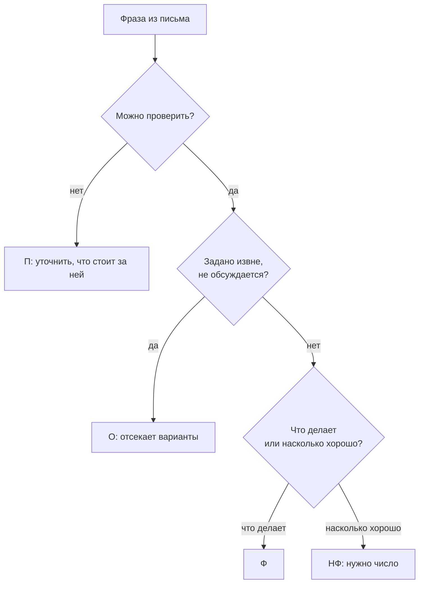

# 🔹 Сессия 11 · Неделя 03 · `0.SD.01` — Как думать об архитектуре

> [!abstract] Зачем
> Агент напишет код за минуты, но что важно — быстро, дешёво, безопасно — он за тебя не решит. Сегодня учимся превращать «сделай хорошо» в требования, которые можно проверить, и называть цену своего выбора. Результат прямо идёт в раздел «Требования» design doc полигона.
> 📰 **Из жизни:** 30.10 Vercel Labs выпустила `agent-desktop` 1.0.2: агент управляет настольными программами через дерево доступности ОС, а не по скриншотам — структура вместо пикселей ([документация](https://agent-browser.dev/desktop)). Что они выиграли и чем, по-твоему, заплатили?

**Время:** ~1,5 ч · **Дата выдачи:** 03.11


---

## 📋 Мини-тест по прошлой сессии *(Сессия 10 · `0.SEC.01`)*

> [!warning] Тест — без подсказок Тьютора и без поиска
> Не знаешь — так и напиши: «не знаю» — тоже ответ. Проверит Ментор вместе с этой сессией; от результата зависит, закроется ли `0.SEC.01` (2 из 3).

1. [x] `.env` с API-ключом лежит в `C:\Projects\second-brain`. Claude Code запущен в этой папке в режиме Manual (в настройках — `default`), правил `deny` нет.
   а) Прочитает ли агент `.env` без вопроса?
   б) Кто ещё, кроме тебя и агента, может дотянуться до ключа? Назови одного и как именно.
   **Ответ:**
   а) Да
   б) Сервер, библиотеки
   ✍️ продиктовано

2. [x] Логин и пароль бухгалтера уже украдены. В 3 часа ночи с ними входят в VPN.
   а) Какая это буква STRIDE?
   б) Твоя мера с шага 3: вход с недоверенного IP и устройства блокируется до апрува админа. Назови один способ, которым злоумышленник с этим паролем всё же пройдёт. Одно предложение.
   **Ответ:**
   а) E - расширение прав (я до сих пор так считаю), поскольку под VPN агент имеет доступ к корпоративной файловой системе. S, быть может, потому что злоумышленник для системы - бухгалтер
   б) Если злоумышленник прокинет тунель или RDP через устройство бухгалтера
   ✍️ продиктовано

3. [x] Через месяц ты нашёл в заметке скрытую инструкцию для агента и не можешь выяснить, с какого сайта и когда она пришла.
   а) Какая это буква STRIDE?
   б) Одна дешёвая мера в скрипте копирования статей, которая решила бы это.
   **Ответ:**
   а) R
   б) сохранять данные источника (в идеале метаданные со страницы, но хз, как это делается)
   ✍️ продиктовано

---

## 🔥 Разминка (по желанию, ~8 мин)

1. [x] 🃏 **Карточки** (5 мин): в Obsidian — команда «Spaced Repetition: Review flashcards from all notes», в окне колод выбери `Фаза0` и пройди те, что подошли по сроку. Больше 30 — не обязательно все; нет ни одной — пропусти пункт.
   **Ответ:** готово
   ✍️ продиктовано

2. [x] **Микрозадача на 1С** (полиглот; ответ текстом, запуск в [OneScript](https://github.com/EvilBeaver/OneScript) — по желанию. Код Ментор не прогонял: платформы под рукой нет). Функция получает массив статусов бэкапов и считает, сколько каких. У `Соответствие` чтение отсутствующего ключа возвращает `Неопределено`. Допиши тело цикла, 1–3 строки.
   ```bsl
   Функция СчитатьСтатусы(Статусы)
       Счётчики = Новый Соответствие;
       Для Каждого Статус Из Статусы Цикл
           // твой код
       КонецЦикла;
       Возврат Счётчики;
   КонецФункции
   ```
   Вход `ok, ok, fail` → `ok` = 2, `fail` = 1. Пустой массив → пустое соответствие.
   **Ответ:**
   ```bsl
   Если Счётчики.Получить(Статус) = Неопределено Тогда
       Счётчики.Вставить(Статус, 1);
   Иначе
       Счётчики.Вставить(Статус, Счётчики.Получить(Статус) + 1);
   КонецЕсли;
   ```
   ✍️ продиктовано

---

## 🔮 Предскажи (2 мин, не оценивается)

В спеке полигона: «чтение заметки — до 100 мс». Ты запускаешь в PowerShell `python -m cli read заметка.md` и секундомер показывает 140 мс. Требование нарушено? Что бы ты проверил первым?
**Ответ (догадка до материалов — ошибаться можно; вернёшься к ней в «Своими словами»):**
Путь к заметке: сколько вложений подпапок до неё
✍️ продиктовано

---

## 📚 Материалы

> [!tip] 📌 Минимум для заданий — ~15 мин
> Идём так: пункт → задание → следующий пункт. Сквозной пример — снова «отчёт о бэкапах» из Сессии 10; бот «Тёплого дома» разбираешь в заданиях.

### М1. Четыре вида фраз в требованиях

**Зачем.** Заказчик пишет одним абзацем всё вперемешку. Если не разделить, агент и ты решаете разные задачи: одни фразы делаются кодом, другие выбирают устройство системы, третьи запрещают варианты.

Пример — начальник смены пишет про отчёт о бэкапах:

| Фраза | Вид | Как понять |
|---|---|---|
| «Скрипт считает ошибки и шлёт письмо» | **Функциональное (Ф)** | Что система **делает** |
| «Письмо приходит до 7:00 в 99 днях из 100» | **Нефункциональное (НФ)** | **Насколько хорошо** делает: скорость, надёжность, стоимость, безопасность |
| «Только через почтовый сервер компании» | **Ограничение (О)** | Задано извне и не обсуждается: закон, приказ, бюджет, что умеет команда |
| «Чтобы письмо выглядело солидно» | **Пожелание (П)** | Проверить нельзя. Спроси, что за этим стоит, или не бери |

Главное различие НФ и ограничения: **НФ можно торговать** (медленнее, зато дешевле), **ограничение нельзя**: оно вычёркивает вариант ещё до сравнения.



Одна фраза может нести два требования: «упавший бэкап — письмо за 15 минут» — действие (Ф) и срок (НФ). Требования ещё и **конфликтуют**: «отчёт на личный Gmail директора» и «данные не покидают компанию» вместе не выполнить. Заметить это — твоя работа, а выбрать — заказчика.

### М2. Как сделать требование проверяемым

**Зачем.** «Быстро» у каждого своё, и агент подгонит код под своё. Нужна запись, по которой спор решает замер.

**Формула: ситуация → реакция → мера → как мерим.**

| Было | Стало |
|---|---|
| «Отчёт надёжный» | Ночью, если журнал повреждён (**ситуация**), скрипт шлёт письмо «отчёт не собран» (**реакция**) в 100% случаев (**мера**); проверка: тест с битым журналом (**как мерим**) |
| «Поиск быстрый» | На хранилище в 5 000 заметок (**ситуация**) поиск возвращает результат (**реакция**) за 300 мс в 95 запусках из 100 (**мера**); мерим функцию ядра, 100 запусков, не запуск процесса (**как мерим**) |

Два приёма, которые нужны для заданий:

- **«Среднее» обманывает.** Девять ответов по 10 мс и один на 5 секунд дают среднее 509 мс, хотя ни один ответ так не работал. Поэтому пишут «в 95 случаях из 100».
- **Проценты — это минуты.** Доступность считается в простое. Пример: окно — 5 рабочих дней по 8 ч, это 40 ч = 2 400 мин; цель 99,5% разрешает простой `2 400 × 0,5% = 12 мин`. Цель 99,9% за тот же срок — 2,4 мин. Каждая девятка дороже прошлой, поэтому сначала спроси, какое окно нужно на самом деле.

> [!danger] 🗡 Как это ломают
> Чего нет в требованиях, то не защищается. Нет лимита на запросы и токены — кто-то или зациклившийся агент сжигает бюджет API: OWASP называет это [Unbounded Consumption](https://genai.owasp.org/llmrisk/llm102025-unbounded-consumption/) (редакция 2025). «Журнал вырос до 50 ГБ» из Сессии 10 — та же история: лимит размера — тоже требование.

### М3. Компромисс: выбрал, выиграл, заплатил

**Зачем.** Richards и Ford называют это первым законом архитектуры: всё — компромисс. Если цены не видно, значит, её ещё не нашли.

Порядок всегда один:


Пример: как начальник смены узнаёт о бэкапах. Варианты — письмо скрипта; дашборд в Grafana; SaaS-мониторинг. Ограничение «данные не покидают компанию» вычёркивает SaaS. Важно: узнать до 7:00 и не держать новый сервер. Итог:

`Выбрал письмо вместо Grafana · выиграл: 2 часа работы, нового сервера нет · заплатил: нет истории и графиков · откатить: легко`

**Обратимость решает, сколько думать.** Письмо заменить легко, поэтому можно решить за минуту. Формат хранения, по которому накопились годы данных, или архитектура, где секреты уже разошлись по копиям, — трудно, тут стоит посидеть. Эту же форму строки ты уже видел в [[Фаза 0/Проекты/Полигон/Решения|журнале решений полигона]].

> [!info]- 🔍 Глубже — по желанию, ~25 мин — раскрыть
> - [Quality Attributes — глава Continuous Architecture in Practice (InformIT)](https://www.informit.com/articles/article.aspx?p=3128836&seqNum=3) — сценарии «стимул, реакция, измерение» и почему нефункциональные требования двигают архитектуру *(проверено: 03.11)*
> - [Конспект «Fundamentals of Software Architecture»](https://danlebrero.com/2021/11/17/fundamentals-of-software-architecture-summary/) — короткий конспект книги, первый закон там есть *(проверено: 03.11)*; [сама книга Richards & Ford, O'Reilly](https://www.oreilly.com/library/view/-/9781098175504) *(найдена поиском 03.11, текст не открывал)*
> - `Шаблоны/Design doc.md`, раздел 2 — куда это всё ляжет

---

## ✏️ Задания

**Дано для заданий 1–3.** Ты инженер инфраструктуры в ООО «Тёплый дом» (вымышленная компания, 400 сотрудников, та же, что в Сессии 10). 40 серверов, бэкапы идут ночью, журналы лежат на внутреннем файловом сервере. После разговора про атаку начальник ИТ прислал письмо:

> 1. Нужен бот в Telegram: спрашиваю «что с бэкапами?» — получаю сводку за ночь.
> 2. Команда `/details <сервер>` показывает последние 20 строк журнала этого сервера.
> 3. Чтобы работало быстро.
> 4. Чтобы падало как можно реже, особенно с 8 до 10 утра, мы тогда и смотрим.
> 5. Имена серверов и строки журналов за периметр компании не уходят — приказ службы ИБ.
> 6. Бюджет — до 15 000 ₽ в месяц.
> 7. Пишем на Python: другой язык у нас никто не поддержит.
> 8. Чтобы выглядело нормально, не как у всех этих ботов.
> 9. Если бэкап ночью упал, бот сам пишет дежурному в течение 15 минут.
> 10. Чтобы посторонние не видели.

1. [x] **Разбери письмо.**
   📖 **Сначала:** [[#М1. Четыре вида фраз в требованиях|М1]]
   🧾 **Что сдать:** а) таблица по 10 пунктам: `№ · вид (Ф / НФ / О / П) · почему — 3–7 слов`. Если в пункте два вида — напиши оба. б) Два пункта письма, которые нельзя выполнить вместе: какие и почему, одно предложение. в) Какой один вопрос ты задашь начальнику, чтобы решить этот конфликт?
   **Образец строки** (на другом случае): `Письмо приходит до 7:00 · НФ · про срок, есть число`.
   **Критерий сдачи:** все 10 пунктов; НФ и О не перепутаны в пунктах 5, 6, 7; конфликт назван через то, куда уходят данные; вопрос к начальнику такой, что по ответу можно выбрать решение.
   **Ответ:**
   а)
   1. Ф — что система делает
   2. Ф — что система делает
   3. П — необходимо уточнить, как быстро должен скрипт отдавать ответ в телеграмм. После — НФ — при запросе к боту скрипт отправляет пользователю отчёт, который уходит в сеть за заданный промежуток времени, мерим передачей в скрипт команды через CLI и фиксируем время возврата локально, скорость интернета не мерим.
   4. НФ — с 8 до 10 утра сервис бота должен быть поднят и отвечать на запрос в n% случаев.
   5. О — невозможно реализовать, поскольку отчёты уходят в телеграмм. Предложение от меня: возврат ссылки на отчёт в корпоративном облачном хранилище с доступом по паролю
   6. О — описывает стоимость поддержания системы работоспособной
   7. О — отсекает любые другие ЯП
   8. П — размытое определение, необходимо уточнить
   9. Ф, НФ и П — описывает поведение системы, описывает время реакции системы на триггер, но не даёт ответа, куда должен прийти сигнал дежурному — нужно уточнить
   10. П — неизвестно, кто является посторонними, как и чего им не надо видеть — уточнить

   б) Наверное, речь о пунктах 1 и 5, поскольку данные уходят телеграмму, но я выше описал, как можно это реализовать. И скорее всего речь так же о пунктах 2 и 5, поскольку решение с 1 и 5 не закрывает эту дыру.
   в) Удобно ли ему будет получать отчёт в формате, описанном в предложении в пункте 5, как и удобно ли получать посредством корпоративной почты или ИБ закроет глаза на утечку данных в телеграмм. Касательно 2 и 5 — будет ли ему удобно в качестве альтернативы получать ссылку на файл журнала с доступом по паролю?
   ✍️ продиктовано

2. [x] **Сделай проверяемым.**
   📖 **Сначала:** [[#М2. Как сделать требование проверяемым|М2]]
   🧾 **Что сдать:** а) Пункты 3, 4 и 10 — каждый одной строкой по формуле `ситуация → реакция → мера → как мерим`. Числа выбери сам, это твоё предложение начальнику. б) Для пункта 4 расчёт: окно — 21 рабочий день с 8 до 10; выбери цель в процентах и посчитай разрешённый простой в минутах, по шагам. в) Одно предложение: как изменится эта цифра, если начальник потребует цель на одну девятку выше, и что ты бы у него спросил.
   **Образец расчёта** — конец М2 (40 ч → 2 400 мин → 12 мин).
   **Критерий сдачи:** в каждой строке есть число или точный признак, по которому видно «да» или «нет»; пункт 10 — не «защищено», а что именно проверяем; расчёт по шагам.
   **Ответ:**
   а)
   3 — при запросе к боту скрипт отправляет пользователю отчёт, который уходит в сеть за 100мс, мерим передачей в скрипт команды через CLI и фиксируем время возврата локально тестом, скорость интернета не должна влиять на результат замера.
   4 — Тут сразу два вижу: I) в промежутках с 8 до 10 утра при попытке выключить бота должно отображаться служебное сообщение, которое говорит администратору, что в промежутке с 8 до 10 часов крайне не рекомендуется выключать службу бота и рекомендует перенести время запуска. Мера — отображение служебного сообщения при попытке выключить службу, измеряем в промежутке с 8 до 10 утра. II) при обращении к боту он отвечает пользователю в 95% случаев. Мера — получение возврата скрипта пользователем в телеграмме, мерим на мок-отчёте через доступ к сессии телеграм тестом
   10 — при переходе по ссылке в облачное хранилище к файлу, файл запрашивает пароль и даёт просмотреть содержимое ТОЛЬКО при правильно введённом пароле, мера — при попытке открыть/скачать файл в облачном хранилище требуется ввод пароля, мерим тестом на мок файле с тест-кейсами для верного/неверного пароля

   б) Вообще некорректное задание, как по мне: тут простой не роляет, нужен доступ в конкретные часы конкретных дней. Но если хотите: 7*24=168; 168/100 = 1,68; 10-8=2; 2*5=10; 10/1,68 = 5,95% работоспособен. 10*60=600; 168*60=10.080; 10.080-600=9.480 минут простоя в неделю. Да, 21 день не использовал, но просто нахуя это тут ваще надо? Вот всё это задание? Ваще не тот пример. Ладно бы ему объёмы надо было обрабатывать — понятно, нахуя считать допустимый простой за промежуток времени. Эта залупа должна работать в конкретные часы, а просто следует ей работать вообще постоянно, но в конкретные часы она жб должна пахать. Если речь идёт о том, что рабочий день — 14 часов, то окей, но блять другое в требованиях было изначально дауны блять: 95% цель, 14*21=294; 294*60=17.640; 17.640/100*5=882 — количество минут простоя в рамках 5% за 21 день.

   в) 723 минуты простоя. Понятно, что речь идёт о том, что "стоимость каждой девятки последующей гораздо выше", и не даром c-rust ребята миллисекунды дрочат годами, но тут я бы спросил, готов ли он ждать готовности в 10 раз дольше за то, чтоб бот точно был доступен на два часа больше в месяц, чем обычно.
   ✍️ продиктовано

3. [x] **Выбери и назови цену.**
   📖 **Сначала:** [[#М3. Компромисс: выбрал, выиграл, заплатил|М3]]
   🧾 **Дано.** Начальник ответил: в Telegram идёт только число без имён («3 из 40 упало»), `/details` — в веб-кабинете внутри сети, через VPN. Осталось решить, что собирает сводку. Цифры условные, их дал подрядчик:

| | А. Шаблон без LLM | Б. Локальная модель | В. Облачная LLM |
|---|---|---|---|
| Работа до запуска | 8 ч | 24 ч | 12 ч |
| Деньги | 0 ₽ | видеокарта 120 000 ₽ разово | ~800 ₽ в месяц |
| Ответ на «что с бэкапами?» | 0,1 с | 6 с | 3 с |
| Вопрос свободным текстом | нет, 5 готовых команд | да | да |
| Что уходит наружу | ничего | ничего | строки журналов с именами серверов |

3. **Что сдать:** а) Какой вариант вычёркивает ограничение, каким именно пунктом письма. б) Для оставшихся вариантов — таблица из 2–3 важных НФ, которые ты выбрал из своих строк в задании 2, и почему именно они. в) Итог одной строкой: `выбрал … вместо … · выиграл … · заплатил … · откатить: легко / трудно`. г) Одно предложение: что должно случиться, чтобы ты передумал.
   **Образец строки в)** — конец М3.
   **Критерий сдачи:** вычеркнутый вариант — со ссылкой на номер пункта; цена — конкретная, и это то, что ты теряешь, а не «ну, есть минусы»; условие в г) можно будет проверить.
   **Ответ:**
   а) в — 5
   гипотетически а, если "что с бэкапами?" не считать командой, но это уже волоёбство какое-то, потому а оставляю
   б) скорость: а выигрывает б, поскольку быстрее как в реализации, так и в срабатывании
   надёжность/простота — а выигрывает, поскольку детерминирован, проще в реализации, поскольку не требует обеспечивать работоспособность LLM, которая один хуй по итогу будет собирать сводку с помощью скрипта
   бюджет/железо: снова а, потому что это суперсильная экономия как времени, так и денег на железе, если сравнивать с б
   в) выбрал а вместо б — выиграл в скорости, надёжности, удобстве поддержания работоспособности, времени и деньгах — заплатил возможностью не нажимать две кнопки, а вбивать по смыслу тот же текст с этих кнопок ручками — откатить: легко
   г) конец света или "просто хотим агента, сделай пожалуйста, нам ваще похуй всё остальное, с нас премия". Ну нет никаких причин передумывать. Да и никто не мешает в дальнейшем масштабировать: скрипт сборки и отправки сводки останется тем же, просто если потом решат сделать так же из бота канал связи с агентом с доступом к журналу и данным о бэкапах, то этот скрипт становится ещё и инструментом, и никак не мешает накручивать дальше
   ✍️ продиктовано

4. [x] **Требования полигона — для design doc.** Это заготовка раздела 2 в шаге 2 практики.
   🧾 **Дано:** твоя спека `specs/01-read-note-cli.md` (критерии 100 мс и 50 МБ там уже есть), [[Фаза 0/Проекты/Полигон/Полигон|карточка полигона]], твой раздел угроз из заданий 1–3 Сессии 10. **Что сдать:** таблица `вид · требование · как проверить`: 2–3 Ф, 3 НФ, 2 О, плюс 2 строки «что не делаем». Затем одна строка: какое из решений в [[Фаза 0/Проекты/Полигон/Решения|журнале решений]] сильнее всего ограничит тебя на неделе 8 (MCP) и чем.
   **Образец строки:** `НФ · запрос к боту в окно 8–10 отвечает за 2 с в 95 случаях из 100 · 100 запросов тестом, считаю 95-й`.
   **Критерий сдачи:** у всех НФ есть число и условие замера; среди НФ или О есть хотя бы одно про данные или ключ (не только скорость); «что не делаем» — то, что тебя реально будет соблазнять.
   **Ответ:**
   **Функциональные (Ф):**
   - Ф · Система может читать содержимое файлов в формате .md по относительному пути · Тест с возвратом известной строки из файла в подпапке хранилища по переданному пути, только mock'и
   - Ф · Система может искать вхождения данных в файлы .md хранилища · Тест с пустым/строковым возвратом при поиске конкретной строки/символа, только mock'и. При непустом возврате указаны пути к документам с вхождениями и их названия
   - Ф · Система выводит результаты поиска/чтения и ошибки в stdout · Тест с выводом возврата известной строки из файла в подпапке хранилища по переданному пути/возврата поиска вхождения символа/строки в файлы с расширением .md внутри хранилища, только mock'и

   **Нефункциональные (НФ):**
   - НФ · Поиск по хранилищу с вложенностью подпапок 3, количеством файлов .md 80, общим количеством файлов 150, объёмом памяти 800Мб, общим количеством символов в файлах .md 2.000.000 выводит возврат поиска в stdout за 250мс · Проверка тестом с mock-данными
   - НФ · Чтение содержимого .md файла объёмом 500.000 символов и его вывод в stdout происходит за 100мс · Проверка тестом с mock-данными
   - НФ · Максимальный размер файла заметки для чтения — не более 10 МБ; попытка чтения файла более 10 МБ пресекается до вычитки в память с ошибкой размера (PayloadTooLargeError, код возврата 1) · Тест чтения mock-файла размером более 10 МБ, проверка вызова ошибки и 0 прочитанных байт содержимого
   - НФ · Обязательно приведение относительного пути к абсолютному и проверка его вхождения в хранилище с помощью метода resolve() класса Path библиотеки pathlib · Тест с передачей относительного пути на входе и возвратом абсолютного пути на выходе в mock-директории
   - НФ · Путь к хранилищу задаётся в файле .env, применённый путь проверяется инструментом · Тест на совпадение путей в .env и возвращаемого инструментом, при отсутствии пути в .env — EnvironmentError

   **Ограничения (О):**
   - О · Запрещено читать инструментами сервера файлы, которые не относятся к формату .md · Тест чтения с передачей путей до mock файлов различных расширений — на выходе PermissionError
   - O · Запрещена передача в инструменты путей, не находящихся в хранилище. Обязательно проверка вхождения пути в хранилище с помощью метода is_relative_to() класса Path библиотеки pathlib · Тест чтения mock файла, находящегося за пределами хранилища — на выходе PermissionError
   - О · Запрещён поиск вхождения строк/символов в документы, не находящиеся в хранилище · Тест поиска строки в mock-файле, содержащим искомую строку и лежащем рядом с mock-хранилищем, файлы которого искомую строку не содержат — на выходе пустой вывод

   **Что не делаем:**
   - Не реализуем инструменты изменения/создания/удаления файлов хранилища, функционал Read-Only
   - Не реализуем кеширование данных хранилища никаким образом

   **Влияние решения на неделю 8 (MCP):**
   Ядро — библиотека на python, а обвязка MCP уже вокруг библиотеки. Разделение логики, код работы с файловой системой не пишется напрямую внутри сервера, тестируются они поочерёдно: сначала поведение на ядре, потом вызов на MCP.
   ✍️ продиктовано

5. [x] **🔧 Руками: измерь и почини** (~15 мин, «сломай и почини»). Запускать в любой новой папке **вне хранилища**, нужен только Python 3.9+. Скрипт создаст файл 50 МБ — в конце удали его.

   Файл `nfr.py`:
   ```python
   import statistics, subprocess, sys, time
   from pathlib import Path

   LIMIT = 10 * 1024 * 1024  # лимит размера заметки: 10 МБ

   def make_note(path: Path, megabytes: int) -> None:
       path.write_text("строка заметки\n" * (megabytes * 1024 * 1024 // 28), encoding="utf-8")

   def too_big(path: Path) -> bool:
       return len(path.read_text(encoding="utf-8").encode("utf-8")) > LIMIT

   def measure(fn, runs: int = 15) -> str:
       times = []
       for _ in range(runs):
           t0 = time.perf_counter()
           fn()
           times.append((time.perf_counter() - t0) * 1000)
       return f"медиана {statistics.median(times):.2f} мс, худший {max(times):.2f} мс"

   small, big = Path("small.md"), Path("big.md")
   make_note(small, 1)
   make_note(big, 50)
   print("чтение 1 МБ:   ", measure(lambda: small.read_text(encoding="utf-8")))
   print("проверка 50 МБ:", measure(lambda: too_big(big)))
   print("запуск python: ", measure(lambda: subprocess.run([sys.executable, "-c", "pass"])))
   ```
   Шаги:
   а) Запусти `python nfr.py`. Запиши три строки вывода. У Ментора на Linux 03.11 порядок был такой: чтение — около 1 мс, проверка — около 100 мс, запуск — около 10 мс. На Windows запуск обычно заметно дольше, это нормально.
   б) Функция `too_big` читает весь файл, чтобы узнать его размер, и отказ большому файлу стоит дорого: это та самая проверка из спеки. Перепиши её одной строкой, чтобы файл не читался, через [`Path.stat().st_size`](https://docs.python.org/3/library/pathlib.html#pathlib.Path.stat). Запусти снова.
   в) Две строки: сколько стоит отказ большому файлу до и после; какую долю от 100 мс съедает запуск Python **у тебя**, и что из этого следует для критерия в твоей спеке.

   **Критерий сдачи:** оба вывода целиком, строка `too_big`, ответ в) с числами + 2–3 строки: что увидел, где пригодится, что мешало.
   **Ответ:**
   а) Вывод до исправления:
   ```text
   чтение 1 МБ:    медиана 2.94 мс, худший 3.30 мс
   проверка 50 МБ: медиана 177.99 мс, худший 200.46 мс
   запуск python:  медиана 24.05 мс, худший 53.26 мс
   ```

   б) Функция `too_big` через `Path.stat().st_size`:
   ```python
   def too_big(path: Path) -> bool:
       return path.stat().st_size > LIMIT
   ```
   Вывод после исправления:
   ```text
   проверка 50 МБ (stat): медиана 0.01 мс, худший 0.38 мс
   ```

   в)
   1. До оптимизации отказ стоил ~178 мс (вычитывание и декодирование всего 50 МБ файла в память), после — ~0.01 мс (мгновенное чтение размера из метаданных файловой системы, ускорение в ~17 000 раз, 0 байт чтения файла).
   2. Запуск самого интерпретатора Python на Windows съедает медианно 24.05 мс (до 53.26 мс в худшем случае) — это от 24% до 53% от всего бюджета в 100 мс. Отсюда прямой вывод для спеки полигона: критерий «до 100 мс» нужно формулировать как «мерим время вызова функции ядра `reader.read_note()`, а не запуск процесса CLI снаружи», иначе накладные расходы запуска интерпретатора на Windows съедят половину допустимого времени.
   Что увидел: чтение метаданных через stat спасает от DoS по памяти и задержкам. Где пригодится: в первой проверке размера файла в `src/reader.py` (шаг 3 практики). Мешало: существенный оверхед создания процесса в Windows.
   🤖 написал агент, проверил я

6. [x] **Своими словами** (3–5 предложений). Коллега говорит: «Напишу агенту „сделай быстро и надёжно“, он сам разберётся». Что ты ему ответишь? Был ли ты прав в «🔮 Предскажи» — если нет, где ошибся?
   **Критерий сдачи:** 3–5 предложений, есть пример с числом.
   **Ответ:**
   Он-то разберётся, но так, как сам захочет. Тебя этот результат навряд ли устроит. И если с таким же подходом решишь этот результат улучшать — получишь производственный ад.
   Я ошибся. Подпапки не при чём, я бы проверил, с какого и по какой момент считается это время. Запуск Python на Windows съедает 24–53 мс, поэтому требование к самому чтению не факт, что нарушено.
   ✍️ продиктовано

---

## 🛠 Связь с практикой

После этой сессии открыт шаг 2 — design doc на страницу: требования из задания 4, угрозы из Сессии 10 → [[НЕДЕЛЯ#🛠 Практика недели]]. Шаг 1 (доправка спеки, пункт б про условия замера) — задание 5 даст для него числа.

---

## 🟨 Мостик к интересу *(по желанию)*

`PAI`: на пирамиде из `0.PAI.01` остановить насос надо за миллисекунды, а ERP отвечает за смену. Это нефункциональное требование, и оно решает, на каком уровне живёт логика. Какое требование из письма начальника ИТ решает примерно так же, где работает бот? Одна строка.
**Ответ:**
Бюджет — 15.000, данные не выходят за пределы инфраструктуры компании, быстрое время ответа
✍️ продиктовано

---

## ✍️ Отчёт

- **Время (сколько ушло):** ~90 мин
- **Трудности и вопросы:** нет, замеры показали реальный оверхед Windows на запуск процесса
- **Подсказки Тьютора:** разобрано 6 из 6 заданий; мини-тест — без подсказок (ур. 0); задания 1–4, 6 — ур. 0; задание 5 — ур. 4 (запуск бенчмарка и замер nfr.py выполнен агентом по поручению, проверено пользователем)

---

## 📋 Мини-тест по этой сессии
*(в начале [[Сессия 12 — 0.AIN.06|Сессии 12]])*

---

## ✅ Проверка *(заполняет Ментор)*

*04.11 (ср) · проверил: Claude Opus 5.5 · автозапуск*

> [!warning] Пересмотр 04.11 по разбору пользователя: 5/10 → 6/10 — ошибки проверки (правило 23)
> - **Задание 5:** поставил 🟡 «по правилу 28, ур. 4». Но Тьютор решение не разбирал: бенчмарк по твоему поручению запустил агент, это пометка `🤖`, и она под ответом есть. По правилу 28 `🤖` оценивается по ревью: критерий выполнен — ✅, без углубления.
> - **Оценка:** «нестыковка НФ с заданием 5» стояла с меткой 💡, а тянула балл вниз. Оценку двигают только ❌.
> - **Задание 4, НФ про `resolve()`:** причина «без числа» неверна. Не годится она потому, что это способ сделать, а не свойство системы. Само свойство — нормальное НФ безопасности с признаком «да/нет» (разбор ниже).
>
> **Ошибки выдачи Ментора (правило 23): на балл не влияют**
> - **2в, «на одну девятку выше»:** в М2 не сказано, что считать девяткой при цели 95%. Ты буквально прибавил девятку: 95,9% → 4,1% от 17 640 = 723 мин. Арифметика верна, минуса нет. Обычно это значит «простой в 10 раз меньше»: 95% → 99,5%.
> - **2б, зачем считать:** М2 учит считать минуты, но не говорит, что с ними делать. Твоё «нахуя» — справедливый вопрос, ответ должен был быть в материале. Он — ниже, в разборе.

**Главное.**
- **Держится:** письмо разобрано верно, НФ и О не спутаны; конфликт с Telegram найден, и выход ты предложил почти тот же, что потом ответил начальник; шаблон выбран с точной ценой; «скрипт сводки потом станет инструментом агента» — сильный ход.
- **Поправить:** окно в 2б — 2 часа в день, а не 14; НФ полигона мерить функцией ядра и с долей запусков, а не «вывод в stdout за 100 мс».
- **Взять дальше:** в design doc — только НФ с условием замера; задания «🔧 Руками» запускать самому.

### Мини-тест по Сессии 10 (`0.SEC.01`) — 2,5 из 3

| № | Итог | Комментарий |
|---|---|---|
| 1 | ¾ | а) ✅ верно. б) «Библиотеки» — верно, это тот самый процесс сервера с зависимостями. ❌ Требовалось: «назови одного и как именно». Написано: «Сервер, библиотеки». Как именно — нет: библиотека работает в том же процессе, что и сервер, и видит те же переменные окружения и файлы. Перечитал: не закрыто |
| 2 | ¾ | а) 🟡 ❌ Вопрос: «Какая это буква STRIDE?» Написано: «E … S, быть может». Главная — S, и твоя вторая половина причину называет точно: «для системы — бухгалтер». Почему не E — ниже. б) ✅ Туннель или RDP через устройство бухгалтера — верный обход: проверка видит доверенное устройство |
| 3 | 1 | а) ✅ R. б) ✅ Сохранять источник. «Как это делается» просто: URL и дата уже есть у скрипта в момент копирования, плюс хеш текста |

**E или S.** Ты пишешь, что до сих пор считаешь E, потому что через VPN открывается файловая система. Но файлы открывает тот же доступ, что есть у самого бухгалтера: прав не стало больше, чем у учётки. E — это когда получают **больше**, чем положено учётке: бухгалтер стал админом. Если у бухгалтера лишний доступ к файлам — это отдельная проблема прав, но не шаг этой атаки. Карточка — ниже.

**Итог:** `0.SEC.01` — ✅ закрыт 04.11.

### Разминка

- **Карточки** — пройдены.
- **1С** ✅ — логика верная: отсутствующий ключ → `Вставить(Статус, 1)`, иначе +1. 💡 Можно короче: `Значение = Счётчики.Получить(Статус)` один раз, затем условие; читать `Соответствие` дважды не нужно. Сам код не прогонял: платформы нет.

### Вердикт по заданиям

| # | Задание | Статус | Что верно | Что не так / чего не хватает | Подсказки |
|---|---|---|---|---|---|
| 1 | Разбор письма | ✅ | Все 10 пунктов; 5, 6, 7 — О; пункт 9 разложен на Ф + НФ, и сам заметил, что не сказано, куда идёт сигнал; конфликт назван через то, что данные уходят Telegram; конфликт 2–5 — сам | 💡 Просили один вопрос, у тебя два с вариантами. По ответу выбрать решение можно, поэтому критерий выполнен. Короче: «Что важнее — Telegram или строки журнала внутри?» | ур. 0 |
| 2 | Сделай проверяемым | 🟡 | а) Во всех строках есть мера или признак; пункт 10 проверяет конкретное: без пароля файла нет; нашёл, что 95% и окно — вещи разные. в) Вопрос начальнику верный: цена против двух часов в месяц | ❌ 2б. Требовалось: «окно — 21 рабочий день с 8 до 10». Написано: «14\*21=294 … 882». Перечитал весь ответ, расчёта на 2 часа нет, хотя в журнале Тьютора за сессию он есть. 💡 Пункт 4, II: в строке нет окна 8–10, а это и есть требование письма. 💡 Пункт 10 закрывает ссылку, но не самого бота: не хватает «отвечает только ID из списка» | ур. 0 по отчёту |
| 3 | Выбери и назови цену | ✅ | В — пункт 5; цена конкретная: нет свободного текста, откат лёгкий; сам увидел, что сводка от скрипта останется инструментом для будущего агента; заметил, считается ли «что с бэкапами?» командой | 💡 б) без чисел из таблицы: 0,1 с против 6 с и 8 ч против 24 ч — так довод сильнее. 💡 г) Условие «просят агента» проверить можно, но есть и измеримое: например, доля запросов, которых нет в 5 командах. «Нет причин передумывать» — значит, условие ещё не нашёл | ур. 0 |
| 4 | Требования полигона | ✅ | Ф, НФ, О и «что не делаем» — сверх объёма; у трёх НФ есть числа и размер данных; размер отсекается до чтения; про данные есть; соблазны реальные — кеш и запись; ограничение MCP названо | 💡 НФ про `resolve()` записано как способ («с помощью метода resolve()»), а не как свойство: см. разбор «НФ или решение». НФ про `.env` — это Ф (что делает при старте), а не «насколько хорошо». 💡 Остальное — см. разбор: как мерить и что с stdout | ур. 0 |
| 5 | 🔧 Измерь и почини | ✅ | `too_big` через `stat` верна; числа и вывод в) верны; следствие для спеки — верное, и уже в коммите (по твоему описанию в `НЕДЕЛЯ.md`) | `🤖`: запускал агент, ты проверил — засчитано по ревью, без углубления. ⚖ После правки показана одна строка из трёх; две другие не меняются, но критерий просил «оба вывода целиком». 💡 «Руками» — чтобы самому увидеть, как ведёт себя Windows: в следующий раз запусти сам | `🤖` (в отчёте записано как ур. 4) |
| 6 | Своими словами | ✅ | Ошибка в «Предскажи» названа сам; пример с числом: 24–53 мс | 💡 Коллеге можно дать, что делать: одно число вместо «быстро» | ур. 0 |
| — | Мостик к `PAI` | ✅ | Пункт 5 и бюджет — верно | Без оценки | ур. 0 |

### Разбор

- **2б, как правильно.** `2 ч × 21 день = 42 ч = 2 520 мин`. При твоих 95%: `2 520 × 5% = 126 мин` за месяц. При 99,5%: 12,6 мин.
- **2б, твоё возражение «нужен доступ в конкретные часы, простой не роляет».** Ты прав насчёт сути: бот должен работать именно в эти часы. Именно поэтому окно и считается только по ним: простой ночью вообще не идёт в счёт, сколько бы он ни длился. Твои 5,95% за неделю показывают то же: нужны всего 10 часов из 168.
- **Зачем цифра.** Её можно положить на стол начальнику: «95% — это 126 минут в месяц, то есть одно сорванное утро целиком. Устроит?» Он скажет нет — считаем 99,5%: 12,6 минуты: один перезапуск в окне съедает их почти целиком. Тот же расчёт говорит, когда перезапускать: вне окна это ничего не стоит. Твоя мера I с предупреждением при остановке службы — про это же, хотя в цифру и не входит.
- **14 часов.** Откуда они, в ответе не сказано: «с 8 до 10» в письме — утра. Если прочитал как до 22:00, 882 при таком окне посчитано верно. Метка ❌ только за то, что окно не то.
- **Журнал Тьютора.** В нём записано «окно 42 ч, 126 мин, 12,6 мин, ур. 0», а в файле другое. Оценка — по файлу. Если расчёт на 42 ч был твой и просто не попал в ответ, скажи, и я сниму минус (спор — по сценарию B).
- **4, НФ или решение (`resolve()`).** НФ отвечает на «насколько хорошо», а не на «как сделать» (М1). «Привести путь через `resolve()`» — это способ, ему место в спеке и design doc: завтра его можно заменить на `realpath`, и требование от этого не изменится. Само свойство за ним такое: `НФ (безопасность) · путь вне хранилища, включая ../ и симлинк наружу, — отказ, прочитано 0 байт · тест на 3 таких пути`. Число тут не обязательно: для безопасности мера — точный признак «да/нет», как в критерии задания 2. Что в М1 стоит «НФ: нужно число», — неточность материала. Проверка «да/нет» у тебя была, но проверяла способ (что возвращается абсолютный путь), а не свойство (что чужой файл не прочитан).
- **4, как мерить.** В НФ стоит «вывод в stdout за 100 мс». Но в задании 5 ты сам вывел: запуск Python съедает 24–53 мс, поэтому мерить надо функцию ядра. Тот же коммит шага 1 это фиксирует, а требование здесь с ним расходится. В design doc: `read_note() на файле 500 000 символов — 100 мс в 95 запусках из 100`. И запас большой: 1 МБ у тебя читается за 2,94 мс, поэтому 100 мс почти ничего не проверяет. Либо ужесточить, либо считать это верхней границей.
- **4, stdout.** Ф-3: «ошибки в stdout». На неделе 8 это сломает MCP: при транспорте stdio в stdout идут только сообщения протокола. Ошибки — в stderr, а в ядре — исключения, печатает их только CLI. Лучше решить сейчас.
- **4, mock'и.** «Только mock'и» — в кейсах для реальной файловой системы они опасны: симлинк, размер и кодировку mock не проверит. Подходят настоящие временные файлы в синтетическом хранилище, как и решено в карточке полигона.

### Что получилось хорошо

- Задание 1: твой выход «ссылка на внутренний ресурс вместо строк в Telegram» почти совпал с ответом начальника в задании 3.
- Задание 3: шаблон не закрывает дорогу агенту, а готовит ему инструмент. Это и есть обратимость из М3.
- Задание 2: ты сам увидел, что доступность и окно — разные вопросы. Спор с заданием дельный, хотя расчёт и ушёл не туда.
- «Предскажи»: прямо написал, где ошибся.

**Оценка: 6/10** *(пересмотрено 04.11, было 5/10)*. Одно 🟡 — 2б (окно) — снимает с целевых 5. Возвращают и поднимают: задание 3 (скрипт как будущий инструмент агента), задание 1 (свой выход из конфликта, совпавший с решением заказчика) и объём задания 4 сверх просьбы. Задание 5 засчитано по `🤖`, в углубление не идёт. Замечания 💡 и ошибки выдачи в оценку не шли.

**Время:** ~90 мин · план ~1,5 ч — норма.

**Занятия:** `0.SD.01` — ⏳ ждёт мини-тест (в начале Сессии 12). `0.SEC.01` — ✅ закрыт 04.11 (мини-тест 2,5/3).

**Долги:** —

**→ Фокусы** *(в `ЗАМЕТКИ.md`)*: окно доступности → мини-тест Сессии 12; НФ: что мерим и доля запусков → мини-тест и шаг 2; условие «передумаю» с числом → мини-тест; stdout и stderr → шаг 3, неделя 8; S или E — первая буква входа по чужому паролю → карточка.

**Теги:** #требования #нфр #компромисс #доступность #замер #окно

---

## 🃏 Карточки для повторения

#flashcards/Фаза0/SD

Четыре вида фраз в требованиях: как отличить?
?
| Вид | Что это | Пример (отчёт о бэкапах) | Ещё пример (бот со сводкой) |
|---|---|---|---|
| Ф, функциональное | Что система делает | Скрипт шлёт письмо с числом ошибок | Команда `/details` показывает строки журнала |
| НФ, нефункциональное | Насколько хорошо делает; можно торговать | Письмо до 7:00 в 99 днях из 100 | Ответ за 2 с в 95 запросах из 100 |
| О, ограничение | Задано извне, не обсуждается, вычёркивает варианты | Только через почтовый сервер компании | Строки журналов не покидают периметр, приказ ИБ |
| П, пожелание | Проверить нельзя: спроси, что за ним стоит | «Чтобы выглядело солидно» | «Чтобы не как у всех этих ботов» |
<!--SR:!2026-11-26,14,290-->

Как считать допустимый простой, если сервис нужен только в определённые часы?::Только по этим часам. 2 ч в день × 21 день = 42 ч = 2 520 мин; при 99,5% — 12,6 мин за месяц. Простой вне окна в счёт не идёт.
<!--SR:!2026-11-26,14,290-->
Зачем считать простой в минутах, а не оставлять проценты?::Минуты можно показать заказчику, и он решит: 95% при окне 42 ч — это 126 мин, одно сорванное утро в месяц. Если не устроит — считаем следующую цель и её цену.
<!--SR:!2026-11-27,15,290-->
Что значит «на одну девятку выше»?::Обычно — простой в 10 раз меньше: 99% → 99,9%. Для цели без девяток, например 95%, договорись о числе заранее: чаще всего имеют в виду 99,5%.
<!--SR:!2026-11-28,16,290-->
Что записать в требование скорости, кроме числа?::Какой объём данных, какая доля запусков должна уложиться (95 из 100), что мерим: функцию или запуск процесса. Среднее обманывает: один ответ на 5 с прячется в нём.
<!--SR:!2026-11-28,16,290-->
Запуск Python на Windows — 24–53 мс, требование — 100 мс на чтение. Что мерить?::Функцию, а не запуск процесса: иначе половину бюджета съест старт интерпретатора, который к чтению не относится.
<!--SR:!2026-11-26,14,290-->
Что значит «условие, при котором передумаю»?::Событие с числом, которое можно увидеть. Например: за месяц 20% запросов к боту не попадают в его 5 команд. Если условия нет, значит, цену решения ещё не посчитали.
<!--SR:!2026-11-27,15,290-->
Украли пароль бухгалтера, вошли в VPN. S или E?::S: система видит бухгалтера, а это другой человек. E было бы, если бы он получил больше прав, чем есть у самой учётки.
<!--SR:!2026-11-27,15,290-->
