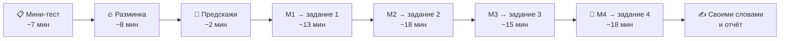
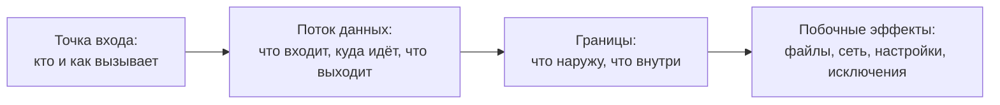

# 🔹 Сессия 12 · Неделя 03 · `0.AIN.06` — Чтение чужого кода

> [!abstract] Зачем
> Код всё чаще пишет агент, а принимать его тебе, и принять можно только то, что можешь объяснить (правило 11). Сегодня — как за 30 минут разобраться в незнакомых 200 строках и не читать их сверху вниз. Завтра на этом стоит ревью (`0.AIN.07`), а в пятницу — `reader.py` полигона.
> 📰 **Из жизни:** 01.11 DeepSeek выложил прототип `dsh-superagent`: агент-кодер сам берёт работу и открывает PR ([README](https://raw.githubusercontent.com/deepseek-ai/dsh-superagent-prototype/main/README.md)). Такой PR приходит без автора, у которого можно спросить. С чего бы ты начал его чтение?

**Время:** ~1,25–1,5 ч · **Дата выдачи:** 04.11



---

## 📋 Мини-тест по прошлой сессии *(Сессия 11 · `0.SD.01`)*

> [!warning] Тест — без подсказок Тьютора и без поиска
> Не знаешь — так и напиши: «не знаю» — тоже ответ. Проверит Ментор вместе с этой сессией; от результата зависит, закроется ли `0.SD.01` (2 из 3).

1. [x] Дежурный смотрит сводку бота с 7 до 9 утра, в месяце 22 рабочих дня, цель — 99%.
   а) Сколько минут бот может лежать в этом окне за месяц? По шагам.
   б) Ночью бот лежал 3 часа. Сколько минут из них идёт в этот счёт?
   **Ответ:**
   а) 2*22=44; 44/100=0.44; 0.44*60=26,4 минуты
   б) 0, нас интересует утренний срез. Ночью бот не так нужен
   ✍️ продиктовано

2. [x] В требованиях написано: «Поиск — за 250 мс. Проверка: тест». Перепиши строку так, чтобы спор решал замер: числа выбери сам.
   **Ответ:**
   На поиске в директории с 50 файлами общим объёмом 2.000.000 токенов время поиска не превышает лимит в 250мс, учитывая только время срабатывания ядра, не учитывая времени на его подъём. Критерий - тест, замеряющий время срабатывания ядра поиска по mock данным
   ✍️ продиктовано

3. [x] Ты выбрал бота на шаблоне с 5 командами вместо LLM. Напиши одно условие с числом, при котором ты передумаешь, и откуда возьмёшь это число.
   **Ответ:**
   Блять, я не передумаю, что за долбаёбский вопрос. Если вдруг LLM начнёт отдавать ответы быстрее маленьких скриптов, если локальные LLM станут супер-доступными, из-за чего вдруг решение станет стоить в пределах 15.000 рублей (из бюджета взял) с простым установщиком - тогда и то можно подумать, ибо нахуя, если скрипт детерминирован и справляется не менее точно, нежели LLM - 100%
   ✍️ продиктовано

---

## 🔥 Разминка (по желанию, ~8 мин)

1. [x] 🃏 **Карточки** (5 мин): в Obsidian — команда «Spaced Repetition: Review flashcards from all notes», в окне колод выбери все колоды и пройди те, что подошли по сроку. Больше 30 — не обязательно все; нет ни одной — пропусти пункт.
   **Ответ:** есть
   ✍️ продиктовано

2. [x] **Микрозадача на Bash** («полиглот», формат «прочитай и поправь»; ответ текстом, запуск в Git Bash или WSL — по желанию). В логах три строки `FAIL`, а скрипт печатает `Упало: 0`. Ментор прогнал 04.11 на Linux: именно так и печатает. Что не так и как поправить? Подсказка: каждая часть конвейера `|` работает в отдельном процессе.
   ```bash
   count=0
   cat logs/*.log | while read line; do
     if [ "$line" = "FAIL" ]; then
       count=$((count + 1))
     fi
   done
   echo "Упало: $count"
   ```
   **Что сдать:** одна строка — почему 0, и исправленный скрипт; любое решение, которое печатает 3.
   **Ответ:**
   Ноль - потому что count собирался в отдельном процессе, и когда цикл заканчивался - count обнулялся. Примерно как в Go с переменными функций.
   ```bash
   count=0
   while read line; do
     if [ "$line" = "FAIL" ]; then
       count=$((count + 1))
     fi
   done < <(cat logs/*.log)
   echo "Упало: $count"
   ```
   ✍️ продиктовано

---

## 🔮 Предскажи (2 мин, не оценивается)

Коллега ушёл в отпуск и оставил модуль на 200 строк: читает логины и пароли из файла. У тебя 30 минут, чтобы понять, можно ли подключать его к агенту. Что откроешь и посмотришь первым? А какую часть читать не станешь?
**Ответ (догадка до материалов — ошибаться можно; вернёшься к ней в «Своими словами»):**
Проверю файлы изменённые, запущу агентноское ревью, прогоню тесты. Ну, вопрос не совсем понял, но точно не буду читать неизменённые файлы.
✍️ продиктовано

---

## 📚 Материалы

> [!tip] 📌 Минимум для заданий — ~15 мин
> Идём так: пункт → задание → следующий пункт. Весь код и команды — здесь и в папке `код_сессия_12`.

**Что читаем.** Модуль `netrc` из стандартной библиотеки Python: 200 строк, читает файл `.netrc` с логинами и паролями к серверам. В файле формат простой: `machine сервер`, ниже `login` и `password`. Таким файлом пользуются, например, `curl` и `git` — это не игрушка, а настоящий чужой код.

В папке [[Фаза 0/Недели/Неделя 03 (02.11–08.11)/код_сессия_12/netrc_copy.py|код_сессия_12]] рядом с этой сессией лежат три файла:

- `netrc_copy.py` — точная копия [`Lib/netrc.py` из Python 3.13](https://github.com/python/cpython/blob/3.13/Lib/netrc.py), номера строк в заданиях — по ней;
- `sample.netrc` — учебный файл, пароли выдуманы;
- `run.py` — 5 строк, которые вызывают модуль.

**Скопируй все три в новую папку вне хранилища** и запускай там. Первая проба: `python run.py`. Ожидаемо:
```text
('svc-backup', '', 'Tr3nirovka-1')
('guest', '', 'guest-123')
```
Проверено 04.11 на Linux, Python 3.13 и 3.10. На Windows Ментор не запускал; разойдётся вывод — так и напиши.

### М1. Карта: с чего начать

**Зачем.** В чужом коде внимание быстро кончается: сверху вниз ты тратишь его на детали, смысла которых ещё не знаешь. Сначала нужна карта, потом детали, и только те, что нужны для твоего вопроса.

**Порядок один и тот же:**



Вот маленький пример. Скрипт отчёта о бэкапах, строки пронумерованы:

```python
1  import os, smtplib
2
3  def _count_errors(path):
4      with open(path, encoding="utf-8") as f:
5          return sum("ERROR" in line for line in f)
6
7  def send_report(path):
8      errors = _count_errors(path)
9      server = smtplib.SMTP(os.environ["SMTP_HOST"])
10     server.sendmail("backup@corp", "boss@corp", f"Ошибок: {errors}")
11
12 if __name__ == "__main__":
13     send_report("/var/log/backup.log")
```

| Шаг | В этом скрипте | Ещё пример: Telegram-бот со сводкой |
|---|---|---|
| Точка входа | Строка 12: запуск как программы (её вызывает cron) → `send_report` | Функция-обработчик, которую зовёт библиотека на сообщение: вызова в твоём коде может и не быть |
| Поток данных | путь → `_count_errors` → число → текст письма → почтовый сервер | Текст сообщения → разбор команды → чтение журнала → строка ответа → Telegram |
| Границы | Снаружи зовут `send_report`; `_count_errors` с подчёркиванием — внутреннее, договорённость, а не запрет | Команды бота — наружу, чтение журнала — внутри |
| Побочные эффекты | Читает файл (4), читает настройку (9), открывает сеть и шлёт письмо (9–10) | Пишет в чат, читает журналы с сервера |

Читать тела функций, пока не ясно, зачем они, не надо: `_count_errors` по имени и строке вызова уже понятна.

### М2. Куски и маяки: почему опытный читает быстрее

**Зачем.** Рабочая память держит несколько единиц, и опытный не умнее: у него единица крупнее. Об этом книга Фелин Херманс *The Programmer's Brain* (Manning, 2021); её короткий [конспект](https://understandlegacycode.com/blog/key-points-of-programmer-brain) ~10 мин *(проверено: 04.11; книгу целиком не читал)*.

- **Кусок (chunk)** — несколько строк, которые ты видишь как одно действие. Строки 4–5 выше — не «открыть файл, цикл, сумма», а один кусок «посчитать `ERROR` в файле». Ещё пример, другого рода: `for attempt in range(3)` плюс `time.sleep` плюс `except` читаются как «повтор с ожиданием», даже если писал незнакомый язык.
- **Маяк (beacon)** — имя или деталь, которая без чтения подсказывает, что здесь происходит. `lo`, `hi`, `mid` — скорее всего, бинарный поиск. Ещё пример, не про имя: `raise` в начале функции — там живёт проверка входа. Маяк может и обмануть: имя — гипотеза, её подтверждает код.

**Как читать:** пройдись по именам, выдвини гипотезу, проверь её по самому важному месту, остальное оставь закрытым.

### М3. Что код трогает снаружи

**Зачем.** Вред почти всегда на стыке с внешним миром, поэтому побочные эффекты ищешь не чтением всего, а поиском по файлу (`Ctrl+F`). Обычно хватает таких строк:

| Что ищем | Что это значит |
|---|---|
| `open(`, `read`, `write` | Файлы |
| `os.environ`, `expanduser`, `getenv` | Настройки и окружение: снаружи пришло то, что код считает своим |
| `requests`, `socket`, `smtplib`, `subprocess` | Сеть и запуск программ |
| `raise`, `except` | Что будет при ошибке и какие ошибки глотаются |
| `if` рядом со словами `security`, `check`, `allow` | Проверки: **при каких условиях они вообще срабатывают** |

Главный вопрос к любой проверке: не «есть ли она», а «когда её нет». В примере М1, если `SMTP_HOST` не задан, скрипт падает на строке 9, и письма нет совсем, — никто об этом не узнает.

> [!danger] 🗡 Как это ломают
> Чужой код прячут там, куда не смотрят. В бэкдоре [xz Utils (CVE-2024-3094)](https://orca.security/resources/blog/critical-xz-utils-supply-chain-compromise-affects-multiple-linux-distributions-cve-2024-3094/) вредоносная часть лежала в файлах тестов и сборки, а не в основном коде. Поэтому «читать только главный файл» — тоже решение с ценой.

### М4. Как увидеть, что реально вызывается

**Зачем.** Схема в голове — гипотеза, а модуль `trace` из стандартной библиотеки показывает факт: кто кого вызвал при этом запуске. Дополнительно ничего ставить не надо.

Пример вывода, на другом скрипте:
```text
report.<module> -> report.send_report
report.send_report -> report._count_errors
```
Читается: скрипт вызвал `send_report`, а она — `_count_errors`. Модуль честно показывает и всё служебное от самого Python, поэтому вывод фильтруем:
```powershell
python -m trace --trackcalls run.py | Select-String netrc_copy
```
Документация: [trace](https://docs.python.org/3/library/trace.html), [netrc](https://docs.python.org/3/library/netrc.html) *(проверено: 04.11)*. Строки с `codecs` и `importlib` в выводе можно игнорировать: это служебное.

> [!info]- 🔍 Глубже — по желанию, ~20 мин — раскрыть
> - [Обзор книги *The Programmer's Brain* на I Programmer](https://www.i-programmer.info/bookreviews/4-methodology/15823-the-programmers-brain.html) — стоит ли брать книгу *(найден поиском 04.11, текст не открывал)*
> - `python -m trace --trace run.py > trace.txt` — покажет каждую выполненную строку. Выйдет много: `_read_char` идёт по файлу посимвольно, это и видно.

---

## ✏️ Задания

**Дано для заданий 1–4:** файлы из папки `код_сессия_12`, скопированные в новую папку. Ты решаешь, можно ли дать такой модуль агенту, который ходит на серверы с логинами из файла.

1. [x] **Карта модуля, без чтения подряд** (~8 мин).
   📖 **Сначала:** [[#М1. Карта: с чего начать|М1]], [[#М2. Куски и маяки: почему опытный читает быстрее|М2]]
   🧾 **Что сдать:** таблица из четырёх строк `что · где (номер строки) · как понял`:
   а) точка входа: через что `run.py` входит в модуль;
   б) что модуль отдаёт наружу: как получить пароль к серверу;
   в) маяк: одно имя, которое сказало тебе больше всего, и какую гипотезу дало;
   г) кусок: один диапазон строк, названный одним действием своими словами.
   **Образец строки** (на скрипте из М1): `кусок · строки 4–5 · посчитать ERROR в файле`.
   **Критерий сдачи:** четыре строки с номерами; в в) написана гипотеза, а не только имя.
   **Ответ:**
   | Что | Где (номер строки) | Как понял |
   |---|---|---|
   | а) Точка входа | строка 81 в netrc_copy.py (в run.py — строка 3) | инициализация класса netrc и передача ему файла |
   | б) Наружу | строка 174 в netrc_copy.py (в run.py — строки 4, 5) | через метод класса authenticators |
   | в) Маяк | строка 174 | название authenticators — наводит на мысль, что пароли, логины и подобную информацию из файла для аутентификации забирает этот метод (плюс run.py с именами методов и класса) |
   | г) Кусок | строки 87–92 | открыть файл в utf-8, а при ошибке попробовать системную кодировку |
   ✍️ продиктовано

2. [x] **Поток данных** (~15 мин).
   📖 **Сначала:** [[#М1. Карта: с чего начать|М1]]
   🧾 **Что сдать:** а) схема Mermaid или строки вида `А → [что передаётся] → Б`: от файла `sample.netrc` до результата `authenticators("backup.teplydom.example")`. б) Что лежит в `creds.hosts` после разбора `sample.netrc`: допиши в `run.py` строку `print(creds.hosts)`, приложи вывод.
   **Образец** (на скрипте из М1): `файл журнала → [строки] → _count_errors → [число] → send_report → [текст письма] → почтовый сервер`.
   **Критерий сдачи:** минимум 5 узлов, на каждой стрелке — что передаётся; в схеме есть `_netrclex`; вывод `creds.hosts` приложен.
   **Ответ:**
   а) `sample.netrc (файл) → [путь к файлу] → netrc.__init__() → [файловый поток символов fp] → _netrclex (get_token()) → [токены: ключевые слова и значения] → netrc._parse() → [словарь self.hosts] → authenticators("backup.teplydom.example") → [кортеж ('svc-backup', '', 'Tr3nirovka-1')]`

   б) Вывод `print(creds.hosts)`:
   ```text
   ('svc-backup', '', 'Tr3nirovka-1')
   ('guest', '', 'guest-123')
   {'backup.teplydom.example': ('svc-backup', '', 'Tr3nirovka-1'), 'default': ('guest', '', 'guest-123')}
   ```
   Словарь вида `{имя: (кортеж логин аккаунт пароль)}`
   ✍️ продиктовано

3. [x] **Что трогает и когда защита молчит** (~12 мин).
   📖 **Сначала:** [[#М3. Что код трогает снаружи|М3]]
   🧾 **Что сдать:**
   а) 3 внешних касания модуля: `строка · что трогает`.
   б) Строка 159: какие три условия должны выполниться, чтобы проверка прав на файл сработала. Отдельным предложением: сработает ли она у тебя на Windows при вызове `netrc("sample.netrc")`, и какие условия не дают.
   в) Запусти `authenticators("evil.example")` на `sample.netrc` и приложи результат. Твой скрипт берёт имя сервера из ссылки в заметке, а заметку прислали снаружи. Чем это опасно? Одно предложение. Какая одна проверка в твоём вызывающем коде это закроет? Одно предложение.
   **Образец строки а)** (на скрипте из М1): `9 · читает настройку SMTP_HOST из окружения`.
   **Критерий сдачи:** номера строк верны; в б) названы все три условия и причина для твоего случая; в в) результат запуска и конкретная проверка, а не «быть осторожнее».
   **Ответ:**
   а)
   - 87–92: чтение файла с диска через open()
   - 161: попытка узнать id пользователя через os.getuid()
   - 156: проверка прав доступа к ключам, вызывается на unix-подобных машинах (а на строке 19: если определить id пользователя невозможно, то возвращается заглушка: проверка безопасности не запустится, но программа не упадёт)

   б)
   1) UNIX-подобная система (_can_security_check)
   2) Передан стандартный путь к файлу .netrc (default_netrc)
   3) Попытка авторизации не под анонимным пользователем (login != "anonymous")

   На Windows при вызове netrc("sample.netrc") не запустится: во-первых, не поддерживается функция os.getuid; во-вторых, передан кастомный путь к файлу, поэтому default_netrc равен False.

   в)
   `('guest', '', 'guest-123')`
   Почему вернулись креды: В sample.netrc есть секция default. Метод authenticators() устроен так: если хоста (evil.example) нет в словаре, он откатывается к секции default и отдаёт её креды (guest, guest-123).
   Чем это опасно: Внешний злоумышленник подсовывает ссылку на свой подконтрольный сервер (evil.example), и скрипт/агент автоматически «утечёт» ему дефолтные логин и пароль.
   Какая проверка закроет: Проверка имени хоста по строгому белому списку (allowlist) разрешённых доменов перед запросом учётных данных (либо проверка явного наличия хоста напрямую в creds.hosts без отката к default).
   ✍️ продиктовано

4. [x] **🔧 Руками: проверь схему, сломай и почини** (~15 мин). Новое: `trace` и правка чужого модуля.
   📖 **Сначала:** [[#М4. Как увидеть, что реально вызывается|М4]]
   Шаги, в той же папке:
   а) Запусти команду из М4. Сравни вывод со своей схемой из задания 2: какого вызова там не было?
   б) В `sample.netrc` замени в строке 4 слово `password` на `pasword`. Запусти `python run.py`. Опечатка в строке 4, а что пишет ошибка?
   в) Найди причину расхождения в `netrc_copy.py` и поправь одной строкой, чтобы ошибка показала верную строку. Запусти снова, затем верни `password` и убедись, что `run.py` снова работает.
   **Критерий сдачи:** вывод а) и что нового; текст ошибки до и после; строка, которую добавил, и в каком месте; одно предложение — почему номер расходился; 2–3 строки: что увидел, где пригодится, что мешало.
   **Ответ:**
   а) В схеме не было скрытой проверки безопасности `_security_check` (и `_can_security_check`), возврата токена `push_token`, а также посимвольного чтения `_read_char`. Самый главный пропущенный узел логики — вызов `_security_check`.

   б) Ошибка до исправления (опечатка в строке 4, а ошибка указывает на строку 3):
   ```text
   netrc_copy.NetrcParseError: bad follower token 'pasword' (sample.netrc, line 3)
   ```

   в) В файле `netrc_copy.py`, в методе `_parse`, добавлена строка 105 (`lexer.lineno += 1`):
   ```python
               elif tt.startswith('#'):
                   if lexer.lineno == saved_lineno and len(tt) == 1:
                       lexer.instream.readline()
                       lexer.lineno += 1  # <-- добавлено
                   continue
   ```
   Ошибка после исправления:
   ```text
   netrc_copy.NetrcParseError: bad follower token 'pasword' (sample.netrc, line 4)
   ```

   - Почему номер расходился: При обработке комментария в строке 1 остаток строки считывался напрямую через `lexer.instream.readline()`, минуя метод `_read_char()`, из-за чего символ переноса строки `\n` не учитывался и счётчик `lexer.lineno` отставал ровно на одну строку.
   - Что увидел: Реальная картина исполнения через `trace` вскрывает неочевидные побочные вызовы (например, `_security_check`), а в стандартной библиотеке Python нашёлся реальный дефект рассинхронизации номеров строк при чтении комментариев.
   - Где пригодится: При исследовании незнакомого кода или PR от агентов `trace` позволяет за один запуск увидеть факт работы без ручной расстановки логов.
   - Что мешало: Служебный шум от внутренних механизмов Python (`codecs`, `importlib`), который обязательно нужно отсекать фильтром.

   🤖 написал агент, проверил я (анализировал ревью агента, вставлял цитаты, уточнял непонятные моменты; своими словами: ошибка в том, что комментарий пропускается ненативным для библиотеки методом readline(), из-за чего нативная проверка на конец строки и обновление счётчика пропускаются. Инкапсуляция нарушена, энивэй обновляем счётчик после обработки ненативным методом)

> [!tip]- 🧭 Как подступиться к шагу в) — раскрыть
> 1. Поиском найди все места, где меняется `lineno`: кто считает строки.
> 2. Подумай, что ещё читает файл, не проходя через этот счётчик. Поиск по `instream` покажет такие места.
> 3. Проверь гипотезу: убери из `sample.netrc` первую строку с комментарием и запусти. Номер стал верным? Что это говорит о причине?

5. [x] **Своими словами** (3–5 предложений). Коллега говорит: «Агент принёс модуль на 200 строк, тесты зелёные, зачем его читать?» Что ответишь? Приведи пример из `netrc`, который не поймал бы набор зелёных тестов на чтение правильного файла. И одной строкой: что из своего плана в «🔮 Предскажи» ты бы теперь поменял.
   **Критерий сдачи:** 3–5 предложений; пример конкретный, со строкой кода или результатом запуска.
   **Ответ:**
   Тесты фиксируют далеко не всё. Вот вроде у нас путь правильный, тесты зелёные, значение по умолчанию применилось, а вот о том, что значение по умолчанию уходит на любой ресурс при аутентификации, и там подразумеваются рабочие значения, тесты тебе не сообщат. Как и не сообщат, что внутренние проверки безопасности в твоей среде не работают, потому что падают молча. Внешние касания поиском по os, path, file, request и другим горячим словам, исключения при ошибках, условия срабатывания - но лучше бы разобрал специальные инструменты, которые упрощают эту задачу (кста, добавь в @Тьютор/Инструментарий.md sast, ruff, pre-commit, bandit и semgrep).
   ✍️ продиктовано

---

## 🛠 Связь с практикой

Этим же порядком будешь читать `reader.py` на шаге 3: точка входа → поток → касания → когда проверка молчит. Критерий шага — «можешь объяснить каждую функцию» — это отсюда. Шаг 2 (design doc) уже открыт → [[НЕДЕЛЯ#🛠 Практика недели]].

---

## ✍️ Отчёт

- **Время (сколько ушло):** ~1,5–2 ч
- **Трудности и вопросы:** Код разбираю с агентами не потому что не вникаю, а потому что так быстрее и точнее получается определить проблему, если я с такими проблемами никогда не был знаком. Тот же пропуск в счётчике в задании 4 я бы смог найти, такое должен уметь находить, но искать баг — это всегда было очень геморно, и сессия растянулась бы ещё минимум на час. Шум служебных вызовов Python (`codecs`, `importlib`) в `trace`. Запрос на статический анализ / SAST (Ruff, Bandit, Semgrep, pre-commit).
- **Подсказки Тьютора:** разобрано 5 из 5 заданий; мини-тест — без подсказок (ур. 0); разминка (Bash) — ур. 2 (subshell); задание 1 — ур. 2 (подсказка диапазона для г); задание 2 — ур. 1 (структура схемы); задание 3 — а) ур. 1, б-в) 🤖; задание 4 — 🤖 (выполнено агентом по поручению, пользователь проверял и анализировал ревью); задание 5 — ур. 0.

---

## 📋 Мини-тест по этой сессии
*(будет в начале следующей сессии — Ментор составит его по итогам проверки)*

---

## ✅ Проверка *(заполняет Ментор)*

---

## 🃏 Карточки для повторения
*(Ментор добавит при проверке)*
