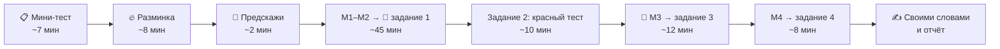

# 🔹 Сессия 13 · Неделя 03 · `0.AIN.07` — Ревью кода от агента

> [!abstract] Зачем
> Ты принимаешь код, который не писал, и подписываешься под ним. Сегодня — ревью, которое находит то, что пропускают зелёные тесты и линтер: идёшь не по коду, а по спеке. На этом стоит шаг 4 практики — ревью `reader.py`.
> 📰 **Из жизни:** команда Claude Code в [разборе своего ревью](https://claude.dev/blog/solving-code-review-at-anthropic/) (15.10.2026) пишет: изменений в день стало больше 30 000 против ~2 500 в мае, агенты ревьюят каждый PR, но апрув агента человеческим не считается, а тот, кто запустил агента, — обязательный ревьюер. Твой агент принёс PR, а ревьюер-агент написал «всё хорошо». Что ты сделаешь до merge?

**Время:** ~1,5–1,75 ч · **Дата выдачи:** 06.11

> 🎲 **Ивент: «Агент-саботажник»** (правило 29). Агент написал поиск заметок по тегу: 244 строки, 13 тестов зелёные. В код спрятаны **ровно 3 серьёзные ошибки**. Каждая нарушает спеку, ни один тест её не ловит. Твоя цель — 3 из 3 без ложных тревог. Ключ у Ментора: откроется при проверке.



---

## 📋 Мини-тест по прошлой сессии *(Сессия 12 · `0.AIN.06`)*

> [!warning] Тест — без подсказок Тьютора и без поиска
> Не знаешь — так и напиши: «не знаю» — тоже ответ. Проверит Ментор вместе с этой сессией; от результата зависит, закроется ли `0.AIN.06` (2 из 3).

Код из `netrc` для вопросов 1 и 3:
```python
# строка 82: default_netrc = file is None
# строка 159:
if _can_security_check() and default_netrc and login != "anonymous":
    ...  # проверка владельца и прав на файл

# строки 174–181:
def authenticators(self, host):
    if host in self.hosts:
        return self.hosts[host]
    elif 'default' in self.hosts:
        return self.hosts['default']
    else:
        return None
```

1. [x] Linux. Вызов `netrc("my.netrc")`, логин в файле `svc-backup`, файл открыт на чтение всем пользователям. Сработает ли проверка прав? Какое условие решает исход?
   **Ответ:**
   Нет, потому что файл передан напрямую; строка 82 и описание вопроса
   ✍️ продиктовано

2. [x] `trace --trackcalls` показал вызов `_security_check`, но вызова `_getpwuid` в выводе нет, хотя в коде она есть. Почему?
   **Ответ:**
   Я отказываюсь решать задание, которое выдали неправильно. Я знаю, почему. Я не скажу. Код прикреплён в недостаточном объёме. Ментор нарушил правило. По этому коду решить невозможно.
   ✍️ продиктовано

3. [x] Твой скрипт получает имя сервера `host` из заметки и не должен отдавать пароль серверу, которого нет в файле. Напиши одну проверку на Python, которая стоит перед вызовом `authenticators(host)`.
   **Ответ:**
   ```python
   if host in self.hosts:
      authentificators(host)
   else:
       raise ValueError("Имя сервера не входит в список разрешённых серверов")
   ```
   ✍️ продиктовано

---

## 🔥 Разминка (по желанию, ~8 мин)

1. [x] 🃏 **Карточки** (5 мин): в Obsidian — команда «Spaced Repetition: Review flashcards from all notes», в окне колод выбери `Фаза0` и пройди те, что подошли по сроку. Больше 30 — не обязательно все; нет ни одной — пропусти пункт.
   **Ответ:**
   Готово
   ✍️ продиктовано

2. [x] **Микрозадача на Go** («полиглот», ревью на три строки). Что случится при запуске и в какой строке? Как поправить? *(Go на машине автозапуска нет, Ментор не запускал; поведение — из спецификации языка.)*
   ```go
   nums := []int{3, 5, 8}
   total := 0
   for i := 0; i <= len(nums); i++ {
       total += nums[i]
   }
   fmt.Println(total)
   ```
   **Что сдать:** одна строка — что случится, и исправленная строка цикла.
   **Ответ:**
   Произойдёт паника index out of range в строке `total += nums[i]` (выход за границы среза при i = 3); исправленная строка: `for i := 0; i < len(nums); i++ {`
   ✍️ продиктовано

3. [x] 🧠 **Решение** (трек «Решения», 2 мин). В шаге 2 ты положил правила проекта в `AGENTS.md` репозитория, а не в `constitution.md` из spec-kit. Запиши это строкой: выбрал … вместо … · выиграл … · заплатил … · откатить: легко / трудно. Строку Ментор перенесёт в журнал решений.
   **Образец:** `выбрал SQLite вместо Postgres · выиграл: нечего администрировать · заплатил: один писатель за раз · откатить: трудно`.
   **Ответ:**
   Выбрал AGENTS.md вместо constitution.md · выиграл: автоматическую загрузку правил любыми ИИ-агентами из корня репозитория без лишних утилит · заплатил: потерей строгой валидации и интеграции с воркфлоу spec-kit · откатить: легко
   ✍️ продиктовано

---

## 🔮 Предскажи (2 мин, не оценивается)

Агент принёс PR на 244 строки: 13 тестов зелёные, линтер настроен. Ты знаешь, что внутри 3 серьёзные ошибки. Какие из них поймает линтер, а какие только твой взгляд? Как думаешь, сколько найдёшь за 30 минут?
**Ответ (догадка до материалов — ошибаться можно; вернёшься к ней в «Своими словами»):**
ошибки безопасности в первую очередь поймаю только я. Найду 3
✍️ продиктовано

---

## 📚 Материалы

> [!tip] 📌 Минимум для заданий — ~15 мин
> Идём так: пункт → задание → следующий пункт. Код — в папке `код_сессия_13`.

> [!note] 🎮 Демо: не готово
> Демо к этому занятию заранее не собрано. Ивент заменяет его как тренажёр; собрать демо можно отдельным заходом по `Шаблоны/Демо.md`.

### М1. Чек-лист ревью

**Зачем.** Глаза сами идут туда, где интересно, поэтому без списка проверяешь то, что и так работает. Чек-лист заставляет задать один и тот же набор вопросов любому коду.

| Пункт | Вопрос к коду | Пример | Ещё пример — с другой стороны |
|---|---|---|---|
| Корректность | Делает ли то, что написано в спеке, на обычном входе? | Сумма считается без НДС, а в спеке с НДС | Отчёт за месяц берёт 30 дней, а в месяце 31 |
| Граничные случаи | Что на пустом, огромном, странном входе? | Деление на длину пустого списка | Имя файла с пробелом ломает команду |
| Ошибки | Куда уходит ошибка и кто о ней узнает? | Повтор при 401: пароль неверен, а скрипт стучится вечно | Сбой записан только в журнал, а вызывающий получает пустой список, как при «ничего нет» |
| Безопасность | Секреты, инъекции, права: что можно подсунуть снаружи? | Запрос SQL собран склейкой строк из ввода | Токен попал в текст исключения и ушёл в журнал |
| Лишняя сложность | Можно ли убрать, и ничего не изменится? | Класс-фабрика ради одного объекта | Настройка, которую никто никогда не менял |
| Несуществующие API | Есть ли такой метод и пакет на самом деле, в твоей версии? | Вызов метода, которого нет в твоей версии библиотеки | Импорт пакета, которого нет в реестре |
| Дублирование | Не написано ли это уже рядом? | Вторая функция разбора дат | Одна проверка скопирована в три входа |
| Качество тестов | Упал бы тест, если сломать код? | Тест повторяет формулу кода | Тест проверяет только «не упало», а не результат |

**Главный приём: иди от спеки, а не от кода.** Код читается убедительно: он написан так, чтобы выглядеть правильным. Поэтому берёшь один пункт спеки и ищешь две вещи:


Пример. Спека: «Отчёт отправляется только дежурному». Код: `send(to=config.get("duty", "all@corp"))`. Строка есть, и тест с заданным `duty` зелёный. Но если настройки нет, письмо уходит всем: тест этого не проверял.

### М2. Как записать замечание

**Зачем.** Список без важности автор читает как список придирок и спорит про отступы, а настоящая ошибка тонет. Команда Claude Code [помечает](https://claude.dev/blog/solving-code-review-at-anthropic/) находки `Important`, `Nit` и `Pre-existing`; определения в статье короткие, ниже они в моей формулировке *(проверено: 06.11)*.

| Метка | Значит | Пример | Ещё пример |
|---|---|---|---|
| `Important` | Нарушает спеку или опасно: до merge чинить | Отчёт уходит всем | Падает на пустом файле |
| `Nit` | Мелочь: работает верно, но можно лучше | Неиспользуемый импорт | Неудачное имя переменной |
| `Pre-existing` | Ошибка была до этого PR: не вина автора | Старый баг рядом с правкой | Опечатка в старом README |

Форма записи: `файл:строка · что не так · пункт спеки или чек-листа · метка`.

> [!danger] 🗡 Как это ломают
> Агент может придумать имя несуществующего пакета, а злоумышленник — зарегистрировать пакет с таким именем. Это [slopsquatting](https://www.endorlabs.com/learn/slopsquatting-when-ai-agents-hallucinate-malicious-packages) *(проверено: 06.11)*. Поэтому «несуществующий API» в чек-листе — ещё и вопрос безопасности: новый `import` в PR смотри отдельно.

### М3. Линтер и SAST: что это даёт

**Зачем.** В прошлой сессии ты попросил инструменты вместо ручного `Ctrl+F`. Сегодня проверишь их на деле. Карточки — в [[Тьютор/Инструментарий]].

- **Ruff** — быстрый линтер: стиль, лишнее, типовые ошибки. **Bandit** — ищет в Python опасные шаблоны.
- Установка и запуск в папке с кодом сессии:
  ```powershell
  pip install ruff bandit
  ruff check .
  bandit tag_search.py tags_cli.py
  ```
- Bandit показывает находку так: код правила, важность и строка. Пример формы, на другом случае: `B602 · High · app.py:14 · subprocess call with shell=True`.

Ментор прогнал 06.11 на Linux, ruff 0.17.4 и Bandit 1.9.4. На Windows не запускал, а набор правил у версий разный: разойдётся вывод — так и напиши.

### М4. Таблица от агента — черновик

**Зачем.** В неделе 2 агент выдумал даты и лицензию в таблице аналогов, а общий вывод «сверено» этого не поймал. Сверка — это конкретные факты против первоисточника.

**Как:** факт → где он записан у автора (репозиторий, файл `LICENSE`, документация) → совпало или нет. Пересказ в блоге и ответ другого агента первоисточником не считаются.

> [!info]- 🔍 Глубже — по желанию, ~20 мин — раскрыть
> - [How the Claude Code team does code review](https://claude.dev/blog/solving-code-review-at-anthropic/) целиком: проверка до PR, субагент со свежим контекстом, голосование ревьюеров, апрувы по риску.
> - Как настроить Bandit на проверку `except … continue`: [B112](https://bandit.readthedocs.io/en/latest/plugins/b112_try_except_continue.html). *Открывать после задания 3.*

> [!quote]- ⭐ Доп. материал от любимых авторов (по желанию, не входит в сдачу) — раскрыть
> - ★ [[Материалы/Сбежавшая нейросеть/04 Как работают с ИИ профи/Создатели Linux, Rails и Paint.NET- как работают с ИИ известные программисты – и что стоит перенять нам|Создатели Linux, Rails и Paint.NET]] · ~23 мин — пять подходов к ревью, от «человек подписывает каждое изменение» до ревью формы.
>   ⚠️ Совет «не читать каждую строку» расходится с нашим правилом 11: код принимается, только когда можешь его объяснить. Цифры OpenAI и прямые цитаты не сверял. *(Сверено 06.11: AudioNoise Торвальдса и закрытие программы наград curl.)*

---

## ✏️ Задания

**Дано для заданий 1–3.** Папка [[Фаза 0/Недели/Неделя 03 (02.11–08.11)/код_сессия_13/tag_search.py|код_сессия_13]]: `tag_search.py` (ядро), `tags_cli.py` (CLI), `test_tag_search.py` (тесты). **Скопируй все три в новую папку вне хранилища**, поставь `pytest`, если его нет, и запусти там `python -m pytest -q`. Ожидаемо: `13 passed` (на Windows тест симлинка может быть пропущен, тогда `12 passed, 1 skipped`).

**Спека задачи, которую получил агент:**

| № | Требование |
|---|---|
| С1 | Тег — `#слово` (буквы, цифры, `_`, `-`, `/`) вне блоков кода. `# Заголовок` и `#frag` внутри адреса ссылки — не теги |
| С2 | Регистр и `#` в запросе не важны: `#Python` и `python` — один тег. Пустой тег — `EmptyTag` |
| С3 | Читаем только `.md`. Служебные папки (имя с точки) и симлинки не читаем |
| С4 | `folder`, если задан, — папка поиска от корня. Её канонический путь обязан лежать внутри корня хранилища, иначе `OutsideVault`, и ни один файл не читается. Папки нет — `FolderNotFound` |
| С5 | Заметка больше 10 МБ на диске пропускается **не читая**: `skipped + 1` и предупреждение |
| С6 | Заметка не читается или не в UTF-8 — поиск не падает: `skipped + 1` и предупреждение с относительным путём |
| С7 | Результат — `SearchResult(paths, skipped, warnings)`; `paths` отсортированы, пути относительные, через `/` |
| С8 | Ядро ничего не печатает. CLI — тонкая обёртка: пути в stdout, ошибки и предупреждения в stderr; ошибка поиска — код 1, настройка не задана — код 2 |

1. [x] 🎲 **Найди саботаж** (~35 мин). Первый проход — своими глазами, без агента. Агента можно позвать только после того, как записал свой список, и тогда отметь, что он добавил.
   📖 **Сначала:** [[#М1. Чек-лист ревью|М1]], [[#М2. Как записать замечание|М2]]
   🧾 **Что сдать:**
   а) таблица прохода по спеке, по строке на С1–С8: `пункт · строка кода · сделано так, как в спеке? · тест, который упал бы`;
   б) замечания списком в форме из М2: три своих кандидата в саботаж и любые `Nit`;
   в) одна дыра **в самой спеке**: вход или ситуация, про которые спека молчит, и что, по-твоему, должно происходить.
   **Образец строки а)** (на примере из М1): `Только дежурному · report.py:12 · нет: без настройки шлёт всем · теста нет`.
   **Образец строки б):** `report.py:12 · без настройки duty письмо уходит всем · «только дежурному» · Important`.
   **Критерий сдачи:** 8 строк в а); в б) у каждого `Important` есть строка и пункт спеки; в в) конкретный вход. Нашёл меньше трёх — всё равно сдай: счёт (найдено и ложные тревоги) подведёт Ментор.
   **Ответ:**
   **в) Дыры в спеке:**
   1. С4 — поиск должен быть рекурсивным по подпапкам или только внутри `folder`?
   2. С5 — передавать относительный путь заметки в предупреждении или нет (в отличие от С6, где формат предупреждения оговорён)?

   **а) Таблица прохода по спеке (С1–С8):**

   | Пункт | Строка кода | Сделано как в спеке? | Тест, который упал бы |
   |---|---|---|---|
   | С1 | 43–55 | Да | `def test_tags_in_code_block_ignored()`, `def test_url_fragment_and_heading_are_not_tags()` |
   | С2 | 35–40 | Да | `def test_case_and_hash_in_query()`, `def test_empty_tag()` |
   | С3 | 70–77 | Да | `def test_skips_service_folders_and_not_md(vault)`, `def test_symlink_is_not_followed(vault, tmp_path)` |
   | С4 | 58–67 | Частично, с проблемой безопасности: путь проверяется по префиксу строки имени корня (`startswith`), надо через `is_relative_to()` | Фактическая ошибка не ловится тестами агента; есть только `test_folder_outside_is_rejected`, `test_folder_not_found`, `test_folder_limits_search` |
   | С5 | 85–90 | Нет: читает файл целиком в память прежде, чем определяет его объём | Теста на отказ по памяти нет, есть только тест вывода на файле чуть больше лимита `def test_big_file_is_skipped(vault)` |
   | С6 | 102–109 | Частично: если файл не в UTF-8, поиск не падает, но `skipped + 1` и предупреждение не выставляются (`except: continue`) | `def test_broken_file_does_not_crash(vault)` проверяет только отсутствие падения, но не проверяет `skipped` и `warnings` |
   | С7 | 29, 80, 111–112 | Да, пути через `_rel()` относительные и с `/` (в строке 80 объявлена, вызывается в 108 и 111) | Тестов на одновременную проверку всех трёх полей сразу нет |
   | С8 | `tags_cli.py:10–32` | Да | Частично в `def test_cli_prints_paths` |

   **б) Замечания списком:**
   - `tag_search.py:63` · функция проверяет вхождение папки в хранилище по строковому `startswith`, пропуская соседние папки вроде `vault_other` · пункт спеки С4 · **Important**
   - `tag_search.py:87` · `_load` читает весь файл в память до проверки размера, создавая риск DoS/OOM вместо проверки размера на диске · пункт спеки С5 · **Important**
   - `tag_search.py:104–105` · при ошибке чтения или невалидном UTF-8 блок `except (OSError, UnicodeDecodeError): continue` глушит ошибку, не увеличивая `skipped` и не добавляя `warning` · пункт спеки С6 · **Important**
   - `tag_search.py:80` · сомнение в вызове `_rel` (разбор: вызывается в 108 и 111) · пункт спеки С7 · **Nit** (ложная тревога)

   ✍️ продиктовано (первый проход выполнен своими глазами, разбор и третий саботаж сопоставлены совместно)

2. [x] **Докажи красным тестом** (~10 мин). Возьми один свой `Important` и напиши тест, который на этом коде **падает**, а по спеке должен проходить. Сам код не чини.
   🧾 **Дано:** фикстура `tmp_path` даёт временную папку, как в `test_tag_search.py`.
   **Образец** (на примере из М1, другой код):
   ```python
   def test_no_duty_does_not_mail_everyone(monkeypatch):
       monkeypatch.delenv("DUTY", raising=False)
       assert recipients() == []    # сейчас падает: ['all@corp']
   ```
   **Критерий сдачи:** код теста и строка вывода `pytest` с `FAILED`. Одно предложение: почему 13 тестов этого не видели.
   **Ответ:**
   ```python
   def test_similar_root_name(vault, tmp_path):
       (tmp_path / "vault_other").mkdir()
       with pytest.raises(OutsideVault):
           find_by_tag(vault, "python", "../vault_other")
   ```
   **Вывод pytest:**
   ```text
   FAILED test_tag_search.py::test_similar_root_name - Failed: DID NOT RAISE OutsideVault
   ```
   **Почему 13 тестов этого не видели:**
   Тесты агента проверяли выход наружу только через `../outside`, чьё имя не начинается с префикса `vault`, поэтому строковая проверка `candidate.startswith(root)` успешно отсекала `outside`, создавая иллюзию надёжной защиты, но полностью пропускала соседние папки с похожим началом пути вроде `vault_other`.

   ✍️ продиктовано

3. [x] **🔧 Руками: что поймают инструменты** (~12 мин). Новое: `ruff`, `bandit`. Запусти **сам**: это три команды из М3.
   📖 **Сначала:** [[#М3. Линтер и SAST: что это даёт|М3]]
   🧾 **Что сдать:** а) вывод обеих команд; б) сверка: какие из твоих `Important` они нашли, какие нет, и что нашли сверх твоего списка; в) 2–3 строки: что увидел, где пригодится, что мешало.
   **Критерий сдачи:** оба вывода целиком; в б) вывод по каждому твоему `Important`.
   **Ответ:**
   **а) Вывод команд целиком:**

   **Ruff (`ruff check .`):**
   ```text
   F401 [*] `json` imported but unused
    --> tags_cli.py:3:8
     |
   1 | """CLI: python tags_cli.py <тег> [--folder ПАПКА]. Тонкая обёртка над ядром."""
   2 | import argparse
   3 | import json
     |        ^^^^
   4 | import os
   5 | import sys
     |
   help: Remove unused import: `json`

   I001 [*] Import block is un-sorted or un-formatted
     --> test_tag_search.py:2:1
      |
    1 |   """Тесты от агента. Все зелёные."""
    2 | / import pytest
    3 | |
    4 | | from tag_search import (
    5 | |     EmptyTag,
    6 | |     FolderNotFound,
    7 | |     MAX_NOTE_SIZE,
    8 | |     OutsideVault,
    9 | |     extract_tags,
   10 | |     find_by_tag,
   11 | |     normalize_tag,
   12 | | )
   13 | | from tags_cli import main
      | |_________________________^
   help: Organize imports

   Found 2 errors.
   [*] 2 fixable with `--fix`.
   ```

   **Bandit (`bandit tag_search.py tags_cli.py`):**
   ```text
   Run started:2026-11-12 22:10:40.718825+00:00

   Test results:
   >> Issue: [B101:assert_used] Use of assert detected. The enclosed code will be removed when compiling to optimised byte code.
      Severity: Low   Confidence: High
      CWE: CWE-703 (https://cwe.mitre.org/data/definitions/703.html)
      More Info: https://bandit.readthedocs.io/en/1.9.4/plugins/b101_assert_used.html
      Location: .\tag_search.py:95:4
   94	    """Заметки с тегом tag под root (или под root/folder)."""
   95	    assert Path(root).is_dir(), "root must be a directory"
   96	    wanted = normalize_tag(tag)

   --------------------------------------------------

   Code scanned:
   	Total lines of code: 115
   	Total lines skipped (#nosec): 0
   	Total potential issues skipped due to specifically being disabled (e.g., #nosec BXXX): 0

   Run metrics:
   	Total issues (by severity):
   		Undefined: 0
   		Low: 1
   		Medium: 0
   		High: 0
   	Total issues (by confidence):
   		Undefined: 0
   		Low: 0
   		Medium: 0
   		High: 1
   Files skipped (0):
   ```

   **б) Сверка с нашими Important:**
   - `tag_search.py:63` (`startswith` вместо `is_relative_to`) — **НЕ нашли** ни Ruff, ни Bandit (инструменты не понимают бизнес-границы файловой системы и семантику Path Traversal без прямого вызова системных шеллов).
   - `tag_search.py:87` (чтение всего файла в RAM до проверки размера) — **НЕ нашли** (SAST не знает о требовании спеки проверять 10 МБ строго до чтения с диска).
   - `tag_search.py:104` (`except: continue` без `skipped` и `warnings`) — **НЕ нашли** (в стандартном профиле Bandit правило B112 по умолчанию не включено).
   - **Сверх списка:**
     - Bandit нашёл `B101: assert_used` на строке 95 — `assert Path(root).is_dir()`, который исчезнет при запуске Python с флагом `-O`.
     - Ruff нашёл неиспользуемый импорт `import json` в `tags_cli.py:3` и неотсортированные импорты в `test_tag_search.py:2`.

   **в) Вывод:**
   Автоматические линтеры и базовый SAST отлично ловят поверхностный синтаксический мусор (лишний `import`, форматирование) и запрещённые конструкции вроде `assert` в коде ядра. Однако они полностью слепы к логическому саботажу и семантическим уязвимостям бизнес-логики: код со всеми тремя реальными дырами прошёл бы автоматические проверки на CI без единого замечания, если бы не ручное ревью по спеке.

   🤖 написал агент, проверил я

4. [x] **Сверь факты из таблицы агента** (~8 мин).
   📖 **Сначала:** [[#М4. Таблица от агента — черновик|М4]]
   🧾 **Дано:** агент написал в сравнении инструментов:

| Инструмент | Что заявил агент |
|---|---|
| Ruff | написан на Go |
| Bandit | лицензия MIT |
| pre-commit | лицензия MIT |

   **Что сдать:** по строке на факт: `факт · где проверил (ссылка на первоисточник) · совпало или нет · как на самом деле`.
   **Образец:** `Hypothesis — лицензия MPL-2.0 · github.com/HypothesisWorks/hypothesis, файл с лицензией · совпало`.
   **Критерий сдачи:** три строки, у каждой ссылка на репозиторий или документацию автора.
   **Ответ:**
   - `Ruff — написан на Go` · https://github.com/astral-sh/ruff (README.md) · **не совпало** · написан на Rust (цитата: *«An extremely fast Python linter and code formatter, written in Rust»*)
   - `Bandit — лицензия MIT` · https://github.com/PyCQA/bandit (файл LICENSE) · **не совпало** · лицензия Apache-2.0 (цитата: *«Apache License Version 2.0, January 2004»*)
   - `pre-commit — лицензия MIT` · https://github.com/pre-commit/pre-commit (файл LICENSE) · **совпало** · лицензия MIT (цитата: *«Copyright (c) 2014 pre-commit dev team... Permission is hereby granted, free of charge...»*)

   🤖 написал агент, проверил я

5. [x] **Своими словами** (3–5 предложений). Коллега пишет: «Тесты зелёные, ruff чистый, агент-ревьюер написал всё хорошо. Мержим?» Что ответишь? Приведи один пример из этого PR: файл и строку. И одной строкой: что в «🔮 Предскажи» оказалось не так.
   **Критерий сдачи:** 3–5 предложений; пример со строкой кода; строка про «Предскажи».
   **Ответ:**
   Подкрути настройки ruff, подключи ещё пару линтеров. Агенту ревьюеру скорми спеку. Глаза заебёшься искать, три часа убьёшь. Пусть каждый критерий из спеки агент подверждает конкретной строкой кода. Конкретно описывает, какие тест-кейсы для каждого критерия есть и что ловят и проверь уже с этой информацией (например, как в `tag_search.py:63` со строковым `startswith`).

   В предскажи не угадал. Нашёл со второго раза, закрыл задание за 3 часа
   А сессию за 4

   ✍️ продиктовано

---

## 🛠 Связь с практикой

Теперь открыты шаги 3–4: задача 1 через агента и ревью diff, этим же проходом «пункт спеки → строка → тест». → [[НЕДЕЛЯ#🛠 Практика недели]]

---

## ✍️ Отчёт

- **Время (сколько ушло):** ~240 мин (~4 часа суммарно; ~3 часа ушло на вычитку кода и Задание 1)
- **Трудности и вопросы:** Вычитка чужого кода по 8 пунктам спеки без настроенных инструментов и агентского ревью по критериям отнимает колоссально много времени и сил (~3 часа на ручной поиск саботажа). Дефолтные тесты и линтеры убаюкивают зелёным статусом, скрывая DoS, обход путей и тихий `continue`.
- **Подсказки Тьютора:** Разобрано 5 из 5 заданий; Задание 1 — ур. 2 (разбор С6 и где прятался тихий `continue`); Задание 2 — ур. 1 (направление по имени функции `test_` для pytest); Задания 3 и 4 — 🤖 (поручение агенту запустить команды и сверить ссылки на GitHub); Задание 5 — ур. 0.
- **Демо:** не было

---

## 🎙 От Тьютора *(если вёл или помогал; без оценки)*

Дмитрий проделал колоссальную работу: самостоятельно вычитал код ядра и тестов и своими глазами поймал 2 из 3 спрятанных дефектов безопасности (`tag_search.py:63` Path Traversal через `startswith` и `tag_search.py:87` чтение 20 ГБ файла в память до проверки размера), а также выделил отличные пробелы в спеке (рекурсивность `folder` и формат предупреждений). Третий саботаж (`tag_search.py:104` пустой `except: continue`, Bandit B112) дожали совместно на втором заходе. Красный тест на С4 составлен точно и показал ложное спокойствие дефолтных тестов. Сессия наглядно показала, почему зелёный статус без глубокого ревью по спеке — опасная иллюзия.

---

## 📋 Мини-тест по этой сессии
*(будет в начале следующей сессии — Ментор составит его по итогам проверки)*

---

## ✅ Проверка *(заполняет Ментор)*

---

## 🃏 Карточки для повторения
*(Ментор добавит при проверке)*
