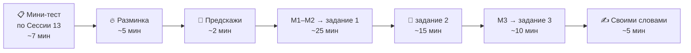
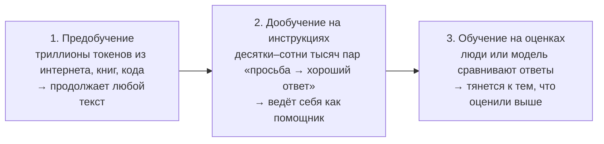

# 🔹 Сессия 14 · Неделя 03 · `0.LLM.01` — Большая картина

> [!abstract] Зачем
> Ты собираешься проектировать автономию агентов: что агент делает сам, а где его проверяет система. Для этого нужно понимать, что внутри: модель — это предсказатель следующего слова, обученный на интернете, и поверх него «ассистент», которого дообучили на оценках людей. Из этого прямо следуют её слабые места — выдумки, устаревшие знания, лесть, послушность любому тексту. И то, почему контроль нельзя доверить самой модели.
> 📰 **Из жизни:** 13.11 Ментор этого проекта (Opus 5.5) не знал, что вышла Claude Fable 5.2 — узнал из документации, когда сверял пост. А бенчмарк [AA-PersonalityBench](https://artificialanalysis.ai/evaluations/aa-personalitybench) *(сверено 13.11: 900 вопросов, 30 черт, нейросети-судьи сравнивают ответы попарно)* показывает, что модели заметно различаются по лести. И то и другое — не баг конкретной модели, а след того, как модели учат. Что бы ты встроил в систему, чтобы на это не опираться?

**Время:** ~1,25–1,5 ч · **Дата выдачи:** 13.11 (пт)



---

## 📋 Мини-тест по прошлой сессии *(Сессия 13 · `0.AIN.07`)*

> [!warning] Тест — без подсказок Тьютора и без поиска
> Не знаешь — так и напиши: «не знаю» — тоже ответ. От результата зависит, закроется ли `0.AIN.07` (2 из 3). Тьютор в поле ответа пишет только твои слова дословно.

Код поиска по тегу из Сессии 13 — то, что нужно для вопросов 1 и 2:
```python
85  def _load(path):
86      """Текст заметки или None, если заметка больше лимита."""
87      text = path.read_text(encoding="utf-8")
88      if len(text) > MAX_NOTE_SIZE:      # MAX_NOTE_SIZE = 10 * 1024 * 1024
89          return None
90      return text

101     for path in _iter_notes(start):
102         try:
103             text = _load(path)
104         except (OSError, UnicodeDecodeError):
105             continue
106         if text is None:
107             result.skipped += 1
108             result.warnings.append(f"слишком большой файл: {_rel(path, root)}")
109             continue
```
Спека: С5 — «Заметка больше 10 МБ **на диске** пропускается **не читая**: `skipped + 1` и предупреждение». С6 — «Заметка не читается или не в UTF-8 — поиск не падает: `skipped + 1` и предупреждение с относительным путём».

1. [ ] В хранилище лежит заметка в кодировке cp1251. Поиск её встречает.
   а) Что увидит вызывающий код в `result`?
   б) Что по С6 должно было случиться?
   **Ответ:**

2. [ ] Почему строки 87–88 не выполняют С5? Две причины.
   а) Про то, когда читается файл.
   б) Про то, что считает `len(text)`.
   **Ответ:**

3. [ ] Спека говорит: «`folder` — папка поиска от корня». Ищет ли поиск в подпапках `folder`, она молчит.
   а) Какое поведение ты бы записал в спеку?
   б) Одна строка критерия приёмки с конкретным входом и ожидаемым результатом.
   **Ответ:**

---

## 🔥 Разминка (по желанию, ~5 мин)

1. [ ] 🃏 **Карточки** (5 мин): в Obsidian — команда «Spaced Repetition: Review flashcards from all notes», в окне колод выбери все колоды и пройди те, что подошли по сроку. Больше 30 — не обязательно все; нет ни одной — пропусти пункт.
   **Ответ:** *(сколько прошёл · какие забыл)*

---

## 🔮 Предскажи (2 мин, не оценивается)

Спрашиваешь модель: «Сколько будет 2 + 2?» — она отвечает «4».
а) Откуда она это «знает»: посчитала, вспомнила или что-то третье?
б) А если спросить, какое сегодня число, — что она ответит и почему?
**Ответ (догадка до материалов — ошибаться можно; вернёшься к ней в «Своими словами»):**

---

## 📚 Материалы

> [!tip] 📌 Минимум для заданий — ~15 мин
> Идём так: пункт → задание → следующий пункт.

> [!note] 🎮 Демо: не готово
> Интерактивное демо к этому занятию заранее не собрано. Его роль сегодня частично играет Transformer Explainer в задании 2 — настоящая модель GPT-2 прямо в браузере. Собрать своё демо можно отдельным заходом по `Шаблоны/Демо.md`.

### М1. Что такое языковая модель

**Зачем.** Почти всё странное в поведении модели объясняется одной фразой: она предсказывает продолжение текста.

Модель — это функция «текст → вероятности следующего кусочка текста» (токена). Пример: на вход «Столица Франции —», на выходе примерно «Париж» 0,9 · «город» 0,03 · «это» 0,01 · … Генерация — это цикл: выбрали токен, дописали его к тексту, снова спросили модель. Ответ на три абзаца — несколько сотен таких шагов.

- **Пример 1.** Подсказка следующего слова на клавиатуре телефона — та же идея, только модель крошечная и знает лишь твою переписку.
- **Пример 2, с другой стороны.** Автодополнение кода в редакторе: модель не «понимает задачу», она продолжает текст программы самым вероятным образом. Поэтому чужой стиль и чужие ошибки из обучающих данных она тоже продолжает.

Знания модели лежат в её **весах** — миллиардах чисел, настроенных при обучении. После обучения веса **заморожены**: из разговора с тобой модель ничему не учится, а всё, что она «помнит» в разговоре, — это текст, который ей заново подают на вход (контекст).

### М2. Как её учат: три этапа



1. **Предобучение (pretraining).** Модель учится угадывать следующий токен на огромном корпусе текстов. Это «сжатие интернета»: в весах оседают факты, грамматика, код, стиль — всё, что часто повторялось. Получается **базовая модель**: она продолжает любой текст. Спроси её «Как испечь хлеб?» — она может продолжить списком других вопросов, как на форуме, а не ответить.
2. **Дообучение на инструкциях (instruction tuning, SFT).** На парах «просьба → хороший ответ», которые написали люди, модель учится роли помощника: отвечать, а не продолжать.
3. **Обучение на оценках (RLHF — по оценкам людей, RLAIF — по оценкам другой модели).** Модели показывают несколько её ответов на одну просьбу, оценщики выбирают лучший. По этим выборам обучают «модель награды», а основную модель подкручивают так, чтобы награда росла. Так появляются вежливость, отказы на опасное — и склонность говорить то, что **нравится** оценщику.

- **Пример этапа 3, с другой стороны.** Стажёр, которого хвалят за «клиент остался доволен», быстро учится соглашаться с клиентом — даже там, где клиент неправ. Модель с наградой «ответ понравился» — тот же стажёр.

**Видео** *(StatQuest, сверено 13.11 по [оглавлению](https://statquest.org/video_index.html))*: [How AI works in Super Simple Terms!!!](https://youtu.be/q-BiW5srMFQ) — к М1, [Reinforcement Learning with Human Feedback (RLHF), Clearly Explained!!!](https://youtu.be/qPN_XZcJf_s) — к этапу 3.

### М3. Что из этого следует для того, кто строит агентов

| Свойство модели | Откуда (М1–М2) | Что встраиваем в систему |
|---|---|---|
| Выдумывает правдоподобное | Предсказывает вероятное продолжение, а не проверенный факт | Факты — из источников (поиск, база), со ссылкой; проверка снаружи |
| Знания устаревают | Веса заморожены на дате среза | Свежее — подавать в контекст (как наш `РАДАР.md`), дату — передавать явно |
| Льстит и соглашается | Этап 3: награда за «понравилось оценщику» | Оценивать не самой моделью «в том же разговоре», а по критериям: тесты, инварианты, вторая проверка без контекста спора |
| Слушается любого текста, похожего на инструкцию | Этапы 2–3 учат выполнять просьбы; для модели и твоя просьба, и текст заметки — просто текст | Граница между данными и инструкциями — в системе: права инструментов, подтверждение на рискованных шагах |
| Не помнит между разговорами | Веса заморожены, память — это контекст | Память агента — файлы и базы, которые ты проектируешь |

> [!danger] 🗡 Как это ломают
> Последняя строка таблицы — корень prompt injection. Модель не отличает «инструкцию владельца» от «текста из письма или заметки»: для неё и то и другое — текст, который надо продолжить, а дообучение научило её выполнять просьбы. Поэтому защиту строят правами и границами системы, а не фразой в промпте «не слушай чужие инструкции». Подробно — `0.AIS.01` (неделя 8).

> [!quote]- ⭐ Доп. материал от любимых авторов (по желанию, не входит в сдачу) — раскрыть
> - ★ [[Материалы/Сбежавшая нейросеть/01 С чего начать/Стажер за $20 в месяц- как на самом деле работает ИИ|Стажёр за $20 в месяц]] · ~9 мин — если не читал в Сессии 2: «предсказание токенов, заморозка весов, память как заметки». Версии моделей и тарифы в статье устарели, принцип — нет.

---

## ✏️ Задания

1. [ ] **Три этапа — своими словами** (~10 мин).
   📖 **Сначала:** [[#М1. Что такое языковая модель|М1]], [[#М2. Как её учат: три этапа|М2]]
   🧾 **Что сдать:** таблица из трёх строк — по этапу на строку. Колонки: `этап · на чём учится · что умеет после · какой след оставляет (что из этого видно в поведении модели)`.
   **Образец строки** (на другом случае — стажёр на складе): `чтение регламентов · все регламенты компании · знает формулировки и порядок операций · пересказывает регламент уверенно, даже где он устарел`.
   **Критерий сдачи:** три строки; в последней колонке — поведение модели, которое можно наблюдать, а не «стала лучше».
   **Ответ:**

2. [ ] **🔧 Руками: настоящая модель в браузере** (~15 мин, [Transformer Explainer](https://poloclub.github.io/transformer-explainer/)). Новое: интерактивная модель GPT-2 small (124 млн параметров), работает прямо в браузере *(сверено 13.11)*.
   📖 **Сначала:** [[#М1. Что такое языковая модель|М1]]
   🧾 **Что сделать и сдать:**
   а) Введи `The capital of France is` и выпиши 5 самых вероятных следующих токенов с вероятностями (или приложи скриншот).
   б) Поставь температуру около 0,1, потом около 2. Что меняется в распределении вероятностей и в том, какой токен выбирается?
   в) Сломай: введи фразу по-русски, например `Столица Франции —`. Что видишь в токенах и в вероятностях? Объясни через М2: на каких данных училась эта модель.
   г) 2–3 строки: что увидел, где пригодится, что мешало.
   **Образец формы** (числа выдуманы, на другой фразе): `а) "Paris" 0,41 · "the" 0,08 · "a" 0,05 · …`.
   **Критерий сдачи:** числа с твоего экрана в а); в б) — что происходит с распределением; в в) — объяснение через данные предобучения; 2–3 строки в г).
   **Ответ:**

3. [ ] **Два слабых места — и что с ними делает система** (~10 мин).
   📖 **Сначала:** [[#М3. Что из этого следует для того, кто строит агентов|М3]]
   🧾 **Дано:** агент полигона в Фазе 1 будет делать сводку по твоим заметкам и сам решать, что в ней главное.
   а) Ты просишь агента: «Какая сейчас самая новая модель Anthropic?» — он уверенно называет устаревшую. Почему — через М1 или М2? Одна мера **в системе** (не в промпте), которая это закрывает.
   б) Ты спорил с агентом о своей ошибке в сводке, и он быстро согласился, что ошибки нет. Почему — через М2? Одна мера в системе, чтобы правоту решала не уступчивость модели.
   **Образец формы** (на другом случае — агент склада, который считает остатки): `причина: … (этап …) · мера: сверка остатков с учётной системой после каждой операции`.
   **Критерий сдачи:** у каждого пункта — причина через этап или свойство из М1–М2 и мера на уровне системы (источник, проверка, права, подтверждение), а не «попросить модель быть внимательнее».
   **Ответ:**

4. [ ] **Своими словами** (3–5 предложений). Коллега говорит: «Модель — это база знаний: спросил — получил факт». Что ответишь? Опирайся на М1–М2 и на задание 2. И одной строкой: был ли ты прав в «🔮 Предскажи» — если нет, где ошибся.
   **Критерий сдачи:** 3–5 предложений, есть «предсказывает продолжение» и следствие для того, кто строит систему; есть возврат к «Предскажи».
   **Ответ:**

---

## ✍️ Отчёт

- **Время (сколько ушло):**
- **Что было новым или неожиданным:**
- **Трудности и вопросы:**
- **Подсказки Тьютора:** *(разобрано N из 4; задание N — ур. X)*
- **Демо:** не было

---

## 🎙 От Тьютора *(если вёл или помогал; без оценки)*

---

## 📋 Мини-тест по этой сессии
*(будет в начале следующей сессии — Ментор составит его по итогам проверки)*

---

## ✅ Проверка *(заполняет Ментор)*

---

## 🃏 Карточки для повторения
