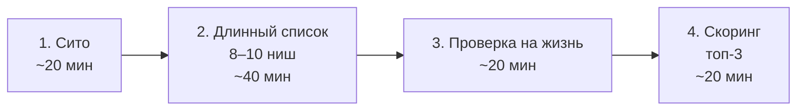

# 🔹 Шаг 1 · Проект «Выбор ниши» · Личное сито, длинный список и топ-3

> **Зачем.** Идеи ниш сопоставляем с личными ограничениями, активами и доступными свидетельствами спроса. Этот шаг даёт два инструмента: **жёсткое сито** (что отсекает сразу) и **скоринг** (что сравнивает оставшееся). Итог шага — 1–3 предварительных кандидата и план проверки опасных допущений.
> **Формат.** Шаг проекта интереса: без обязательного недельного слота, мини-теста и оценки; фактическое время входит в общую нагрузку (правило 27 `AGENTS.md`). Проверка — вердикт и разбор.
> **Время:** ~1,5–2 ч. **Дата выдачи:** 16.11.2026
> **Как сдавать.** Таблицы заполняются **в карточке** — [[Фаза 0/Проекты/Выбор ниши/Выбор ниши|Выбор ниши]], разделы 1, 2 и 4. В полях «Ответ:» здесь — только вывод одной-двумя строками на задание. Дублировать таблицы не надо.

---

## 📚 Метод (минимум, ~12 мин)

### Откуда берутся кандидаты — четыре источника, а не фантазия

1. **Активы.** Что ты умеешь лучше среднего, к чему у тебя доступ, что ты знаешь изнутри. Инфраструктура, 1С, звук и работа с агентами дают исходные гипотезы о преимуществах. Сочетание навыков полезно, только если оно решает нужную клиенту задачу; это предстоит проверить.
2. **Боль, которую видел своими глазами.** Не «говорят, есть проблема», а «я видел, как люди на это тратили часы и ругались». Собственный опыт помогает поставить вопросы, но тоже может быть нерепрезентативным.
3. **Рынки, где деньги уже ходят.** Правило простое: существующие платежи — полезное свидетельство спроса; отсутствие найденных платежей означает неопределённость, а не доказанное отсутствие рынка. Ищи, где платят **сейчас**, а не где «будет платить через три года».
4. **Скучное.** Всё, что связано с отчётностью, согласованиями, бумагами, складами, учётом и регламентами, выглядит неинтересно — такие категории тоже стоит рассмотреть. Их конкуренцию и маржу проверяют отдельно: скука не гарантирует доходность.

### Что уже есть — не начинай с нуля

В папке `Desktop\BIZ` лежит твоя собственная работа: фулфилмент и складское хранение, модель на 36 месяцев, тарифы, налоги, конкуренты. Это **готовый кандидат в длинный список** — внеси его как одну из строк, а проверенные числа **перенеси в «Дневник цифр»** карточки (раздел 4) с пометками `ФАКТ` / `ОЦЕНКА` / `РАСЧЁТ`. Заново это исследование не делается. Проектом «Выбор ниши» эта ниша при этом не становится — она просто один из кандидатов.

### Что можно отдать агентам, а что нет

Ты почти всё исследуешь через агентов, поэтому вот граница:

| Отдаётся агенту | Остаётся за тобой |
|---|---|
| Набрать **широкий** список направлений (10–15) без фаворита — это приём «варианты без выбора» из `0.BIZ.01` | Сито: бюджет, часы, минимум прибыли, табу |
| Собрать по каждой нише внешние признаки: сколько игроков, диапазон цен, требования и нормы — **со ссылками** | Оценки по пяти критериям и выбор топ-3 |
| Проверить факты по первоисточникам | Источник «видел боль своими глазами» — его у агента нет |
| Черновик таблиц в карточке | Решение, что отсеяно и почему |

**Правило:** агент даёт варианты и факты, критерии и выбор — твои. Если агент принёс готовый топ-3 с обоснованием — это не результат шага, а черновик.

### Сито — жёсткий отсев, а не оценка

Ниша отсеивается сразу, если не проходит **хотя бы один** пункт сита. Сито не спорит и не сравнивает: оно просто вычёркивает. Порядок важен — сначала отсев, потом скоринг, иначе понравившаяся идея протащит себя через все фильтры.

### Скоринг — пять критериев, оценка 1–5

| Критерий | 1 балл | 5 баллов |
|---|---|---|
| **Актив** | ничем не выделяюсь | у меня есть то, чего у других нет |
| **Порог входа** | нужны миллионы и год | можно начать на свои и за месяц |
| **Проверяемость** | спрос не проверить без запуска | спрос проверяется за неделю и почти бесплатно |
| **Доступ к клиенту** | не знаю, где эти клиенты | знаю конкретных людей или места, могу дотянуться |
| **Личный интерес** | противно | готов заниматься годами |

**Скоринг — предварительная гипотеза.** Низкие «актив» и «доступ к клиенту» означают риск, который нужно проверить, а не автоматический запрет. Рядом с баллом запиши основание и уверенность. Жёстко отсекаются только явно заданные личные ограничения.

В список включи минимум два направления вне IT и автоматизации. Разрешены 1–3 предварительных финалиста: не нужно добирать три искусственно. Для них сразу запиши в карточку два опасных допущения, дешёвые проверки и пороги отказа — до получения результатов.

---

## ✏️ Задания

1. [ ] **Личное сито** (~20 мин). Заполни таблицу 1 карточки: деньги на старт, личных часов в неделю, минимальная прибыль, срок до первых денег, география, табу, **активы и рычаги**.
   🧾 **Что сдать:** заполненная таблица в карточке + одна строка здесь: какой пункт сита самый жёсткий и почему.
   **Образец формы** (на другом случае): `Деньги на старт · 150 000 ₽ · больше нет, кредит не беру`.
   **Критерий сдачи:** все семь полей заполнены, **числа — там, где это деньги и время** (суммы, часы, месяцы); география, табу и активы — словами, но конкретно («Екатеринбург и область, дальше не поеду», а не «где удобно»). В «активах» — не меньше трёх пунктов, каждый с пометкой, чем он даёт преимущество.
   **Ответ:**

2. [ ] **Длинный список: 8–10 ниш** (~40 мин). Набери кандидатов по четырём источникам выше. Для каждой — источник идеи и одно предложение, **кто платит и за что**. Фулфилмент и хранение из `Desktop\BIZ` — одна из строк.
   🧾 **Что сдать:** таблица в карточке (раздел 2): `ниша · источник идеи (актив / видел боль / деньги уже ходят / скучное) · кто платит и за что`.
   **Образец строки** (на выдуманной нише): `настройка складского учёта для мелких оптовиков · актив: 1С и учёт · платят оптовики за то, чтобы остатки сходились и налоговая не задавала вопросов`.
   **Критерий сдачи:** 8–10 строк; у каждой назван плательщик; минимум два направления — вне IT и автоматизации; связь с активами описана как гипотеза; черновик широкого списка можно было получить агентом, но источник и плательщик у каждой строки — твои.
   **Ответ:**

3. [ ] **Проверка на жизнь** (~20 мин). По каждому кандидату возьми **один-два внешних признака**, что в этой категории ходят деньги. Признак выбирается под нишу:
   - **офлайн и локальные услуги** — число игроков в 2ГИС или на Картах по категории в твоей географии;
   - **B2B, онлайн, продукты и SaaS** — спрос по Wordstat, живые объявления на Авито или вакансии на hh (нанимают под то, за что платят);
   - **редкое и нишевое** — подписчики и отзывы у 2–3 существующих игроков.
   🧾 **Что сдать:** колонка к таблице в карточке: `признак · что нашёл · вывод`.
   **Образец формы** (на выдуманной нише): `2ГИС «склад ответственного хранения», Екатеринбург · 26 игроков, цены 350–600 ₽/м² · есть признаки предложения; платёжеспособный спрос ещё нужно проверить`.
   **Критерий сдачи:** по всем кандидатам; признак назван явно и указано, что он доказывает. Число игроков — предложение, отзывы — клиентский опыт, подписчики — аудитория: по отдельности они не подтверждают прибыльность входа нового участника. **Ноль игроков — это не автоматический отсев:** пустая категория означает либо нишу, которой ещё нет (и тогда нужен признак спроса, а не предложения), либо отсутствие спроса. Напиши словами, какая из двух версий вероятнее и почему.
   **Ответ:**

4. [ ] **Скоринг и топ-3** (~20 мин). Прогони кандидатов через сито (жёсткий отсев), затем оцени оставшихся по пяти критериям 1–5. Занеси в раздел 2 карточки со состояниями `🟢 топ-3` · `🟡 в списке` · `❌ отсеяна — причина`.
   🧾 **Что сдать:** таблица в карточке: `ниша · пять оценок · сумма · состояние · причина отсева` + 3–5 строк здесь: почему выбраны эти 1–3 кандидата и какие два допущения проверять первыми.
   **Образец строки** (на выдуманной нише): `складской учёт · 5/2/4/4/3 = 18 · 🟢 топ-3 · прошла сито, актив и доступ высокие`.
   **Критерий сдачи:** у каждой отсеянной — причина; для низких оценок «актив» и «доступ» назван риск и способ проверки; в объяснении названо, что ты **не** взял и почему.
   **Ответ:**

---

## ✍️ Отчёт

- **Время (сколько ушло):**
- **Что было неожиданным:**
- **Трудности и вопросы:**
- **Подсказки Тьютора:** *(заполняет Тьютор, если помогал)*

---

## ✅ Проверка *(заполняет Ментор)*

> Вердикт и короткий разбор, без оценки. Смотрю: сито заполнено числами там, где деньги и время; плательщик назван у каждой ниши; проверка на жизнь сделана признаком, подходящим нише; у отсеянных есть причины; риски низких оценок явно названы; допущения и пороги отказа записаны до проверки.
