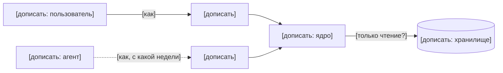

# 🏗 Design doc — шаблон для «Второго мозга»

> **Что это.** Общий `Шаблоны/Design doc.md`, подогнанный под полигон: какие разделы писать сейчас (шаг 2 практики недели 3, «на страницу»), какие — позже и к какой неделе, откуда брать содержание. Черновик от 05.11.2026, переделан в тот же день: в design doc — **только устройство продукта**; инструменты разработки и поведение агента-кодера — в `AGENTS.md` репозитория. Заполненный по этому шаблону вариант — `docs/design.md` в репозитории (🤖, ждёт проверки).
> **Куда копировать:** `docs/design.md` в репозитории `C:\Projects\second-brain`. Заполняешь ты; места для ответа — `[дописать: …]`. Образцы строк — на **другой** системе (бот сводки бэкапов из Сессии 11), чтобы не подсказывать ответ.
> **Метки разделов:** 🟢 — пишем сейчас, на страницу · ⏳ нед. N — раздел появится, когда до него дойдёт практика; сейчас — одна строка «будет на неделе N».

> [!warning] Чего в design doc нет — три документа, три уровня
> | Документ | Что в нём | Пример из полигона |
> |---|---|---|
> | **Design doc** (этот) | Система целиком: части, потоки данных, угрозы, НФ всей системы, что не делаем, решения | «Ядро — библиотека, CLI и MCP — тонкие входы» |
> | **Правила проекта** — `AGENTS.md` репозитория или `constitution.md` spec-kit | Что действует в **любой** задаче: поведение агента-кодера, изоляция, код, тесты, линтеры, инструменты из [[Тьютор/Инструментарий\|Инструментария]] | «Агенту хранилище не менять», «тесты только на синтетике», «Bandit перед коммитом» |
> | **Спека задачи** — `specs/NN-…md` (в spec-kit к ней ещё `plan.md` фичи) | Одна задача: вход, выход, критерии с числами, тест-кейсы | «`read_note()` на файле до 1 МБ — ≤ 100 мс» |
>
> Проверка: если пункт касается одной функции — в спеку; если любой задачи — в правила; если устройства системы — сюда. `plan.md` фичи в spec-kit ссылается на этот документ, а не повторяет его.

---

# 🏗 Design doc: «Второй мозг» — MCP-сервер над хранилищем Obsidian

> Дата: [ДД.ММ.ГГГГ] · Статус: черновик · Автор: [ты] · Ревью: [агент-ревьюер по `AGENTS.md` §7 / Ментор] · Версия: короткая (нед. 3), полная — нед. 14 (`0.SD.04`)

## 1. Цель и контекст 🟢

- **Боль:** [дописать: какую проблему решаем — своими словами, 1–2 предложения. Подсказка: карточка полигона, «Что и зачем»]
- **Для кого:** [дописать: кто пользуется — человек через CLI, Claude Code через MCP; кто ещё]
- **Как поймём, что работает:** [дописать: 1–2 наблюдаемых признака на уровне системы, а не одной функции]

> Образец (бот бэкапов): «Начальник смены узнаёт о сбое бэкапа до 7:00 без ручной проверки журналов; признак — 0 пропущенных сбоев за месяц».

## 2. Требования к системе 🟢

Только то, что касается **системы целиком**. НФ одной функции — в её спеке. Источник — задание 4 [[Фаза 0/Недели/Неделя 03 (02.11–08.11)/Сессия 11 — 0.SD.01|Сессии 11]] и разбор к нему в «Проверке».

| Вид | Требование | Как проверить |
|---|---|---|
| Ф | [дописать] | [дописать] |
| НФ | [дописать: с числом и условием замера — что мерим, на каком объёме, в скольких запусках из 100] | [дописать] |
| НФ (безопасность) | [дописать: свойство, а не способ — «что не должно случиться», а не «каким методом»] | [дописать] |
| О | [дописать: что задано извне и не обсуждается] | — |

> Образец строки: `НФ · сводка по запросу к боту приходит за 2 с в 95 запросах из 100 в окно 8–10 · 100 запросов тестом, считаю 95-й`.

**Что не делаем** (уровень системы): [дописать: 2–3 строки — то, что будет соблазнять. Подсказка: ответ «Что не делаем» в задании 4 Сессии 11]

## 3. Оценки «на салфетке» 🟢 *(3–4 строки)*

[дописать: сколько заметок и файлов в хранилище, общий объём, самый большой файл; сколько запросов в день от тебя и от агента. Отсюда — нужен ли индекс и сколько он весит]

> ⏳ нед. 5: токены и деньги — сколько стоит одна сводка через LLM и сколько в месяц (лог стоимости из практики недели 5).

## 4. Архитектура 🟢

**Контекст** — кто и что вокруг системы (уровень 1 C4). **Контейнеры** — из чего она состоит (уровень 2). Полная C4 — нед. 14 (`0.SD.03`).

**Ключевые компоненты** — по строке на каждый: ответственность и чего он **не** делает.
- [дописать]

**Решения, которые уже приняты** (журнал решений и карточка полигона) — перенеси своими словами, каждое одной строкой «решение → что из этого следует»: только чтение по устройству · путь к хранилищу настройкой · строгая проверка путей · ядро-библиотека и тонкие входы · статьи по подписке не уходят провайдеру · экспорт наружу — только после подтверждения человеком. Новых решений здесь не принимаешь — они идут в [[Фаза 0/Проекты/Полигон/Решения|журнал решений]], а в нед. 14 становятся ADR.

## 5. Данные 🟢 *(коротко)*

| Данные | Где лежат | Кто читает | Кто пишет | Сколько живут |
|---|---|---|---|---|
| [дописать: заметки] | | | | |
| [дописать: настройки и секреты] | | | | |
| ⏳ нед. 4: индекс эмбеддингов | [дописать на нед. 4: где — внутри хранилища или снаружи, и почему] | | | ⏳ нед. 13: переиндексация по таймеру |
| ⏳ нед. 5: лог токенов и стоимости | | | | |

> Образец строки (бот бэкапов): `журнал бэкапов · сервер бэкапа, /var/log/backup · скрипт сводки · служба бэкапа · 30 дней, ротация`.

**Что уходит наружу** (облачной модели, провайдеру эмбеддингов): [дописать: что можно и что нельзя. Опора — правило в `AGENTS.md` обучения, раздел 1: «Провайдерам моделей и эмбеддингов… может уходить всё хранилище, кроме статей по подписке»]

## 6. API и контракты ⏳ нед. 8

Инструменты MCP: имя, вход, выход, ошибки. Сейчас — одна строка: «CLI `read <путь>` — контракт в `specs/01-read-note-cli.md`; MCP-инструменты — нед. 8 (`0.AGT.06`)».

## 7. AI-часть ⏳ нед. 4–10

Сейчас — одна строка «будет». Позже по пунктам: модели и резервная (нед. 7: облачная против локальной) · что попадает в контекст и откуда (нед. 5–6) · инструменты агента и их права (нед. 6–8) · где человек подтверждает (нед. 9: экспорт) · evals — ссылка на eval-отчёт (нед. 10, `Шаблоны/Eval-отчёт.md`).

## 8. Безопасность 🟢

**Границы доверия** — что считаем недоверенным входом: [дописать: минимум три. Подсказка: откуда приходит текст, который не писал ты сам; кто передаёт путь; кто читает вывод]

**Угрозы с мерой** — 3+ строки по форме из шага 2 практики: `угроза · буква STRIDE · ущерб В/С/Н · мера и где она стоит`. Источник — твои ответы в заданиях 1–3 [[Фаза 0/Недели/Неделя 03 (02.11–08.11)/Сессия 10 — 0.SEC.01|Сессии 10]].
- [дописать]
- [дописать]
- [дописать]

> Образец строки (бот бэкапов): `Чужой в чате получает сводку · I · С · бот отвечает только ID из списка, проверка до формирования ответа`.

Угрозы **процесса разработки** — агент-кодер, зависимости, секреты в репозитории — не здесь, а в `AGENTS.md` (изоляция агента, правила зависимостей).

> ⏳ нед. 13: полная модель угроз полигона по `Шаблоны/Модель угроз.md` — здесь останется ссылка. Чем её делать (DFD и STRIDE, Threat Composer, OWASP pytm) — вопрос процесса, решается на неделе 13.

## 9. Отказы и деградация ⏳ нед. 7–9

Сейчас — одна строка. Позже: модель недоступна → [что делаем]; индекс устарел → [что видит пользователь]; хранилище недоступно → [какая ошибка].

## 10. Наблюдаемость и стоимость ⏳ нед. 5

Лог вызовов и токенов, бюджет в месяц, когда тревога. Сейчас — одна строка «будет на неделе 5».

## 11. Альтернативы ⏳ нед. 14

Сейчас — только ссылка на [[Фаза 0/Проекты/Полигон/Решения|журнал решений]]: там уже есть «выбрал … вместо …». На нед. 14 ключевые станут ADR (`Шаблоны/ADR.md`).

## 12. Открытые вопросы и риски 🟢

- [дописать: что ещё не решено и к какой неделе нужно решить. Подсказка: где хранить индекс; как отдавать текст заметки агенту, чтобы он не стал инструкцией]

## 13. План ⏳ по мере задач

Дерево фичи 1 — [[Фаза 0/Проекты/Полигон/Полигон#Фича 1 — поиск и прошлые ошибки|карточка полигона]]. Здесь — только ссылки на спеки по мере появления: `specs/01-read-note-cli.md` — [статус].

---

> [!tip]- Как проверить свою короткую версию (раскрыть)
> - На страницу: разделы 🟢 заполнены, ⏳ — по одной строке.
> - Ни одного пункта, который касается одной функции (это в спеку) или любой задачи (это в правила).
> - В разделе 2 у каждого НФ есть число и условие замера; НФ безопасности — свойство, а не способ.
> - В разделе 8 — 3+ угрозы продукта с мерой; угроз процесса разработки здесь нет.
> - Схема в разделе 4 показывает, где граница «только чтение».
