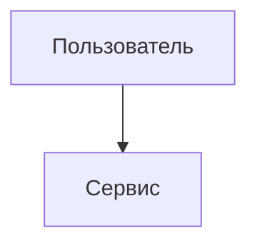

# 🏗 Design doc: [Система]

> Дата: ДД.ММ.ГГГГ · Статус: черновик / на ревью / утверждён · Автор: [ты] · Ревью: [агент / кто]
> Design doc пишется до реализации и обновляется, когда система расходится с ним.

## 1. Цель и контекст
Что строим, для кого, какую проблему решаем. Почему сейчас.

## 2. Требования
- **Функциональные:**
- **Нефункциональные:** нагрузка, задержка, доступность, стоимость, безопасность, приватность.
- **Не-цели:**

## 3. Оценки «на салфетке»
Пользователи, запросы в секунду, объёмы данных, токены и стоимость в месяц.

## 4. Архитектура
C4: контекст и контейнеры (Mermaid).

Ключевые компоненты и их ответственность.

## 5. Данные
Модель данных, где что хранится, сколько живёт, кто имеет доступ.

## 6. API и контракты
Эндпоинты, инструменты агента, MCP-серверы, форматы.

## 7. AI-часть (если есть)
- Модели и маршрутизация, резервная модель.
- Контекст: что попадает в промпт и откуда.
- Инструменты агента и их права.
- Где человек в контуре (подтверждения).
- Как измеряем качество (evals) — ссылка на eval-отчёт.

## 8. Безопасность
Кратко + ссылка на модель угроз.

## 9. Отказы и деградация
Что происходит, когда падает БД, модель, внешний API; таймауты, повторы, идемпотентность.

## 10. Наблюдаемость и стоимость
Логи, метрики, трейсы; бюджеты и алерты.

## 11. Альтернативы
Что рассматривали и почему не выбрали. Ключевые решения — отдельными ADR.

## 12. Открытые вопросы и риски

## 13. План реализации
Шаги размером «один PR», в каждом — спецификация (SDD).
