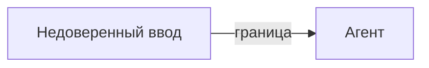

# 🛡 Модель угроз: [Система]

> Дата: ДД.ММ.ГГГГ · Связанный design doc: [[...]]
> Методика: STRIDE для системы в целом + OWASP Top 10 for LLM Applications 2025 и OWASP Top 10 for Agentic Applications 2026 для AI-части.

## 1. Что защищаем (активы)
| Актив | Почему ценен | Где находится |
|---|---|---|
| | | |

## 2. Кто может навредить (нарушители)
Внешний злоумышленник, пользователь-злоумышленник, автор вредного документа/страницы, скомпрометированная зависимость, сам агент (ошибка или перехват цели).

## 3. Схема и доверенные границы
Диаграмма потоков данных; где проходят границы доверия. **Всё, что прочитала модель, — недоверенный ввод.**

## 4. «Смертельная триада» — проверка
- [ ] Агент имеет доступ к приватным данным?
- [ ] Агент читает недоверенный контент?
- [ ] У агента есть канал наружу (отправка, запросы, ссылки, изображения)?

Если отмечены все три — нужна явная мера, разрывающая цепочку.

## 5. Угрозы
| # | Угроза | Категория (STRIDE / LLM / ASI) | Вероятность | Ущерб | Мера защиты | Статус |
|---|---|---|---|---|---|---|
| 1 | | | Н/С/В | Н/С/В | | ⬜ |

## 6. Права инструментов агента
| Инструмент | Что может | Риск | Подтверждение человеком | Лимиты |
|---|---|---|---|---|
| | | | да / нет | |

## 7. Остаточные риски
Что осознанно принимаем и почему.

## 8. Как проверяем
Тесты, red team-кейсы, evals на безопасность.
