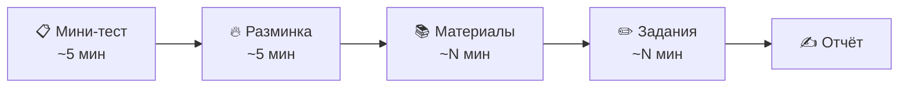
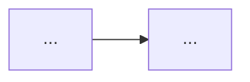

# 🔹 Сессия [N] · Неделя [NN] · `0.XXX.NN` — [Тема]

> **Шаблон сессии.** Агент создаёт `Фаза N/Недели/Неделя NN (…)/Сессия N — <коды>.md` утром после проверки прошлой сессии (автозапуск) или по запросу «давай задание».
> **Как работать:** читай задание → пиши ответ **прямо под ним**, в поле «Ответ:» (текст, код блоком ```, ссылка на коммит или файл) → отмечай `[x]` → в конце заполни короткий отчёт → пиши агенту «проверь» или оставь до утра: заполненное поле «Время» = сдано, утренний агент проверит сам.
> Занятие интереса недели — тот же шаблон, файл `Интерес — <код>.md`. Ивент интересов на выходные — тот же шаблон без мини-теста и оценки, файл `Ивент интересов — <тема>.md`.
> **Визуал** (сценарий A2, шаг 3): выноски Obsidian (`> [!тип]`, со знаком `-` — свёрнута), схемы Mermaid там, где они объясняют лучше текста, карта сессии в начале, интерактивное демо, если тема про механизм. **Поля «Ответ:» и задания — никогда не внутри выносок**: в них неудобно писать.
> Удали эту врезку при создании сессии.

> [!abstract] Зачем
> [1–2 предложения: какую задачу это решает в нашем векторе]

**Время:** ~[1–1,5] ч · **Дата выдачи:** [ДД.ММ]


> 🎲 **Ивент:** [формат из каталога ROADMAP] — [вводные и правила игры] *(только если занятие проходит как ивент, правило 29 `AGENTS.md`; иначе удали строку)*

---

## 📋 Мини-тест по прошлой сессии *(Сессия [N−1] · `0.XXX.NN`)*

> [!warning] Тест — без подсказок Тьютора и без поиска
> Не знаешь — так и напиши: «не знаю» — тоже ответ. Проверит Ментор вместе с этой сессией; от результата зависит, закроется ли прошлое занятие (2 из 3).
> *(Агенту: вопросы — прицельно по ошибкам и фокусам из «Проверки» прошлой сессии; у интереса — по прошлому занятию интереса. После вход-теста и в первой сессии фазы — удали раздел.)*

1. [ ] [Вопрос]
   **Ответ:**
2. [ ] [Вопрос]
   **Ответ:**
3. [ ] [Вопрос]
   **Ответ:**

---

## 🔥 Разминка (по желанию, 5 мин)

1. [ ] Вспомни 3 факта из прошлого занятия — без подглядывания.
   **Ответ:**
2. [ ] Микрозадача руками: [3–10 строк на Python]
   **Ответ:**
   ```python

   ```

---

## 📚 Материалы

> [!tip] Материалы настоятельно рекомендуются к изучению перед выполнением заданий.

**[Главная идея занятия — схемой]:**



[1–3 предложения к схеме]

- [Название — ссылка, ~N мин] *(проверено: ДД.ММ)*

> [!info]- Что читать и зачем — раскрыть
> [разделы, на что обратить внимание; длинные пояснения — сюда, а не в основной текст]

> [!tip]- 🧭 Как подступиться к заданию N *(только если для задания нужен метод, которого не было в материалах и прошлых занятиях)* — раскрыть
> 1. [шаг метода — без готового ответа]

> [!example] 🎮 Интерактивное демо — «[название]» *(если тема про механизм)*
> ▶ **[Открыть демо](ссылка на артефакт)** · копия в хранилище: `Материалы/Демо/<код> — <тема>.html` · ~N мин
> [что покрутить и что увидеть; часть, которая подсказывает ответ на задание, — за кнопкой «после заданий»]

> [!quote]- ⭐ Доп. материал от любимых авторов *(по желанию, не входит в сдачу; только если есть подходящее — сценарий A2, шаг 4)* — раскрыть
> - [[Материалы/<Автор>/<раздел>/<статья>|Название]] · ~N мин — зачем к этой сессии · ⚠️ что устарело или спорно *(сверено: ДД.ММ)*
> - *(статей может быть несколько — по строке на каждую)*

---

## ✏️ Задания

1. [ ] [Что сделать]
   **Критерий сдачи:** [что должно получиться]
   **Ответ:**

2. [ ] [Что сделать]
   **Критерий сдачи:** [...]
   **Ответ:**

3. [ ] **🔧 Руками** (10–20 мин): [попробуй на маленьком примере инструмент, команду или сервис из материалов — что именно запустить и на чём]
   **Критерий сдачи:** вывод команды или скриншот + 2–3 строки: что увидел, где пригодится, что мешало.
   **Ответ:**

4. [ ] **Своими словами:** 3–5 предложений — что понял и где это пригодится.
   **Ответ:**

---

## 🛠 Связь с практикой *(только если занятия сессии нужны для практики недели)*

После этой сессии можно делать: [шаг N практики — что именно] → [[НЕДЕЛЯ#🛠 Практика недели]]. Ответы по практике — в `НЕДЕЛЯ.md`.

---

## 🟨 Мостик к интересу *(только если тема пересекается; по желанию)*

[2–3 строки: как тема связана с LOW / SQL / CTF / PAI + микрозадача]
**Ответ:**

---

## ✍️ Отчёт

- **Время (сколько ушло):**
- **Трудности и вопросы:**
- **Подсказки Тьютора:** *(заполняет Тьютор, если помогал: «разобрано N из M заданий; задание N — ур. X»)*

---

## 🎙 От Тьютора *(только для ивентов и интерактивных заданий, которые вёл Тьютор; иначе удали раздел)*

*(ведущий пишет после игры: как шла игра по раундам, итог и счёт, что получилось, где буксовал — комментарий, без оценки и вердикта. Разбор и оценку даёт Ментор ниже)*

---

## 📋 Мини-тест по этой сессии
*(будет в начале следующей сессии — Ментор составит его по итогам проверки)*

---

## ✅ Проверка *(заполняет Ментор)*

> Подробно, но по делу: по каждому заданию — что сделано, что верно, где ошибка и почему это ошибка. Цитируй ответ пользователя, когда разбираешь неточность. Пример заполнения — ниже, в комментарии.

**Вердикт по заданиям:**

| # | Задание | Статус | Что верно | Что не так / чего не хватает | Подсказки |
|---|---|---|---|---|---|
| 1 | | ✅ / 🟡 / ❌ | | | — / ур. N |

**Разбор ошибок** *(по каждой существенной: что написано → как правильно → почему; без готовых решений там, где пользователь может доделать сам)*:
-

**Что получилось хорошо** *(конкретно, со ссылкой на задание)*:
-

**Оценка:** /10 — [обоснование: от целевых 5 вверх или вниз — за что именно; как учтены подсказки Тьютора (правило 28)]

**Время:** [из отчёта] · против плана ~[N] ч — [норма / быстрее / дольше и почему]

**Мини-тест по прошлой сессии (Сессия [N−1]):** /3 — [по каждому вопросу: ✅/🟡/❌ + одна строка, что не так] → занятие `0.XXX.NN` закрыто ✅ / в долги 🔁 *(нет раздела — удали строку)*

**Занятия:** `0.XXX.NN` — ⏳ ждёт мини-тест (в начале Сессии [N+1]) / в долги 🔁 (что именно доделать и к какому сроку)

**Долги:** [конкретно: что, в каком объёме, к какой сессии] / —

**→ Фокусы** *(что учесть в следующих сессиях; продублировано в `ЗАМЕТКИ.md`)*:
-

**Теги:** #тема · #тип-ошибки

---

## 🃏 Карточки для повторения
*(Ментор добавляет при проверке: 4–8 карточек — ключевые понятия сессии и ошибки пользователя. Формат плагина Spaced Repetition: `Вопрос::Ответ`, одна карточка — одна строка; в начале блока — тег `#flashcards/<предмет>`, например `#flashcards/AIN`)*

<!-- Пример заполнения:

**Вердикт по заданиям:**

| # | Задание | Статус | Что верно | Что не так / чего не хватает | Подсказки |
|---|---|---|---|---|---|
| 1 | Схема цикла агента | ✅ | Все 4 звена: модель → инструмент → результат → снова модель; верно отмечено, где агент решает сам | — | — |
| 2 | Сравнение режимов прав | 🟡 | Различие «спрашивать / не спрашивать» понято | Не сказано, чем опасен режим без подтверждений для команд с удалением; пример из своей практики отсутствует | ур. 1 |
| 3 | Своими словами: SDD | ✅ | «Спека — это ТЗ, по которому агент сдаёт работу» — точная формулировка | — | — |

**Разбор ошибок:**
- Задание 2: «в авто-режиме агент сам разберётся, что опасно» → агент оценивает опасность по своей модели мира, а не по твоей: `rm` в рабочей папке для него рутина. Поэтому опасные классы команд перечисляются явно в правилах проекта. Доделать: 2–3 строки с примером из своего Telegram-агента.

**Что получилось хорошо:**
- Задание 3: аналогия «спека — это ТЗ, по которому агент сдаёт работу» — точная и своя, её стоит использовать в спецификации практики.

**Оценка:** 5/10 — задания выполнены в полном объёме (целевой балл); 2 — частично, но это доработка, а не пропуск. Подсказка ур. 1 на оценку не влияет. Сверх задания ничего не было, поэтому не выше 5.

**Время:** 1 ч 20 мин · против плана ~1–1,5 ч — норма.

**Мини-тест по прошлой сессии (Сессия 2):** 2/3 — 1 ✅; 2 ✅; 3 🟡 путает «режим плана» и «режим без подтверждений» → занятие `0.AIN.01` закрыто ✅.

**Занятия:** `0.AIN.02` — ⏳ ждёт мини-тест (в начале Сессии 4); задание 2 доделать в разминке Сессии 4.

**Долги:** —

**→ Фокусы:**
- Режимы прав: в Сессии 4 разминка на различие «план / авто / ручное подтверждение».

**Теги:** #агенты #права #хорошая-аналогия
-->
