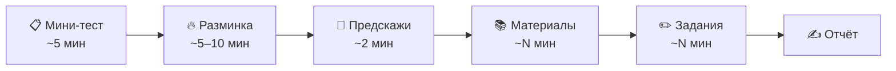
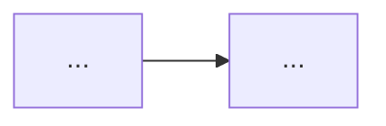

# 🔹 Сессия [N] · Неделя [NN] · `0.XXX.NN` — [Тема]

> **Шаблон сессии.** Агент создаёт `Фаза N/Недели/Неделя NN (…)/Сессия N — <коды>.md` утром после проверки прошлой сессии (автозапуск) или по запросу «давай задание».
> **Как работать:** читай задание → пиши ответ **прямо под ним**, в поле «Ответ:» (текст, код блоком ```, ссылка на коммит или файл) → отмечай `[x]` → в конце заполни короткий отчёт → пиши агенту «проверь» или оставь до утра: заполненное поле «Время» = сдано, утренний агент проверит сам.
> Занятие интереса недели — тот же шаблон, файл `Интерес — <код>.md`. Ивент интересов на выходные — тот же шаблон без мини-теста и оценки, файл `Ивент интересов — <тема>.md`.
> **Визуал** (сценарий A2, шаг 3): выноски Obsidian (`> [!тип]`, со знаком `-` — свёрнута), схемы Mermaid там, где они объясняют лучше текста, карта сессии в начале, интерактивное демо, если тема про механизм. **Поля «Ответ:» и задания — никогда не внутри выносок**: в них неудобно писать.
> Удали эту врезку при создании сессии.

> [!abstract] Зачем
> [1–2 предложения: какую задачу это решает в нашем векторе]
> 📰 **Из жизни:** [1–2 строки: свежий случай по теме из хроники `РАДАР.md` или известный инцидент] — что бы сделал ты? *(только если есть подходящий и проверенный; иначе удали строку)*

**Время:** ~[1–1,5] ч · **Дата выдачи:** [ДД.ММ]


> 🎲 **Ивент:** [формат из каталога ROADMAP] — [вводные и правила игры] *(только если занятие проходит как ивент, правило 29 `AGENTS.md`; иначе удали строку)*

---

## 📋 Мини-тест по прошлой сессии *(Сессия [N−1] · `0.XXX.NN`)*

> [!warning] Тест — без подсказок Тьютора и без поиска
> Не знаешь — так и напиши: «не знаю» — тоже ответ. Проверит Ментор вместе с этой сессией; от результата зависит, закроется ли прошлое занятие (2 из 3).
> *(Агенту: вопросы — прицельно по ошибкам и фокусам из «Проверки» прошлой сессии; у интереса — по прошлому занятию интереса. После вход-теста и в первой сессии фазы — удали раздел.)*

1. [ ] [Вопрос]
   **Ответ:**
2. [ ] [Вопрос]
   **Ответ:**
3. [ ] [Вопрос]
   **Ответ:**

---

## 🔥 Разминка (по желанию, 5–10 мин)

1. [ ] 🃏 **Карточки** (5 мин): в Obsidian — команда «Spaced Repetition: Review flashcards from all notes», в окне колод выбери `<Фаза0 — в нечётной сессии · все колоды — в чётной>` и пройди те, что подошли по сроку. Больше 30 — не обязательно все; нет ни одной — пропусти пункт.
   **Ответ:** *(сколько прошёл · какие забыл)*
2. [ ] Микрозадача руками: [3–10 строк на Python]
   **Ответ:**
   ```python

   ```

---

## 🔮 Предскажи (2 мин, не оценивается)

[один вопрос «что будет, если…» по механизму занятия — на примере из твоих систем]
**Ответ (догадка до материалов — ошибаться можно; вернёшься к ней в «Своими словами»):**

---

## 📚 Материалы

> [!tip] 📌 Минимум для заданий — ~N мин
> Пункты идут по порядку заданий: у каждого задания есть строка «📖 Сначала» — какие пункты прочитать или посмотреть перед ним. Можно идти так: пункт → задание → следующий пункт. Всё, что нужно для заданий, — здесь. «🔍 Глубже» ниже — только сверх заданий, по желанию.

### М1. Тема первого шага

[Объяснение, а не шпаргалка: зачем это → пример на живых числах из твоих систем → интуиция → только потом формула или правило. Таблица-сводка — в конце пункта, как итог.]
[**Пример — парой** (AGENTS.md, A2, шаг 3): к каждому понятию — второй пример, непохожий на первый (другой объект, направление или вопрос). Вопрос-подсказку пиши через суть, а не через первый пример. В таблице — колонки «Пример» и «Ещё пример — с другой стороны».]

**[Главная идея шага — схемой]** *(схема Mermaid — в каждом пункте, где она объясняет лучше текста: цикл, поток данных, кто кому шлёт, состояния, сравнение; хотя бы одна на сессию)*:



[1–3 предложения к схеме]

- 🎬 [Видео — ссылка, ~N мин] — что в нём к этому шагу *(проверено: ДД.ММ)*

### М2. Тема второго шага

[объяснение + схема, если помогает]

- 📄 [Статья или документация — ссылка, ~N мин] *(проверено: ДД.ММ)*

> [!info]- 🔍 Глубже — по желанию, ~N мин — раскрыть
> [только то, что сверх заданий: доп. ссылки и темы на вырост. Объяснения, нужные для заданий, и ответы на них — не сюда, а в пункты М]

> [!danger] 🗡 Как это ломают
> [1–3 строки: как тему занятия атакуют или где она становится дырой — без ответа на задания] *(связь натянута — удали выноску)*

> [!tip]- 🧭 Как подступиться к заданию N *(только если для задания нужен метод, которого не было в материалах и прошлых занятиях)* — раскрыть
> 1. [шаг метода — без готового ответа]

> [!example] 🎮 Интерактивное демо — «[название]» *(обязательно; эксперимент или тренажёр; критерии — `Шаблоны/Демо.md`)*
> ▶ **[[Материалы/Демо/<код> — <тема>.html|Открыть демо]]** (копия в хранилище) · [артефакт](ссылка на артефакт, если опубликован) · ~N мин *(ссылки только на хранилище или артефакт, не на `file:///` и папки агента)*
> 🎯 **Миссия:** [чего добиться в демо и что записать — в ответ задания N]; часть, которая подсказывает ответ на задание, — за кнопкой «после заданий»
> ✅ ☑ ручка ☑ предсказание ☑ третья механика ☑ злой случай ☑ миссия с числом ☑ закрытая часть ☑ свой мир ☑ проверено в браузере

> [!quote]- ⭐ Доп. материал от любимых авторов *(по желанию, не входит в сдачу; только если есть подходящее — сценарий A2, шаг 4)* — раскрыть
> - [[Материалы/<Автор>/<раздел>/<статья>|Название]] · ~N мин — зачем к этой сессии · ⚠️ что устарело или спорно *(сверено: ДД.ММ)*
> - *(статей может быть несколько — по строке на каждую)*

---

## ✏️ Задания

> **Для агента — как собрать задание** (сценарий A2, шаг 3 `AGENTS.md`; удали врезку при создании). Общий минимум в каждом задании: что дано · что сдать и в каком виде · образец формы ответа на другом случае. Затем — прогон: реши задание сам по материалам; где угадывал — перепиши.

| Тип | Примеры | Что ещё обязательно | Чего не надо |
|---|---|---|---|
| **Расчёт** | `MTH`, стоимость токенов | В материале — такой же пример, решённый по шагам; в ответе просить ход решения, а не только число | Выдуманной «жизненной» обёртки: голые числа (`1, 3, 3, 5` — посчитай дисперсию) часто лучше |
| **Код** | `PY`, «код руками» | Что функция принимает и возвращает; 2–3 вызова с результатом; что делать с ошибочным входом | Описания алгоритма словами вместо примеров вызова |
| **Спека и тесты** | `AIN.04` | Смысл функции простыми словами («листаем заметки по страницам»); пример вызова с расчётом (`pages(7, 3)` → 3: 3 + 3 + 1); задание про тесты или ревью — код реализации прямо в задании, с пояснением по строкам | Расчёта на то, что смысл очевиден |
| **Архитектура и решение** | `PAI`, `SEC`, `AGT` | Пример из жизни обязателен и подробен: кто ты, что сломалось (с цифрами), что есть под рукой, что сдать | «Завод хочет агента» без конкретной проблемы |
| **Своими словами** | конец сессии | Кому объясняешь и про что именно; объём | «Объясни тему» без рамок |
| **Руками** | 🔧 | Где запускать, какая команда, какой вывод примерно ждать | Одного «попробуй инструмент X» |

Пример из жизни можно в любом типе, если уместен; если есть — расписан подробно (см. строку «Архитектура и решение»).

1. [ ] [Что сделать]
   🧾 **Дано и что сдать:** [вводные; форма ответа; образец формы на другом случае]
   📖 **Сначала:** [[#М1. Тема первого шага|М1]]
   **Критерий сдачи:** [что должно получиться]
   **Ответ:**

2. [ ] [Что сделать]
   📖 **Сначала:** [[#М2. Тема второго шага|М2]]
   **Критерий сдачи:** [...]
   **Ответ:**

3. [ ] **🔧 Руками** (10–20 мин): [попробуй на маленьком примере **новый для тебя** инструмент, команду или сервис из материалов — лучше «сломай и почини»: сломай намеренно, посмотри симптомы, восстанови]
   **Критерий сдачи:** вывод команды или скриншот (сломанное и починенное) + 2–3 строки: что увидел, где пригодится, что мешало.
   **Ответ:**

4. [ ] **Своими словами:** 3–5 предложений — что понял и где это пригодится. Был ли прав в «🔮 Предскажи» — если нет, где ошибся.
   **Ответ:**

---

## 🛠 Связь с практикой *(только если занятия сессии нужны для практики недели)*

После этой сессии можно делать: [шаг N практики — что именно] → [[НЕДЕЛЯ#🛠 Практика недели]]. Ответы по практике — в `НЕДЕЛЯ.md`.

---

## 🟨 Мостик к интересу *(только если тема пересекается; по желанию)*

[2–3 строки: как тема связана с LOW / SQL / CTF / PAI + микрозадача]
**Ответ:**

---

## ✍️ Отчёт

- **Время (сколько ушло):**
- **Трудности и вопросы:**
- **Подсказки Тьютора:** *(заполняет Тьютор, если помогал: «разобрано N из M заданий; задание N — ур. X»)*
- **Демо:** 1–5 · что было непонятно или скучно

---

## 🎙 От Тьютора *(только для ивентов и интерактивных заданий, которые вёл Тьютор; иначе удали раздел)*

*(ведущий пишет после игры: как шла игра по раундам, итог и счёт, что получилось, где буксовал — комментарий, без оценки и вердикта. Разбор и оценку даёт Ментор ниже)*

---

## 📋 Мини-тест по этой сессии
*(будет в начале следующей сессии — Ментор составит его по итогам проверки)*

---

## ✅ Проверка *(заполняет Ментор)*

> Подробно, но по делу: по каждому заданию — что сделано, что верно, где ошибка и почему это ошибка. Пример заполнения — ниже, в комментарии.
> **Минус — с двумя цитатами:** «требовалось: …» (текст задания, критерий, «дано», `М`, образец) и «написано: …» (ответ). Нет цитаты требования — минуса нет, это дыра в задании (AGENTS.md, сценарий B, шаг 2). Перед записью — проход адвоката: перечитай ответ целиком, не закрыт ли минус в другом месте.
> **Метки замечаний:** ❌ ошибка — влияет на статус и оценку · 💡 можно сильнее — не влияет · ⚖ спорно — не влияет. Каждое — полным предложением, без «мелочь» и «дёшево».

**Главное:** держится — [...] · поправить — [...] · в следующую сессию — [...]

**Вердикт по заданиям:**

| # | Задание | Статус | Что верно | Что не так / чего не хватает | Подсказки |
|---|---|---|---|---|---|
| 1 | | ✅ / 🟡 / ❌ | | ❌ / 💡 / ⚖ + суть; у ❌ — «требовалось: …» · «написано: …» · «перечитал: не закрыто» | — / ур. N |

**Разбор ошибок** *(по каждой с меткой: что написано → как правильно → почему; без готовых решений там, где пользователь может доделать сам)*:
-

**Что получилось хорошо** *(конкретно, со ссылкой на задание)*:
-

**Оценка:** /10 — [обоснование: от целевых 5 вверх или вниз — за что именно; как учтены подсказки Тьютора (правило 28)]

**Время:** [из отчёта] · против плана ~[N] ч — [норма / быстрее / дольше и почему]

**Мини-тест по прошлой сессии (Сессия [N−1]):** /3 — [по каждому вопросу: ✅/🟡/❌ + одна строка, что не так] → занятие `0.XXX.NN` закрыто ✅ / в долги 🔁 *(нет раздела — удали строку)*

**Занятия:** `0.XXX.NN` — ⏳ ждёт мини-тест (в начале Сессии [N+1]) / в долги 🔁 (что именно доделать и к какому сроку)

**Долги:** [конкретно: что, в каком объёме, к какой сессии] / —

**→ Фокусы** *(что учесть в следующих сессиях; продублировано в `ЗАМЕТКИ.md`)*:
-

**Теги:** #тема · #тип-ошибки

---

## 🃏 Карточки для повторения
*(Ментор добавляет при проверке: 4–8 карточек — ключевые понятия сессии и ошибки пользователя. Формат плагина Spaced Repetition: `Вопрос::Ответ`, одна карточка — одна строка; в начале блока — тег `#flashcards/Фаза<N>/<предмет>`, например `#flashcards/Фаза0/AIN`. Карточка понятна сама по себе через месяц: без отсылок к функциям и примерам сессии (`pages`, «задание 2») — нужен пример, давай его прямо в ответе. Можно и карточку-таблицу (сравнение, признаки): строка вопроса, строка `?`, таблица, после — пустая строка. Плагин читает весь файл: `::` вне блока карточек (например, вывод pytest `файл::тест`) тоже станет карточкой — разорви его невидимым пробелом между двоеточиями)*

<!-- Пример заполнения:

**Главное:** держится — цикл агента и своя аналогия про ТЗ · поправить — опасные команды перечисляются в правилах явно, агент сам не поймёт · в следующую сессию — разминка на режимы прав.

**Вердикт по заданиям:**

| # | Задание | Статус | Что верно | Что не так / чего не хватает | Подсказки |
|---|---|---|---|---|---|
| 1 | Схема цикла агента | ✅ | Все 4 звена: модель → инструмент → результат → снова модель; верно отмечено, где агент решает сам | — | — |
| 2 | Сравнение режимов прав | 🟡 | Различие «спрашивать / не спрашивать» понято | Не сказано, чем опасен режим без подтверждений для команд с удалением; пример из своей практики отсутствует | ур. 1 |
| 3 | Своими словами: SDD | ✅ | «Спека — это ТЗ, по которому агент сдаёт работу» — точная формулировка | — | — |

**Разбор ошибок:**
- Задание 2: «в авто-режиме агент сам разберётся, что опасно» → агент оценивает опасность по своей модели мира, а не по твоей: `rm` в рабочей папке для него рутина. Поэтому опасные классы команд перечисляются явно в правилах проекта. Доделать: 2–3 строки с примером из своего Telegram-агента.

**Что получилось хорошо:**
- Задание 3: аналогия «спека — это ТЗ, по которому агент сдаёт работу» — точная и своя, её стоит использовать в спецификации практики.

**Оценка:** 5/10 — задания выполнены в полном объёме (целевой балл); 2 — частично, но это доработка, а не пропуск. Подсказка ур. 1 на оценку не влияет. Сверх задания ничего не было, поэтому не выше 5.

**Время:** 1 ч 20 мин · против плана ~1–1,5 ч — норма.

**Мини-тест по прошлой сессии (Сессия 2):** 2/3 — 1 ✅; 2 ✅; 3 🟡 путает «режим плана» и «режим без подтверждений» → занятие `0.AIN.01` закрыто ✅.

**Занятия:** `0.AIN.02` — ⏳ ждёт мини-тест (в начале Сессии 4); задание 2 доделать в разминке Сессии 4.

**Долги:** —

**→ Фокусы:**
- Режимы прав: в Сессии 4 разминка на различие «план / авто / ручное подтверждение».

**Теги:** #агенты #права #хорошая-аналогия
-->
